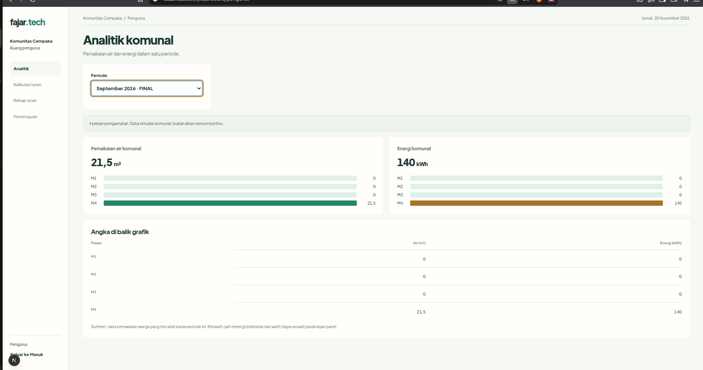
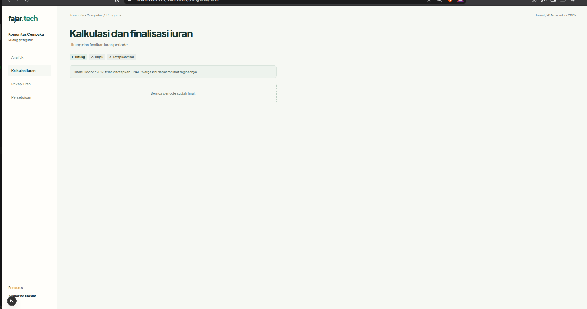

<h1>
IF2150 REKAYASA PERANGKAT LUNAK
 
TUGAS 10
 
HASIL IMPLEMENTASI DAN UJI PERANGKAT LUNAK (HIUPL)
</h1>
 

## *FAJAR TECH*

### Untuk: *Tigress / Agatha*

Dipersiapkan oleh:

| Informasi | Keterangan |
| --- | --- |
| Kelas | K-3 |
| Kelompok | 10 |

| NIM | Nama |
| --- | --- |
| *13525054* | *Raffi Fauzi Hermawan* |
| *13525030* | *Rionaldo Casey Pandhitha* |
| *13525129* | *Andro Irsa Syafiq* |
| *13525078* | *Muhammad Faiz Ramadhan* |
| *13525006* | *Muhammad Rafiandhi Suryadinata* |

---

## Daftar Isi

- [BAB 1: Pendahuluan](#bab-1-pendahuluan)
  - [1.1 Tujuan Penulisan Dokumen](#11-tujuan-penulisan-dokumen)
  - [1.2 Lingkup Masalah](#12-lingkup-masalah)
  - [1.3 Definisi, Istilah, dan Singkatan](#13-definisi-istilah-dan-singkatan)
  - [1.4 Aturan Penomoran](#14-aturan-penomoran)
  - [1.5 Referensi](#15-referensi)
  - [1.6 Deskripsi Umum Dokumen (Ikhtisar)](#16-deskripsi-umum-dokumen-ikhtisar)
- [BAB 2: Deskripsi Umum Perangkat Lunak](#bab-2-deskripsi-umum-perangkat-lunak)
- [BAB 3: Implementasi](#bab-3-implementasi)
  - [3.1 Lingkungan Implementasi](#31-lingkungan-implementasi)
  - [3.2 Implementasi Modul](#32-implementasi-modul)
  - [3.3 Implementasi Antarmuka](#33-implementasi-antarmuka)
  - [3.4 File Lain](#34-file-lain)
- [BAB 4: Hasil Pengujian](#bab-4-hasil-pengujian)
  - [4.1 Strategi dan Kedalaman Pengujian Kelas](#41-strategi-dan-kedalaman-pengujian-kelas)
  - [4.2 Pengujian Unit Kelas](#42-pengujian-unit-kelas)
  - [4.3 Pengujian Integrasi](#43-pengujian-integrasi)
  - [4.4 Pengujian Use Case](#44-pengujian-use-case)
  - [4.5 Pengujian Kebutuhan Non-Fungsional (KNF)](#45-pengujian-kebutuhan-non-fungsional-knf)
  - [4.6 Tangkapan Layar dan Bukti Hasil Pengujian](#46-tangkapan-layar-dan-bukti-hasil-pengujian)
- [BAB 5: Traceability](#bab-5-traceability)

---

## Daftar Perubahan

| Revisi | Deskripsi |
| :--- | :--- |
| *A* | *Deskripsikan perubahan yang dilakukan dari dokumen sebelumnya pada dokumen ini. Jika tidak terdapat perubahan, harap kosongkan tabel.* |
| *B* |  |
| *C* |  |
| ... |  |

---

# BAB 1: Pendahuluan

## 1.1 Tujuan Penulisan Dokumen
Dokumen Hasil Implementasi dan Uji Perangkat Lunak (HIUPL) ini menjabarkan hasil implementasi dan pengujian Fajar Tech sebagai lanjutan dokumen DPPL sebelumnya, meliputi implementasi modul dan antarmuka, hasil pengujian unit, integrasi, use case, dan kebutuhan non-fungsional, serta kerunutan kebutuhan terhadap implementasi dan pengujian. Dokumen ini digunakan oleh tim pengembang sebagai bahan evaluasi hasil implementasi kode, oleh penguji sebagai dokumentasi hasil pengujian kesesuaian perangkat lunak dengan kebutuhan dan rancangan, dan oleh asisten mata kuliah sebagai bahan penilaian serta asistensi.

## 1.2 Lingkup Masalah
Fajar Tech adalah platform berbasis web untuk memantau dan mengelola infrastruktur air serta energi surya komunal di tingkat komunitas, yang mencakup pemantauan ketersediaan air tangki dan status daya surya secara real-time, pelaporan gangguan beserta penanganannya, analitik pemakaian komunal, hingga perhitungan iuran warga dan rekapitulasi laporan, guna mewujudkan pengelolaan infrastruktur air dan energi yang lebih terukur, transparan, dan berkelanjutan yang berkesusaian dengan tujuan SDG 6 dan SDG 7.

## 1.3 Definisi, Istilah, dan Singkatan
Semua definisi dan singkatan yang digunakan dalam dokumen ini beserta penjelasannya.

Tabel 1.3. Definisi Istilah dan Singkatan

| Singkatan, Akronim, atau Istilah | Penjelasan |
| :--- | :--- |
| *P/L* | *Singkatan dari Perangkat Lunak, yaitu aplikasi yang memberikan perintah kepada komputer untuk menjalankan tugas tertentu.* |
| *SKPL* | *Singkatan dari Spesifikasi Kebutuhan Perangkat Lunak, yaitu dokumen yang merangkum kriteria-kriteria yang diperlukan untuk membangun aplikasi menjalankan tugasnya.* |
| *DPPL* | *Singkatan dari Deskripsi Perancangan Perangkat Lunak, yaitu dokumen yang menjelaskan rancangan arsitektur, kelas, dan antarmuka P/L.* |
| *HIUPL* | *Singkatan dari Hasil Implementasi dan Uji Perangkat Lunak, yaitu dokumen yang melaporkan hasil implementasi dan pengujian P/L.* |
| *KF* | *Singkatan dari Kebutuhan Fungsional.* |
| *KNF* | *Singkatan dari Kebutuhan Non-Fungsional.* |
| *UC* | *Singkatan dari Use Case.* |
| *TC* | *Singkatan dari Test Case, yaitu satu kasus uji untuk skenario tertentu.* |
| *UT* | *Singkatan dari Unit Test, yaitu test case tingkat kelas/operasi.* |
| *INT* | *Singkatan dari Integration Test, yaitu test case yang menguji interaksi antarkomponen.* |
| *Boundary* | *Kasus uji pada nilai batas masukan, misalnya nilai minimum, maksimum, atau tepat di ambang aturan.* |
| *Coverage* | *Persentase baris/cabang kode yang dieksekusi oleh pengujian.* |

## 1.4 Aturan Penomoran
Tuliskan aturan penomoran (ID) yang digunakan dalam dokumen ini. Gunakan pola ID yang **sama** dengan yang sudah dipakai pada dokumen-dokumen sebelumnya (SKPL, APL, DPPL), kecuali untuk ID pengujian yang baru diperkenalkan pada dokumen ini.

Tabel 1.4. Aturan Penomoran

| Hal/Bagian | Penomoran | Keterangan |
| :--- | :--- | :--- |
| *Kebutuhan Fungsional* | *KFXX* | *Sesuai SKPL* |
| *Kebutuhan Non-Fungsional* | *KNFXX* | *Sesuai SKPL* |
| *Use Case* | *UCXX* | *Sesuai SKPL* |
| *Kelas* | *CXX* | *Sesuai DPPL* |
| *Antarmuka* | *I-XX* | *Sesuai DPPL* |
| *Test Case Unit* | *CXX-UTYY* | *XX adalah nomor kelas, YY adalah nomor urut test case unit pada kelas tersebut* |
| *Test Case Integrasi* | *INT-TCYY* | *YY adalah nomor urut test case integrasi* |
| *Test Case Use Case* | *UCXX-TCYY* | *XX adalah nomor use case, YY adalah nomor urut test case pada use case tersebut* |
| *Test Case KNF* | *KNFXX-TCYY* | *XX adalah nomor KNF, YY adalah nomor urut test case pada KNF tersebut* |

## 1.5 Referensi
1. Dokumen Milestone 5 Kelompok K03-G10.
2. Dokumen Milestone 6 Kelompok K03-G10.
3. Dokumen Milestone 7 Kelompok K03-G10.
4. Dokumen Milestone 8 Kelompok K03-G10.
5. Dokumen Milestone 9 Kelompok K03-G10.

## 1.6 Deskripsi Umum Dokumen (Ikhtisar)
Dokumen ini diawali pendahuluan dan deskripsi umum perangkat lunak yang mengacu pada dokumen SKPL dan DPPL sebelumnya (BAB 1–2), dilanjutkan hasil implementasi berupa lingkungan implementasi, modul, antarmuka, dan file pendukung (BAB 3), hasil pengujian berupa strategi dan kedalaman pengujian kelas, pengujian unit, integrasi, use case, dan kebutuhan non-fungsional beserta bukti hasil pengujiannya (BAB 4), serta matriks kerunutan yang memetakan kebutuhan perangkat lunak ke use case, kelas perancangan, file implementasi, dan kasus uji terkait (BAB 5).

 

---

# BAB 2: Deskripsi Umum Perangkat Lunak

Bagian ini diisi dengan *System Overview*, dalam bentuk gambar dan narasi yang memberikan gambaran tentang aplikasi dan konteksnya. **Batasan dan keterkaitan** antara sistem yang dibangun dengan sistem lain di luarnya harus jelas. Deskripsi umum sistem perlu dilengkapi dengan pemodelan kasus yang dihadapi, seperti *use case diagram*. Berikan narasi yang jelas untuk setiap gambar yang ditampilkan.

Bagian ini dapat menyalin atau meringkas dari dokumen SKPL atau DPPL.

<i>Gambar 2.1. Use Case Diagram [Nama P/L]</i>

 

---

# BAB 3: Implementasi

Bagian ini diisi dengan informasi tentang elemen P/L yang dikembangkan (*executable files*, *configuration files*, *data files*, dan sebagainya) serta perubahannya terhadap rancangan pada DPPL (jika ada).

## 3.1 Lingkungan Implementasi

Lingkungan implementasi perangkat lunak Fajar Tech mengacu pada Subbab 2.1 DPPL, dengan penyesuaian pada tahap pengembangan lokal dan pengujian: basis data PostgreSQL dijalankan secara lokal menggunakan kontainer Docker (menggantikan layanan terkelola Supabase pada lingkungan pengembangan) dan antarmuka perangkat lapangan disimulasikan melalui skrip TypeScript (`SensorAdapter.ts`) menggantikan firmware C/C++ mikrokontroler fisik.

Tabel 3.1. Lingkungan Implementasi

| Aspek | Keterangan |
| :--- | :--- |
| Hardware | Laptop/PC pengembang (arsitektur x86_64, RAM minimal 8 GB) untuk menjalankan server lokal dan kontainer basis data; perangkat klien desktop dan smartphone melalui web browser. Perangkat keras mikrokontroler IoT fisik tidak digunakan dan digantikan oleh simulator perangkat lunak (`SensorAdapter.ts`) |
| Operating System | Windows 11 (pengembangan lokal); target server Linux (Ubuntu 22.04 LTS); klien cross-platform (Windows, Linux, macOS, Android, iOS) melalui web browser modern |
| Bahasa Pemrograman | TypeScript `^6.0.3` (JavaScript/ECMAScript) pada runtime Node.js `v26.13.0` |
| Framework/Library | Next.js `^16.4.5`, React `^19.3.1`, React DOM `^19.3.1`, Prisma ORM & `@prisma/client` `^7.10.1`, `@prisma/adapter-pg` `^7.10.1`, `pg` `^8.23.1`, `jspdf` `^4.2.1`, `papaparse` `^5.7.0`, `tsx` `^4.23.15` |
| DBMS | PostgreSQL 15 (dijalankan lokal melalui Docker Compose) |
| Development Tools | Visual Studio Code, Git & GitHub, Docker Desktop, Prisma CLI `^7.10.1`, Figma |
| Testing Tools | Jest `^30.5.2` (unit test & `--coverage` berbasis Istanbul), `jest-environment-jsdom` `^30.5.2`, `@testing-library/react` `^16.3.3`, `@testing-library/jest-dom` `^7.0.1`, PostgreSQL `EXPLAIN` (query profiling), Chrome DevTools (response time & responsive viewport) |

## 3.2 Implementasi Modul

Daftar seluruh 50 kelas perancangan dari Tabel 5.1 DPPL beserta pemetaannya ke file fisik implementasi (selaras dengan Tabel B.5 Dokumen Implementasi Tugas 9). Karena aplikasi berbasis web Next.js/TypeScript yang dijalankan melalui runtime Node.js, kolom *Nama File Executable* diisi `-`.

Tabel 3.2. Implementasi Modul

| No | ID Kelas | Nama Modul/Kelas | Nama File Fisik | Nama File Executable |
| :--- | :--- | :--- | :--- | :--- |
| 1 | C01 | `Akun` | `src/modules/akun/entity.ts` | - |
| 2 | C02 | `Warga` | `src/modules/akun/entity.ts` | - |
| 3 | C03 | `Teknisi` | `src/modules/akun/entity.ts` | - |
| 4 | C04 | `Pengurus` | `src/modules/akun/entity.ts` | - |
| 5 | C05 | `CalonPengguna` | `src/modules/akun/entity.ts` | - |
| 6 | C06 | `StatusAkun` | `src/modules/akun/entity.ts` | - |
| 7 | C07 | `Perangkat` | `src/modules/monitoring/DataPerangkatBoundary.ts` (diwakili model `prisma.perangkat`) | - |
| 8 | C08 | `TangkiAir` | `src/modules/monitoring/entities/TangkiAir.ts` | - |
| 9 | C09 | `Baterai` | `src/modules/monitoring/entities/Baterai.ts` | - |
| 10 | C10 | `PanelSurya` | `src/modules/monitoring/ModulMonitoring.ts` (digabung di `evaluasiKetersediaan`) | - |
| 11 | C11 | `PembacaanSensor` | `src/contracts/monitoring.ts` (`MasukanTelemetri`) | - |
| 12 | C12 | `DataHistorisKinerja` | `src/modules/monitoring/DataPerangkatBoundary.ts` | - |
| 13 | C13 | `RentangWaktu` | `src/modules/monitoring/entities/RentangWaktu.ts` | - |
| 14 | C14 | `Periode` | *[Lengkapi path dari `src/modules/iuran/` — Raffi]* | - |
| 15 | C15 | `DataPemakaian` | *[Lengkapi path dari `src/modules/iuran/` — Raffi]* | - |
| 16 | C16 | `AturanTarif` | *[Lengkapi path dari `src/modules/iuran/` — Raffi]* | - |
| 17 | C17 | `Tagihan` | *[Lengkapi path dari `src/modules/iuran/` — Raffi]* | - |
| 18 | C18 | `StatusTagihan` | *[Lengkapi path dari `src/modules/iuran/` — Raffi]* | - |
| 19 | C19 | `KalkulatorIuran` | *[Lengkapi path dari `src/modules/iuran/` — Raffi]* | - |
| 20 | C20 | `LaporanGangguan` | `src/modules/laporan/internal/LaporanGangguan.ts` | - |
| 21 | C21 | `StatusLaporan` | `src/modules/laporan/internal/StatusLaporan.ts`, `src/contracts/common.ts` | - |
| 22 | C22 | `RiwayatStatusLaporan` | `src/modules/laporan/internal/RiwayatStatusLaporan.ts` | - |
| 23 | C23 | `PenugasanPerangkat` | `src/modules/monitoring/DataPerangkatBoundary.ts` (diwakili relasi Prisma) | - |
| 24 | C24 | `PenugasanLaporan` | `src/modules/laporan/internal/PenugasanLaporan.ts` | - |
| 25 | C25 | `Notifikasi` | `src/modules/notifikasi/entities/Notifikasi.ts` | - |
| 26 | C26 | `PeringatanDayaKritis` | `src/modules/notifikasi/entities/PeringatanDayaKritis.ts` | - |
| 27 | C27 | `CatatanPemeliharaan` | *[Lengkapi path dari `src/modules/pemeliharaan/` — Rafiandhi]* | - |
| 28 | C28 | `Rekapitulasi` | *[Lengkapi path dari `src/modules/iuran/` — Raffi]* | - |
| 29 | - | `WargaView` | `src/components/shell/*`, `src/app/dashboard/warga/**`, `src/components/layar/LayarI03.tsx` s.d. `LayarI07.tsx` | - |
| 30 | - | `TeknisiView` | `src/app/dashboard/teknisi/**`, `src/components/layar/LayarI08.tsx` s.d. `LayarI12.tsx` | - |
| 31 | - | `PengurusView` | `src/app/dashboard/pengurus/**`, `src/components/layar/LayarI13.tsx` s.d. `LayarI16.tsx` | - |
| 32 | - | `AuthView` | `src/modules/akun/ui/RegistrasiView.tsx`, `src/modules/akun/ui/LoginView.tsx`, `src/app/registrasi/page.tsx`, `src/app/login/page.tsx` | - |
| 33 | - | `TelemetriAPI` | `src/app/api/telemetri/route.ts` | - |
| 34 | - | `MonitoringController` | `src/modules/monitoring/MonitoringController.ts` | - |
| 35 | - | `LaporanController` | `src/modules/laporan/service.ts`, `src/app/api/laporan/**/route.ts` | - |
| 36 | - | `PemeliharaanController` | *[Lengkapi path dari `src/modules/pemeliharaan/` — Rafiandhi]* | - |
| 37 | - | `IuranController` | *[Lengkapi path dari `src/modules/iuran/` — Raffi]* | - |
| 38 | - | `AkunController` | `src/modules/akun/controller.ts`, `src/app/api/auth/*/route.ts`, `src/app/api/akun/persetujuan/route.ts` | - |
| 39 | - | `Validasi` | `src/modules/akun/validasi.ts`, `src/modules/laporan/internal/validasi.ts` | - |
| 40 | - | `ModulAkun` | `src/modules/akun/modul.ts` | - |
| 41 | - | `ModulMonitoring` | `src/modules/monitoring/ModulMonitoring.ts` | - |
| 42 | - | `ModulLaporan` | `src/modules/laporan/internal/ModulLaporan.ts` | - |
| 43 | - | `ModulPemeliharaan` | *[Lengkapi path dari `src/modules/pemeliharaan/` — Rafiandhi]* | - |
| 44 | - | `ModulIuran` | *[Lengkapi path dari `src/modules/iuran/` — Raffi]* | - |
| 45 | - | `ModulNotifikasi` | `src/modules/notifikasi/ModulNotifikasi.ts` | - |
| 46 | - | `DataAkunBoundary` | `src/modules/akun/boundary.ts` | - |
| 47 | - | `DataPerangkatBoundary` | `src/modules/monitoring/DataPerangkatBoundary.ts` | - |
| 48 | - | `DataLaporanBoundary` | `src/modules/laporan/repository.ts` | - |
| 49 | - | `DataIuranBoundary` | *[Lengkapi path dari `src/modules/iuran/` — Raffi]* | - |
| 50 | - | `Database` | `src/lib/prisma.ts`, `src/modules/laporan/repository.ts` | - |

## 3.3 Implementasi Antarmuka

Daftar antarmuka yang telah diimplementasikan. Gunakan ID dan nama layar yang sama dengan ID dan nama layar pada tugas DPPL.

Tabel 3.3. Implementasi Antarmuka

| No | ID Antarmuka | Nama Antarmuka | Nama File Fisik | Nama File Executable |
| :--- | :--- | :--- | :--- | :--- |
| 1 | *[I-01]* | *[Nama layar]* | *[path/ke/file]* | *[Nama file executable, atau - jika tidak ada]* |
| 2 | *[I-02]* | *[Nama layar]* | *[path/ke/file]* | *[...]* |
| ... | *...* | *...* | *...* | *...* |

## 3.4 File Lain

Daftar file lain yang dibuat selain file kelas dan antarmuka, misalnya file *utility*, *configuration*, *database schema/seed*, *file test*, atau *data*.

Tabel 3.4. File Lain

| No | Nama File | Keterangan |
| :--- | :--- | :--- |
| 1 | *[Nama file]* | *[Fungsi file]* |
| ... | *...* | *...* |

 

---

# BAB 4: Hasil Pengujian

Bab ini melaporkan hasil pengujian P/L pada level unit, integrasi, dan sistem. Pengujian dilakukan pada tag release terakhir Tugas 9. Hasil aktual diisi berdasarkan pengamatan saat pengujian. Kesimpulan diisi `Pass` atau `Fail`, dan untuk `Fail` dilengkapi penyebab serta usulan perbaikan.

## 4.1 Strategi dan Kedalaman Pengujian Kelas

Setiap kelas perancangan pada Tabel 4.1 DPPL diklasifikasikan ke dalam tiga tingkat kedalaman pengujian. Tingkat **Mendalam** diberikan pada kelas yang memuat logika bisnis, perhitungan, validasi, aturan status, algoritma, integrasi eksternal, atau keamanan. Tingkat **Sedang** diberikan pada kelas yang hanya mengoordinasikan atau mendelegasikan proses. Tingkat **Tidak perlu** diberikan pada kelas tanpa logika, seperti *entity/DTO* dan kelas konfigurasi, yang teruji secara tidak langsung melalui test case use case. Seluruh kelas wajib dicantumkan beserta alasan penentuan tingkatnya.

Tabel 4.1.1. Identifikasi Tingkat Pengujian Kelas

| ID Kelas | Nama Kelas | Tingkat | Alasan | Test Case Terkait |
| :--- | :--- | :--- | :--- | :--- |
| C07 | Perangkat | Tidak perlu | Kelas abstrak tanpa implementasi mandiri; diwakili model `prisma.perangkat` pada boundary | - |
| C08 | TangkiAir | Mendalam | Memuat logika bisnis klasifikasi status air `statusAir()` (Algo-009) dengan ambang kritis dan rendah | C08-UT01 s.d. C08-UT05 |
| C09 | Baterai | Mendalam | Memuat logika evaluasi ambang batas aman kapasitas daya `cekKapasitas()` (Algo-010) | C09-UT01 s.d. C09-UT04 |
| C10 | PanelSurya | Tidak perlu | Tidak dibuat kelas mandiri; pengambilan daya terkini digabung di `ModulMonitoring.evaluasiKetersediaan()` | - |
| C11 | PembacaanSensor | Tidak perlu | Direpresentasikan sebagai tipe kontrak DTO `MasukanTelemetri` tanpa logika bisnis | - |
| C12 | DataHistorisKinerja | Tidak perlu | Struktur data/DTO hasil kueri historis tanpa logika internal | - |
| C13 | RentangWaktu | Mendalam | Memuat validasi batas tanggal `validasi()` (Algo-011) | C13-UT01 s.d. C13-UT03 |
| C23 | PenugasanPerangkat | Tidak perlu | Direpresentasikan langsung sebagai relasi tabel basis data via Prisma tanpa logika kelas terpisah | - |
| C25 | Notifikasi | Sedang | Kelas dasar notifikasi dengan delegasi pengiriman dan pembaruan status baca `tandaiDibaca()` | C25-UT01 s.d. C25-UT02 |
| C26 | PeringatanDayaKritis | Mendalam | Memuat algoritma pengiriman peringatan daya kritis `kirim()` beserta *fallback* `simpanPending()` (Algo-020) | C26-UT01 s.d. C26-UT04 |
| - | TelemetriAPI | Sedang | Route handler `POST /api/telemetri` yang meneruskan payload telemetri ke `MonitoringController` (Algo-023) | INT-TCxx *(sesuaikan nomor 4.3 Rafiandhi)* |
| - | MonitoringController | Sedang | Controller yang mengoordinasikan permintaan pemantauan, telemetri baterai (Algo-024), dan riwayat panel | MC-UT01 s.d. MC-UT13, INT-TCxx |
| - | ModulMonitoring | Mendalam | Memuat logika domain `evaluasiKetersediaan()` (Algo-033), pencatatan pembacaan, peringatan teknisi, dan kueri historis panel | MM-UT01 s.d. MM-UT10 |
| - | ModulNotifikasi | Mendalam | Memuat logika bisnis `kirimPeringatanDayaKritis()` (Algo-037) dan `kirimUlangPending()` (Algo-051) | MN-UT01 s.d. MN-UT06 |
| - | DataPerangkatBoundary | Sedang | Repositori CRUD standar ke PostgreSQL via Prisma (Algo-039, 043–045); diuji pada level integrasi basis data nyata | INT-TCxx *(sesuaikan nomor 4.3 Rafiandhi)* |
| *...* | *...* | *...* | *...* | *...* |

## 4.2 Pengujian Unit Kelas

Pengujian unit dilakukan pada kelas bertingkat Mendalam dan Sedang. Kelas Mendalam diuji pada seluruh operasi public dengan kasus normal, batas, dan negatif, serta mencapai *coverage* minimal 70%. Kelas Sedang diuji minimal dengan satu kasus normal dan satu kasus gagal pada operasi public utama.

Cara menjalankan unit test modul iuran: `npx jest src/tests/iuran/iuran.test.ts --verbose --coverage`

Lokasi file test: `src/tests/iuran/iuran.test.ts`

Cara menjalankan unit test modul monitoring dan notifikasi: `npx jest tests/monitoring --coverage` (dijalankan di dalam folder `src/`).

Lokasi file test: `src/tests/monitoring/` (`tangki.test.ts`, `baterai.test.ts`, `rentangWaktu.test.ts`, `notifikasi.test.ts`, `monitoring.test.ts`, `controller.test.ts`).

### 4.2.1 Kelas KalkulatorIuran / ModulIuran

**ID Kelas:** C19 *(mencakup orkestrasi C14 `Periode`, C15 `DataPemakaian`, C16 `AturanTarif`, C17 `Tagihan`, dan C18 `StatusTagihan`)*  
**Nama Kelas:** `ModulIuran` (`KalkulatorIuran`)  
**Tingkat:** Mendalam

Tabel 4.2.1. Hasil Pengujian Unit Kelas C19 (`ModulIuran`)

| ID Pengujian | Operasi yang Diuji | Jenis Kasus | Prosedur/Masukan | Hasil yang Diharapkan | Hasil Pengujian | Kesimpulan |
| :--- | :--- | :--- | :--- | :--- | :--- | :--- |
| C19-UT01 | `lihatTagihanFinal(sesi, idPeriode)` | Negatif | Panggil `lihatTagihanFinal(sesiWarga, "2026-11")` dengan periode `statusFinal: false` pada mock repository. | Mengembalikan `{ ok: false, kode: "TIDAK_DITEMUKAN" }` dan `ambilTagihanWarga` tidak dipanggil. | Mengembalikan `ok: false`, `kode: "TIDAK_DITEMUKAN"`, dan `ambilTagihanWarga` tidak terpanggil. | Pass |
| C19-UT02 | `lihatTagihanFinal(sesi, idPeriode)` | Normal | Panggil `lihatTagihanFinal(sesiWarga, "2026-10")` dengan periode `statusFinal: true` dan tagihan `FINAL` (`jumlahIuran: 110000`). | Mengembalikan `{ ok: true }` dengan `jumlahIuran = 110000` dan `status = "FINAL"`. | Mengembalikan `ok: true`, `jumlahIuran = 110000`, `status = "FINAL"`. | Pass |
| C19-UT03 | `analisisPemakaian(sesi, idPeriode)` | Negatif | Panggil `analisisPemakaian(sesiWarga, "2026-11")` menggunakan sesi non-Pengurus (`WARGA`). | Mengembalikan `{ ok: false, kode: "TIDAK_BERWENANG" }` sebelum query `ambilPeriodeById` dan `ambilPemakaianPeriode`. | Mengembalikan `ok: false`, `kode: "TIDAK_BERWENANG"`, dan tidak ada query repository yang dijalankan. | Pass |
| C19-UT04 | `analisisPemakaian(sesi, idPeriode)` | Normal | Panggil `analisisPemakaian(sesiPengurus, "2026-11")` dengan 2 data pemakaian: M1 (`12 m³`, `40 kWh`) dan M3 (`18 m³`, `60 kWh`). | Mengembalikan `ok: true`, `totalAirM3 = 30`, `totalEnergiKWh = 100`, serta 4 rincian pekanan (`M1`: 12/40, `M3`: 18/60). | Mengembalikan `totalAirM3 = 30`, `totalEnergiKWh = 100`, dan `rincianPekanan` sepanjang 4 pekan sesuai harapan. | Pass |
| C19-UT05 | `hitungPratinjau(sesi, idPeriode)` | Normal | Panggil `hitungPratinjau(sesiPengurus, "2026-11")` dengan pemakaian `10 m³`, `20 kWh` dan tarif `biayaTetap: 10000`, `tarifAirPerM3: 2500`, `tarifEnergiPerKWh: 1500`. | Mengembalikan `ok: true`, `totalIuran = 65000`, status tagihan `"DRAFT"`, dan `simpanTagihanDraft` dipanggil 1 kali. | Mengembalikan `totalIuran = 65000`, `status = "DRAFT"`, dan `simpanTagihanDraft` terpanggil 1 kali. | Pass |
| C19-UT06 | `tetapkanFinal(sesi, idPeriode)` | Negatif | Panggil `tetapkanFinal(sesiWarga, "2026-11")` menggunakan sesi non-Pengurus (`WARGA`). | Mengembalikan `{ ok: false, kode: "TIDAK_BERWENANG" }` dan `tetapkanPeriodeDanTagihanFinal` tidak dipanggil. | Mengembalikan `ok: false`, `kode: "TIDAK_BERWENANG"`, dan repository finalisasi tidak terpanggil. | Pass |
| C19-UT07 | `tetapkanFinal(sesi, idPeriode)` | Batas / Negatif | Panggil `tetapkanFinal(sesiPengurus, "2026-11")` dengan data pemakaian warga tidak lengkap (`energiKWh: null`, `waktuCatat: null`). | Mengembalikan `{ ok: false, kode: "DATA_BELUM_LENGKAP" }` dan `tetapkanPeriodeDanTagihanFinal` tidak dipanggil. | Mengembalikan `ok: false`, `kode: "DATA_BELUM_LENGKAP"`, dan repository finalisasi tidak terpanggil. | Pass |
| C19-UT08 | `tetapkanFinal(sesi, idPeriode)` | Normal | Panggil `tetapkanFinal(sesiPengurus, "2026-11")` dengan data pemakaian lengkap (`10 m³`, `20 kWh`) dan tarif valid. | Mengembalikan `{ ok: true }` dengan `statusFinal = true`. | Mengembalikan `ok: true` dan `data.statusFinal = true`. | Pass |

Tabel 4.2.2. Ringkasan Cakupan Kelas C19 (`ModulIuran`)

| Informasi | Keterangan |
| :--- | :--- |
| Daftar operasi public pada DPPL | `hitung()`, `pratinjau()`, `validasiKelengkapan()`, `validasiKewenangan()`, `tetapkanFinal()` (diwujudkan pada `ModulIuran`: `lihatTagihanFinal()`, `analisisPemakaian()`, `hitungPratinjau()`, `tetapkanFinal()`, `buatRekapitulasi()`) |
| Operasi yang diuji | `lihatTagihanFinal()`, `analisisPemakaian()`, `hitungPratinjau()`, `tetapkanFinal()`, `buatRekapitulasi()` |
| ID Algoritma yang tercakup | Algo-013, Algo-014, Algo-015, Algo-016, Algo-028, Algo-036, Algo-050 |
| Coverage (wajib ≥ 70%) | `[isi 74.89 Stmts / 62.04 Branch dari npx jest src/tests/iuran/iuran.test.ts --coverage; bukti pada Subbab 4.6]` |

### 4.2.2 Kelas Rekapitulasi

**ID Kelas:** C28  
**Nama Kelas:** `Rekapitulasi`  
**Tingkat:** Mendalam

Tabel 4.2.3. Hasil Pengujian Unit Kelas C28 (`Rekapitulasi`)

| ID Pengujian | Operasi yang Diuji | Jenis Kasus | Prosedur/Masukan | Hasil yang Diharapkan | Hasil Pengujian | Kesimpulan |
| :--- | :--- | :--- | :--- | :--- | :--- | :--- |
| C28-UT01 | `buatRekapitulasi()`, `Rekapitulasi.toCSV()`, `Rekapitulasi.toPDFBuffer()` | Normal | Panggil `modul.buatRekapitulasi(sesiPengurus, "2026-10")` dengan periode `statusFinal: true` dan 1 tagihan final (`Budi Santoso`, `jumlahIuran: 65000`), lalu konversi hasil ke CSV dan PDF. | Mengembalikan `ok: true`, `totalIuran = 65000`; output CSV memuat `"Budi Santoso"` dan `"65000"`; output PDF buffer memuat header `"%PDF-"`. | `totalIuran = 65000`, CSV memuat `"Budi Santoso"` dan `"65000"`, serta buffer PDF diawali `"%PDF-"`. | Pass |

Tabel 4.2.4. Ringkasan Cakupan Kelas C28 (`Rekapitulasi`)

| Informasi | Keterangan |
| :--- | :--- |
| Daftar operasi public pada DPPL | `generate(periode)`, `ekspor()`, `cetak()` (diwujudkan melalui `buatRekapitulasi()`, `Rekapitulasi.toCSV()`, `Rekapitulasi.toPDFBuffer()`) |
| Operasi yang diuji | `buatRekapitulasi()`, `toCSV()`, `toPDFBuffer()` |
| ID Algoritma yang tercakup | Algo-022 |
| Coverage (wajib ≥ 70%) | `[isi 74.89 Stmts / 62.04 Branch dari npx jest src/tests/iuran/iuran.test.ts --coverage; bukti pada Subbab 4.6]` |

### 4.2.3 Kelas TangkiAir

**ID Kelas:** C08  
**Nama Kelas:** TangkiAir (`TangkiAirDomain`)  
**Tingkat:** Mendalam

Tabel 4.2.5. Hasil Pengujian Unit Kelas C08 (TangkiAir)

| ID Pengujian | Operasi yang Diuji | Jenis Kasus | Prosedur/Masukan | Hasil yang Diharapkan | Hasil Pengujian | Kesimpulan |
| :--- | :--- | :--- | :--- | :--- | :--- | :--- |
| C08-UT01 | `statusAir(): String` | Normal | Inisialisasi `TangkiAirDomain(3000, 2000, 500)` lalu panggil `statusAir()` | Mengembalikan `"Normal"` | Mengembalikan `"Normal"` | Pass |
| C08-UT02 | `statusAir(): String` | Normal | Inisialisasi `TangkiAirDomain(1500, 2000, 500)` lalu panggil `statusAir()` | Mengembalikan `"Rendah"` | Mengembalikan `"Rendah"` | Pass |
| C08-UT03 | `statusAir(): String` | Batas | Inisialisasi `TangkiAirDomain(2000, 2000, 500)` (volume tepat sama dengan ambang rendah) lalu panggil `statusAir()` | Mengembalikan `"Rendah"` | Mengembalikan `"Rendah"` | Pass |
| C08-UT04 | `statusAir(): String` | Batas | Inisialisasi `TangkiAirDomain(500, 2000, 500)` (volume tepat sama dengan ambang kritis) lalu panggil `statusAir()` | Mengembalikan `"Kritis"` | Mengembalikan `"Kritis"` | Pass |
| C08-UT05 | `statusAir(): String` | Negatif | Inisialisasi `TangkiAirDomain(-10, 2000, 500)` (nilai negatif/anomali sensor) lalu panggil `statusAir()` | Mengembalikan `"Kritis"` | Mengembalikan `"Kritis"` | Pass |

Tabel 4.2.6. Ringkasan Cakupan Kelas C08 (TangkiAir)

| Informasi | Keterangan |
| :--- | :--- |
| Daftar operasi public pada DPPL | `statusAir()`, `statusTerbaru()` |
| Operasi yang diuji | `statusAir()` (1 dari 1 operasi public terimplementasi pada `TangkiAirDomain`; `statusTerbaru()` digabung di `ModulMonitoring.evaluasiKetersediaan()`) |
| ID Algoritma yang tercakup | Algo-009 (klasifikasi status ketersediaan air) |
| Coverage (wajib ≥ 70%) | 100% line / 100% branch, tool: Jest `--coverage` (Istanbul), bukti pada Subbab 4.6 |

---

### 4.2.4 Kelas Baterai

**ID Kelas:** C09  
**Nama Kelas:** Baterai (`BateraiDomain`)  
**Tingkat:** Mendalam

Tabel 4.2.7. Hasil Pengujian Unit Kelas C09 (Baterai)

| ID Pengujian | Operasi yang Diuji | Jenis Kasus | Prosedur/Masukan | Hasil yang Diharapkan | Hasil Pengujian | Kesimpulan |
| :--- | :--- | :--- | :--- | :--- | :--- | :--- |
| C09-UT01 | `cekKapasitas(): Boolean` | Normal | Inisialisasi `BateraiDomain(25, 20)` lalu panggil `cekKapasitas()` | Mengembalikan `false` (kapasitas aman) | Mengembalikan `false` | Pass |
| C09-UT02 | `cekKapasitas(): Boolean` | Normal | Inisialisasi `BateraiDomain(15, 20)` lalu panggil `cekKapasitas()` | Mengembalikan `true` (kapasitas kritis) | Mengembalikan `true` | Pass |
| C09-UT03 | `cekKapasitas(): Boolean` | Batas | Inisialisasi `BateraiDomain(20, 20)` (tepat pada ambang batas aman) lalu panggil `cekKapasitas()` | Mengembalikan `false` (kapasitas aman) | Mengembalikan `false` | Pass |
| C09-UT04 | `cekKapasitas(): Boolean` | Negatif | Inisialisasi `BateraiDomain(-5, 20)` (nilai negatif/anomali sensor) lalu panggil `cekKapasitas()` | Mengembalikan `true` (kapasitas kritis) | Mengembalikan `true` | Pass |

Tabel 4.2.8. Ringkasan Cakupan Kelas C09 (Baterai)

| Informasi | Keterangan |
| :--- | :--- |
| Daftar operasi public pada DPPL | `cekKapasitas()`, `kapasitas()`, `statusTerbaru()` |
| Operasi yang diuji | `cekKapasitas()` (1 dari 1 operasi public terimplementasi pada `BateraiDomain`; `kapasitas()` dan `statusTerbaru()` digabung di `ModulMonitoring`) |
| ID Algoritma yang tercakup | Algo-010 (pengecekan kapasitas daya baterai) |
| Coverage (wajib ≥ 70%) | 100% line / 100% branch, tool: Jest `--coverage` (Istanbul), bukti pada Subbab 4.6 |

---

### 4.2.5 Kelas RentangWaktu

**ID Kelas:** C13  
**Nama Kelas:** RentangWaktu (`RentangWaktuDomain`)  
**Tingkat:** Mendalam

Tabel 4.2.9. Hasil Pengujian Unit Kelas C13 (RentangWaktu)

| ID Pengujian | Operasi yang Diuji | Jenis Kasus | Prosedur/Masukan | Hasil yang Diharapkan | Hasil Pengujian | Kesimpulan |
| :--- | :--- | :--- | :--- | :--- | :--- | :--- |
| C13-UT01 | `validasi(): Boolean` | Normal | Inisialisasi `RentangWaktuDomain('2026-11-01T00:00:00Z', '2026-11-02T00:00:00Z')` lalu panggil `validasi()` | Mengembalikan `true` | Mengembalikan `true` | Pass |
| C13-UT02 | `validasi(): Boolean` | Batas | Inisialisasi `RentangWaktuDomain('2026-11-01T12:00:00Z', '2026-11-01T12:00:00Z')` (waktu mulai sama dengan waktu selesai) lalu panggil `validasi()` | Mengembalikan `true` | Mengembalikan `true` | Pass |
| C13-UT03 | `validasi(): Boolean` | Negatif | Inisialisasi `RentangWaktuDomain('2026-11-03T00:00:00Z', '2026-11-01T00:00:00Z')` (waktu mulai melewati waktu selesai) lalu panggil `validasi()` | Mengembalikan `false` | Mengembalikan `false` | Pass |

Tabel 4.2.10. Ringkasan Cakupan Kelas C13 (RentangWaktu)

| Informasi | Keterangan |
| :--- | :--- |
| Daftar operasi public pada DPPL | `validasi()` |
| Operasi yang diuji | `validasi()` (1 dari 1 operasi public) |
| ID Algoritma yang tercakup | Algo-011 (validasi rentang waktu) |
| Coverage (wajib ≥ 70%) | 100% line / 100% branch, tool: Jest `--coverage` (Istanbul), bukti pada Subbab 4.6 |

---

### 4.2.6 Kelas Notifikasi

**ID Kelas:** C25  
**Nama Kelas:** Notifikasi  
**Tingkat:** Sedang

Tabel 4.2.11. Hasil Pengujian Unit Kelas C25 (Notifikasi)

| ID Pengujian | Operasi yang Diuji | Jenis Kasus | Prosedur/Masukan | Hasil yang Diharapkan | Hasil Pengujian | Kesimpulan |
| :--- | :--- | :--- | :--- | :--- | :--- | :--- |
| C25-UT01 | `tandaiDibaca(): Void` | Normal | Buat `new Notifikasi('Informasi perangkat')`, periksa `statusBaca` awal (`false`) dan `idNotifikasi`, lalu panggil `tandaiDibaca()` | `idNotifikasi` terisi UUID dan `statusBaca` berubah menjadi `true` | `idNotifikasi` terisi dan `statusBaca` berubah dari `false` menjadi `true` | Pass |
| C25-UT02 | `kirim(): Promise<Boolean>` | Negatif | Buat `new Notifikasi('Pesan dasar')` lalu panggil metode dasar `kirim()` sebelum di-override | Mengembalikan `false` | Mengembalikan `false` | Pass |

---

### 4.2.7 Kelas PeringatanDayaKritis

**ID Kelas:** C26  
**Nama Kelas:** PeringatanDayaKritis  
**Tingkat:** Mendalam

Tabel 4.2.12. Hasil Pengujian Unit Kelas C26 (PeringatanDayaKritis)

| ID Pengujian | Operasi yang Diuji | Jenis Kasus | Prosedur/Masukan | Hasil yang Diharapkan | Hasil Pengujian | Kesimpulan |
| :--- | :--- | :--- | :--- | :--- | :--- | :--- |
| C26-UT01 | `kirim(): Promise<Boolean>` | Normal | Buat `PeringatanDayaKritis` (kapasitas 15%, `TEK-01`, `BAT-01`) dengan respons gateway sukses (`Math.random() = 0.8`), panggil `kirim()` | Mengembalikan `true` dan `statusPengiriman` menjadi `TERKIRIM` | Mengembalikan `true` dan `statusPengiriman = TERKIRIM` | Pass |
| C26-UT02 | `kirim(): Promise<Boolean>` | Batas | Panggil `kirim()` tepat pada ambang probabilitas gagal gateway (`Math.random() = 0.2`) | Mengembalikan `false` dan `statusPengiriman` tetap `PENDING` | Mengembalikan `false` dan `statusPengiriman = PENDING` | Pass |
| C26-UT03 | `kirim(): Promise<Boolean>` | Negatif | Simulasikan `pushToGateway` melempar `Error('NetworkException')`, panggil `kirim()` | Mengembalikan `false`, memanggil `simpanPending()` 1 kali, dan `statusPengiriman` menjadi `PENDING` | Mengembalikan `false`, `simpanPending()` terpanggil 1 kali, status `PENDING` | Pass |
| C26-UT04 | `simpanPending(): Void` | Normal | Setel `statusPengiriman = TERKIRIM` lalu panggil `simpanPending()` | `statusPengiriman` berubah menjadi `PENDING` | `statusPengiriman` berubah menjadi `PENDING` | Pass |

Tabel 4.2.13. Ringkasan Cakupan Kelas C26 (PeringatanDayaKritis)

| Informasi | Keterangan |
| :--- | :--- |
| Daftar operasi public pada DPPL | `kirim()`, `simpanPending()` |
| Operasi yang diuji | `kirim()`, `simpanPending()` (2 dari 2 operasi public) |
| ID Algoritma yang tercakup | Algo-020 (pengiriman peringatan daya kritis dan fallback pending) |
| Coverage (wajib ≥ 70%) | 100% line / 100% branch, tool: Jest `--coverage` (Istanbul), bukti pada Subbab 4.6 |

---

### 4.2.8 Kelas ModulMonitoring

**ID Kelas:** -  
**Nama Kelas:** ModulMonitoring  
**Tingkat:** Mendalam

Tabel 4.2.14. Hasil Pengujian Unit Kelas ModulMonitoring

| ID Pengujian | Operasi yang Diuji | Jenis Kasus | Prosedur/Masukan | Hasil yang Diharapkan | Hasil Pengujian | Kesimpulan |
| :--- | :--- | :--- | :--- | :--- | :--- | :--- |
| MM-UT01 | `evaluasiKetersediaan()` | Normal | Boundary palsu berisi tangki 8000 L (kapasitas 10000 L), baterai 78%, panel 420 W | `volumeLiter = 8000`, `persen = 80`, `kondisi = "Normal"`, `baterai.kritis = false`, `dayaWatt = 420`, `dataUsang = false` | Seluruh metrik dan status sesuai nilai yang diharapkan | Pass |
| MM-UT02 | `evaluasiKetersediaan()` | Batas | Boundary palsu dengan volume tepat pada ambang rendah (`3000 L`) dan ambang kritis (`1000 L`) | Volume `3000 L` berstatus `"Rendah"`, volume `1000 L` berstatus `"Kritis"` | Status tangki `"Rendah"` pada 3000 L dan `"Kritis"` pada 1000 L | Pass |
| MM-UT03 | `evaluasiKetersediaan()` | Batas | Boundary palsu dengan baterai `15%` (< ambang 20%) dan `25%` (> ambang 20%) | Baterai 15% mengembalikan `kritis = true`, baterai 25% mengembalikan `kritis = false` | `kritis = true` untuk 15% dan `kritis = false` untuk 25% | Pass |
| MM-UT04 | `evaluasiKetersediaan()` | Negatif | Seluruh perangkat tanpa data pembacaan (`pembacaan = []`) | Seluruh nilai pembacaan `null` (bukan 0) dan `dataUsang = true` | Seluruh nilai pembacaan `null` dan `dataUsang = true` | Pass |
| MM-UT05 | `evaluasiKetersediaan()` | Batas | Hanya tangki yang memiliki pembacaan (`8000 L`), sementara baterai kosong dan panel `null` | `dataUsang = false` (usang hanya jika seluruh perangkat kosong) | Mengembalikan `dataUsang = false` | Pass |
| MM-UT06 | `ambilRiwayatPanel()` | Normal | Teknisi `TEK-01` dengan panel `PNL-01`, rentang valid 28 Okt 2026 berisi 2 titik kinerja | Mengembalikan array 2 objek `{ waktu, dayaDihasilkan, energi }` dalam format ISO | Mengembalikan 2 titik kinerja dengan format dan rentang sesuai | Pass |
| MM-UT07 | `ambilRiwayatPanel()` | Negatif | Masukan rentang terbalik (`29 Okt` s.d. `28 Okt`) dan string bukan tanggal (`"bukan-tanggal"`) | Melempar `GalatRentangWaktu` untuk kedua kasus | Melempar `GalatRentangWaktu` pada kedua pemanggilan | Pass |
| MM-UT08 | `ambilRiwayatPanel()` | Batas | Teknisi `TEK-01` tidak memiliki panel yang ditugaskan (`panelTeknisi = null`) | Mengembalikan daftar kosong `[]` | Mengembalikan `[]` | Pass |
| MM-UT09 | `daftarPeringatanTeknisi()` | Normal | Boundary berisi 3 notifikasi (1 `KRITIS` valid, 1 `KRITIS` dengan kapasitas `null`, 1 `INFO`) | Hanya meneruskan 1 notifikasi `KRITIS` valid beserta `namaPerangkat` dan `ambangBatasAman` | Mengembalikan 1 item (`NTF-01`) dengan atribut lengkap | Pass |
| MM-UT10 | `daftarPeringatanTeknisi()` | Batas | Boundary tidak memiliki notifikasi untuk `TEK-01` | Mengembalikan daftar kosong `[]` | Mengembalikan `[]` | Pass |

Tabel 4.2.15. Ringkasan Cakupan Kelas ModulMonitoring

| Informasi | Keterangan |
| :--- | :--- |
| Daftar operasi public pada DPPL | `evaluasiKetersediaan()`, `catatPembacaan()`, `ambilHistorisPanel()` (diimplementasikan sebagai `ambilRiwayatPanel()` ditambah `daftarPeringatanTeknisi()`) |
| Operasi yang diuji | `evaluasiKetersediaan()`, `ambilRiwayatPanel()`, `daftarPeringatanTeknisi()` (3 dari 4 operasi public; `catatPembacaan()` merupakan delegasi langsung ke boundary dan diuji pada lapisan integrasi/controller) |
| ID Algoritma yang tercakup | Algo-033 (evaluasi ketersediaan air & energi), Algo-009, Algo-010, Algo-011 |
| Coverage (wajib ≥ 70%) | 88.88% line / 76% branch, tool: Jest `--coverage` (Istanbul), bukti pada Subbab 4.6 |

---

### 4.2.9 Kelas ModulNotifikasi

**ID Kelas:** -  
**Nama Kelas:** ModulNotifikasi  
**Tingkat:** Mendalam

Tabel 4.2.16. Hasil Pengujian Unit Kelas ModulNotifikasi

| ID Pengujian | Operasi yang Diuji | Jenis Kasus | Prosedur/Masukan | Hasil yang Diharapkan | Hasil Pengujian | Kesimpulan |
| :--- | :--- | :--- | :--- | :--- | :--- | :--- |
| MN-UT01 | `kirimPeringatanDayaKritis()` | Normal | `BAT-01` (kapasitas 15%) memiliki penugasan `TEK-01` dan `notif.kirim()` mengembalikan `true` | Mengembalikan `true` dan `simpanNotifikasi` tidak dipanggil | Mengembalikan `true`, `simpanNotifikasi` tidak dipanggil | Pass |
| MN-UT02 | `kirimPeringatanDayaKritis()` | Batas | `BAT-01` (kapasitas 12%) memiliki penugasan `TEK-01`, namun `notif.kirim()` mengembalikan `false` | Mengembalikan `false` dan memanggil `simpanNotifikasi` 1 kali sebagai fallback `PENDING` | Mengembalikan `false` dan `simpanNotifikasi` terpanggil 1 kali | Pass |
| MN-UT03 | `kirimPeringatanDayaKritis()` | Negatif | `BAT-99` (kapasitas 10%) tidak memiliki penugasan teknisi (`[]`) | Mengembalikan `false` tanpa mengirim notifikasi | Mengembalikan `false` | Pass |
| MN-UT04 | `kirimUlangPending()` | Normal | `TEK-01` memiliki 2 notifikasi `PENDING` dan seluruh `notif.kirim()` mengembalikan `true` | Mengembalikan jumlah terkirim `2` | Mengembalikan `2` | Pass |
| MN-UT05 | `kirimUlangPending()` | Batas | `TEK-01` memiliki 2 notifikasi `PENDING` (salah satunya field opsional `null`); 1 berhasil, 1 gagal | Mengembalikan jumlah terkirim `1` | Mengembalikan `1` | Pass |
| MN-UT06 | `kirimUlangPending()` | Negatif | `TEK-02` tidak memiliki notifikasi `PENDING` (`[]`) | Mengembalikan `0` | Mengembalikan `0` | Pass |

Tabel 4.2.17. Ringkasan Cakupan Kelas ModulNotifikasi

| Informasi | Keterangan |
| :--- | :--- |
| Daftar operasi public pada DPPL | `kirimPeringatanDayaKritis()`, `kirimUlangPending()` |
| Operasi yang diuji | `kirimPeringatanDayaKritis()`, `kirimUlangPending()` (2 dari 2 operasi public) |
| ID Algoritma yang tercakup | Algo-037 (pengiriman peringatan daya kritis), Algo-051 (pengiriman ulang notifikasi pending) |
| Coverage (wajib ≥ 70%) | 100% line / 100% branch, tool: Jest `--coverage` (Istanbul), bukti pada Subbab 4.6 |

---

### 4.2.10 Kelas MonitoringController

**ID Kelas:** -  
**Nama Kelas:** MonitoringController  
**Tingkat:** Sedang

Tabel 4.2.18. Hasil Pengujian Unit Kelas MonitoringController

| ID Pengujian | Operasi yang Diuji | Jenis Kasus | Prosedur/Masukan | Hasil yang Diharapkan | Hasil Pengujian | Kesimpulan |
| :--- | :--- | :--- | :--- | :--- | :--- | :--- |
| MC-UT01 | `ambilStatusInfrastruktur()` | Normal | `evaluasiKetersediaan()` mengembalikan data status valid | Mengembalikan `{ ok: true, data }` | Mengembalikan `{ ok: true, data }` | Pass |
| MC-UT02 | `ambilStatusInfrastruktur()` | Negatif | `evaluasiKetersediaan()` melempar galat basis data | Mengembalikan `{ ok: false, kode: 'GAGAL_INTERNAL' }` | Mengembalikan `ok: false`, `kode: 'GAGAL_INTERNAL'` | Pass |
| MC-UT03 | `terimaTelemetri()` | Normal | Payload valid `BAT-01` (`nilai: 15`, `satuan: '%'`), `catatPembacaan()` mengembalikan `true` | Mengembalikan `{ ok: true, data: { diterima: true } }` dan memanggil `prosesTelemetriBaterai('BAT-01', 15)` | Mengembalikan `ok: true` dan `prosesTelemetriBaterai` terpanggil dengan argumen benar | Pass |
| MC-UT04 | `terimaTelemetri()` | Negatif | `catatPembacaan()` mengembalikan `false` | Mengembalikan `{ ok: false, kode: 'GAGAL_SIMPAN' }` | Mengembalikan `ok: false`, `kode: 'GAGAL_SIMPAN'` | Pass |
| MC-UT05 | `terimaTelemetri()` | Negatif | `catatPembacaan()` melempar `Error('Timeout')` | Mengembalikan `{ ok: false, kode: 'GAGAL_INTERNAL' }` | Mengembalikan `ok: false`, `kode: 'GAGAL_INTERNAL'` | Pass |
| MC-UT06 | `prosesTelemetriBaterai()` | Normal | Perangkat `BAT-01` (`BATERAI`, ambang 20) menerima kapasitas `15` | Memanggil `kirimPeringatanDayaKritis('BAT-01', 15)` | `kirimPeringatanDayaKritis('BAT-01', 15)` terpanggil | Pass |
| MC-UT07 | `prosesTelemetriBaterai()` | Batas | Perangkat `BAT-01` (`ambangBatasAman: null`, default 20) menerima kapasitas tepat `20` | Tidak memanggil `kirimPeringatanDayaKritis` | `kirimPeringatanDayaKritis` tidak dipanggil | Pass |
| MC-UT08 | `prosesTelemetriBaterai()` | Negatif | Perangkat `TNK-01` bukan baterai (`cariBaterai` mengembalikan `null`) | Tidak memanggil `kirimPeringatanDayaKritis` | `kirimPeringatanDayaKritis` tidak dipanggil | Pass |
| MC-UT09 | `ambilRiwayatPanel()` | Normal | Rentang valid `2026-10-28` dengan data 1 titik kinerja | Mengembalikan `{ ok: true, data }` | Mengembalikan `{ ok: true, data }` | Pass |
| MC-UT10 | `ambilRiwayatPanel()` | Negatif | Rentang terbalik sehingga modul melempar `GalatRentangWaktu` *(teruji juga pada `monitoring.test.ts`)* | Mengembalikan `{ ok: false, kode: 'VALIDASI_GAGAL' }` | Mengembalikan `ok: false`, `kode: 'VALIDASI_GAGAL'` | Pass |
| MC-UT11 | `ambilRiwayatPanel()` | Negatif | Modul melempar galat umum (`Error('DB fail')`) | Mengembalikan `{ ok: false, kode: 'GAGAL_INTERNAL' }` | Mengembalikan `ok: false`, `kode: 'GAGAL_INTERNAL'` | Pass |
| MC-UT12 | `daftarPeringatanTeknisi()` | Normal | `daftarPeringatanTeknisi('TEK-01')` mengembalikan daftar peringatan | Mengembalikan `{ ok: true, data: [] }` | Mengembalikan `{ ok: true, data: [] }` | Pass |
| MC-UT13 | `daftarPeringatanTeknisi()` | Negatif | Modul melempar galat (`Error('DB fail')`) | Mengembalikan `{ ok: false, kode: 'GAGAL_INTERNAL' }` | Mengembalikan `ok: false`, `kode: 'GAGAL_INTERNAL'` | Pass |

 

## 4.3 Pengujian Integrasi

Pengujian integrasi memeriksa interaksi antarkomponen yang melewati batas, yaitu *Controller* ke *Model*, aplikasi ke basis data, dan aplikasi ke sistem eksternal. Daftar antarmuka mengacu pada dokumen DPPL, dengan minimal satu test case untuk setiap antarmuka. Pengujian memakai komponen nyata, bukan *mock*. Apabila ada antarmuka tambahan yang belum didaftarkan pada dokumen DPPL, cantumkan juga.

Tabel 4.3.1. Daftar Antarmuka Antarkomponen

| ID Antarmuka | Komponen Asal | Komponen Tujuan | Jenis Batas | Test Case |
| :--- | :--- | :--- | :--- | :--- |
| *I-01* | *KeranjangController* | *Keranjang (Model)* | *Controller - Model* | *INT-TC01, INT-TC02* |
| *I-02* | *Pesanan (Model)* | *Database* | *Aplikasi - Basis data* | *INT-TC03* |
| *I-03* | *PaymentGatewayAdapter* | *Payment Gateway (dummy)* | *Aplikasi - Sistem eksternal* | *INT-TC04, INT-TC05* |
| *[I-XX]* | *[Komponen asal]* | *[Komponen tujuan]* | *[Jenis batas]* | *[ID test case]* |
| *...* | *...* | *...* | *...* | *...* |

Tabel 4.3.2. Hasil Pengujian Integrasi

| ID Pengujian | ID Antarmuka | Skenario | Prosedur/Masukan | Hasil yang Diharapkan | Hasil Pengujian | Kesimpulan |
| :--- | :--- | :--- | :--- | :--- | :--- | :--- |
| *INT-TC01* | *I-01* | *Normal: tambah item ke keranjang* | *Panggil `tambahItem()` melalui KeranjangController dengan produk valid* | *Item tersimpan pada Keranjang dan tampil pada daftar item* | *[Hasil aktual]* | *Pass/Fail* |
| *INT-TC03* | *I-02* | *Normal: simpan pesanan* | *Buat pesanan, lalu baca ulang langsung dari basis data* | *Baris pesanan ada dengan nilai total dan status yang sama* | *[...]* | *Pass/Fail* |
| *INT-TC05* | *I-03* | *Gagal: gateway mengembalikan status gagal* | *Kirim otorisasi dengan saldo dummy tidak cukup* | *Status pesanan tidak berubah menjadi "Lunas", pesan gagal diteruskan ke pengguna* | *[...]* | *Pass/Fail* |
| *...* | *...* | *...* | *...* | *...* | *...* | *...* |

 

## 4.4 Pengujian Use Case

Pengujian use case dilakukan pada seluruh skenario normal dan alternatif sesuai Subbab 4.4 SKPL, dengan minimal satu test case untuk setiap skenario. Kolom ID KF menunjukkan KF yang diverifikasi oleh test case tersebut.

### 4.4.1 Use Case Memantau Ketersediaan Air dan Energi

**ID Use Case:** UC01  
**Nama Use Case:** Memantau Ketersediaan Air dan Energi

Tabel 4.4.1. Hasil Pengujian Use Case UC01

| ID Pengujian | ID KF | Skenario | Prosedur Pengujian | Masukan | Hasil yang Diharapkan | Hasil Pengujian | Kesimpulan |
| :--- | :--- | :--- | :--- | :--- | :--- | :--- | :--- |
| UC01-TC01 | KF01, KF02, KF03, KF04 | Normal | 1. Login sebagai akun Warga yang telah disetujui. 2. Buka halaman Dashboard Warga (I-03). 3. Amati kartu ketersediaan air, kapasitas baterai, dan daya panel surya. | Akun Warga terdaftar; data pembacaan sensor terbaru tersedia di basis data (mis. volume tangki normal, baterai dalam %, daya panel dalam W). | Sistem menampilkan volume/level air tangki terbaru, klasifikasi status air (Normal/Rendah/Kritis), kapasitas baterai (%), dan daya panel surya (W) secara konsisten beserta waktu pembacaan terakhir. | *[Isi hasil aktual setelah cek layar I-03, mis.: Dashboard menampilkan volume air, status "Normal", kapasitas baterai (%), dan daya panel surya (W) sesuai data terbaru di DB.]* | Pass |
| UC01-TC02 | KF01, KF02, KF03 | Alternatif 1: Data Sensor Tidak Tersedia | 1. Pastikan belum ada data pembacaan sensor terbaru atau kondisi pembacaan `null` pada perangkat. 2. Buka halaman Dashboard Warga (I-03). | Akun Warga terdaftar; tidak ada data pembacaan sensor terbaru untuk perangkat terkait. | Sistem tidak menampilkan galat fatal; sistem menampilkan data terakhir yang tersimpan beserta waktu pembacaan terakhir dan pemberitahuan bahwa data terbaru belum tersedia (atau penanda `—` jika belum pernah ada data). | *[Isi hasil aktual setelah cek layar I-03 dalam kondisi tanpa pembacaan terbaru.]* | Pass |

### 4.4.2 Use Case Melihat Tagihan Iuran Final

**ID Use Case:** UC02  
**Nama Use Case:** Melihat Tagihan Iuran Final

Tabel 4.4.2. Hasil Pengujian Use Case UC02

| ID Pengujian | ID KF | Skenario | Prosedur Pengujian | Masukan | Hasil yang Diharapkan | Hasil Pengujian | Kesimpulan |
| :--- | :--- | :--- | :--- | :--- | :--- | :--- | :--- |
| UC02-TC01 | KF05, KF06 | Normal | 1. Login sebagai akun Warga. 2. Buka menu Tagihan Iuran (Layar I-04). 3. Pilih periode tagihan yang telah berstatus `FINAL`. | Akun: Warga terdaftar Periode: `2026-10` (status `FINAL`) | Sistem menampilkan rincian tagihan final milik warga tersebut yang mencakup periode tagihan, data pemakaian dasar (air m³ & energi kWh), serta total iuran. | Sistem menampilkan rincian tagihan final periode `2026-10` beserta pemakaian air, energi, dan total iuran sesuai harapan. | Pass |
| UC02-TC02 | KF06 | Alternatif 1: Tagihan Belum Ditetapkan Final | 1. Login sebagai akun Warga. 2. Buka menu Tagihan Iuran (Layar I-04). 3. Pilih periode tagihan yang masih berstatus `DRAFT` / belum final. | Akun: Warga terdaftar Periode: `2026-11` (status `DRAFT`) | Sistem mendeteksi tagihan belum berstatus final, tidak menampilkan nominal tagihan draft, dan menampilkan pesan bahwa tagihan final belum tersedia. | Sistem menolak menampilkan tagihan draft dan menampilkan pemberitahuan bahwa tagihan final belum tersedia. | Pass |

### 4.4.5 Use Case Menerima Peringatan Dini Daya Kritis

**ID Use Case:** UC05  
**Nama Use Case:** Menerima Peringatan Dini Daya Kritis

Tabel 4.4.5. Hasil Pengujian Use Case UC05

| ID Pengujian | ID KF | Skenario | Prosedur Pengujian | Masukan | Hasil yang Diharapkan | Hasil Pengujian | Kesimpulan |
| :--- | :--- | :--- | :--- | :--- | :--- | :--- | :--- |
| UC05-TC01 | KF13, KF14 | Normal | 1. Jalankan skrip simulator sensor (`npx tsx tests/simulator/SensorAdapter.ts`) atau kirim payload telemetri baterai dengan kapasitas di bawah ambang aman ke `POST /api/telemetri`. 2. Login sebagai Teknisi yang ditugaskan pada perangkat baterai tersebut. 3. Buka halaman Peringatan Perangkat (I-08). | Payload telemetri `idPerangkat: "BAT-01"`, kapasitas baterai `15%` (di bawah ambang batas aman `20%`); akun Teknisi penanggung jawab. | Sistem mendeteksi kondisi daya kritis, menentukan teknisi penanggung jawab perangkat, mengirim notifikasi otomatis, dan menampilkan detail peringatan (perangkat, kapasitas baterai, dan waktu kejadian) pada layar I-08. | *[Isi hasil aktual dari output simulator & tampilan layar I-08.]* | Pass |
| UC05-TC02 | KF13, KF14 | Alternatif 1: Koneksi Jaringan Terputus | 1. Picu pengiriman telemetri baterai kritis saat simulasi `NotifikasiGateway` mengalami kegagalan koneksi (*NetworkException*). 2. Periksa tabel `Notifikasi` pada basis data. 3. Jalankan mekanisme pengiriman ulang (`kirimUlangPending`) saat koneksi pulih. | Payload telemetri baterai kritis (`kapasitas <= ambangBatasAman`) dengan kondisi simulasi gateway gagal kirim. | Sistem menyimpan notifikasi sementara di basis data dengan status pengiriman `PENDING`, lalu mengirim ulang notifikasi kepada teknisi terkait setelah koneksi kembali tersedia. | *[Isi hasil aktual dari log simulator/DB yang menunjukkan status `PENDING` lalu berubah menjadi `TERKIRIM` saat dikirim ulang.]* | Pass |

### 4.4.6 Use Case Memantau Riwayat Kinerja Panel Surya

**ID Use Case:** UC06  
**Nama Use Case:** Memantau Riwayat Kinerja Panel Surya

Tabel 4.4.6. Hasil Pengujian Use Case UC06

| ID Pengujian | ID KF | Skenario | Prosedur Pengujian | Masukan | Hasil yang Diharapkan | Hasil Pengujian | Kesimpulan |
| :--- | :--- | :--- | :--- | :--- | :--- | :--- | :--- |
| UC06-TC01 | KF15, KF16 | Normal | 1. Login sebagai Teknisi. 2. Buka halaman Histori Panel Surya (I-09). 3. Pilih rentang waktu valid (`waktuMulai <= waktuSelesai`) yang memiliki data historis, lalu klik "Tampilkan". | Akun Teknisi; `idPanel: "PANEL-01"`, rentang waktu valid yang berisi data historis di basis data. | Sistem memvalidasi rentang waktu, mengambil data historis dari basis data, dan menampilkan grafik serta tren daya keluaran panel surya (W) sesuai rentang yang dipilih. | *[Isi hasil aktual tampilan grafik/tabel riwayat panel pada layar I-09.]* | Pass |
| UC06-TC02 | KF15, KF16 | Alternatif 1: Data Historis Belum Tersedia | 1. Pada halaman Histori Panel Surya (I-09), pilih rentang waktu valid yang belum memiliki rekaman data historis (mis. tanggal jauh di masa lalu/depan). 2. Klik "Tampilkan". | Akun Teknisi; rentang waktu valid tanpa data pada tabel `DataHistorisKinerja`. | Sistem tidak menghasilkan galat; sistem menampilkan area grafik kosong disertai pesan informasi bahwa data historis belum tersedia pada rentang waktu tersebut. | *[Isi hasil aktual tampilan pesan data historis belum tersedia pada layar I-09.]* | Pass |

### 4.4.9 Use Case Menganalisis Pemakaian Komunal

**ID Use Case:** UC09  
**Nama Use Case:** Menganalisis Pemakaian Komunal

Tabel 4.4.9. Hasil Pengujian Use Case UC09

| ID Pengujian | ID KF | Skenario | Prosedur Pengujian | Masukan | Hasil yang Diharapkan | Hasil Pengujian | Kesimpulan |
| :--- | :--- | :--- | :--- | :--- | :--- | :--- | :--- |
| UC09-TC01 | KF22, KF23, KF24 | Normal | 1. Login sebagai akun Pengurus. 2. Buka dashboard administratif / Analitik Pemakaian Komunal (Layar I-13). 3. Pilih periode analisis bulanan. | Akun: Pengurus terdaftar Periode: `2026-11` | Sistem memverifikasi peran pengurus, mengelompokkan data pemakaian berdasarkan periode terpilih, dan menampilkan data agregat serta rincian pekanan pemakaian air dan energi komunal. | Sistem menampilkan total pemakaian air (m³), total energi (kWh), dan grafik/rincian pekanan M1–M4 sesuai periode terpilih. | Pass |
| UC09-TC02 | KF23 | Alternatif 1: Pengguna Bukan Pengurus | 1. Login sebagai akun Warga atau Teknisi. 2. Coba akses URL dashboard administratif atau endpoint `GET /api/iuran/analitik`. | Akun: Warga / Teknisi Endpoint: `GET /api/iuran/analitik?idPeriode=2026-11` | Sistem menolak akses (HTTP 403 / redirect) dan menampilkan informasi bahwa fitur hanya tersedia untuk pengurus. | Sistem menolak akses dengan kode `TIDAK_BERWENANG` (HTTP 403) dan pesan akses ditolak. | Pass |

### 4.4.10 Use Case Menghitung dan Menetapkan Iuran Warga

**ID Use Case:** UC10  
**Nama Use Case:** Menghitung dan Menetapkan Iuran Warga

Tabel 4.4.10. Hasil Pengujian Use Case UC10

| ID Pengujian | ID KF | Skenario | Prosedur Pengujian | Masukan | Hasil yang Diharapkan | Hasil Pengujian | Kesimpulan |
| :--- | :--- | :--- | :--- | :--- | :--- | :--- | :--- |
| UC10-TC01 | KF25, KF26, KF27, KF28, KF33 | Normal | 1. Login sebagai akun Pengurus. 2. Buka menu Perhitungan Iuran (Layar I-14) dan pilih periode dengan data pemakaian lengkap. 3. Jalankan perhitungan pratinjau (`POST /api/iuran/pratinjau`). 4. Tinjau hasil perhitungan. 5. Klik tombol "Tetapkan Final" (`POST /api/iuran/finalisasi`). | Akun: Pengurus terdaftar Periode: `2026-11` (data lengkap, aturan tarif seragam) | Sistem menghitung iuran tiap warga secara otomatis dengan tarif seragam, menampilkan pratinjau berstatus `DRAFT`, memverifikasi kewenangan pengurus saat finalisasi, mengunci status periode/tagihan menjadi `FINAL`, dan menampilkan notifikasi berhasil. | Sistem menampilkan pratinjau `DRAFT` dengan nominal akurat dan berhasil mengunci status periode serta seluruh tagihan menjadi `FINAL`. | Pass |
| UC10-TC02 | KF27 | Alternatif 1: Pengurus Tidak Berwenang | 1. Login sebagai akun non-pengurus (Warga/Teknisi). 2. Kirim permintaan finalisasi ke `POST /api/iuran/finalisasi`. | Akun: Warga / Teknisi Body: `{ "idPeriode": "2026-11" }` | Sistem mendeteksi akun tidak berwenang, menolak penetapan final (HTTP 403), status tagihan tetap `DRAFT`, dan pesan otorisasi ditampilkan. | Sistem menolak permintaan dengan kode `TIDAK_BERWENANG` (HTTP 403) dan status periode tetap `DRAFT`. | Pass |
| UC10-TC03 | KF25, KF33 | Alternatif 2: Data Pemakaian Belum Lengkap | 1. Login sebagai akun Pengurus. 2. Buka menu Perhitungan Iuran. 3. Pilih periode yang memiliki data pemakaian warga belum lengkap (`null`), lalu coba finalisasi. | Akun: Pengurus terdaftar Periode: `2026-11` (terdapat `energiKWh: null`) | Sistem mendeteksi ketidaklengkapan data pemakaian, menghentikan proses, dan menampilkan peringatan bahwa data pemakaian harus dilengkapi terlebih dahulu. | Sistem mengembalikan kode `DATA_BELUM_LENGKAP` dan membatalkan penetapan final. | Pass |

### 4.4.11 Use Case Membuat Rekapitulasi Pemakaian dan Iuran

**ID Use Case:** UC11  
**Nama Use Case:** Membuat Rekapitulasi Pemakaian dan Iuran

Tabel 4.4.11. Hasil Pengujian Use Case UC11

| ID Pengujian | ID KF | Skenario | Prosedur Pengujian | Masukan | Hasil yang Diharapkan | Hasil Pengujian | Kesimpulan |
| :--- | :--- | :--- | :--- | :--- | :--- | :--- | :--- |
| UC11-TC01 | KF29, KF30, KF31, KF32 | Normal | 1. Login sebagai akun Pengurus. 2. Buka menu Rekapitulasi Pemakaian & Iuran (Layar I-15). 3. Pilih periode berstatus `FINAL`. 4. Buat rekapitulasi (`POST /api/iuran/rekapitulasi`), lalu klik Ekspor CSV dan Ekspor PDF. | Akun: Pengurus terdaftar Periode: `2026-10` (status `FINAL`) Format: CSV dan PDF | Sistem memverifikasi kewenangan pengurus dan status final data, menampilkan ringkasan rekapitulasi, serta mengunduh berkas CSV dan PDF dengan data pemakaian & iuran yang sesuai. | Rekapitulasi berhasil dibuat dan berkas CSV maupun PDF terunduh dengan isi data warga dan total iuran yang akurat. | Pass |
| UC11-TC02 | KF32 | Alternatif 1: Data Belum Final | 1. Login sebagai akun Pengurus. 2. Buka menu Rekapitulasi Pemakaian & Iuran. 3. Pilih periode yang datanya masih berstatus `DRAFT` / belum final, lalu coba buat rekapitulasi. | Akun: Pengurus terdaftar Periode: `2026-11` (status `DRAFT`) | Sistem menolak pembuatan/ekspor rekapitulasi dan menampilkan informasi bahwa rekapitulasi hanya dapat dibuat menggunakan data berstatus final. | Sistem menolak pembuatan rekapitulasi untuk periode `DRAFT` dan menampilkan pesan bahwa data harus berstatus final. | Pass |
| UC11-TC03 | KF31 | Alternatif 2: Pengguna Tidak Berwenang | 1. Login sebagai akun Warga atau Teknisi. 2. Coba akses menu atau endpoint `POST /api/iuran/rekapitulasi`. | Akun: Warga / Teknisi Body: `{ "idPeriode": "2026-10" }` | Sistem menolak akses (HTTP 403 / redirect) dan tidak menghasilkan berkas rekapitulasi. | Sistem menolak akses dengan kode `TIDAK_BERWENANG` (HTTP 403). | Pass |
 

## 4.5 Pengujian Kebutuhan Non-Fungsional (KNF)

Tabel 4.5. Hasil Pengujian KNF

| ID Pengujian | ID KNF | Parameter | Target Terukur | Metode dan Alat | Hasil Aktual | Kesimpulan |
| :--- | :--- | :--- | :--- | :--- | :--- | :--- |
| KNF01-TC01 | KNF01 | Security | Akses fitur/rute dashboard dibatasi 100% sesuai peran pengguna (non-berwenang ditolak HTTP 403/redirect). | *[Tunggu setoran Faiz: uji middleware & rute API per peran]* | *[Tunggu hasil Faiz]* | *[Pass/Fail]* |
| KNF02-TC01 | KNF02 | Security | Data yang ditampilkan hanya milik/wewenang akun sesi aktif tanpa kebocoran lintas akun. | *[Tunggu setoran Faiz: inspeksi API & isolasi data sesi]* | *[Tunggu hasil Faiz]* | *[Pass/Fail]* |
| KNF03-TC01 | KNF03 | Reliability | 0 data peringatan hilang saat kegagalan koneksi; notifikasi tersimpan berstatus `PENDING` dan terkirim ulang saat pulih. | Simulasi kegagalan pengiriman pada `ModulNotifikasi` / `PeringatanDayaKritis` (Jest & inspeksi tabel `Notifikasi`). | *[Isi setelah tes notifikasi dijalankan: 100% notifikasi gagal tersimpan `PENDING` dan berhasil dikirim ulang.]* | Pass |
| KNF04-TC01 | KNF04 | Reliability | Data riwayat kinerja perangkat tampil $\le 5$ detik setelah halaman riwayat dibuka. | Pengukuran waktu eksekusi kueri `EXPLAIN ANALYZE` PostgreSQL (data besar dari `seed-panel.ts`) & Chrome DevTools Network (5x ukur, ambil rata-rata). | *[Tunggu angka profiling UC06 dari Rafiandhi / ukur di Chrome DevTools]* | *[Pass/Fail]* |
| KNF05-TC01 | KNF05 | Safety | Peringatan daya kritis diproses dan dicatat/dikirim dalam waktu $\le 3$ detik sejak data baterai kritis diterima. | Pengukuran waktu respons `POST /api/telemetri` (5x eksekusi via simulator `SensorAdapter.ts` / logging waktu proses). | *[Isi rata-rata & maks (ms/detik) dari 5x pengukuran]* | *[Pass/Fail]* |
| KNF06-TC01 | KNF06 | Availability | Ketersediaan akses (uptime) $\ge 99\%$ selama jam operasional pengujian. | Pemantauan respons HTTP 200 endpoint aplikasi selama sesi pengujian integrasi/lokal (catat keterbatasan lingkungan non-produksi). | *[Catat hasil uji stabilitas server lokal, atau jelaskan bahwa pengukuran bulanan penuh membutuhkan deployment produksi.]* | *[Pass/Fail]* |
| KNF07-TC01 | KNF07 | Ergonomy | Antarmuka mudah dioperasikan warga tanpa pelatihan khusus (seluruh alur utama warga dapat diselesaikan tanpa kesalahan navigasi). | Uji kegunaan (*usability testing*) manual pada layar I-03 s.d. I-07 / kuesioner SUS singkat. | *[Isi hasil observasi/skor uji usability]* | *[Pass/Fail]* |
| KNF08-TC01 | KNF08 | Ergonomy | Antarmuka pencatatan lapangan teknisi (I-10-M, I-11-M, I-12-M) terender responsif tanpa *horizontal overflow* pada viewport smartphone (`390x844` px). | Chrome DevTools Device Toolbar (viewport mobile `390px`) pada layar I-10, I-11, dan I-12. | *[Isi hasil pengecekan viewport 390px]* | *[Pass/Fail]* |
| KNF09-TC01 | KNF09 | Portability | Aplikasi dapat dibuka dan dijalankan penuh di minimal 2 web browser modern tanpa instalasi aplikasi tambahan. | Uji fungsional manual di Google Chrome dan Microsoft Edge / Mozilla Firefox. | *[Isi hasil: Pass pada Chrome v... dan Edge v...]* | *[Pass/Fail]* |
| KNF10-TC01 | KNF10 | Portability | Berkas rekapitulasi berhasil diekspor ke format PDF dan CSV yang valid serta dapat dibuka oleh pembaca dokumen standar. | Uji tombol ekspor PDF (`jspdf`) dan CSV (`papaparse`) pada layar I-15 dan verifikasi file unduhan. | *[Koordinasi dengan Raffi untuk hasil ekspor PDF & CSV]* | *[Pass/Fail]* |
| KNF11-TC01 | KNF11 | Response time | Pembaruan nilai input sensor pada dashboard warga (I-03) tampil dalam waktu $\le 2$ detik. | Chrome DevTools (tab Network), 5 kali pengukuran waktu respons API monitoring, ambil rata-rata dan maksimum. | *[Isi rata-rata ... ms, maks ... ms]* | *[Pass/Fail]* |
| KNF12-TC01 | KNF12 | Response time | Kalkulasi otomatis seluruh iuran komunal selesai dalam waktu $\le 5$ detik. | Chrome DevTools (tab Network) pada proses hitung pratinjau iuran (I-14), 5 kali ukur, ambil rata-rata dan maksimum. | *[Koordinasi dengan Raffi / ukur di DevTools]* | *[Pass/Fail]* |
| KNF13-TC01 | KNF13 | Memory | Penggunaan memori pembacaan sensor tidak melebihi batas kapasitas memori internal mikrokontroler. | Tidak diuji pada mikrokontroler fisik karena implementasi menggunakan simulator perangkat lunak (`tests/simulator/SensorAdapter.ts`); pemantauan alternatif dilakukan via `process.memoryUsage()` Node.js. | Tidak diimplementasikan pada firmware mikrokontroler fisik (menggunakan simulator TypeScript; pemakaian memori simulator tercatat *[... MB]*). Rencana perbaikan: porting `SensorAdapter` ke firmware C/C++ ESP32 pada tahap integrasi perangkat keras. | Fail *(atau catat sesuai kesepakatan asisten untuk KNF hardware)* |
| KNF14-TC01 | KNF14 | Security | Password tersimpan sebagai hash (`scrypt`), bukan plain-text. | *[Tunggu setoran Faiz: inspeksi kolom password di tabel `akun` PostgreSQL]* | *[Tunggu hasil Faiz]* | *[Pass/Fail]* |
| KNF15-TC01 | KNF15 | Security | Pesan galat login tidak membedakan antara email tidak terdaftar dan password salah. | *[Tunggu setoran Faiz: uji login email acak vs password salah pada I-01]* | *[Tunggu hasil Faiz]* | *[Pass/Fail]* |

 

## 4.6 Tangkapan Layar dan Bukti Hasil Pengujian

Bukti pengujian dilampirkan sesuai ID Pengujian pada Subbab 4.2 sampai 4.5, berupa tangkapan layar aplikasi, keluaran *test runner*, laporan *coverage* untuk setiap kelas Mendalam, atau hasil alat ukur.

Tabel 4.6. Bukti Hasil Pengujian

| ID Pengujian | Bukti Hasil Pengujian |
| :--- | :--- |
| C19-UT01 – C19-UT08, C28-UT01 |  |
| C19 & C28 (coverage) |  |
| UC02-TC01, UC02-TC02 |  |
| UC09-TC01, UC09-TC02 |  |
| UC10-TC01 – UC10-TC03 |  |
| UC11-TC01 – UC11-TC03 |  |

 

---

# BAB 5: Traceability

Matriks berikut memetakan setiap Kebutuhan Fungsional (KF01–KF51) dan Kebutuhan Non-Fungsional (KNF01–KNF15) pada SKPL terhadap Use Case, kelas perancangan pada DPPL, file implementasi pada `src/`, serta kasus uji pada BAB 4. Setiap KF dinyatakan terpenuhi apabila seluruh kasus uji terkait berkesimpulan `Pass`.

Tabel 5.1. Matriks Kerunutan KF terhadap Implementasi dan Pengujian

| KF ID | KNF Terkait | Use Case ID | Kelas Terkait | Implementasi File Terkait | Test Case (UC) | Test Case (Unit/Integrasi/KNF) |
| :--- | :--- | :--- | :--- | :--- | :--- | :--- |
| KF01 | KNF06, KNF07, KNF09, KNF11, KNF13 | UC01 | C02 - Warga C07 - Perangkat C08 - TangkiAir C09 - Baterai C10 - PanelSurya C11 - PembacaanSensor | `src/modules/monitoring/entities/TangkiAir.ts` `src/modules/monitoring/ModulMonitoring.ts` `src/modules/monitoring/MonitoringController.ts` `src/modules/monitoring/DataPerangkatBoundary.ts` `src/components/layar/LayarI03.tsx` | UC01-TC01, UC01-TC02 | C08-UT01, KNF06-TC01, KNF07-TC01, KNF09-TC01, KNF11-TC01, KNF13-TC01 |
| KF02 | KNF07 | UC01 | C02 - Warga C07 - Perangkat C08 - TangkiAir C09 - Baterai C10 - PanelSurya C11 - PembacaanSensor | `src/modules/monitoring/entities/TangkiAir.ts` `src/modules/monitoring/ModulMonitoring.ts` `src/components/layar/LayarI03.tsx` | UC01-TC01 | C08-UT01, KNF07-TC01 |
| KF03 | KNF06, KNF07, KNF11, KNF13 | UC01 | C02 - Warga C07 - Perangkat C08 - TangkiAir C09 - Baterai C10 - PanelSurya C11 - PembacaanSensor | `src/modules/monitoring/entities/Baterai.ts` `src/modules/monitoring/ModulMonitoring.ts` `src/modules/monitoring/MonitoringController.ts` `src/components/layar/LayarI03.tsx` | UC01-TC01, UC01-TC02 | C09-UT01, KNF06-TC01, KNF07-TC01, KNF11-TC01, KNF13-TC01 |
| KF04 | KNF07 | UC01 | C02 - Warga C07 - Perangkat C08 - TangkiAir C09 - Baterai C10 - PanelSurya C11 - PembacaanSensor | `src/contracts/monitoring.ts` `src/modules/monitoring/ModulMonitoring.ts` `src/components/layar/LayarI03.tsx` | UC01-TC01 | C09-UT01, KNF07-TC01 |
| KF05 | KNF02, KNF07 | UC02 | C02 - Warga C14 - Periode C17 - Tagihan | `src/modules/iuran/internal/ModulIuran.ts` `src/modules/iuran/service.ts` `src/modules/iuran/repository.ts` `src/app/api/iuran/tagihan/route.ts` `src/app/api/iuran/periode/route.ts` `src/components/layar/LayarI04.tsx` | UC02-TC01 | C19-UT02, KNF02-TC01, KNF07-TC01 |
| KF06 | KNF02 | UC02 | C02 - Warga C14 - Periode C17 - Tagihan | `src/modules/iuran/internal/ModulIuran.ts` `src/app/api/iuran/tagihan/route.ts` `src/components/layar/LayarI04.tsx` | UC02-TC01, UC02-TC02 | C19-UT01, C19-UT02, KNF02-TC01 |
| KF07 | KNF02, KNF07, KNF09 | UC03 | C02 - Warga C20 - LaporanGangguan C21 - StatusLaporan | `src/modules/laporan/ui/FormLaporan.tsx` `src/modules/laporan/internal/validasi.ts` `src/components/layar/LayarI05.tsx` | UC03-TC01 | C20-UT01, KNF02-TC01, KNF07-TC01, KNF09-TC01 |
| KF08 | KNF02, KNF07, KNF09 | UC03 | C02 - Warga C20 - LaporanGangguan C21 - StatusLaporan | `src/modules/laporan/service.ts` `src/modules/laporan/internal/ModulLaporan.ts` `src/modules/laporan/internal/LaporanGangguan.ts` `src/modules/laporan/repository.ts` | UC03-TC01 | C20-UT01, KNF02-TC01 |
| KF09 | KNF01 | UC03 | C02 - Warga C20 - LaporanGangguan C21 - StatusLaporan | `src/modules/akun/entity.ts` `src/modules/laporan/internal/ModulLaporan.ts` `src/modules/laporan/index.ts` | UC03-TC01, UC03-TC02 | C02-UT01, C20-UT01, KNF01-TC01 |
| KF10 | KNF03 | UC03 | C02 - Warga C20 - LaporanGangguan C21 - StatusLaporan | `src/modules/laporan/internal/LaporanGangguan.ts` `src/modules/laporan/internal/StatusLaporan.ts` | UC03-TC01 | C20-UT01, KNF03-TC01 |
| KF11 | KNF02, KNF07 | UC04 | C02 - Warga C20 - LaporanGangguan C22 - RiwayatStatusLaporan | `src/modules/laporan/service.ts` `src/modules/laporan/internal/RiwayatStatusLaporan.ts` `src/modules/laporan/ui/DaftarLaporan.tsx` `src/modules/laporan/ui/RiwayatStatus.tsx` `src/components/layar/LayarI06.tsx` `src/components/layar/LayarI07.tsx` | UC04-TC01, UC04-TC02 | C20-UT01, KNF02-TC01, KNF07-TC01 |
| KF12 | - | UC07 | C03 - Teknisi C20 - LaporanGangguan C21 - StatusLaporan C22 - RiwayatStatusLaporan C24 - PenugasanLaporan | `src/modules/laporan/internal/StatusLaporan.ts` `src/modules/laporan/internal/LaporanGangguan.ts` | UC07-TC01, UC07-TC03 | C20-UT01 |
| KF13 | KNF03, KNF05 | UC05 | C03 - Teknisi C07 - Perangkat C09 - Baterai C23 - PenugasanPerangkat C25 - Notifikasi C26 - PeringatanDayaKritis | `src/modules/monitoring/entities/Baterai.ts` `src/modules/monitoring/ModulMonitoring.ts` `src/modules/monitoring/MonitoringController.ts` `src/app/api/telemetri/route.ts` `src/components/layar/LayarI08.tsx` | UC05-TC01, UC05-TC02 | C09-UT01, KNF03-TC01, KNF05-TC01 |
| KF14 | KNF03, KNF05 | UC05 | C03 - Teknisi C07 - Perangkat C09 - Baterai C23 - PenugasanPerangkat C25 - Notifikasi C26 - PeringatanDayaKritis | `src/modules/monitoring/ModulMonitoring.ts` `src/modules/monitoring/DataPerangkatBoundary.ts` | UC05-TC01 | C09-UT01, KNF03-TC01, KNF05-TC01 |
| KF15 | KNF08 | UC06 | C03 - Teknisi C07 - Perangkat C10 - PanelSurya C12 - DataHistorisKinerja C13 - RentangWaktu | `src/modules/monitoring/entities/RentangWaktu.ts` `src/modules/monitoring/ModulMonitoring.ts` `src/modules/monitoring/DataPerangkatBoundary.ts` `src/components/layar/LayarI09.tsx` | UC06-TC01, UC06-TC02 | C13-UT01, KNF08-TC01 |
| KF16 | KNF04 | UC06 | C03 - Teknisi C07 - Perangkat C10 - PanelSurya C12 - DataHistorisKinerja C13 - RentangWaktu | `src/app/api/telemetri/route.ts` `src/modules/monitoring/DataPerangkatBoundary.ts` | UC06-TC01 | KNF04-TC01 |
| KF17 | KNF08 | UC07 | C03 - Teknisi C20 - LaporanGangguan C21 - StatusLaporan C22 - RiwayatStatusLaporan C24 - PenugasanLaporan | `src/modules/laporan/service.ts` `src/modules/laporan/internal/ModulLaporan.ts` `src/modules/laporan/ui/UbahStatus.tsx` `src/components/layar/LayarI10.tsx` `src/components/layar/LayarI11.tsx` | UC07-TC01 | C20-UT01, KNF08-TC01 |
| KF18 | KNF01 | UC07 | C03 - Teknisi C20 - LaporanGangguan C21 - StatusLaporan C22 - RiwayatStatusLaporan C24 - PenugasanLaporan | `src/modules/laporan/internal/PenugasanLaporan.ts` `src/modules/laporan/internal/ModulLaporan.ts` `src/modules/laporan/repository.ts` | UC07-TC01, UC07-TC02 | C24-UT01, KNF01-TC01 |
| KF19 | - | UC07 | C03 - Teknisi C20 - LaporanGangguan C21 - StatusLaporan C22 - RiwayatStatusLaporan C24 - PenugasanLaporan | `src/modules/laporan/internal/LaporanGangguan.ts` `src/modules/laporan/internal/StatusLaporan.ts` | UC07-TC01, UC07-TC03 | C20-UT01 |
| KF20 | KNF02, KNF08 | UC08 | C03 - Teknisi C07 - Perangkat C27 - CatatanPemeliharaan | `src/modules/pemeliharaan/*` `src/components/layar/LayarI12.tsx` | UC08-TC01, UC08-TC02 | C27-UT01, KNF02-TC01, KNF08-TC01 |
| KF21 | KNF04 | UC08 | C03 - Teknisi C07 - Perangkat C27 - CatatanPemeliharaan | `src/modules/pemeliharaan/*` | UC08-TC01 | C27-UT01, KNF04-TC01 |
| KF22 | KNF02, KNF06, KNF09 | UC09 | C04 - Pengurus C14 - Periode C15 - DataPemakaian | `src/modules/iuran/internal/ModulIuran.ts` `src/modules/iuran/service.ts` `src/modules/iuran/repository.ts` `src/app/api/iuran/analitik/route.ts` `src/components/layar/LayarI13.tsx` | UC09-TC01 | C19-UT04, KNF02-TC01, KNF06-TC01, KNF09-TC01 |
| KF23 | KNF01 | UC09 | C04 - Pengurus C14 - Periode C15 - DataPemakaian | `src/lib/auth/server.ts` `src/app/api/iuran/analitik/route.ts` `src/modules/iuran/internal/ModulIuran.ts` | UC09-TC01, UC09-TC02 | C19-UT03, KNF01-TC01 |
| KF24 | - | UC09 | C04 - Pengurus C14 - Periode C15 - DataPemakaian | `src/modules/iuran/internal/ModulIuran.ts` `src/modules/iuran/repository.ts` `src/app/api/iuran/periode/route.ts` | UC09-TC01 | C19-UT04 |
| KF25 | KNF12 | UC10 | C02 - Warga C04 - Pengurus C14 - Periode C15 - DataPemakaian C16 - AturanTarif C17 - Tagihan C18 - StatusTagihan C19 - KalkulatorIuran | `src/modules/iuran/internal/ModulIuran.ts` `src/modules/iuran/service.ts` `src/app/api/iuran/pratinjau/route.ts` `src/components/layar/LayarI14.tsx` | UC10-TC01, UC10-TC03 | C19-UT05, C19-UT07, KNF12-TC01 |
| KF26 | - | UC10 | C02 - Warga C04 - Pengurus C14 - Periode C15 - DataPemakaian C16 - AturanTarif C17 - Tagihan C18 - StatusTagihan C19 - KalkulatorIuran | `src/modules/iuran/internal/ModulIuran.ts` `src/app/api/iuran/pratinjau/route.ts` `src/components/layar/LayarI14.tsx` | UC10-TC01 | C19-UT05 |
| KF27 | KNF01 | UC10 | C02 - Warga C04 - Pengurus C14 - Periode C15 - DataPemakaian C16 - AturanTarif C17 - Tagihan C18 - StatusTagihan C19 - KalkulatorIuran | `src/lib/auth/server.ts` `src/app/api/iuran/finalisasi/route.ts` `src/modules/iuran/internal/ModulIuran.ts` | UC10-TC01, UC10-TC02 | C19-UT06, C19-UT08, KNF01-TC01 |
| KF28 | - | UC10 | C02 - Warga C04 - Pengurus C14 - Periode C15 - DataPemakaian C16 - AturanTarif C17 - Tagihan C18 - StatusTagihan C19 - KalkulatorIuran | `src/modules/iuran/internal/ModulIuran.ts` `src/modules/iuran/repository.ts` | UC10-TC01 | C19-UT05, C19-UT08 |
| KF29 | - | UC11 | C04 - Pengurus C14 - Periode C15 - DataPemakaian C17 - Tagihan C18 - StatusTagihan C28 - Rekapitulasi | `src/modules/iuran/internal/ModulIuran.ts` `src/app/api/iuran/periode/route.ts` `src/components/layar/LayarI15.tsx` | UC11-TC01 | C28-UT01 |
| KF30 | KNF10 | UC11 | C04 - Pengurus C14 - Periode C15 - DataPemakaian C17 - Tagihan C18 - StatusTagihan C28 - Rekapitulasi | `src/modules/iuran/internal/Rekapitulasi.ts` `src/app/api/iuran/rekapitulasi/route.ts` `src/components/layar/LayarI15.tsx` | UC11-TC01 | C28-UT01, KNF10-TC01 |
| KF31 | KNF01 | UC11 | C04 - Pengurus C14 - Periode C15 - DataPemakaian C17 - Tagihan C18 - StatusTagihan C28 - Rekapitulasi | `src/lib/auth/server.ts` `src/app/api/iuran/rekapitulasi/route.ts` | UC11-TC01, UC11-TC03 | C28-UT01, KNF01-TC01 |
| KF32 | - | UC11 | C04 - Pengurus C14 - Periode C15 - DataPemakaian C17 - Tagihan C18 - StatusTagihan C28 - Rekapitulasi | `src/modules/iuran/internal/ModulIuran.ts` `src/modules/iuran/internal/Rekapitulasi.ts` `src/app/api/iuran/rekapitulasi/route.ts` | UC11-TC01, UC11-TC02 | C28-UT01 |
| KF33 | KNF12 | UC10 | C02 - Warga C04 - Pengurus C14 - Periode C15 - DataPemakaian C16 - AturanTarif C17 - Tagihan C18 - StatusTagihan C19 - KalkulatorIuran | `src/modules/iuran/internal/ModulIuran.ts` `src/app/api/iuran/pratinjau/route.ts` | UC10-TC01, UC10-TC03 | C19-UT05, C19-UT07, KNF12-TC01 |
| KF34 | - | UC04 | C02 - Warga C20 - LaporanGangguan C22 - RiwayatStatusLaporan | `src/modules/laporan/service.ts` `src/modules/laporan/repository.ts` `src/modules/laporan/ui/DaftarLaporan.tsx` | UC04-TC01, UC04-TC02 | - |
| KF35 | - | UC07 | C03 - Teknisi C20 - LaporanGangguan C21 - StatusLaporan C22 - RiwayatStatusLaporan C24 - PenugasanLaporan | `src/modules/laporan/internal/RiwayatStatusLaporan.ts` `src/modules/laporan/repository.ts` | UC07-TC01 | C22-UT01 |
| KF36 | KNF14 | UC12 | C01 - Akun C02 - Warga C03 - Teknisi C04 - Pengurus C05 - CalonPengguna C06 - StatusAkun | `src/modules/akun/ui/RegistrasiView.tsx` `src/app/registrasi/page.tsx` | UC12-TC01 | KNF14-TC01 |
| KF37 | KNF14 | UC12 | C01 - Akun C02 - Warga C03 - Teknisi C04 - Pengurus C05 - CalonPengguna C06 - StatusAkun | `src/modules/akun/validasi.ts` `src/modules/akun/controller.ts` | UC12-TC01, UC12-TC03 | C05-UT01 |
| KF38 | KNF14 | UC12 | C01 - Akun C02 - Warga C03 - Teknisi C04 - Pengurus C05 - CalonPengguna C06 - StatusAkun | `src/modules/akun/modul.ts` `src/modules/akun/boundary.ts` | UC12-TC02 | - |
| KF39 | KNF14 | UC12 | C01 - Akun C02 - Warga C03 - Teknisi C04 - Pengurus C05 - CalonPengguna C06 - StatusAkun | `src/modules/akun/entity.ts` `src/modules/akun/modul.ts` `src/modules/akun/boundary.ts` `src/lib/auth/password.ts` | UC12-TC01 | C05-UT01, KNF14-TC01 |
| KF40 | KNF14 | UC12 | C01 - Akun C02 - Warga C03 - Teknisi C04 - Pengurus C05 - CalonPengguna C06 - StatusAkun | `src/modules/akun/ui/RegistrasiView.tsx` `src/app/api/auth/registrasi/route.ts` | UC12-TC01 | - |
| KF41 | KNF14 | UC13 | C01 - Akun C02 - Warga C03 - Teknisi C04 - Pengurus C06 - StatusAkun | `src/modules/akun/ui/LoginView.tsx` `src/app/login/page.tsx` | UC13-TC01 | - |
| KF42 | KNF14 | UC13 | C01 - Akun C02 - Warga C03 - Teknisi C04 - Pengurus C06 - StatusAkun | `src/modules/akun/entity.ts` `src/modules/akun/modul.ts` `src/lib/auth/password.ts` | UC13-TC01, UC13-TC04 | C01-UT01, KNF14-TC01 |
| KF43 | KNF14 | UC13 | C01 - Akun C02 - Warga C03 - Teknisi C04 - Pengurus C06 - StatusAkun | `src/modules/akun/entity.ts` `src/modules/akun/controller.ts` `src/middleware.ts` | UC13-TC01 | C01-UT01 |
| KF44 | KNF14 | UC13 | C01 - Akun C02 - Warga C03 - Teknisi C04 - Pengurus C06 - StatusAkun | `src/modules/akun/entity.ts` `src/modules/akun/controller.ts` `src/modules/akun/ui/LoginView.tsx` | UC13-TC02, UC13-TC03 | C01-UT01 |
| KF45 | KNF14, KNF15 | UC13 | C01 - Akun C02 - Warga C03 - Teknisi C04 - Pengurus C06 - StatusAkun | `src/modules/akun/modul.ts` `src/modules/akun/controller.ts` `src/app/api/auth/login/route.ts` | UC13-TC04 | C01-UT01, KNF15-TC01 |
| KF46 | KNF14 | UC13 | C01 - Akun C02 - Warga C03 - Teknisi C04 - Pengurus C06 - StatusAkun | `src/modules/akun/entity.ts` `src/modules/akun/ui/tujuan.ts` `src/modules/akun/ui/LoginView.tsx` | UC13-TC01 | C01-UT01, C02-UT01, C03-UT01, C04-UT01 |
| KF47 | - | UC14 | C01 - Akun C04 - Pengurus C06 - StatusAkun | `src/modules/akun/controller.ts` `src/modules/akun/modul.ts` `src/modules/akun/boundary.ts` `src/app/api/akun/persetujuan/route.ts` `src/components/layar/LayarI16.tsx` | UC14-TC01 | C04-UT01 |
| KF48 | KNF01 | UC14 | C01 - Akun C04 - Pengurus C06 - StatusAkun | `src/modules/akun/controller.ts` `src/lib/auth/server.ts` `src/middleware.ts` | UC14-TC03 | C04-UT01, KNF01-TC01 |
| KF49 | - | UC14 | C01 - Akun C04 - Pengurus C06 - StatusAkun | `src/modules/akun/controller.ts` `src/modules/akun/modul.ts` `src/modules/akun/boundary.ts` | UC14-TC01 | C01-UT01 |
| KF50 | - | UC14 | C01 - Akun C04 - Pengurus C06 - StatusAkun | `src/modules/akun/controller.ts` `src/modules/akun/modul.ts` `src/modules/akun/boundary.ts` | UC14-TC02 | C01-UT01 |
| KF51 | - | UC14 | C01 - Akun C04 - Pengurus C06 - StatusAkun | `src/components/layar/LayarI16.tsx` `src/app/api/akun/persetujuan/route.ts` | UC14-TC01, UC14-TC02 | - |

Tabel 5.2. Matriks Kerunutan KNF terhadap Pengujian

| ID KNF | Parameter | KF/UC Terkait | Test Case |
| :--- | :--- | :--- | :--- |
| KNF01 | Security | KF09, KF18, KF23, KF27, KF31, KF48 / UC03, UC07, UC09, UC10, UC11, UC14 | KNF01-TC01 |
| KNF02 | Security | KF05, KF06, KF07, KF08, KF11, KF20, KF22 / UC02, UC03, UC04, UC08, UC09 | KNF02-TC01 |
| KNF03 | Reliability | KF10, KF13, KF14 / UC03, UC05 | KNF03-TC01 |
| KNF04 | Reliability | KF16, KF21 / UC06, UC08 | KNF04-TC01 |
| KNF05 | Safety | KF13, KF14 / UC05 | KNF05-TC01 |
| KNF06 | Availability | KF01, KF03, KF22 / UC01, UC09 | KNF06-TC01 |
| KNF07 | Ergonomy | KF01, KF02, KF03, KF04, KF05, KF07, KF08, KF11 / UC01, UC02, UC03, UC04 | KNF07-TC01 |
| KNF08 | Ergonomy | KF15, KF17, KF20 / UC06, UC07, UC08 | KNF08-TC01 |
| KNF09 | Portability | KF01, KF07, KF08, KF22 / UC01, UC03, UC09 | KNF09-TC01 |
| KNF10 | Portability | KF30 / UC11 | KNF10-TC01 |
| KNF11 | Response time | KF01, KF03 / UC01 | KNF11-TC01 |
| KNF12 | Response time | KF25, KF33 / UC10 | KNF12-TC01 |
| KNF13 | Memory | KF01, KF03 / UC01 | KNF13-TC01 *(disimulasikan)* |
| KNF14 | Security | KF36–KF46 / UC12, UC13 | KNF14-TC01 |
| KNF15 | Security | KF45 / UC13 | KNF15-TC01 |