<h1>
IF2150 REKAYASA PERANGKAT LUNAK
 
TUGAS 5
 
DESKRIPSI PERANCANGAN PERANGKAT LUNAK (DPPL)
</h1>
 

## *FAJAR TECH*

### Untuk: *Tigress / Agatha*

Dipersiapkan oleh:

| Informasi | Keterangan |
| --- | --- |
| Kelas | K-3 |
| Kelompok | 10 |

| NIM | Nama |
| --- | --- |
| *13525054* | *Raffi Fauzi Hermawan* |
| *13525030* | *Rionaldo Casey Pandhitha* |
| *13525129* | *Andro Irsa Syafiq* |
| *13525078* | *Muhammad Faiz Ramadhan* |
| *13525006* | *Muhammad Rafiandhi Suryadinata* |
---

## Daftar Perubahan

| Revisi | Deskripsi |
| :--- | :--- |
| *A* | *Deskripsikan perubahan yang dilakukan dari dokumen sebelumnya pada dokumen ini. Jika tidak terdapat perubahan, harap kosongkan tabel.* |
| *B* |  |
| *C* |  |
| ... |  |

---

 

> **Petunjuk pengerjaan:** *[Silahkan hapus bagian ini setelah selesai mengerjakan]*
>
> Dokumen ini melanjutkan **Spesifikasi Kebutuhan Perangkat Lunak (SKPL)** dan **Arsitektur Perangkat Lunak (APL)**. Gunakan nama, ID, kebutuhan, dan use case yang konsisten dengan kedua dokumen tersebut. Contoh pola ID baru di bawah dapat disesuaikan dengan kesepakatan kelompok, ID yang sudah ada tetap dipertahankan.

 

---

# BAB 1: Pendahuluan

## 1.1 Tujuan Penulisan Dokumen
Dokumen Deskripsi Perancangan Perangkat Lunak (DPPL) ini disusun untuk menjabarkan perancangan detail dari perangkat lunak Fajar Tech, meliputi realisasi use case dalam bentuk diagram sekvens, perancangan kelas dengan stereotipe dan tipe data yang spesifik, serta matriks kerunutan. Dokumen ini ditujukan bagi tim pengembang (developer) sebagai panduan teknis (blue-print) pada tahap implementasi kode (coding), serta bagi penguji (tester) untuk menyusun skenario pengujian berbasis desain.

## 1.2 Lingkup Masalah
Fajar Tech adalah platform berbasis web untuk memantau dan mengelola infrastruktur air serta energi surya komunal di tingkat komunitas, yang mencakup pemantauan ketersediaan air tangki dan status daya surya secara real-time, pelaporan gangguan beserta penanganannya, analitik pemakaian komunal, hingga perhitungan iuran warga dan rekapitulasi laporan, guna mewujudkan pengelolaan infrastruktur air dan energi yang lebih terukur, transparan, dan berkelanjutan yang berkesusaian dengan tujuan SDG 6 dan SDG 7.

## 1.3 Definisi, Istilah, dan Singkatan

Tabel 1.3. Definisi Istilah dan Singkatan

| Singkatan, Akronim, atau Istilah | Penjelasan |
| :--- | :--- |
| *P/L* | *Singkatan dari Perangkat Lunak, yaitu aplikasi yang memberikan perintah kepada komputer untuk menjalankan tugas tertentu.* |
| *DPPL* | *Singkatan dari Spesifikasi Kebutuhan Perangkat Lunak, yaitu dokumen yang merangkum kriteria-kriteria yang diperlukan untuk membangun aplikasi menjalankan tugasnya.* |
| *SKPL* | *Spesifikasi Kebutuhan Perangkat Lunak, dokumen Milestone 5 yang menjadi acuan kebutuhan sistem.* |
| *APL* | *Arsitektur Perangkat Lunak, dokumen Milestone 6 yang menjadi acuan perancangan arsitektur sistem.* |
| *UC* | *Singkatan dari Use Case.* |
| *C* | *Singkatan dari Kelas.* |
| *KF* | *Kebutuhan Fungsional, fitur atau fungsi spesifik yang harus disediakan oleh perangkat lunak.* |
| *KNF* | *Kebutuhan Non-Fungsional, batasan atau atribut mutu (seperti kinerja dan keandalan) yang harus dipenuhi sistem.* |

## 1.4 Aturan Penomoran

Tabel 1.4. Aturan Penomoran

| Hal/Bagian | Penomoran | Keterangan |
| :--- | :--- | :--- |
| *Uce Case* | *UCXX* | XX = angka 01–14 sesuai dengan dokumen SKPL|
| *Kelas* | *CXX* | XX = angka 01–28 sesuai dengan dokumen SKPL|
| *Kebutuhan Fungsional* | *KFXX* | XX = angka 01–51 sesuai dengan dokumen SKPL|
| *Kebutuhan Non-Fungsional* | *KNFXX* | XX = angka 01–15 sesuai dengan dokumen SKPL |

## 1.5 Referensi
1. Dokumen Milestone 1 Kelompok K03-G10.
2. Dokumen Milestone 2 Kelompok K03-G10.
3. Dokumen Milestone 3 Kelompok K03-G10.
4. Dokumen Milestone 4 Kelompok K03-G10.
4. Dokumen Milestone 5 Kelompok K03-G10.
4. Dokumen Milestone 6 Kelompok K03-G10.

## 1.6 Deskripsi Umum Dokumen (Ikhtisar)
Dokumen ini diawali dengan pendahuluan dan perancangan arsitektur yang diturunkan dari APL. Selanjutnya, Bab 3 menjabarkan realisasi setiap use case melalui identifikasi kelas perancangan, diagram sekvens, dan diagram kelas detail. Bab 4 menyajikan diagram kelas keseluruhan sistem, dan Bab 5 memetakan matriks kerunutan untuk menjamin ketertelusuran dari kelas perancangan kembali ke use case yang direalisasikannya.

 

---

# BAB 2: Perancangan Arsitektur

## 2.1 Rancangan Lingkungan Implementasi

- **Operating system:** server Linux (Ubuntu 22.04 LTS) pada layanan cloud hosting/VPS; klien cross-platform (Windows, Linux, macOS, Android, iOS) melalui browser; perangkat lapangan menjalankan firmware pada mikrokontroler IoT.
- **DBMS:** PostgreSQL (layanan terkelola Supabase) sebagai basis data terpusat.
- **Development tools:** Visual Studio Code, Git dan GitHub, draw.io/StarUML, Mermaid Live Editor.
- **Filing system:** Git pada repository GitHub kelompok untuk versioning kode sumber, dokumen, dan aset diagram.
- **Bahasa pemrograman:** TypeScript/JavaScript dengan Next.js (presentation dan application services) serta Node.js (server); C/C++ untuk firmware SensorAdapter.

## 2.2 Style/Pattern Arsitektur Acuan

Fajar Tech menggunakan **Layered Architecture** empat lapisan sebagai satu-satunya style arsitektur acuan; basis data bersama dan pemisahan view–controller–model ala MVC terwujud di dalam lapisan-lapisan tersebut, sehingga keseluruhan sistem dijelaskan dengan satu gaya yang konsisten. Presentation layer berisi user interfacer (DashboardWargaView, DashboardTeknisiView, DashboardPengurusView, LaporanGangguanView, AuthView) dan antarmuka mesin TelemetriAPI; application services layer berisi controller (MonitoringController, LaporanController, PemeliharaanController, IuranController, AkunController) sebagai titik pemeriksaan kewenangan terpusat (KNF01, KNF02); domain services layer berisi modul pemegang kelas dan aturan bisnis SKPL (ModulMonitoring, ModulLaporan, ModulPemeliharaan, ModulIuran, ModulAkun, ModulNotifikasi) dengan gaya kendali didelegasikan; technical services layer berisi RepositoriData (PostgreSQL), NotifikasiGateway, serta SensorAdapter di perangkat lapangan yang menyangga kiriman data saat koneksi terputus (KNF03). Aturan antarlapisan bersifat top-to-bottom.

Pemilihan ini didasarkan pada karakteristik perangkat lunak: empat peran dengan dasbor berbeda membuat view per peran tidak menyentuh logika domain; alur bisnis (pemantauan, laporan dan pemeliharaan, iuran, akun) masing-masing diwadahi satu controller sehingga UC01–UC14 tertelusur jelas; dan aturan bisnis (KF02, KF06, KF12, KF19, KF25–KF28, KF33) terpusat di domain. Atribut mutu dominan adalah keandalan (KNF05 ≤ 3 detik; KNF06 99%) dan kemampuan pemeliharaan (perubahan tarif hanya menyentuh satu modul), sedangkan kinerja tingkat sedang (KNF11 ≤ 2 detik; KNF12 ≤ 5 detik) membuat latensi berlapis dapat diterima. MVC hanya menerangkan lapisan antarmuka, pipe and filter tidak cocok untuk sistem interaktif, dan microservices berlebihan untuk tim lima orang; repository dan client-server terwujud di dalam lapisan.

<i>Gambar 1. Arsitektur Layered</i>

## 2.3 Identifikasi Komponen / Modul / Subsistem

Komponen view, controller, dan technical services pada tabel di bawah diambil dari BAB 1 dokumen APL; baris model diambil langsung dari Tabel 2.1 dokumen APL.

Tabel 2.3. Identifikasi Komponen/Modul/Subsistem

| Nama Komponen/Modul/Subsistem | Jenis | Penjelasan |
| :--- | :--- | :--- |
| *WargaView* | *PRESENTATION LAYER* | *Menampilkan dashboard air dan energi, tagihan final, serta fitur laporan gangguan bagi Warga dan meneruskan aksi pengguna ke controller terkait (UC01–UC04).* |
| *TeknisiView* | *PRESENTATION LAYER* | *Menampilkan peringatan daya kritis, riwayat kinerja panel surya, pembaruan status gangguan, dan pencatatan pemeliharaan bagi Teknisi (UC05–UC08).* |
| *PengurusView* | *PRESENTATION LAYER* | *Menampilkan analitik pemakaian, pengelolaan iuran, rekapitulasi, dan persetujuan akun bagi Pengurus (UC09–UC11, UC14).* |
| *AuthView* | *PRESENTATION LAYER* | *Menyediakan antarmuka registrasi dan login serta meneruskan data autentikasi ke AkunController (UC12–UC13).* |
| *TelemetriAPI* | *PRESENTATION LAYER* | *Menerima data dari perangkat pengukuran lapangan dan meneruskannya ke MonitoringController untuk mendukung pemantauan serta peringatan (UC01, UC05, UC06).* |
| *MonitoringController* | *BUSINESS LAYER* | *Mengoordinasikan pemantauan air dan energi, pengolahan telemetri, riwayat kinerja panel surya, dan evaluasi kondisi daya kritis dengan ModulMonitoring dan ModulNotifikasi (UC01, UC05, UC06).* |
| *LaporanController* | *BUSINESS LAYER* | *Mengoordinasikan pembuatan laporan gangguan, penelusuran riwayat/status, dan pembaruan status penanganan dengan ModulLaporan (UC03, UC04, UC07).* |
| *PemeliharaanController* | *BUSINESS LAYER* | *Mengoordinasikan pencatatan kegiatan pemeliharaan atau perbaikan perangkat dengan ModulPemeliharaan (UC08).* |
| *IuranController* | *BUSINESS LAYER* | *Mengoordinasikan akses tagihan final, analitik pemakaian, perhitungan dan finalisasi iuran, serta pembuatan rekapitulasi dengan ModulIuran (UC02, UC09–UC11).* |
| *AkunController* | *BUSINESS LAYER* | *Mengoordinasikan registrasi, login, pemeriksaan status akun, serta persetujuan atau penolakan akun dengan ModulAkun (UC12–UC14).* |
| *Validasi* | *BUSINESS LAYER* | *Menyediakan pemeriksaan input yang dapat digunakan ulang, seperti kelengkapan field, format, tipe data, dan rentang dasar. Aturan bisnis tetap ditangani controller dan modul domain terkait.* |
| *ModulAkun* | *BUSINESS LAYER* | *Mengelompokkan C01 Akun, C02 Warga, C03 Teknisi, C04 Pengurus, C05 CalonPengguna, dan C06 StatusAkun untuk aturan akun, peran, autentikasi, dan persetujuan akun (UC12–UC14 serta penggunaan akun pada use case terkait).* |
| *ModulMonitoring* | *BUSINESS LAYER* | *Mengelompokkan C07 Perangkat, C08 TangkiAir, C09 Baterai, C10 PanelSurya, C11 PembacaanSensor, C12 DataHistorisKinerja, dan C13 RentangWaktu untuk pemantauan perangkat dan data historis (UC01, UC05, UC06).* |
| *ModulLaporan* | *BUSINESS LAYER* | *Mengelompokkan C20 LaporanGangguan, C21 StatusLaporan, C22 RiwayatStatusLaporan, dan C24 PenugasanLaporan untuk pelaporan serta penanganan gangguan (UC03, UC04, UC07).* |
| *ModulPemeliharaan* | *BUSINESS LAYER* | *Mewadahi C27 CatatanPemeliharaan untuk pencatatan tindakan, waktu, hasil, dan perangkat yang dipelihara (UC08).* |
| *ModulIuran* | *BUSINESS LAYER* | *Mengelompokkan C14 Periode, C15 DataPemakaian, C16 AturanTarif, C17 Tagihan, C18 StatusTagihan, C19 KalkulatorIuran, dan C28 Rekapitulasi untuk pemakaian, kalkulasi/finalisasi iuran, dan rekapitulasi (UC02, UC09–UC11).* |
| *ModulNotifikasi* | *BUSINESS LAYER* | *Mengelompokkan C23 PenugasanPerangkat, C25 Notifikasi, dan C26 PeringatanDayaKritis untuk menentukan penerima serta isi peringatan daya kritis (UC05).* |
| *DataAkunBoundary* | *DATA ACCESS LAYER* | *Menjadi batas akses data akun, peran, status persetujuan, dan kredensial antara Business Layer dan Database.* |
| *DataPerangkatBoundary* | *DATA ACCESS LAYER* | *Menjadi batas akses data perangkat, pembacaan sensor, data historis, penugasan perangkat, notifikasi terkait perangkat, dan catatan pemeliharaan.* |
| *DataLaporanBoundary* | *DATA ACCESS LAYER* | *Menjadi batas akses data laporan gangguan, riwayat status, dan penugasan laporan.* |
| *DataIuranBoundary* | *DATA ACCESS LAYER* | *Menjadi batas akses data periode, pemakaian, aturan tarif, tagihan, dan rekapitulasi.* |
| *Database* | *DATABASE* | *Menyimpan data persisten Fajar Tech secara terpusat menggunakan PostgreSQL atau MySQL sesuai lingkungan operasi pada SKPL.* |

## 2.4 Model Arsitektur Perangkat Lunak

Architectural View adalah cara mendeskripsikan arsitektur sistem dari sudut pandang tertentu. Pada bab ini, model arsitektur Fajar Tech digambarkan menggunakan **Logical View** sebagai view utama dan **Physical View** sebagai view pelengkap. Pemilihan ini disesuaikan dengan style **Layered Architecture** serta komponen pada Tabel 2.3.

### 2.4.1 Logical View

Logical View dipilih karena mampu memperlihatkan pembagian tanggung jawab setiap lapisan dan hubungan fungsional antarkomponen. View ini juga paling mudah dicek konsistensinya dengan Tabel 2.1 dan style Layered Architecture pada BAB 1.

<i>Gambar 3.1. Logical View Fajar Tech</i>

Gambar 3.1 memperlihatkan empat lapisan utama, yaitu **Presentation Layer**, **Business Layer**, **Data Access Layer**, dan **Database**. Aktor serta sistem eksternal digambarkan dengan garis putus-putus di luar sistem, yaitu Warga, Teknisi, Pengurus, Calon Pengguna, dan Perangkat IoT.

#### Presentation Layer

- `WargaView`
- `TeknisiView`
- `PengurusView`
- `AuthView`
- `TelemetriAPI`

#### Business Layer

Controller:

- `MonitoringController`
- `LaporanController`
- `PemeliharaanController`
- `IuranController`
- `AkunController`

Komponen pendukung:

- `Validasi`

Modul domain:

- `ModulAkun`
- `ModulMonitoring`
- `ModulLaporan`
- `ModulPemeliharaan`
- `ModulIuran`
- `ModulNotifikasi`

#### Data Access Layer

- `DataAkunBoundary`
- `DataPerangkatBoundary`
- `DataLaporanBoundary`
- `DataIuranBoundary`

#### Database

- `Database`

#### Hubungan Antarkomponen

Aktor eksternal ke Presentation Layer:

- Warga → `WargaView`
- Teknisi → `TeknisiView`
- Pengurus → `PengurusView`
- Calon Pengguna → `AuthView`
- Perangkat IoT → `TelemetriAPI` : “kirim data metrik operasional”

Presentation Layer ke Business Layer:

- `WargaView` → `MonitoringController` : “lihat dashboard air/energi (UC01)”
- `WargaView` → `IuranController` : “lihat tagihan final (UC02)”
- `WargaView` → `LaporanController` : “buat/lihat laporan gangguan (UC03–UC04)”
- `TeknisiView` → `MonitoringController` : “lihat peringatan daya kritis & riwayat panel surya (UC05–UC06)”
- `TeknisiView` → `LaporanController` : “perbarui status gangguan (UC07)”
- `TeknisiView` → `PemeliharaanController` : “catat pemeliharaan (UC08)”
- `PengurusView` → `IuranController` : “analitik pemakaian, kelola iuran, rekapitulasi (UC09–UC11)”
- `PengurusView` → `AkunController` : “persetujuan akun (UC14)”
- `AuthView` → `AkunController` : “registrasi/login (UC12–UC13)”
- `TelemetriAPI` → `MonitoringController` : “teruskan data telemetri (UC01, UC05, UC06)”

Controller ke `Validasi`:

- `MonitoringController`, `LaporanController`, `PemeliharaanController`, `IuranController`, `AkunController` → `Validasi` : “validasi input”

Controller ke modul domain:

- `MonitoringController` → `ModulMonitoring`, `ModulNotifikasi`
- `LaporanController` → `ModulLaporan`
- `PemeliharaanController` → `ModulPemeliharaan`
- `IuranController` → `ModulIuran`
- `AkunController` → `ModulAkun`

Modul domain ke Data Access Layer:

- `ModulAkun` → `DataAkunBoundary` : “akses data akun, peran, kredensial”
- `ModulMonitoring` → `DataPerangkatBoundary` : “akses perangkat, sensor, historis”
- `ModulLaporan` → `DataLaporanBoundary` : “akses laporan, status, penugasan”
- `ModulPemeliharaan` → `DataPerangkatBoundary` : “akses catatan pemeliharaan”
- `ModulIuran` → `DataIuranBoundary` : “akses periode, pemakaian, tarif, tagihan, rekap”
- `ModulNotifikasi` → `DataPerangkatBoundary` : “akses penugasan & notifikasi perangkat”

Data Access Layer ke Database:

- `DataAkunBoundary` → `Database` : “query/CRUD akun”
- `DataPerangkatBoundary` → `Database` : “query/CRUD perangkat”
- `DataLaporanBoundary` → `Database` : “query/CRUD laporan”
- `DataIuranBoundary` → `Database` : “query/CRUD iuran”

Aturan ketergantungan antarlapisan mengikuti pola top-to-bottom. Lapisan atas dapat menggunakan layanan lapisan di bawahnya, tetapi lapisan bawah tidak menggunakan layanan dari lapisan di atasnya.

Gambar 3.1 berbentuk *block diagram*: seluruh komponen pada Tabel 2.1 digambarkan dan dikelompokkan sesuai pola yang digunakan, ditambah komponen pendukung dan basis data. Sistem di luar P/L digambarkan dengan garis putus-putus, dan setiap garis diberi label agar hubungan antarkomponen dapat dipahami.

### 2.4.2 Physical View

Physical View dipilih untuk menunjukkan lingkungan operasi sesuai Tabel 1.1, yaitu web browser, server Node.js atau PHP, DBMS PostgreSQL atau MySQL, dan perangkat keras IoT.

<i>Gambar 3.2. Physical View Fajar Tech</i>

Gambar 3.2 memperlihatkan empat node utama.

#### Client Device

Label: “Web Browser modern pada OS cross-platform: Windows/Linux/macOS/Android/iOS”

Isi:

- `WargaView`
- `TeknisiView`
- `PengurusView`
- `AuthView`

#### Server Cloud/VPS

Label: “Node.js atau PHP”

Isi:

- `TelemetriAPI`
- `MonitoringController`
- `LaporanController`
- `PemeliharaanController`
- `IuranController`
- `AkunController`
- `Validasi`
- `ModulAkun`
- `ModulMonitoring`
- `ModulLaporan`
- `ModulPemeliharaan`
- `ModulIuran`
- `ModulNotifikasi`
- `DataAkunBoundary`
- `DataPerangkatBoundary`
- `DataLaporanBoundary`
- `DataIuranBoundary`

#### Database Server

Label: “PostgreSQL atau MySQL”

Isi:

- `Database`

#### Perangkat Keras IoT

Label: “Mikrokontroler IoT pada fasilitas komunitas”

Node ini merupakan lingkungan operasi dari Tabel 1.1, bukan komponen perangkat lunak pada Tabel 2.1.

#### Hubungan Antarnode

- Client Device → Server Cloud/VPS : “HTTPS request/response”
- Perangkat Keras IoT → `TelemetriAPI` : “kirim data metrik operasional via HTTP/MQTT”
- Server Cloud/VPS → Database Server : “SQL query/CRUD via TCP”

 

---

# BAB 3: Realisasi Use Case

## 3.1 Use Case Memantau Ketersediaan Air dan Energi

**ID Use Case:** *UC01*  
**Nama Use Case:** *Memantau Ketersediaan Air dan Energi*

### 3.1.1 Identifikasi Kelas

Tabel 3.1. Identifikasi Kelas Use Case Memantau Ketersediaan Air dan Energi

| No | Nama Kelas Perancangan | Nama Kelas Analisis Terkait |
|:--- | :--- | :--- |
| 1 | *WargaView* | *-* |
| 2 | *TelemetriAPI* | *-* |
| 3 | *MonitoringController* | *-* |
| 4 | *TangkiAir* | *TangkiAir* |
| 5 | *Baterai* | *Baterai* |
| 6 | *PanelSurya* | *PanelSurya* |
| 7 | *PembacaanSensor.* | *PembacaanSensor* |
| 8 | *DataPerangkatBoundary* | *-* |

### 3.1.2 Sequence Diagram

- **Skenario Normal**

Warga membuka dashboard utama untuk memantau ketersediaan infrastruktur. `MonitoringController` menarik data metrik terbaru melalui `DataPerangkatBoundary`. Setelah data diperoleh, controller mendelegasikan pengecekan ke masing-masing entitas domain (`TangkiAir`, `Baterai`, `PanelSurya`) untuk dievaluasi. Hasil status dan kapasitas kemudian dirangkai dan ditampilkan kepada warga.

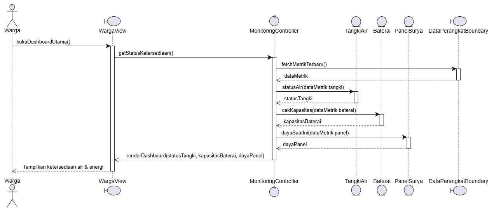

<i>Gambar 3.1.N. Sequence Diagram UC01 — Skenario Normal</i>

- **Skenario Alternatif 1: Data Sensor Tidak Tersedia**

`MonitoringController` berupaya menarik data metrik terbaru, namun `DataPerangkatBoundary` mengembalikan nilai `null` atau data usang akibat perangkat IoT tidak mengirimkan pembaruan. Sistem memberikan respons error dengan menampilkan pesan bahwa data terbaru belum tersedia serta mempertahankan tampilan data terakhir.

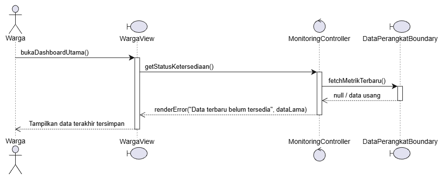

<i>Gambar 3.1.A1. Sequence Diagram UC01 — Data Sensor Tidak Tersedia</i>

### 3.1.3 Diagram Kelas

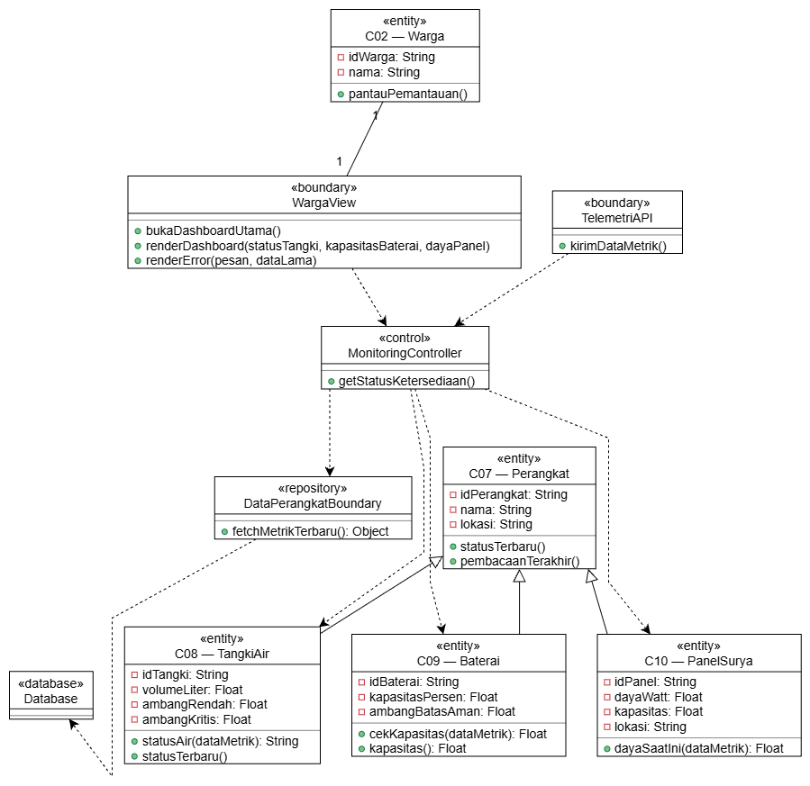

<i>Gambar 3.1.K. Diagram Kelas UC01</i>

Atribut dan operasi ditampilkan langsung pada kompartemen kelas dengan visibilitas (lingkaran hijau untuk public, kotak merah untuk private).

 

## 3.2 Use Case Melihat Tagihan Iuran Final

**ID Use Case:** *UC02*  
**Nama Use Case:** *Melihat Tagihan Iuran Final*

### 3.2.1 Identifikasi Kelas

Tabel 3.2. Identifikasi Kelas Use Case Melihat Tagihan Iuran Final

| No | Nama Kelas Perancangan | Nama Kelas Analisis Terkait |
|:--- | :--- | :--- |
| 1 | *WargaView* | *-* |
| 2 | *IuranController* | *-* |
| 3 | *Tagihan* | *Tagihan* |
| 4 | *Periode* | *Periode* |
| 5 | *DataIuranBoundaryi* | *-* |

### 3.2.2 Sequence Diagram

- **Skenario Normal**

Warga memilih periode tagihan yang diinginkan. `IuranController` meminta data tagihan terkait dari `DataIuranBoundary`. Entitas `Tagihan` memvalidasi statusnya (`sudahFinal`) dan mengembalikan hasil `true`. Tagihan yang sudah sah kemudian dibongkar rinciannya dan dikembalikan ke antarmuka untuk ditampilkan kepada warga.

<i>Gambar 3.2.N. Sequence Diagram UC02 — Skenario Normal</i>

- **Skenario Alternatif 1: Tagihan Belum Ditetapkan Final**

Ketika warga memilih periode tagihan, entitas `Tagihan` mendeteksi bahwa statusnya masih berstatus *draft* atau belum disetujui pengurus (mengembalikan `false`). Sistem memblokir rincian dan menampilkan pesan informasi bahwa tagihan final belum tersedia.

<i>Gambar 3.2.A1. Sequence Diagram UC02 — Tagihan Belum Ditetapkan Final</i>

### 3.2.3 Diagram Kelas

<i>Gambar 3.2.K. Diagram Kelas UC02</i>

Atribut dan operasi ditampilkan langsung pada kompartemen kelas dengan visibilitas (lingkaran hijau untuk public, kotak merah untuk private).

 

## 3.3 Use Case Mengirim Laporan Gangguan

**ID Use Case:** *UC03*\
**Nama Use Case:** *Mengirim Laporan Gangguan*\
**Aktor:** Warga\
**Kebutuhan fungsional:** KF07, KF08, KF09, KF10.

### 3.3.1 Identifikasi Kelas

Tabel 3.3. Identifikasi Kelas Use Case UC03

| No | Nama Kelas Perancangan | Nama Kelas Analisis Terkait |
| --- | --- | --- |
| 1 | Warga | C02 Warga |
| 2 | LaporanGangguan | C20 LaporanGangguan |
| 3 | StatusLaporan | C21 StatusLaporan |
| 4 | WargaView | — (kelas desain tambahan, tidak ada padanan kelas analisis Cxx) |
| 5 | LaporanController | — (kelas desain tambahan, tidak ada padanan kelas analisis Cxx) |
| 6 | Validasi | — (kelas desain tambahan, tidak ada padanan kelas analisis Cxx) |
| 7 | ModulLaporan | — (kelas desain tambahan, tidak ada padanan kelas analisis Cxx) |
| 8 | ModulAkun | — (kelas desain tambahan, tidak ada padanan kelas analisis Cxx) |
| 9 | DataAkunBoundary | — (kelas desain tambahan, tidak ada padanan kelas analisis Cxx) |
| 10 | Database | — (kelas desain tambahan, tidak ada padanan kelas analisis Cxx) |
| 11 | DataLaporanBoundary | — (kelas desain tambahan, tidak ada padanan kelas analisis Cxx) |

Kelas View, controller, `Validasi`, fasad modul, dan data boundary diturunkan dari komponen APL M6 Tabel 2.1 dan Tabel 3.1. View menangani interaksi, controller mengoordinasikan permintaan dari sesi, fasad menjalankan layanan domain, dan data boundary membatasi akses ke `Database`. Fasad modul dan `Database` merupakan kelas perancangan tambahan; tidak diberi ID analisis Cxx baru. `ModulAkun` dan `DataAkunBoundary` digunakan sebagai dependensi akun untuk memverifikasi keanggotaan; tambahan dependensi lintas modul ini dijelaskan dalam kontrak handoff.

### 3.3.2 Sequence Diagram

- **Skenario Normal**

Data formulir mencakup jenis gangguan, deskripsi, dan foto pendukung. Identitas warga serta komunitas berasal dari sesi terautentikasi. `ModulAkun` mengambil keadaan akun terbaru; pemeriksaan keanggotaan dilakukan pada domain sebelum objek laporan dibuat. Laporan baru ditetapkan berstatus `MENUNGGU`, disimpan, lalu diikuti notifikasi keberhasilan.

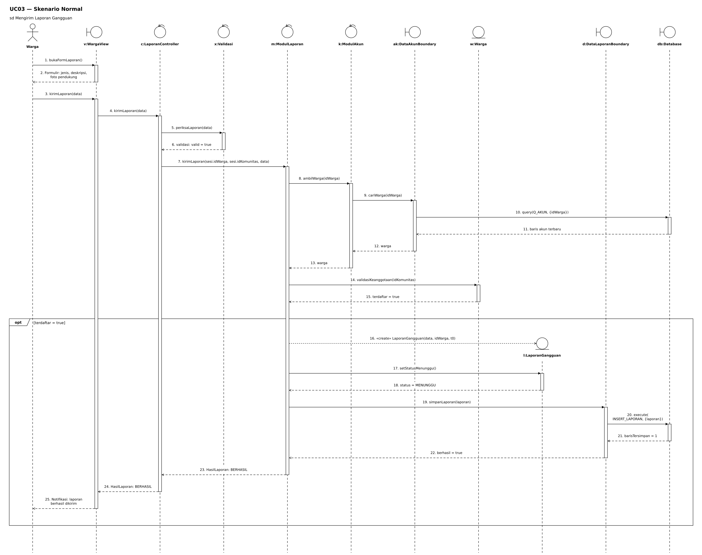

<i>Gambar 3.3.N. Sequence Diagram UC03 — Skenario Normal</i>

[Sumber draw.io editable](./assets/diagram/rionaldo/uc03-seq-normal.drawio) · [Ekspor SVG](./assets/diagram/rionaldo/uc03-seq-normal.svg)

- **Skenario Alternatif 1: Warga Tidak Terdaftar**

Keanggotaan warga tidak memenuhi komunitas terkait. Sistem menolak pengiriman dengan pesan tidak memiliki otorisasi; objek laporan tidak dibuat dan penyimpanan tidak dipanggil.

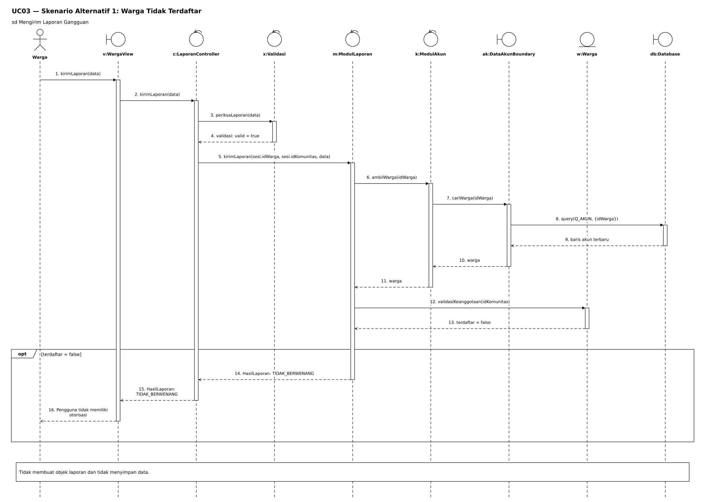

<i>Gambar 3.3.A1. Sequence Diagram UC03 — Warga Tidak Terdaftar</i>

[Sumber draw.io editable](./assets/diagram/rionaldo/uc03-seq-alt1.drawio) · [Ekspor SVG](./assets/diagram/rionaldo/uc03-seq-alt1.svg)

### 3.3.3 Diagram Kelas

<i>Gambar 3.3.K. Diagram Kelas UC03</i>

[Sumber draw.io editable](./assets/diagram/rionaldo/uc03-class.drawio) · [Ekspor SVG](./assets/diagram/rionaldo/uc03-class.svg)

Tipe `FormLaporan`, `FormPemeliharaan`, `HasilValidasi`, `HasilLaporan`, `HasilStatus`, `HasilPemeliharaan`, `DetailLaporan`, `RingkasanStatus`, dan `Tampilan` adalah record/nilai perancangan sesuai konteks operasi, bukan kelas analisis baru. Identitas pelaku berasal dari `KonteksSesi`. Definisi lengkap disertakan pada kontrak kelas pendamping.

Atribut dan operasi ditampilkan langsung pada kompartemen kelas dengan visibilitas, parameter, dan tipe data. Kelas yang digunakan lintas UC mengambil signature dari satu registri desain. Garis asosiasi memakai multiplisitas; dependensi layanan dan penggunaan enumerasi menggunakan panah putus-putus. Identitas Cxx mengikuti SKPL.

**Rujukan:** SKPL M5 §§4.4.3 / 5.2.3, §4.2, §6.1–6.2; APL M6 Tabel 2.1 dan Tabel 3.1; PDF Asistensi Akbar M7 hlm. 4–12. Nomor caption memakai identitas subbab dan skenario agar tidak berbenturan dengan gambar UC anggota lain.

 

## 3.4 Use Case Menelusuri Status Laporan Gangguan

**ID Use Case:** *UC04*\
**Nama Use Case:** *Menelusuri Status Laporan Gangguan*\
**Aktor:** Warga\
**Kebutuhan fungsional:** KF11, KF34.

### 3.4.1 Identifikasi Kelas

Tabel 3.4. Identifikasi Kelas Use Case UC04

| No | Nama Kelas Perancangan | Nama Kelas Analisis Terkait |
| --- | --- | --- |
| 1 | Warga | C02 Warga |
| 2 | LaporanGangguan | C20 LaporanGangguan |
| 3 | RiwayatStatusLaporan | C22 RiwayatStatusLaporan |
| 4 | WargaView | — (kelas desain tambahan, tidak ada padanan kelas analisis Cxx) |
| 5 | LaporanController | — (kelas desain tambahan, tidak ada padanan kelas analisis Cxx) |
| 6 | ModulLaporan | — (kelas desain tambahan, tidak ada padanan kelas analisis Cxx) |
| 7 | DataLaporanBoundary | — (kelas desain tambahan, tidak ada padanan kelas analisis Cxx) |
| 8 | Database | — (kelas desain tambahan, tidak ada padanan kelas analisis Cxx) |
| 9 | StatusLaporan | C21 StatusLaporan |

Kelas View, controller, `Validasi`, fasad modul, dan data boundary diturunkan dari komponen APL M6 Tabel 2.1 dan Tabel 3.1. View menangani interaksi, controller mengoordinasikan permintaan dari sesi, fasad menjalankan layanan domain, dan data boundary membatasi akses ke `Database`. Fasad modul dan `Database` merupakan kelas perancangan tambahan; tidak diberi ID analisis Cxx baru.

`StatusLaporan` (C21) ditambahkan sebagai dependensi tipe untuk atribut status C20/C22; C21 bukan kelas analisis tambahan pada daftar UC04 SKPL §5.2.4.

### 3.4.2 Sequence Diagram

- **Skenario Normal**

Pencarian daftar, detail, dan riwayat selalu menyertakan `idWarga` dari sesi pada predikat akses data. Riwayat ditampilkan bersama timestamp yang diurutkan menaik. Pemilihan ID laporan dari antarmuka tidak boleh menghilangkan pembatasan pemilik pada server.

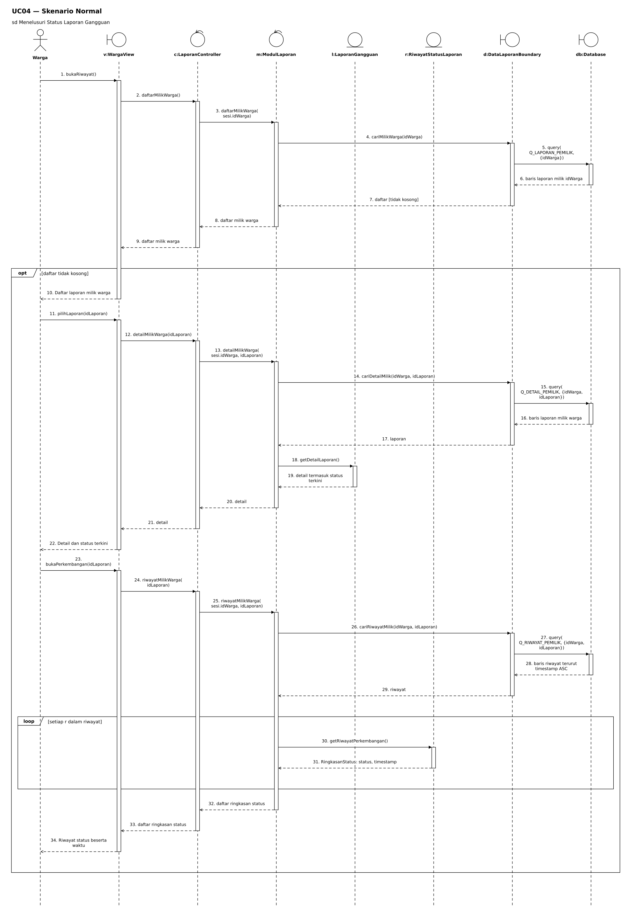

<i>Gambar 3.4.N. Sequence Diagram UC04 — Skenario Normal</i>

[Sumber draw.io editable](./assets/diagram/rionaldo/uc04-seq-normal.drawio) · [Ekspor SVG](./assets/diagram/rionaldo/uc04-seq-normal.svg)

- **Skenario Alternatif 1: Laporan Tidak Ditemukan**

Pencarian berdasarkan identitas warga menghasilkan daftar kosong. Sistem menampilkan informasi bahwa belum ada laporan gangguan yang dapat ditampilkan.

<i>Gambar 3.4.A1. Sequence Diagram UC04 — Laporan Tidak Ditemukan</i>

[Sumber draw.io editable](./assets/diagram/rionaldo/uc04-seq-alt1.drawio) · [Ekspor SVG](./assets/diagram/rionaldo/uc04-seq-alt1.svg)

### 3.4.3 Diagram Kelas

<i>Gambar 3.4.K. Diagram Kelas UC04</i>

[Sumber draw.io editable](./assets/diagram/rionaldo/uc04-class.drawio) · [Ekspor SVG](./assets/diagram/rionaldo/uc04-class.svg)

Tipe `FormLaporan`, `FormPemeliharaan`, `HasilValidasi`, `HasilLaporan`, `HasilStatus`, `HasilPemeliharaan`, `DetailLaporan`, `RingkasanStatus`, dan `Tampilan` adalah record/nilai perancangan sesuai konteks operasi, bukan kelas analisis baru. Identitas pelaku berasal dari `KonteksSesi`. Definisi lengkap disertakan pada kontrak kelas pendamping.

Atribut dan operasi ditampilkan langsung pada kompartemen kelas dengan visibilitas, parameter, dan tipe data. Kelas yang digunakan lintas UC mengambil signature dari satu registri desain. Garis asosiasi memakai multiplisitas; dependensi layanan dan penggunaan enumerasi menggunakan panah putus-putus. Identitas Cxx mengikuti SKPL.

**Rujukan:** SKPL M5 §§4.4.4 / 5.2.4, §4.2, §6.1–6.2; APL M6 Tabel 2.1 dan Tabel 3.1; PDF Asistensi Akbar M7 hlm. 4–12. Diagram normal memuat seluruh langkah dalam satu urutan; gunakan SVG pada zoom 100% untuk membaca diagram panjang. Nomor caption memakai identitas subbab dan skenario agar tidak berbenturan dengan gambar UC anggota lain.

 

## 3.5 Use Case Menerima Peringatan Dini Daya Kritis

**ID Use Case:** *UC05*  
**Nama Use Case:** *Menerima Peringatan Dini Daya Kritis*

### 3.5.1 Identifikasi Kelas

Tabel 3.5. Identifikasi Kelas Use Case Menerima Peringatan Dini Daya Kritis

| No | Nama Kelas Perancangan | Nama Kelas Analisis Terkait |
|:--- | :--- | :--- |
| 1 | *TeknisiView* | *-* |
| 2 | *TelemetriAPI* | *-* |
| 3 | *MonitoringController* | *Tagihan* |
| 4 | *Baterai* | *Baterai* |
| 5 | *PenugasanPerangkat* | *PenugasanPerangkat* |
| 6 | *PeringatanDayaKritis* | *PeringatanDayaKritis* |
| 7 | *DataIuranBoundaryi* | *-* |

### 3.5.2 Sequence Diagram

- **Skenario Normal**

Berdasarkan *trigger* telemetri, `MonitoringController` mengevaluasi kapasitas baterai. Saat mendeteksi kondisi kritis, sistem mencari teknisi yang ditugaskan melalui `DataPerangkatBoundary` dan memverifikasi tanggung jawabnya. Objek `PeringatanDayaKritis` dibuat dan dikirimkan ke antarmuka perangkat Teknisi yang bersangkutan dalam wujud *push notification*.

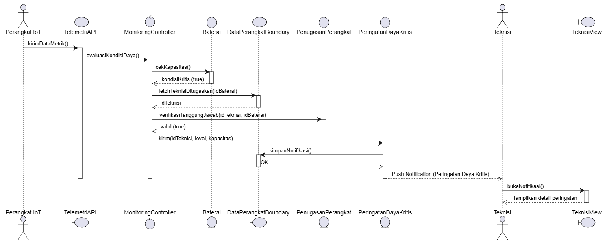

<i>Gambar 3.5.N. Sequence Diagram UC05 — Skenario Normal</i>

- **Skenario Alternatif 1: Koneksi Jaringan Terputus**

Saat notifikasi kritis dikirim, koneksi jaringan menuju perangkat teknisi sedang terputus. Objek `PeringatanDayaKritis` menyadari kegagalan ini dan menyimpannya ke database dengan status *pending*. Ketika teknisi *online* kembali, sistem secara otomatis menarik data *pending* tersebut dan menampilkannya.

<i>Gambar 3.5.A1. Sequence Diagram UC05 — Koneksi Jaringan Terputus</i>

### 3.5.3 Diagram Kelas

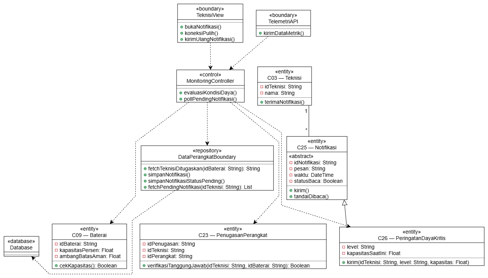

<i>Gambar 3.5.K. Diagram Kelas UC05</i>

Atribut dan operasi ditampilkan langsung pada kompartemen kelas dengan visibilitas (lingkaran hijau untuk public, kotak merah untuk private).

 

## 3.6 Use Case Memantau Riwayat Kinerja Panel Surya

**ID Use Case:** *UC06*  
**Nama Use Case:** *Memantau Riwayat Kinerja Panel Surya*

### 3.6.1 Identifikasi Kelas

Tabel 3.6. Identifikasi Kelas Use Case Memantau Riwayat Kinerja Panel Surya

| No | Nama Kelas Perancangan | Nama Kelas Analisis Terkait |
|:--- | :--- | :--- |
| 1 | *TeknisiView* | *-* |
| 2 | *MonitoringController* | *Tagihan* |
| 3 | *PanelSurya* | *PanelSurya* |
| 4 | *RentangWaktu* | *RentangWaktu* |
| 5 | *DataHistorisKinerja* | *DataHistorisKinerja* |
| 6 | *DataIuranBoundaryi* | *-* |

### 3.6.2 Sequence Diagram

- **Skenario Normal**

Teknisi memilih filter rentang waktu. `MonitoringController` memvalidasi logika penanggalan menggunakan kelas `RentangWaktu`. Jika valid, entitas `PanelSurya` akan mengambil raw data dari `DataPerangkatBoundary`, kemudian dikonversi oleh `DataHistorisKinerja` menjadi format data grafik yang dapat digambar oleh antarmuka.

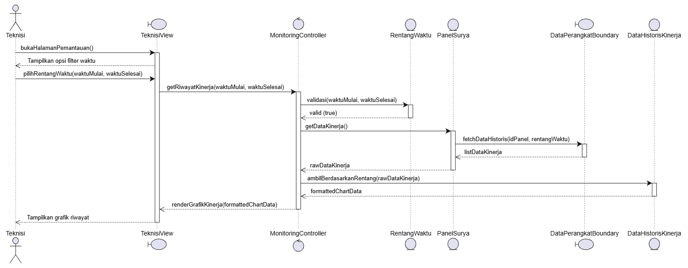

<i>Gambar 3.6.N. Sequence Diagram UC06 — Skenario Normal</i>

- **Skenario Alternatif 1: Data Historis Belum Tersedia**

Setelah memvalidasi rentang waktu, `PanelSurya` menanyakan riwayat log kepada *database*. Karena belum ada aktivitas atau data terhapus pada periode tersebut, daftar yang dikembalikan kosong. Sistem menampilkan pesan error bahwa data historis tidak ditemukan.

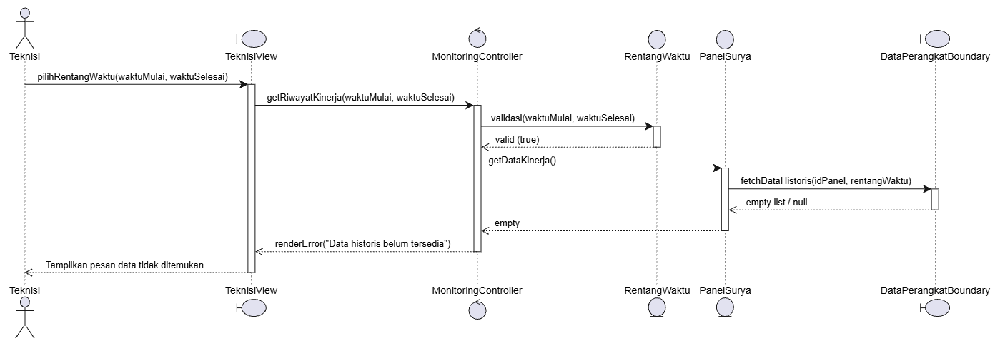

<i>Gambar 3.6.A1. Sequence Diagram UC06 — Data Historis Belum Tersedia</i>

### 3.6.3 Diagram Kelas

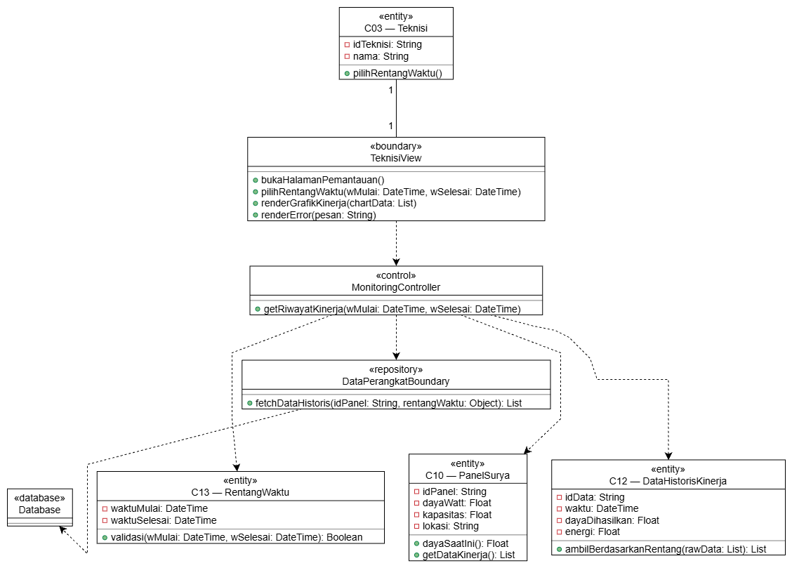

<i>Gambar 3.6.K. Diagram Kelas UC06</i>

Atribut dan operasi ditampilkan langsung pada kompartemen kelas dengan visibilitas (lingkaran hijau untuk public, kotak merah untuk private).

 

## 3.7 Use Case Memperbarui Status Penanganan Gangguan

**ID Use Case:** *UC07*\
**Nama Use Case:** *Memperbarui Status Penanganan Gangguan*\
**Aktor:** Teknisi\
**Kebutuhan fungsional:** KF12, KF17, KF18, KF19, KF35.

### 3.7.1 Identifikasi Kelas

Tabel 3.7. Identifikasi Kelas Use Case UC07

| No | Nama Kelas Perancangan | Nama Kelas Analisis Terkait |
| --- | --- | --- |
| 1 | Teknisi | C03 Teknisi |
| 2 | LaporanGangguan | C20 LaporanGangguan |
| 3 | PenugasanLaporan | C24 PenugasanLaporan |
| 4 | RiwayatStatusLaporan | C22 RiwayatStatusLaporan |
| 5 | StatusLaporan | C21 StatusLaporan |
| 6 | TeknisiView | — (kelas desain tambahan, tidak ada padanan kelas analisis Cxx) |
| 7 | LaporanController | — (kelas desain tambahan, tidak ada padanan kelas analisis Cxx) |
| 8 | ModulLaporan | — (kelas desain tambahan, tidak ada padanan kelas analisis Cxx) |
| 9 | DataLaporanBoundary | — (kelas desain tambahan, tidak ada padanan kelas analisis Cxx) |
| 10 | Database | — (kelas desain tambahan, tidak ada padanan kelas analisis Cxx) |

Kelas View, controller, `Validasi`, fasad modul, dan data boundary diturunkan dari komponen APL M6 Tabel 2.1 dan Tabel 3.1. View menangani interaksi, controller mengoordinasikan permintaan dari sesi, fasad menjalankan layanan domain, dan data boundary membatasi akses ke `Database`. Fasad modul dan `Database` merupakan kelas perancangan tambahan; tidak diberi ID analisis Cxx baru.

### 3.7.2 Sequence Diagram

- **Skenario Normal**

Daftar dan detail tugas dibatasi menurut identitas teknisi pada sesi. Domain memverifikasi penugasan sebelum memeriksa transisi status. Transisi sah hanya `MENUNGGU → SEDANG_DIPERBAIKI → SELESAI`; status tetap, lompatan, dan perpindahan mundur ditolak. Status dan riwayat bertimestamp disimpan dalam satu transaksi.

<i>Gambar 3.7.N. Sequence Diagram UC07 — Skenario Normal</i>

[Sumber draw.io editable](./assets/diagram/rionaldo/uc07-seq-normal.drawio) · [Ekspor SVG](./assets/diagram/rionaldo/uc07-seq-normal.svg)

- **Skenario Alternatif 1: Teknisi Tidak Berwenang**

Penugasan yang sesuai tidak ditemukan. Sistem menolak perubahan dan menampilkan pesan tidak berwenang; status dan riwayat tidak berubah.

<i>Gambar 3.7.A1. Sequence Diagram UC07 — Teknisi Tidak Berwenang</i>

[Sumber draw.io editable](./assets/diagram/rionaldo/uc07-seq-alt1.drawio) · [Ekspor SVG](./assets/diagram/rionaldo/uc07-seq-alt1.svg)

- **Skenario Alternatif 2: Perubahan Status Tidak Valid**

Setelah penugasan dipastikan sesuai, domain mendeteksi transisi yang tidak sah. Sistem menolak perubahan dan menampilkan pilihan status berikutnya yang legal; status dan riwayat tidak berubah.

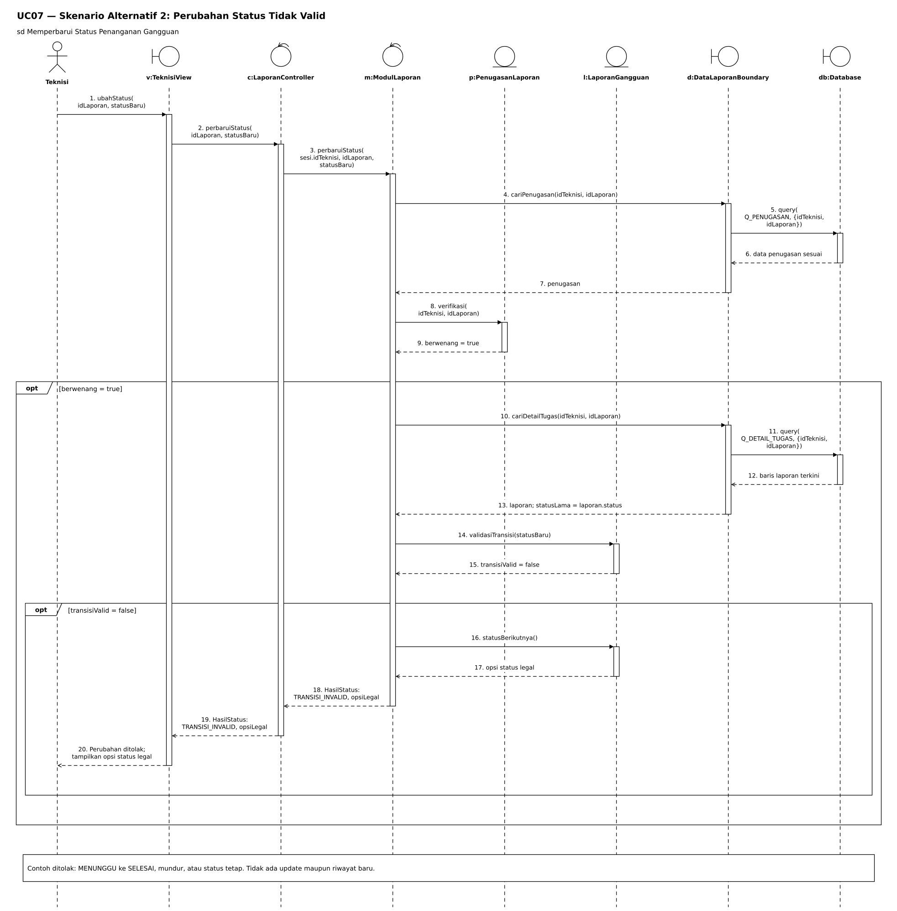

<i>Gambar 3.7.A2. Sequence Diagram UC07 — Perubahan Status Tidak Valid</i>

[Sumber draw.io editable](./assets/diagram/rionaldo/uc07-seq-alt2.drawio) · [Ekspor SVG](./assets/diagram/rionaldo/uc07-seq-alt2.svg)

### 3.7.3 Diagram Kelas

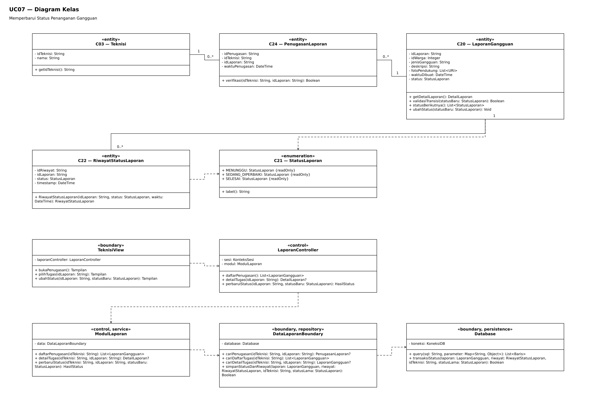

<i>Gambar 3.7.K. Diagram Kelas UC07</i>

[Sumber draw.io editable](./assets/diagram/rionaldo/uc07-class.drawio) · [Ekspor SVG](./assets/diagram/rionaldo/uc07-class.svg)

Tipe `FormLaporan`, `FormPemeliharaan`, `HasilValidasi`, `HasilLaporan`, `HasilStatus`, `HasilPemeliharaan`, `DetailLaporan`, `RingkasanStatus`, dan `Tampilan` adalah record/nilai perancangan sesuai konteks operasi, bukan kelas analisis baru. Identitas pelaku berasal dari `KonteksSesi`. Definisi lengkap disertakan pada kontrak kelas pendamping.

Atribut dan operasi ditampilkan langsung pada kompartemen kelas dengan visibilitas, parameter, dan tipe data. Kelas yang digunakan lintas UC mengambil signature dari satu registri desain. Garis asosiasi memakai multiplisitas; dependensi layanan dan penggunaan enumerasi menggunakan panah putus-putus. Identitas Cxx mengikuti SKPL.

**Rujukan:** SKPL M5 §§4.4.7 / 5.2.7, §4.2, §6.1–6.2; APL M6 Tabel 2.1 dan Tabel 3.1; PDF Asistensi Akbar M7 hlm. 4–12. Diagram normal memuat seluruh langkah dalam satu urutan; gunakan SVG pada zoom 100% untuk membaca diagram panjang. Nomor caption memakai identitas subbab dan skenario agar tidak berbenturan dengan gambar UC anggota lain.

 

## 3.8 Use Case Mencatat Kegiatan Pemeliharaan

**ID Use Case:** *UC08*\
**Nama Use Case:** *Mencatat Kegiatan Pemeliharaan*\
**Aktor:** Teknisi\
**Kebutuhan fungsional:** KF20, KF21.

### 3.8.1 Identifikasi Kelas

Tabel 3.8. Identifikasi Kelas Use Case UC08

| No | Nama Kelas Perancangan | Nama Kelas Analisis Terkait |
| --- | --- | --- |
| 1 | Teknisi | C03 Teknisi |
| 2 | Perangkat | C07 Perangkat |
| 3 | CatatanPemeliharaan | C27 CatatanPemeliharaan |
| 4 | TeknisiView | — (kelas desain tambahan, tidak ada padanan kelas analisis Cxx) |
| 5 | PemeliharaanController | — (kelas desain tambahan, tidak ada padanan kelas analisis Cxx) |
| 6 | Validasi | — (kelas desain tambahan, tidak ada padanan kelas analisis Cxx) |
| 7 | ModulPemeliharaan | — (kelas desain tambahan, tidak ada padanan kelas analisis Cxx) |
| 8 | DataPerangkatBoundary | — (kelas desain tambahan, tidak ada padanan kelas analisis Cxx) |
| 9 | Database | — (kelas desain tambahan, tidak ada padanan kelas analisis Cxx) |

Kelas View, controller, `Validasi`, fasad modul, dan data boundary diturunkan dari komponen APL M6 Tabel 2.1 dan Tabel 3.1. View menangani interaksi, controller mengoordinasikan permintaan dari sesi, fasad menjalankan layanan domain, dan data boundary membatasi akses ke `Database`. Fasad modul dan `Database` merupakan kelas perancangan tambahan; tidak diberi ID analisis Cxx baru.

### 3.8.2 Sequence Diagram

- **Skenario Normal**

Formulir memuat ID perangkat, waktu pelaksanaan, tindakan, dan catatan hasil. Kelengkapan diperiksa sebelum domain membuat catatan. Catatan yang berhasil disimpan mengikat identitas teknisi, identitas perangkat, dan waktu pelaksanaan sehingga dapat ditelusuri kembali.

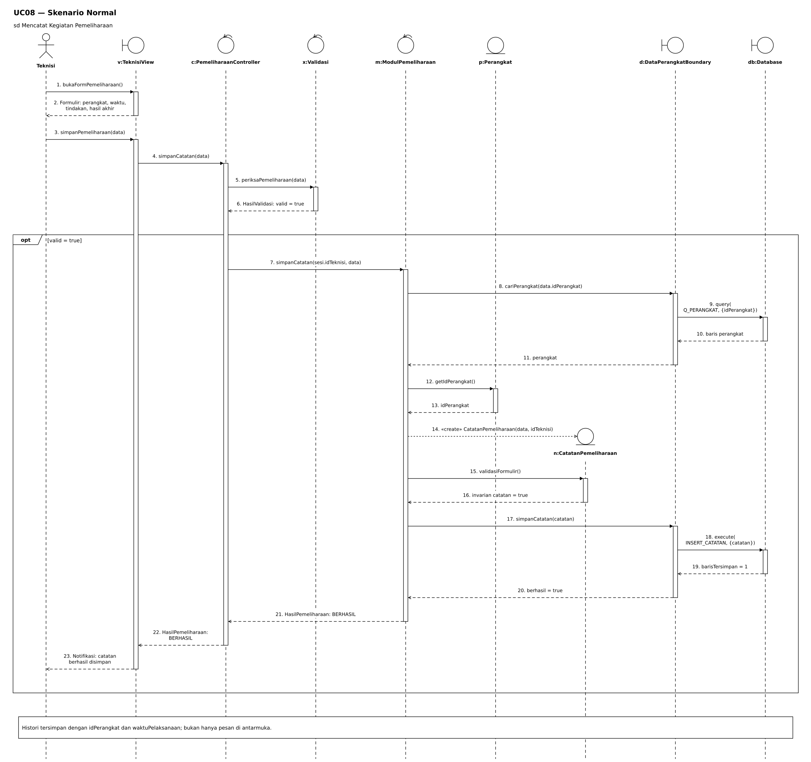

<i>Gambar 3.8.N. Sequence Diagram UC08 — Skenario Normal</i>

[Sumber draw.io editable](./assets/diagram/rionaldo/uc08-seq-normal.drawio) · [Ekspor SVG](./assets/diagram/rionaldo/uc08-seq-normal.svg)

- **Skenario Alternatif 1: Formulir Tidak Lengkap**

Validasi menemukan kolom wajib yang kosong. Sistem membatalkan penyimpanan, mempertahankan isian, dan menandai kolom yang harus dilengkapi.

<i>Gambar 3.8.A1. Sequence Diagram UC08 — Formulir Tidak Lengkap</i>

[Sumber draw.io editable](./assets/diagram/rionaldo/uc08-seq-alt1.drawio) · [Ekspor SVG](./assets/diagram/rionaldo/uc08-seq-alt1.svg)

### 3.8.3 Diagram Kelas

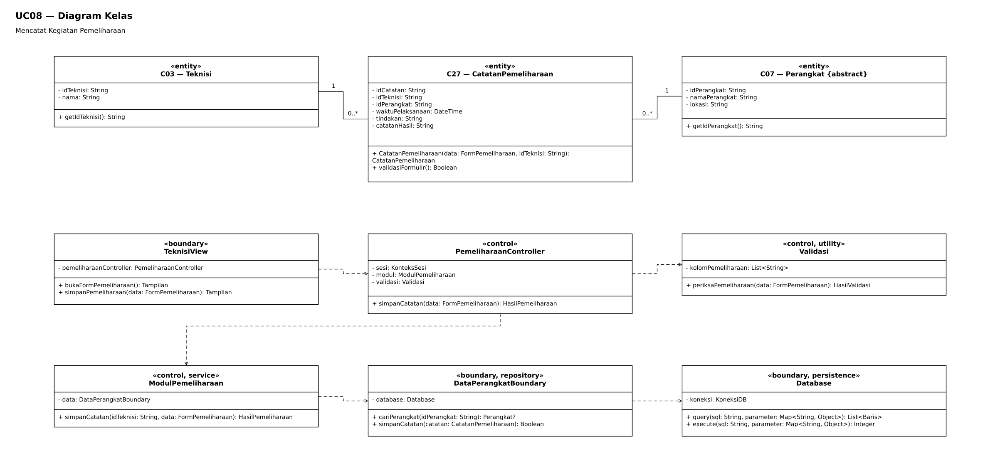

<i>Gambar 3.8.K. Diagram Kelas UC08</i>

[Sumber draw.io editable](./assets/diagram/rionaldo/uc08-class.drawio) · [Ekspor SVG](./assets/diagram/rionaldo/uc08-class.svg)

Tipe `FormLaporan`, `FormPemeliharaan`, `HasilValidasi`, `HasilLaporan`, `HasilStatus`, `HasilPemeliharaan`, `DetailLaporan`, `RingkasanStatus`, dan `Tampilan` adalah record/nilai perancangan sesuai konteks operasi, bukan kelas analisis baru. Identitas pelaku berasal dari `KonteksSesi`. Definisi lengkap disertakan pada kontrak kelas pendamping.

Atribut dan operasi ditampilkan langsung pada kompartemen kelas dengan visibilitas, parameter, dan tipe data. Kelas yang digunakan lintas UC mengambil signature dari satu registri desain. Garis asosiasi memakai multiplisitas; dependensi layanan dan penggunaan enumerasi menggunakan panah putus-putus. Identitas Cxx mengikuti SKPL.

**Rujukan:** SKPL M5 §§4.4.8 / 5.2.8, §4.2, §6.1–6.2; APL M6 Tabel 2.1 dan Tabel 3.1; PDF Asistensi Akbar M7 hlm. 4–12. Nomor caption memakai identitas subbab dan skenario agar tidak berbenturan dengan gambar UC anggota lain.

## 3.9 Use Case Menganalisis Pemakaian Komunal
 
**ID Use Case:** *UC09*  
**Nama Use Case:** *Menganalisis Pemakaian Komunal*
 
### 3.9.1 Identifikasi Kelas
 
Realisasi UC09 melewati jalur `PengurusView` → `IuranController` → `ModulIuran` → `DataIuranBoundary` sesuai Tabel 3.1 dokumen APL. Kelas *boundary*, *control*, dan *repository* adalah kelas perancangan baru yang berasal dari komponen APL, sehingga tidak memiliki kelas analisis.
 
Tabel 3.9. Identifikasi Kelas Use Case UC09
 
| No | Nama Kelas Perancangan | Nama Kelas Analisis Terkait |
|:--- | :--- | :--- |
| 1 | `PengurusView` «boundary» | — (komponen *PengurusView*, APL Tabel 2.1) |
| 2 | `IuranController` «control» | — (komponen *IuranController*, APL Tabel 2.1) |
| 3 | `Validasi` «utility» | — (komponen *Validasi*, APL Tabel 2.1) |
| 4 | `DataIuranBoundary` «repository» | — (komponen *DataIuranBoundary*, APL Tabel 2.1) |
| 5 | `Akun` «entity» | C01 – Akun |
| 6 | `Pengurus` «entity» | C04 – Pengurus |
| 7 | `Periode` «entity» | C14 – Periode |
| 8 | `DataPemakaian` «entity» | C15 – DataPemakaian |
 
### 3.9.2 Sequence Diagram
 
- **Skenario Normal**
Pengurus membuka dashboard administratif, lalu `IuranController` memeriksa kewenangan melalui `Pengurus.verifikasiKewenangan()`. Setelah pengurus memilih periode, `Validasi` memeriksa periode. `DataIuranBoundary` mengambil `Periode` dan `DataPemakaian` pada periode itu (KF24), dan `IuranController` menghitung agregat air dan energi. View menampilkan agregat dan riwayat pemakaian (KF22).
 

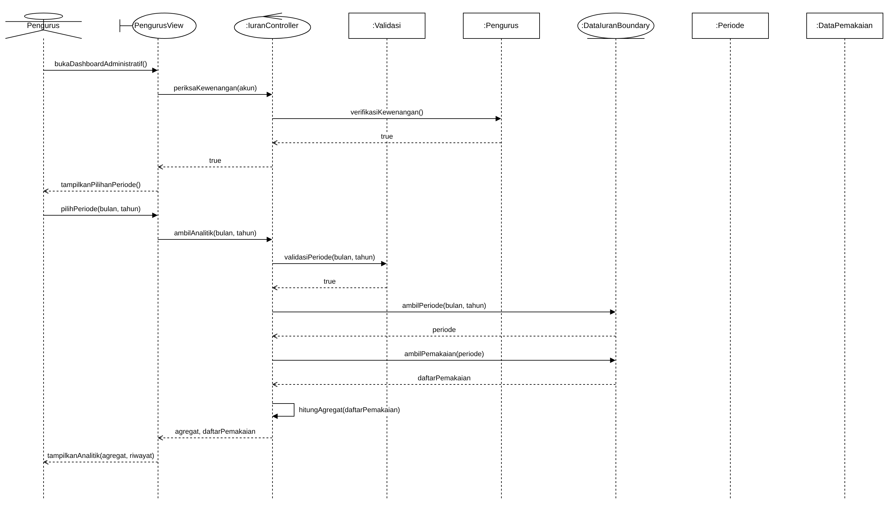

<i>Gambar 3.9.1. Sequence Diagram UC09 - Skenario Normal</i>

- **Skenario Alternatif 1: Pengguna Bukan Pengurus**
Warga atau Teknisi membuka dashboard administratif. `IuranController.periksaKewenangan()` mendeteksi bahwa akun bukan `Pengurus` dan mengembalikan `false`. Akses ditolak dan tidak ada data yang diambil dari `DataIuranBoundary` (KF23, KNF01, KNF02).
 

<i>Gambar 3.9.2. Sequence Diagram UC09 - Pengguna Bukan Pengurus</i>

### 3.9.3 Diagram Kelas
 

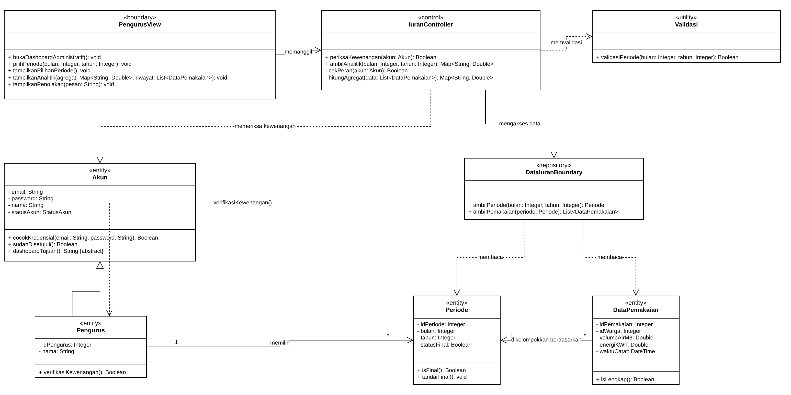

<i>Gambar 3.9.3. Diagram Kelas UC09 - Menganalisis Pemakaian Komunal</i>

---
 
## 3.10 Use Case Menghitung dan Menetapkan Iuran Warga
 
**ID Use Case:** *UC10*  
**Nama Use Case:** *Menghitung dan Menetapkan Iuran Warga*
 
### 3.10.1 Identifikasi Kelas
 
UC10 memiliki relasi `<<include>> UC09` dan `<<extend>> UC02` (SKPL). `DataPemakaian` dan `Periode` dipakai ulang dengan definisi yang sama seperti di UC09. `KalkulatorIuran` (C19) adalah *domain service* di `ModulIuran`; `IuranController` hanya mendelegasikan ke service ini.
 
Tabel 3.10. Identifikasi Kelas Use Case UC10
 
| No | Nama Kelas Perancangan | Nama Kelas Analisis Terkait |
|:--- | :--- | :--- |
| 1 | `PengurusView` «boundary» | — (komponen *PengurusView*, APL Tabel 2.1) |
| 2 | `IuranController` «control» | — (komponen *IuranController*, APL Tabel 2.1) |
| 3 | `Validasi` «utility» | — (komponen *Validasi*, APL Tabel 2.1) |
| 4 | `DataIuranBoundary` «repository» | — (komponen *DataIuranBoundary*, APL Tabel 2.1) |
| 5 | `KalkulatorIuran` «service» | C19 – KalkulatorIuran |
| 6 | `Pengurus` «entity» | C04 – Pengurus |
| 7 | `Periode` «entity» | C14 – Periode |
| 8 | `DataPemakaian` «entity» | C15 – DataPemakaian |
| 9 | `AturanTarif` «entity» | C16 – AturanTarif |
| 10 | `Tagihan` «entity» | C17 – Tagihan |
| 11 | `StatusTagihan` «enumeration» | C18 – StatusTagihan |
| 12 | `Warga` «entity» | C02 – Warga |
 
### 3.10.2 Sequence Diagram
 
- **Skenario Normal**
Pengurus memilih periode. Setelah `Validasi` dan `KalkulatorIuran.validasiKelengkapan()` lolos, `KalkulatorIuran.pratinjau()` mengambil satu `AturanTarif` untuk periode itu dan memakainya untuk seluruh warga (KF28). Tiap `Tagihan` dibuat berstatus `DRAFT` dan dihitung lewat `hitungTotal()` (KF25, KF33). Hasilnya ditampilkan sebagai pratinjau (KF26). Saat pengurus menekan "Tetapkan Final", `KalkulatorIuran.validasiKewenangan()` memeriksa kewenangan (KF27). Setelah itu semua `Tagihan` dan `Periode` ditandai `FINAL` dan disimpan, lalu notifikasi berhasil ditampilkan.
 

<i>Gambar 3.10.1. Sequence Diagram UC10 - Skenario Normal</i>

- **Skenario Alternatif 1: Pengurus Tidak Berwenang**
`Pengurus.verifikasiKewenangan()` mengembalikan `false`, sehingga penetapan final ditolak dan pesan otorisasi ditampilkan. Tidak ada `Tagihan` atau `Periode` yang berubah.
 

<i>Gambar 3.10.2. Sequence Diagram UC10 - Pengurus Tidak Berwenang</i>

- **Skenario Alternatif 2: Data Pemakaian Belum Lengkap**
`DataPemakaian.isLengkap()` mengembalikan `false` untuk sebagian warga. `KalkulatorIuran.validasiKelengkapan()` mengembalikan `false`, perhitungan dihentikan sebelum `Tagihan` dibuat, dan pengurus diminta melengkapi data terlebih dahulu.
 

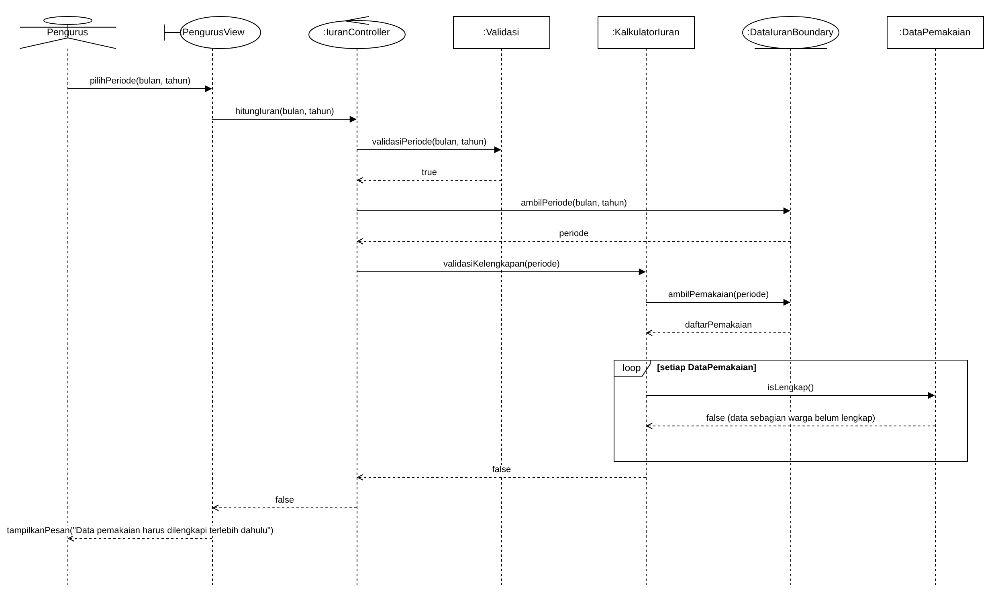

<i>Gambar 3.10.3. Sequence Diagram UC10 - Data Pemakaian Belum Lengkap</i>

### 3.10.3 Diagram Kelas
 

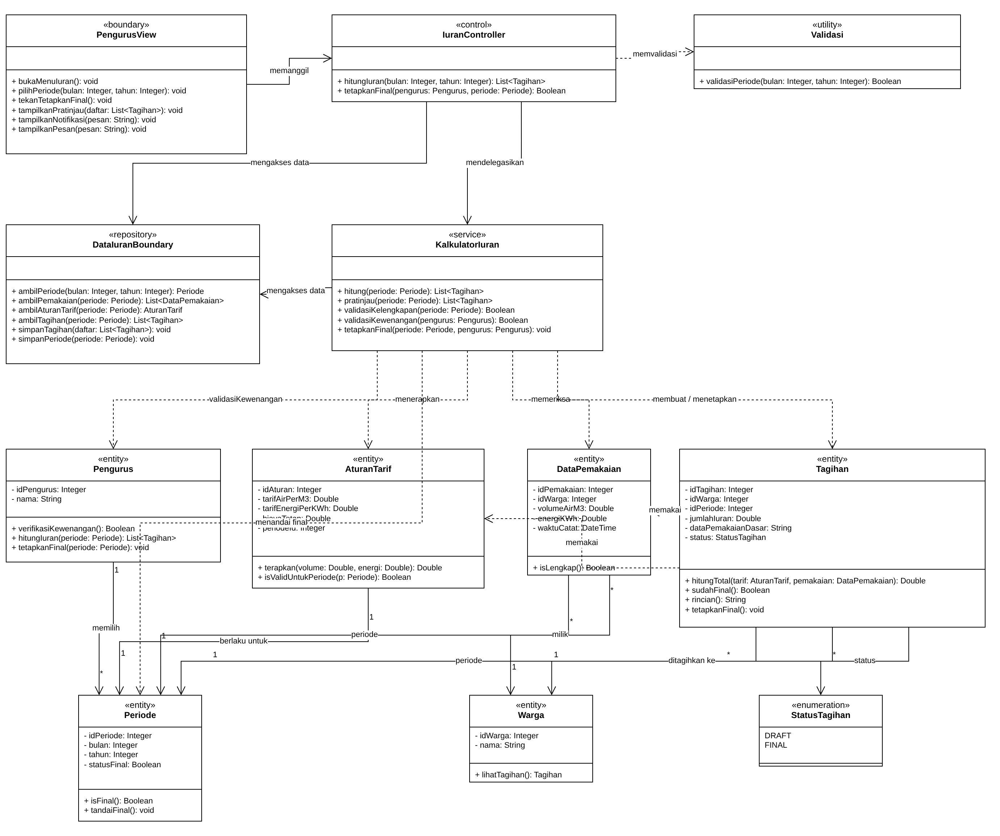

<i>Gambar 3.10.4. Diagram Kelas UC10 - Menghitung dan Menetapkan Iuran Warga</i>

---
 
## 3.11 Use Case Membuat Rekapitulasi Pemakaian dan Iuran
 
**ID Use Case:** *UC11*  
**Nama Use Case:** *Membuat Rekapitulasi Pemakaian dan Iuran*
 
### 3.11.1 Identifikasi Kelas
 
Tabel 3.11. Identifikasi Kelas Use Case UC11
 
| No | Nama Kelas Perancangan | Nama Kelas Analisis Terkait |
|:--- | :--- | :--- |
| 1 | `PengurusView` «boundary» | — (komponen *PengurusView*, APL Tabel 2.1) |
| 2 | `IuranController` «control» | — (komponen *IuranController*, APL Tabel 2.1) |
| 3 | `Validasi` «utility» | — (komponen *Validasi*, APL Tabel 2.1) |
| 4 | `DataIuranBoundary` «repository» | — (komponen *DataIuranBoundary*, APL Tabel 2.1) |
| 5 | `Pengurus` «entity» | C04 – Pengurus |
| 6 | `Periode` «entity» | C14 – Periode |
| 7 | `DataPemakaian` «entity» | C15 – DataPemakaian |
| 8 | `Tagihan` «entity» | C17 – Tagihan |
| 9 | `StatusTagihan` «enumeration» | C18 – StatusTagihan |
| 10 | `Rekapitulasi` «entity» | C28 – Rekapitulasi |
 
### 3.11.2 Sequence Diagram
 
- **Skenario Normal**
Pengurus membuka menu rekapitulasi. Kewenangan diperiksa lewat `Pengurus.verifikasiKewenangan()` dan daftar periode ditampilkan (KF29, KF31). Setelah periode dipilih, `IuranController` memastikan data final dengan `Periode.isFinal()` dan `Tagihan.sudahFinal()` untuk setiap tagihan (KF32). Saat pengurus memilih "buat rekapitulasi", `Pengurus.buatRekapitulasi()` memanggil `Rekapitulasi.generate(periode)`, yang menjumlahkan `DataPemakaian` dan `Tagihan` periode itu (KF30). Terakhir, pengurus memilih ekspor (PDF atau CSV, KNF10) atau cetak.
 

<i>Gambar 3.11.1. Sequence Diagram UC11 - Skenario Normal</i>

- **Skenario Alternatif 1: Data Belum Final**
`Periode.isFinal()` bernilai `false`, atau periode sudah final tetapi masih ada `Tagihan` yang `sudahFinal()` bernilai `false`. `Rekapitulasi.generate()` tidak dipanggil, dan pengurus diberi informasi bahwa rekapitulasi hanya dapat dibuat dari data final.
 

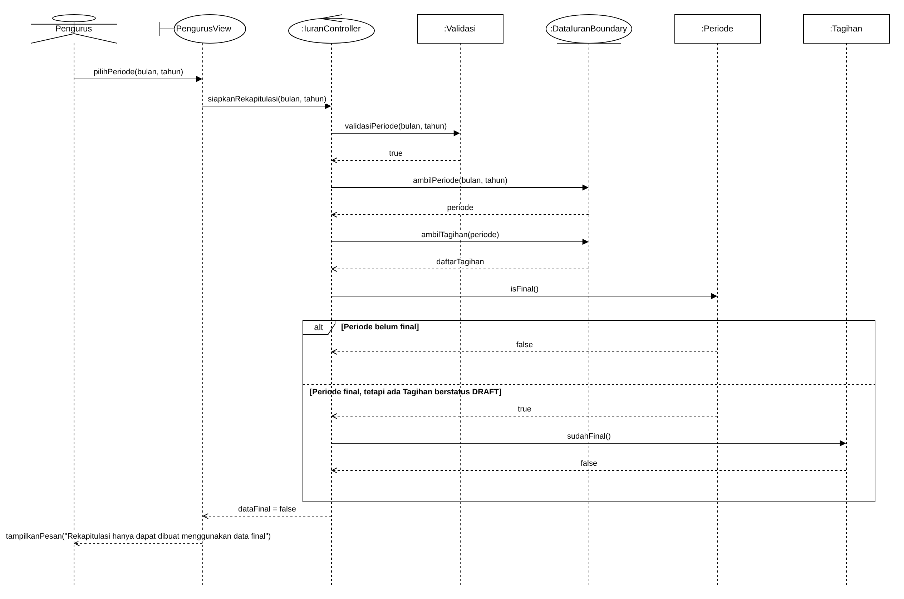

<i>Gambar 3.11.2. Sequence Diagram UC11 - Data Belum Final</i>

- **Skenario Alternatif 2: Pengguna Tidak Berwenang**
Pengguna bukan pengurus (Warga atau Teknisi) mencoba membuka menu rekapitulasi. `IuranController.periksaKewenangan()` mengembalikan `false` dan akses ditolak (KF31, KNF01).
 

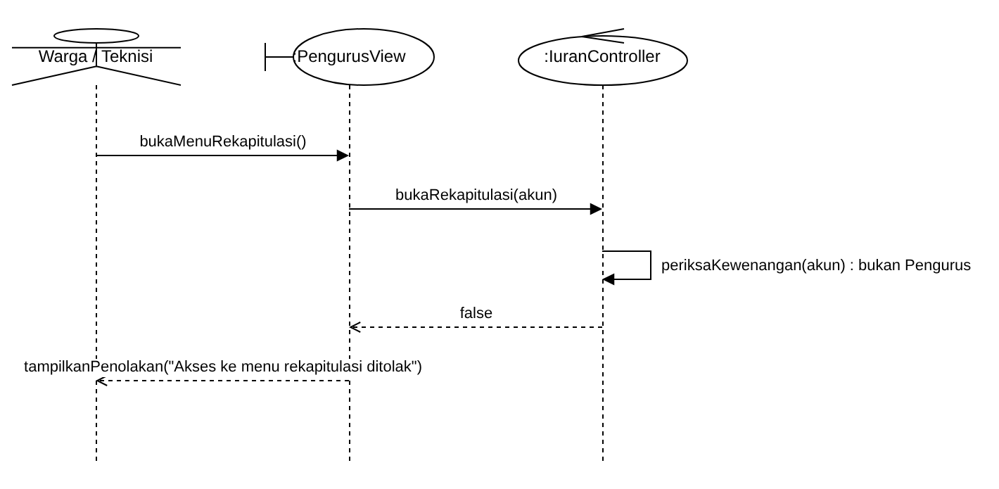

<i>Gambar 3.11.3. Sequence Diagram UC11 - Pengguna Tidak Berwenang</i>

### 3.11.3 Diagram Kelas
 

<i>Gambar 3.11.4. Diagram Kelas UC11 - Membuat Rekapitulasi Pemakaian dan Iuran</i>

 

## 3.12 Use Case 12

**ID Use Case:** *UC12*
**Nama Use Case:** *Melakukan Registrasi Akun*
 
### 3.12.1 Identifikasi Kelas

Tabel 3.12. Identifikasi Kelas Use Case UC12

| No | Nama Kelas Perancangan | Nama Kelas Analisis Terkait |
|:--- | :--- | :--- |
| 1 | `AuthView` «boundary» | — (komponen *AuthView*, APL Tabel 2.1) |
| 2 | `AkunController` «control» | — (komponen *AkunController*, APL Tabel 2.1) |
| 3 | `Validasi` «utility» | — (komponen *Validasi*, APL Tabel 2.1) |
| 4 | `DataAkunBoundary` «repository» | — (komponen *DataAkunBoundary*, APL Tabel 2.1) |
| 5 | `CalonPengguna` «entity» | C05 – CalonPengguna |
| 6 | `Akun` «entity» | C01 – Akun |
| 7 | `Warga` «entity» | C02 – Warga |
| 8 | `Teknisi` «entity» | C03 – Teknisi |
| 9 | `Pengurus` «entity» | C04 – Pengurus |
| 10 | `StatusAkun` «entity» | C06 – StatusAkun |
 
### 3.12.2 Sequence Diagram

- **Skenario Normal**
Calon pengguna membuka halaman registrasi dan mengisi formulir (nama, email, password, pilihan peran). Saat tombol "Daftar" ditekan, `AuthView` meneruskan permintaan ke `AkunController.daftarkan(nama, email, password, peran)`. Controller mengambil data email lewat `DataAkunBoundary.cariEmail(email)` dan memvalidasi kelengkapan serta keunikan email melalui `Validasi.validasiRegistrasi(nama, email, password, existing)`. Bila lolos, `CalonPengguna.daftarkan()` menciptakan akun peran lewat `Akun.buatAkun(peran)` dengan status awal "Menunggu Persetujuan" melalui `Akun.ubahStatus(...)`, lalu menyimpannya lewat `DataAkunBoundary.simpanAkun(akun)`. `AuthView` menampilkan notifikasi bahwa registrasi berhasil dan akun menunggu persetujuan pengurus (KF09, KF14).

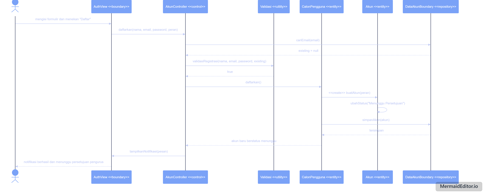

<i>Gambar 3.12.1. Sequence Diagram UC12 - Skenario Normal</i>

- **Skenario Alternatif 1: Email Sudah Terdaftar**
`DataAkunBoundary.cariEmail(email)` mengembalikan objek `Akun` yang sudah ada, sehingga `Validasi.validasiRegistrasi(...)` bernilai `false`. Tidak ada akun yang diciptakan; `AuthView` menampilkan pesan "Email sudah terdaftar, silakan gunakan email lain".

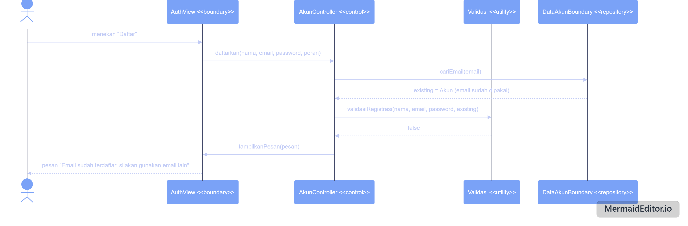

<i>Gambar 3.12.2. Sequence Diagram UC12 - Email Sudah Terdaftar</i>

### 3.12.3 Diagram Kelas

<i>Gambar 3.12.3. Diagram Kelas UC12 - Melakukan Registrasi Akun (nilai izin StatusAkun: "Menunggu Persetujuan", "Disetujui", "Ditolak")</i>

 

## 3.13 Use Case 13

**ID Use Case:** *UC13*
**Nama Use Case:** *Melakukan Login Akun*

### 3.13.1 Identifikasi Kelas

Tabel 3.13. Identifikasi Kelas Use Case UC13

| No | Nama Kelas Perancangan | Nama Kelas Analisis Terkait |
|:--- | :--- | :--- |
| 1 | `AuthView` «boundary» | — (komponen *AuthView*, APL Tabel 2.1) |
| 2 | `AkunController` «control» | — (komponen *AkunController*, APL Tabel 2.1) |
| 3 | `DataAkunBoundary` «repository» | — (komponen *DataAkunBoundary*, APL Tabel 2.1) |
| 4 | `Akun` «entity» | C01 – Akun |
| 5 | `Warga` «entity» | C02 – Warga |
| 6 | `Teknisi` «entity» | C03 – Teknisi |
| 7 | `Pengurus` «entity» | C04 – Pengurus |
| 8 | `StatusAkun` «entity» | C06 – StatusAkun |

### 3.13.2 Sequence Diagram

- **Skenario Normal**
Pengguna (Warga/Teknisi/Pengurus) mengisi kredensial dan menekan "Login". `AkunController.login(email, password)` mengambil akun lewat `DataAkunBoundary.ambilAkun(email)`, lalu memverifikasi kecocokan kredensial dengan `Akun.cocokKredensial(email, password)` dan status persetujuan dengan `Akun.sudahDisetujui()`. Bila keduanya benar, tujuan halaman ditentukan oleh polimorfisme `Akun.dashboardTujuan()` yang dijawab berbeda oleh subclass peran (late binding), dan `AuthView` mengarahkan pengguna ke dasbor sesuai perannya (KF18, KF23, KF27).

<i>Gambar 3.13.1. Sequence Diagram UC13 - Skenario Normal</i>

- **Skenario Alternatif 1: Akun Belum Disetujui**
`Akun.cocokKredensial(email, password)` bernilai `true` tetapi `Akun.sudahDisetujui()` bernilai `false` karena status akun masih "Menunggu Persetujuan". `AuthView` menampilkan pesan bahwa akun masih menunggu persetujuan pengurus dan pengguna tidak diarahkan ke dasbor mana pun.

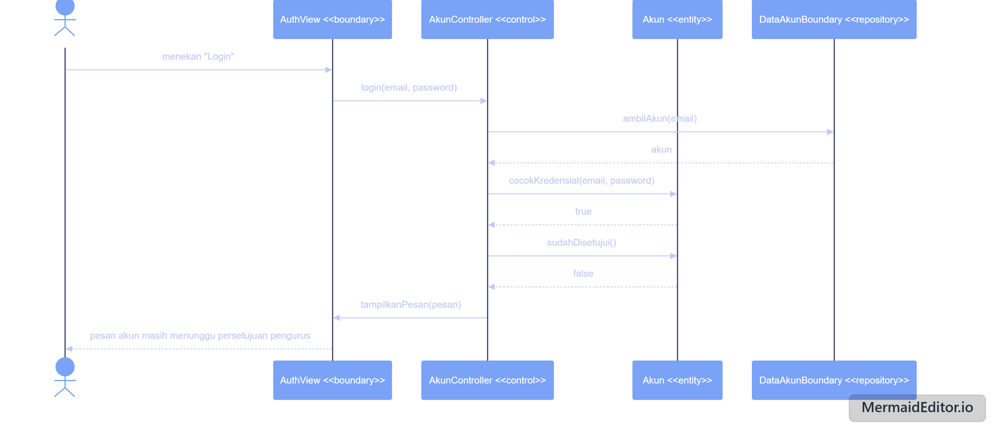

<i>Gambar 3.13.2. Sequence Diagram UC13 - Akun Belum Disetujui</i>

### 3.13.3 Diagram Kelas

<i>Gambar 3.13.3. Diagram Kelas UC13 - Melakukan Login Akun</i>

## 3.14 Use Case 14

**ID Use Case:** *UC14*
**Nama Use Case:** *Mengelola Persetujuan Akun*

### 3.14.1 Identifikasi Kelas

Tabel 3.14. Identifikasi Kelas Use Case UC14

| No | Nama Kelas Perancangan | Nama Kelas Analisis Terkait |
|:--- | :--- | :--- |
| 1 | `DashboardPengurusView` «boundary» | — (komponen *DashboardPengurusView*, APL Tabel 2.1) |
| 2 | `AkunController` «control» | — (komponen *AkunController*, APL Tabel 2.1) |
| 3 | `DataAkunBoundary` «repository» | — (komponen *DataAkunBoundary*, APL Tabel 2.1) |
| 4 | `Pengurus` «entity» | C04 – Pengurus |
| 5 | `Akun` «entity» | C01 – Akun |
| 6 | `StatusAkun` «entity» | C06 – StatusAkun |

### 3.14.2 Sequence Diagram

- **Skenario Normal**
Pengurus membuka menu persetujuan akun pada `DashboardPengurusView`. `AkunController.ambilAkunMenunggu()` terlebih dahulu memeriksa kewenangan lewat `Pengurus.verifikasiKewenangan()` (KF23), kemudian mengambil daftar akun berstatus "Menunggu Persetujuan" lewat `Pengurus.lihatAkunMenunggu()` yang membaca `DataAkunBoundary.ambilBerdasarkanStatus(...)`. Daftar ditampilkan; pengurus memilih akun dan menekan "Setujui" (atau "Tolak"), sehingga `Pengurus.setujuiAkun(akun)` memanggil `Akun.ubahStatus("Disetujui")` dan menyimpan perubahan lewat `DataAkunBoundary.perbaruiAkun(akun)`. `DashboardPengurusView` menampilkan notifikasi hasil persetujuan.

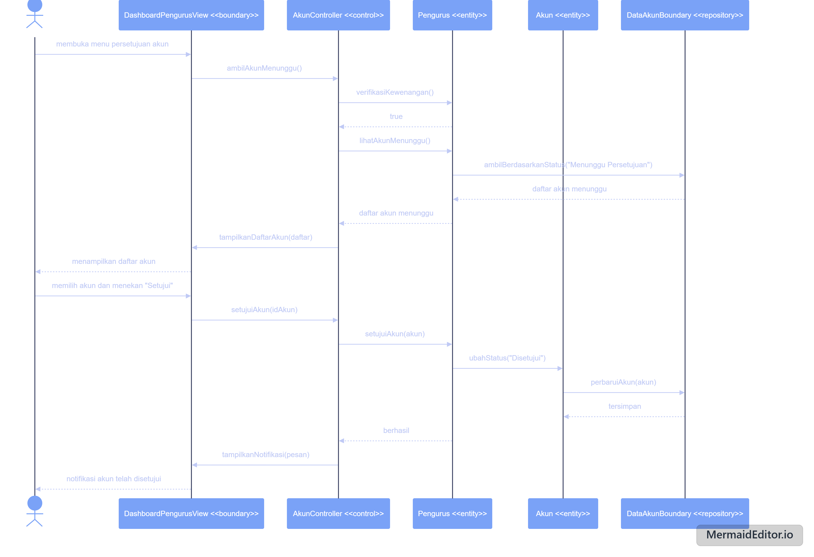

<i>Gambar 3.14.1. Sequence Diagram UC14 - Skenario Normal</i>

- **Skenario Alternatif 1: Tidak Ada Akun Menunggu Persetujuan**
`DataAkunBoundary.ambilBerdasarkanStatus("Menunggu Persetujuan")` mengembalikan daftar kosong. `DashboardPengurusView` menampilkan informasi bahwa tidak ada akun yang menunggu persetujuan, sehingga tidak ada aksi persetujuan yang dapat dilakukan.

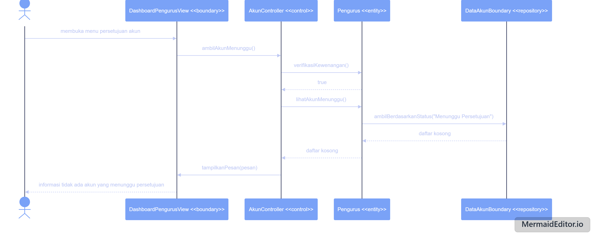

<i>Gambar 3.14.2. Sequence Diagram UC14 - Tidak Ada Akun Menunggu Persetujuan</i>

### 3.14.3 Diagram Kelas

<i>Gambar 3.14.3. Diagram Kelas UC14 - Mengelola Persetujuan Akun</i>

 

## 3.2 Use Case XX

Silahkan lanjutkan untuk  *use case* berikutnya dengan content yang sama dengan 3.1

 

---

# BAB 4: Diagram Kelas Keseluruhan

## 4.1 Diagram Kelas

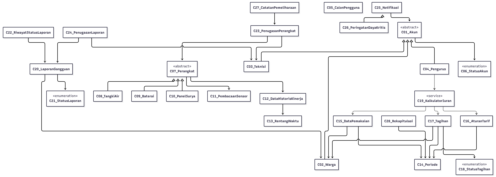

<i>Gambar 4.1. Diagram Kelas Perancangan Keseluruhan Fajar Tech</i>

Tabel 4.1. Daftar Kelas Perancangan Keseluruhan

| ID Kelas | Nama Kelas | Atribut | Metode/Operasi |
| :--- | :--- | :--- | :--- |
| C01 | Akun | email, password, nama, statusAkun | cocokKredensial(email, password), sudahDisetujui(), dashboardTujuan() {abstract} |
| C02 | Warga | idWarga, nama | pantauPemantauan(), lihatTagihan(), lihatRiwayatLaporan() |
| C03 | Teknisi | idTeknisi, nama, kontak | terimaNotifikasi(), ubahStatusLaporan(), pilihRentangWaktu() |
| C04 | Pengurus | idPengurus, nama | verifikasiKewenangan(), hitungIuran(periode), tetapkanFinal(periode), buatRekapitulasi() |
| C05 | CalonPengguna | nama, email, password, peranPilihan | daftarkan(): Akun |
| C06 | StatusAkun | MENUNGGU, DISETUJUI, DITOLAK | — |
| C07 | Perangkat | idPerangkat, nama, lokasi | statusTerbaru() {abstract}, pembacaanTerakhir() |
| C08 | TangkiAir | idTangki, volumeLiter, ambangRendah, ambangKritis | statusAir(), statusTerbaru() |
| C09 | Baterai | idBaterai, kapasitasPersen, ambangBatasAman | cekKapasitas(), kapasitas() |
| C10 | PanelSurya | idPanel, dayaWatt, kapasitas, lokasi | dayaSaatIni(), getDataKinerja() |
| C11 | PembacaanSensor | idPembacaan, nilai, satuan, waktu | catat() |
| C12 | DataHistorisKinerja | idData, waktu, dayaDihasilkan, energi | ambilBerdasarkanRentang(r: RentangWaktu) |
| C13 | RentangWaktu | waktuMulai, waktuSelesai | validasi() |
| C14 | Periode | idPeriode, bulan, tahun, statusFinal | isFinal(), tandaiFinal() |
| C15 | DataPemakaian | idPemakaian, idWarga, volumeAirM3, energiKWh, waktuCatat | isLengkap() |
| C16 | AturanTarif | idAturan, tarifAirPerM3, tarifEnergiPerKWh, biayaTetap, periodeId | terapkan(volume, energi), isValidUntukPeriode() |
| C17 | Tagihan | idTagihan, idWarga, idPeriode, jumlahIuran, dataPemakaianDasar, status | hitungTotal(), sudahFinal(), rincian(), tetapkanFinal() |
| C18 | StatusTagihan | DRAFT, FINAL | — |
| C19 | KalkulatorIuran | — (service) | hitung(periode), pratinjau(periode), validasiKelengkapan(), validasiKewenangan(), tetapkanFinal() |
| C20 | LaporanGangguan | idLaporan, jenisGangguan, deskripsi, status, waktuDibuat | ubahStatus(s), simpan() |
| C21 | StatusLaporan | MENUNGGU, SEDANG_DIPERBAIKI, SELESAI | — |
| C22 | RiwayatStatusLaporan | idRiwayat, status, timestamp | catat() |
| C23 | PenugasanPerangkat | idPenugasan, idTeknisi, idPerangkat | verifikasiTanggungJawab() |
| C24 | PenugasanLaporan | idPenugasan, idTeknisi, idLaporan, waktuPenugasan | verifikasi() |
| C25 | Notifikasi | idNotifikasi, pesan, waktu, statusBaca | kirim(), tandaiDibaca() |
| C26 | PeringatanDayaKritis | level, kapasitasSaatIni | — (inherit kirim()) |
| C27 | CatatanPemeliharaan | idCatatan, waktuPelaksanaan, tindakan, catatanHasil | simpan(), validasi() |
| C28 | Rekapitulasi | idRekap, idPeriode, totalPemakaianAir, totalPemakaianEnergi, totalIuran | generate(periode), ekspor(), cetak() |

 

---

# BAB 5: Matriks Kerunutan

Matriks kerunutan ini memetakan kelas perancangan ke use case yang direalisasikannya, dan sebaliknya. Acuan utama adalah Tabel 6.1 SKPL M5 (kelas analisis → use case), disesuaikan dengan Tabel 3.x pada BAB 3 dan Tabel 4.1 pada BAB 4 DPPL ini. Komponen perancangan tanpa ID Cxx diturunkan dari Tabel 2.1 dan Tabel 3.1 dokumen APL M6. Penomoran ID mengikuti §1.4.

## 5.1 Kelas Analisis terhadap Use Case

Tabel 5.1. Matriks Kerunutan Kelas Analisis (C01–C28) terhadap Use Case

| Kelas | Use Case Terkait |
| :--- | :--- |
| C01 – Akun | UC09 – Menganalisis Pemakaian Komunal; UC12 – Melakukan Registrasi Akun; UC13 – Melakukan Login Akun; UC14 – Mengelola Persetujuan Akun |
| C02 – Warga | UC01 – Memantau Ketersediaan Air dan Energi; UC02 – Melihat Tagihan Iuran Final; UC03 – Mengirim Laporan Gangguan; UC04 – Menelusuri Status Laporan Gangguan; UC10 – Menghitung dan Menetapkan Iuran Warga; UC12 – Melakukan Registrasi Akun; UC13 – Melakukan Login Akun |
| C03 – Teknisi | UC05 – Menerima Peringatan Dini Daya Kritis; UC06 – Memantau Riwayat Kinerja Panel Surya; UC07 – Memperbarui Status Penanganan Gangguan; UC08 – Mencatat Kegiatan Pemeliharaan; UC12 – Melakukan Registrasi Akun; UC13 – Melakukan Login Akun |
| C04 – Pengurus | UC09 – Menganalisis Pemakaian Komunal; UC10 – Menghitung dan Menetapkan Iuran Warga; UC11 – Membuat Rekapitulasi Pemakaian dan Iuran; UC12 – Melakukan Registrasi Akun; UC13 – Melakukan Login Akun; UC14 – Mengelola Persetujuan Akun |
| C05 – CalonPengguna | UC12 – Melakukan Registrasi Akun |
| C06 – StatusAkun | UC12 – Melakukan Registrasi Akun; UC13 – Melakukan Login Akun; UC14 – Mengelola Persetujuan Akun |
| C07 – Perangkat | UC01 – Memantau Ketersediaan Air dan Energi; UC05 – Menerima Peringatan Dini Daya Kritis; UC06 – Memantau Riwayat Kinerja Panel Surya; UC08 – Mencatat Kegiatan Pemeliharaan |
| C08 – TangkiAir | UC01 – Memantau Ketersediaan Air dan Energi |
| C09 – Baterai | UC01 – Memantau Ketersediaan Air dan Energi; UC05 – Menerima Peringatan Dini Daya Kritis |
| C10 – PanelSurya | UC01 – Memantau Ketersediaan Air dan Energi; UC06 – Memantau Riwayat Kinerja Panel Surya |
| C11 – PembacaanSensor | UC01 – Memantau Ketersediaan Air dan Energi |
| C12 – DataHistorisKinerja | UC06 – Memantau Riwayat Kinerja Panel Surya |
| C13 – RentangWaktu | UC06 – Memantau Riwayat Kinerja Panel Surya |
| C14 – Periode | UC02 – Melihat Tagihan Iuran Final; UC09 – Menganalisis Pemakaian Komunal; UC10 – Menghitung dan Menetapkan Iuran Warga; UC11 – Membuat Rekapitulasi Pemakaian dan Iuran |
| C15 – DataPemakaian | UC09 – Menganalisis Pemakaian Komunal; UC10 – Menghitung dan Menetapkan Iuran Warga; UC11 – Membuat Rekapitulasi Pemakaian dan Iuran |
| C16 – AturanTarif | UC10 – Menghitung dan Menetapkan Iuran Warga |
| C17 – Tagihan | UC02 – Melihat Tagihan Iuran Final; UC10 – Menghitung dan Menetapkan Iuran Warga; UC11 – Membuat Rekapitulasi Pemakaian dan Iuran |
| C18 – StatusTagihan | UC10 – Menghitung dan Menetapkan Iuran Warga; UC11 – Membuat Rekapitulasi Pemakaian dan Iuran |
| C19 – KalkulatorIuran | UC10 – Menghitung dan Menetapkan Iuran Warga |
| C20 – LaporanGangguan | UC03 – Mengirim Laporan Gangguan; UC04 – Menelusuri Status Laporan Gangguan; UC07 – Memperbarui Status Penanganan Gangguan |
| C21 – StatusLaporan | UC03 – Mengirim Laporan Gangguan; UC04 – Menelusuri Status Laporan Gangguan; UC07 – Memperbarui Status Penanganan Gangguan |
| C22 – RiwayatStatusLaporan | UC04 – Menelusuri Status Laporan Gangguan; UC07 – Memperbarui Status Penanganan Gangguan |
| C23 – PenugasanPerangkat | UC05 – Menerima Peringatan Dini Daya Kritis |
| C24 – PenugasanLaporan | UC07 – Memperbarui Status Penanganan Gangguan |
| C25 – Notifikasi | UC05 – Menerima Peringatan Dini Daya Kritis |
| C26 – PeringatanDayaKritis | UC05 – Menerima Peringatan Dini Daya Kritis |
| C27 – CatatanPemeliharaan | UC08 – Mencatat Kegiatan Pemeliharaan |
| C28 – Rekapitulasi | UC11 – Membuat Rekapitulasi Pemakaian dan Iuran |

Perbedaan terhadap Tabel 6.1 SKPL: `StatusLaporan` (C21) juga dipakai UC04 karena status terkini laporan ditampilkan pada penelusuran, dan `Akun` (C01) juga dipakai UC09 karena akun dipakai untuk memeriksa kewenangan Pengurus. Keduanya mengikuti Tabel 3.4 dan Tabel 3.9.

## 5.2 Kelas Perancangan Tambahan terhadap Use Case

Kelas berikut adalah kelas perancangan dari komponen APL (view, controller, modul domain, data boundary, `Validasi`, `Database`) yang tidak memiliki padanan kelas analisis Cxx.

Tabel 5.2. Matriks Kerunutan Kelas Perancangan Tambahan terhadap Use Case

| Kelas Perancangan | Jenis | Use Case Terkait |
| :--- | :--- | :--- |
| AuthView | View (Presentation) | UC12 – Melakukan Registrasi Akun; UC13 – Melakukan Login Akun |
| PengurusView | View (Presentation) | UC09 – Menganalisis Pemakaian Komunal; UC10 – Menghitung dan Menetapkan Iuran Warga; UC11 – Membuat Rekapitulasi Pemakaian dan Iuran; UC14 – Mengelola Persetujuan Akun |
| TeknisiView | View (Presentation) | UC05 – Menerima Peringatan Dini Daya Kritis; UC06 – Memantau Riwayat Kinerja Panel Surya; UC07 – Memperbarui Status Penanganan Gangguan; UC08 – Mencatat Kegiatan Pemeliharaan |
| WargaView | View (Presentation) | UC01 – Memantau Ketersediaan Air dan Energi; UC02 – Melihat Tagihan Iuran Final; UC03 – Mengirim Laporan Gangguan; UC04 – Menelusuri Status Laporan Gangguan |
| TelemetriAPI | API (Presentation) | UC01 – Memantau Ketersediaan Air dan Energi; UC05 – Menerima Peringatan Dini Daya Kritis; UC06 – Memantau Riwayat Kinerja Panel Surya |
| AkunController | Controller (Business) | UC12 – Melakukan Registrasi Akun; UC13 – Melakukan Login Akun; UC14 – Mengelola Persetujuan Akun |
| IuranController | Controller (Business) | UC02 – Melihat Tagihan Iuran Final; UC09 – Menganalisis Pemakaian Komunal; UC10 – Menghitung dan Menetapkan Iuran Warga; UC11 – Membuat Rekapitulasi Pemakaian dan Iuran |
| LaporanController | Controller (Business) | UC03 – Mengirim Laporan Gangguan; UC04 – Menelusuri Status Laporan Gangguan; UC07 – Memperbarui Status Penanganan Gangguan |
| MonitoringController | Controller (Business) | UC01 – Memantau Ketersediaan Air dan Energi; UC05 – Menerima Peringatan Dini Daya Kritis; UC06 – Memantau Riwayat Kinerja Panel Surya |
| PemeliharaanController | Controller (Business) | UC08 – Mencatat Kegiatan Pemeliharaan |
| Validasi | Utilitas (Business) | Seluruh use case (UC01–UC14) |
| ModulAkun | Modul domain (Business) | UC03 – Mengirim Laporan Gangguan; UC12 – Melakukan Registrasi Akun; UC13 – Melakukan Login Akun; UC14 – Mengelola Persetujuan Akun |
| ModulIuran | Modul domain (Business) | UC02 – Melihat Tagihan Iuran Final; UC09 – Menganalisis Pemakaian Komunal; UC10 – Menghitung dan Menetapkan Iuran Warga; UC11 – Membuat Rekapitulasi Pemakaian dan Iuran |
| ModulLaporan | Modul domain (Business) | UC03 – Mengirim Laporan Gangguan; UC04 – Menelusuri Status Laporan Gangguan; UC07 – Memperbarui Status Penanganan Gangguan |
| ModulMonitoring | Modul domain (Business) | UC01 – Memantau Ketersediaan Air dan Energi; UC05 – Menerima Peringatan Dini Daya Kritis; UC06 – Memantau Riwayat Kinerja Panel Surya |
| ModulNotifikasi | Modul domain (Business) | UC05 – Menerima Peringatan Dini Daya Kritis |
| ModulPemeliharaan | Modul domain (Business) | UC08 – Mencatat Kegiatan Pemeliharaan |
| DataAkunBoundary | Data boundary (Data Access) | UC03 – Mengirim Laporan Gangguan; UC12 – Melakukan Registrasi Akun; UC13 – Melakukan Login Akun; UC14 – Mengelola Persetujuan Akun |
| DataIuranBoundary | Data boundary (Data Access) | UC02 – Melihat Tagihan Iuran Final; UC09 – Menganalisis Pemakaian Komunal; UC10 – Menghitung dan Menetapkan Iuran Warga; UC11 – Membuat Rekapitulasi Pemakaian dan Iuran |
| DataLaporanBoundary | Data boundary (Data Access) | UC03 – Mengirim Laporan Gangguan; UC04 – Menelusuri Status Laporan Gangguan; UC07 – Memperbarui Status Penanganan Gangguan |
| DataPerangkatBoundary | Data boundary (Data Access) | UC01 – Memantau Ketersediaan Air dan Energi; UC05 – Menerima Peringatan Dini Daya Kritis; UC06 – Memantau Riwayat Kinerja Panel Surya; UC08 – Mencatat Kegiatan Pemeliharaan |
| Database | Database | Seluruh use case (UC01–UC14) |

`ModulAkun` dan `DataAkunBoundary` juga dipakai UC03 untuk memverifikasi keanggotaan warga (lihat Tabel 3.3), selain pada UC12–UC14. Semua controller memanggil `Validasi`, dan semua use case mengakses `Database` melalui data boundary terkait.

## 5.3 Use Case terhadap Kelas (Arah Sebaliknya)

Tabel 5.3. Matriks Kerunutan Use Case terhadap Kelas Analisis dan Komponen Perancangan

| Use Case | Kelas Analisis | Kelas Perancangan Tambahan |
| :--- | :--- | :--- |
| UC01 – Memantau Ketersediaan Air dan Energi | C02, C07, C08, C09, C10, C11 | WargaView, TelemetriAPI, MonitoringController, Validasi, ModulMonitoring, DataPerangkatBoundary, Database |
| UC02 – Melihat Tagihan Iuran Final | C02, C14, C17 | WargaView, IuranController, Validasi, ModulIuran, DataIuranBoundary, Database |
| UC03 – Mengirim Laporan Gangguan | C02, C20, C21 | WargaView, LaporanController, Validasi, ModulAkun, ModulLaporan, DataAkunBoundary, DataLaporanBoundary, Database |
| UC04 – Menelusuri Status Laporan Gangguan | C02, C20, C21, C22 | WargaView, LaporanController, Validasi, ModulLaporan, DataLaporanBoundary, Database |
| UC05 – Menerima Peringatan Dini Daya Kritis | C03, C07, C09, C23, C25, C26 | TeknisiView, TelemetriAPI, MonitoringController, Validasi, ModulMonitoring, ModulNotifikasi, DataPerangkatBoundary, Database |
| UC06 – Memantau Riwayat Kinerja Panel Surya | C03, C07, C10, C12, C13 | TeknisiView, TelemetriAPI, MonitoringController, Validasi, ModulMonitoring, DataPerangkatBoundary, Database |
| UC07 – Memperbarui Status Penanganan Gangguan | C03, C20, C21, C22, C24 | TeknisiView, LaporanController, Validasi, ModulLaporan, DataLaporanBoundary, Database |
| UC08 – Mencatat Kegiatan Pemeliharaan | C03, C07, C27 | TeknisiView, PemeliharaanController, Validasi, ModulPemeliharaan, DataPerangkatBoundary, Database |
| UC09 – Menganalisis Pemakaian Komunal | C01, C04, C14, C15 | PengurusView, IuranController, Validasi, ModulIuran, DataIuranBoundary, Database |
| UC10 – Menghitung dan Menetapkan Iuran Warga | C02, C04, C14, C15, C16, C17, C18, C19 | PengurusView, IuranController, Validasi, ModulIuran, DataIuranBoundary, Database |
| UC11 – Membuat Rekapitulasi Pemakaian dan Iuran | C04, C14, C15, C17, C18, C28 | PengurusView, IuranController, Validasi, ModulIuran, DataIuranBoundary, Database |
| UC12 – Melakukan Registrasi Akun | C01, C02, C03, C04, C05, C06 | AuthView, AkunController, Validasi, ModulAkun, DataAkunBoundary, Database |
| UC13 – Melakukan Login Akun | C01, C02, C03, C04, C06 | AuthView, AkunController, Validasi, ModulAkun, DataAkunBoundary, Database |
| UC14 – Mengelola Persetujuan Akun | C01, C04, C06 | PengurusView, AkunController, Validasi, ModulAkun, DataAkunBoundary, Database |
