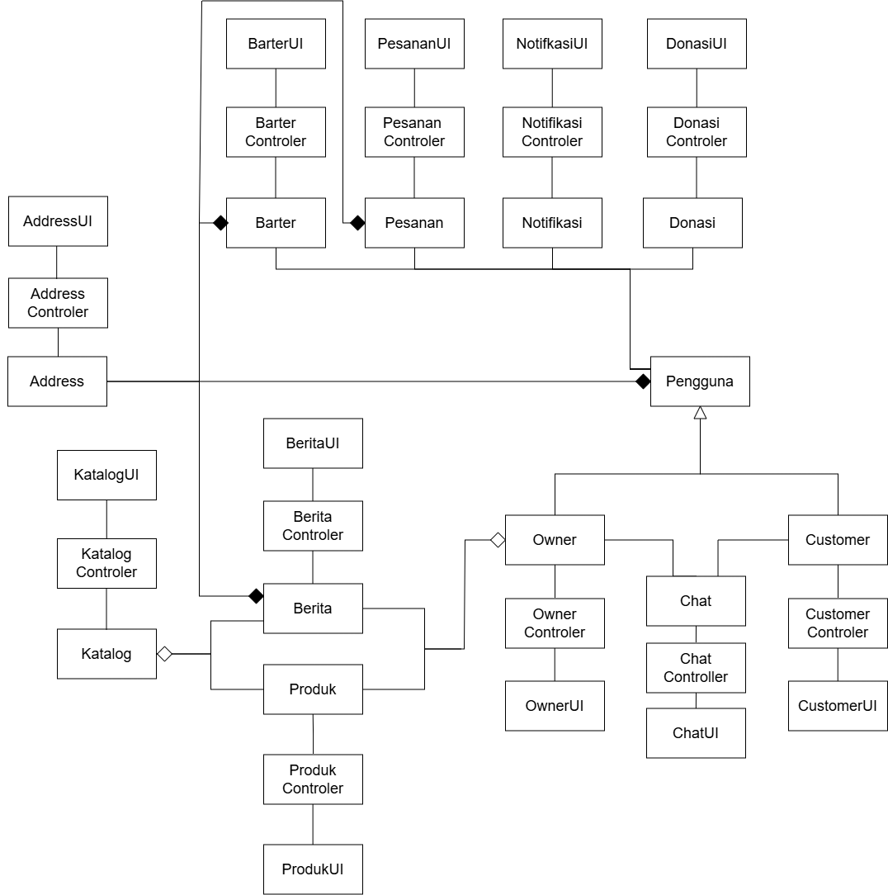

<h1>
IF2150 REKAYASA PERANGKAT LUNAK
 
TUGAS 5
 
DESKRIPSI PERANCANGAN PERANGKAT LUNAK (DPPL)
</h1>
 

## *FAJAR TECH*

### Untuk: *Tigress / Agatha*

Dipersiapkan oleh:

| Informasi | Keterangan |
| --- | --- |
| Kelas | K-3 |
| Kelompok | 10 |

| NIM | Nama |
| --- | --- |
| *13525054* | *Raffi Fauzi Hermawan* |
| *13525030* | *Rionaldo Casey Pandhitha* |
| *13525129* | *Andro Irsa Syafiq* |
| *13525078* | *Muhammad Faiz Ramadhan* |
| *13525006* | *Muhammad Rafiandhi Suryadinata* |
---

## Daftar Perubahan

| Revisi | Deskripsi |
| :--- | :--- |
| *A* | *Deskripsikan perubahan yang dilakukan dari dokumen sebelumnya pada dokumen ini. Jika tidak terdapat perubahan, harap kosongkan tabel.* |
| *B* |  |
| *C* |  |
| ... |  |

---

 

> **Petunjuk pengerjaan:** *[Silahkan hapus bagian ini setelah selesai mengerjakan]*
>
> Dokumen ini melanjutkan **Spesifikasi Kebutuhan Perangkat Lunak (SKPL)** dan **Arsitektur Perangkat Lunak (APL)**. Gunakan nama, ID, kebutuhan, dan use case yang konsisten dengan kedua dokumen tersebut. Contoh pola ID baru di bawah dapat disesuaikan dengan kesepakatan kelompok, ID yang sudah ada tetap dipertahankan.

 

---

# BAB 1: Pendahuluan

## 1.1 Tujuan Penulisan Dokumen
Dokumen Deskripsi Perancangan Perangkat Lunak (DPPL) ini disusun untuk menjabarkan perancangan detail dari perangkat lunak Fajar Tech, meliputi realisasi use case dalam bentuk diagram sekvens, perancangan kelas dengan stereotipe dan tipe data yang spesifik, serta matriks kerunutan. Dokumen ini ditujukan bagi tim pengembang (developer) sebagai panduan teknis (blue-print) pada tahap implementasi kode (coding), serta bagi penguji (tester) untuk menyusun skenario pengujian berbasis desain.

## 1.2 Lingkup Masalah
Fajar Tech adalah platform berbasis web untuk memantau dan mengelola infrastruktur air serta energi surya komunal di tingkat komunitas, yang mencakup pemantauan ketersediaan air tangki dan status daya surya secara real-time, pelaporan gangguan beserta penanganannya, analitik pemakaian komunal, hingga perhitungan iuran warga dan rekapitulasi laporan, guna mewujudkan pengelolaan infrastruktur air dan energi yang lebih terukur, transparan, dan berkelanjutan yang berkesusaian dengan tujuan SDG 6 dan SDG 7.

## 1.3 Definisi, Istilah, dan Singkatan

Tabel 1.3. Definisi Istilah dan Singkatan

| Singkatan, Akronim, atau Istilah | Penjelasan |
| :--- | :--- |
| *P/L* | *Singkatan dari Perangkat Lunak, yaitu aplikasi yang memberikan perintah kepada komputer untuk menjalankan tugas tertentu.* |
| *DPPL* | *Singkatan dari Spesifikasi Kebutuhan Perangkat Lunak, yaitu dokumen yang merangkum kriteria-kriteria yang diperlukan untuk membangun aplikasi menjalankan tugasnya.* |
| *UC* | *Singkatan dari Use Case.* |

## 1.4 Aturan Penomoran

Tabel 1.4. Aturan Penomoran

| Hal/Bagian | Penomoran | Keterangan |
| :--- | :--- | :--- |
| *Uce Case* | *UCXX* | |
| *Kelas* | *CXX* | |

## 1.5 Referensi
1. Dokumen Milestone 1 Kelompok K03-G10.
2. Dokumen Milestone 2 Kelompok K03-G10.
3. Dokumen Milestone 3 Kelompok K03-G10.
4. Dokumen Milestone 4 Kelompok K03-G10.
4. Dokumen Milestone 5 Kelompok K03-G10.
4. Dokumen Milestone 6 Kelompok K03-G10.

## 1.6 Deskripsi Umum Dokumen (Ikhtisar)
Dokumen ini diawali dengan pendahuluan dan perancangan arsitektur yang diturunkan dari APL. Selanjutnya, Bab 3 menjabarkan realisasi setiap use case melalui identifikasi kelas perancangan, diagram sekvens, dan diagram kelas detail. Bab 4 menyajikan diagram kelas keseluruhan sistem, dan Bab 5 memetakan matriks kerunutan untuk menjamin ketertelusuran dari kelas perancangan kembali ke use case yang direalisasikannya.

 

---

# BAB 2: Perancangan Arsitektur

## 2.1 Rancangan Lingkungan Implementasi

- **Operating system:** server Linux (Ubuntu 22.04 LTS) pada layanan cloud hosting/VPS; klien cross-platform (Windows, Linux, macOS, Android, iOS) melalui browser; perangkat lapangan menjalankan firmware pada mikrokontroler IoT.
- **DBMS:** PostgreSQL (layanan terkelola Supabase) sebagai basis data terpusat.
- **Development tools:** Visual Studio Code, Git dan GitHub, draw.io/StarUML, Mermaid Live Editor.
- **Filing system:** Git pada repository GitHub kelompok untuk versioning kode sumber, dokumen, dan aset diagram.
- **Bahasa pemrograman:** TypeScript/JavaScript dengan Next.js (presentation dan application services) serta Node.js (server); C/C++ untuk firmware SensorAdapter.

## 2.2 Style/Pattern Arsitektur Acuan

Fajar Tech menggunakan **Layered Architecture** empat lapisan sebagai satu-satunya style arsitektur acuan; basis data bersama dan pemisahan view–controller–model ala MVC terwujud di dalam lapisan-lapisan tersebut, sehingga keseluruhan sistem dijelaskan dengan satu gaya yang konsisten. Presentation layer berisi user interfacer (DashboardWargaView, DashboardTeknisiView, DashboardPengurusView, LaporanGangguanView, AuthView) dan antarmuka mesin TelemetriAPI; application services layer berisi controller (MonitoringController, LaporanController, PemeliharaanController, IuranController, AkunController) sebagai titik pemeriksaan kewenangan terpusat (KNF01, KNF02); domain services layer berisi modul pemegang kelas dan aturan bisnis SKPL (ModulMonitoring, ModulLaporan, ModulPemeliharaan, ModulIuran, ModulAkun, ModulNotifikasi) dengan gaya kendali didelegasikan; technical services layer berisi RepositoriData (PostgreSQL), NotifikasiGateway, serta SensorAdapter di perangkat lapangan yang menyangga kiriman data saat koneksi terputus (KNF03). Aturan antarlapisan bersifat top-to-bottom.

Pemilihan ini didasarkan pada karakteristik perangkat lunak: empat peran dengan dasbor berbeda membuat view per peran tidak menyentuh logika domain; alur bisnis (pemantauan, laporan dan pemeliharaan, iuran, akun) masing-masing diwadahi satu controller sehingga UC01–UC14 tertelusur jelas; dan aturan bisnis (KF02, KF06, KF12, KF19, KF25–KF28, KF33) terpusat di domain. Atribut mutu dominan adalah keandalan (KNF05 ≤ 3 detik; KNF06 99%) dan kemampuan pemeliharaan (perubahan tarif hanya menyentuh satu modul), sedangkan kinerja tingkat sedang (KNF11 ≤ 2 detik; KNF12 ≤ 5 detik) membuat latensi berlapis dapat diterima. MVC hanya menerangkan lapisan antarmuka, pipe and filter tidak cocok untuk sistem interaktif, dan microservices berlebihan untuk tim lima orang; repository dan client-server terwujud di dalam lapisan.

<i>Gambar 1. Arsitektur Layered</i>

## 2.3 Identifikasi Komponen / Modul / Subsistem

Komponen view, controller, dan technical services pada tabel di bawah diambil dari BAB 1 dokumen APL; baris model diambil langsung dari Tabel 2.1 dokumen APL.

Tabel 2.3. Identifikasi Komponen/Modul/Subsistem

| Nama Komponen/Modul/Subsistem | Jenis | Penjelasan |
| :--- | :--- | :--- |
| *[Nama komponen/modul/subsistem]* | *[Jenis]* | *[Tanggung jawab komponen]* |
| *[Nama komponen/modul/subsistem]* | *[Jenis]* | *[Tanggung jawab komponen]* |
| *...* | *...* | *...* |

## 2.4 Model Arsitektur Perangkat Lunak

Gunakan hasil **BAB 3 Model Arsitektur Perangkat Lunak pada dokumen APL**. 

### 2.4.1 View [Nama View]

Tuliskan secara singkat model arsitektur yang dipilih dan alasan model tersebut cocok untuk aplikasi.

<i>Gambar 2. Contoh Logical View pada P/L E-Commerce</i>

### 2.4.X View [Nama View]
*[Lakukan hal yang sama dengan bagian sebelumnya]*

 

---

# BAB 3: Realisasi Use Case

## 3.1 Use Case [Nama Use Case 1]

**ID Use Case:** *[UC01 sesuai SKPL]*  
**Nama Use Case:** *[Nama use case sesuai SKPL]*

### 3.1.1 Identifikasi Kelas

Identifikasi kelas yang terkait dengan use case tersebut. Kelas di tahap perancangan dapat berbeda dengan dengan kelas di tahap analisis. Dapat menggunakan tabel di bawah:

Tabel 3.1. Identifikasi Kelas Use Case [UC01]

| No | Nama Kelas Perancangan | Nama Kelas Analisis Terkait |
|:--- | :--- | :--- |
| 1 | *[Nama kelas perancangan]* | *[Nama kelas analisis pada SKPL]* |
| 2 | *[Nama kelas perancangan]* | *[Nama kelas analisis pada SKPL]* |
| ... | *...* | *...* |

### 3.1.2 Sequence Diagram

Buat *sequence diagram* untuk **setiap skenario use case**, mencakup skenario normal dan alternatif pada subbab 4.4 SKPL. Diagram melibatkan kelas-kelas yang telah diidentifikasi pada SKPL. 

- **Skenario Normal**

<i>Gambar X. Sequence Diagram [UC01]</i>

- **Skenario Alternatif [Nomor]: [Nama Skenario]**

<i>Gambar X. Sequence Diagram [UC01] - [Nama skenario alternatif]</i>

### 3.1.3 Diagram Kelas

Buatlah diagram kelas untuk use case ini yang terdiri atas kelas-kelas dari 3.1.1. **Setiap kelas pada diagram wajib menampilkan atribut dan metode/operasi langsung di dalam kotak kelasnya**, sehingga tidak perlu membuat tabel daftar atribut dan metode per kelas pada subbab ini. Daftar lengkap atribut dan metode seluruh kelas disajikan pada Tabel 4.1 (Bab 4).

<i>Gambar X. Diagram Kelas [Nama Uce Case]</i>

Pada diagram, pastikan:
- Atribut dituliskan beserta visibilitas dan tipe datanya, misalnya `- email: String`.
- Operasi dituliskan beserta visibilitas, parameter, dan tipe kembaliannya, misalnya `+ login(email: String, password: String): Boolean`.
- Relasi antarkelas (asosiasi, agregasi, komposisi, generalisasi, dan dependensi) digambarkan lengkap dengan multiplisitas.
- Semua operasi yang dipanggil pada sequence diagram 3.1.2 (skenario normal dan alternatif) ada pada kelas yang bersangkutan.
- Kelas yang sama dengan kelas di use case lain memakai nama, atribut, dan metode yang konsisten.

## 3.2 Use Case XX

Silahkan lanjutkan untuk  *use case* berikutnya dengan content yang sama dengan 3.1

 

---

# BAB 4: Diagram Kelas Keseluruhan

## 4.1 Diagram Kelas

**Bagian ini diisi dengan diagram kelas keseluruhan.**

<i>Gambar 4.1. Diagram Kelas Perancangan Keseluruhan [Nama P/L]</i>

Tabel 4.1. Daftar Kelas Perancangan Keseluruhan

| ID Kelas | Nama Kelas | Atribut | Metode/Operasi |
| :--- | :--- | :--- | :--- |
| *[C01]* | *[Nama kelas]* | *[Daftar atribut]* | *[Daftar metode/operasi]* |
| *[C02]* | *[Nama kelas]* | *[Daftar atribut]* | *[Daftar metode/operasi]* |
| *[C03]* | *[Nama kelas]* | *[Daftar atribut]* | *[Daftar metode/operasi]* |
| *...* | *...* | *...* | *...* |

 

---

# BAB 5: Matriks Kerunutan

Petakan kelas perancangan dengan use case yang terkait. Gunakan **BAB 6 Traceability pada dokumen SKPL** sebagai acuan keterkaitan kelas analisis dan use case, lalu sesuaikan dengan realisasi use case dan kelas perancangan pada BAB 3–BAB 5 DPPL.

Tabel 7.1. Matriks Kerunutan Kelas terhadap Use Case

| Kelas | Use Case Terkait |
| :--- | :--- |
| *[ID kelas - Nama kelas]* | *[ID UC - Nama use case]* |
| *[ID kelas - Nama kelas]* | *[ID UC - Nama use case]* |
| *...* | *...* |
