<h1>
IF2150 REKAYASA PERANGKAT LUNAK
<br>
TUGAS 5
<br>
DESKRIPSI PERANCANGAN PERANGKAT LUNAK (DPPL)
</h1>
<br>

## *FAJAR TECH*

### Untuk: *Tigress / Agatha*

Dipersiapkan oleh:

| Informasi | Keterangan |
| --- | --- |
| Kelas | K-3 |
| Kelompok | 10 |

| NIM | Nama |
| --- | --- |
| *13525054* | *Raffi Fauzi Hermawan* |
| *13525030* | *Rionaldo Casey Pandhitha* |
| *13525129* | *Andro Irsa Syafiq* |
| *13525078* | *Muhammad Faiz Ramadhan* |
| *13525006* | *Muhammad Rafiandhi Suryadinata* |
---

## Daftar Perubahan

| Revisi | Deskripsi |
| :--- | :--- |
| A | 28 Oktober 2026: rekonsiliasi BAB5 UC03/04/07 terhadap 50 kelas terbaru; penguatan sesi, isolasi pemilik, transisi dan transaksi tanpa menghapus operasi rekan. |
| B | BAB6: 20 layar ekspor final (17 desktop, 3 mobile), tabel objek, navigasi, otorisasi dan state tekstual UC01–UC14. |
| C | Audit integrasi BAB5/BAB6 dan inventaris bukti pada M8_HANDOFF_QA.md; BAB7 dipertahankan identik dengan origin/main sesuai override scope. |

---

<br>

> **Petunjuk pengerjaan:** *[Silahkan hapus bagian ini setelah selesai mengerjakan]*
>
> Dokumen ini melanjutkan **Spesifikasi Kebutuhan Perangkat Lunak (SKPL)** dan **Arsitektur Perangkat Lunak (APL)**. Gunakan nama, ID, kebutuhan, dan use case yang konsisten dengan kedua dokumen tersebut. Contoh pola ID baru di bawah dapat disesuaikan dengan kesepakatan kelompok, ID yang sudah ada tetap dipertahankan.

<br>

---


# BAB 1: Pendahuluan

## 1.1 Tujuan Penulisan Dokumen
Dokumen Deskripsi Perancangan Perangkat Lunak (DPPL) bagian kedua ini menjabarkan perancangan rinci Fajar Tech sebagai lanjutan dokumen DPPL sebelumnya, meliputi perancangan rinci kelas (tabel operasi, tabel atribut, pseudocode/algoritma, dan query SQL) serta perancangan antarmuka berupa mockup layar dan tabel spesifikasi objek. Dokumen ini digunakan oleh tim pengembang sebagai cetak biru tahap implementasi kode, oleh penguji sebagai dasar penyusunan skenario pengujian berbasis desain, dan oleh asisten mata kuliah sebagai bahan penilaian serta asistensi.


## 1.2 Lingkup Masalah
Fajar Tech adalah platform berbasis web untuk memantau dan mengelola infrastruktur air serta energi surya komunal di tingkat komunitas, yang mencakup pemantauan ketersediaan air tangki dan status daya surya secara real-time, pelaporan gangguan beserta penanganannya, analitik pemakaian komunal, hingga perhitungan iuran warga dan rekapitulasi laporan, guna mewujudkan pengelolaan infrastruktur air dan energi yang lebih terukur, transparan, dan berkelanjutan yang berkesusaian dengan tujuan SDG 6 dan SDG 7.

## 1.3 Definisi, Istilah, dan Singkatan

Tabel 1.3. Definisi Istilah dan Singkatan

| Singkatan, Akronim, atau Istilah | Penjelasan |
| :--- | :--- |
| *P/L* | *Singkatan dari Perangkat Lunak, yaitu aplikasi yang memberikan perintah kepada komputer untuk menjalankan tugas tertentu.* |
| *DPPL* | *Singkatan dari Spesifikasi Kebutuhan Perangkat Lunak, yaitu dokumen yang merangkum kriteria-kriteria yang diperlukan untuk membangun aplikasi menjalankan tugasnya.* |
| *SKPL* | *Spesifikasi Kebutuhan Perangkat Lunak, dokumen Milestone 5 yang menjadi acuan kebutuhan sistem.* |
| *APL* | *Arsitektur Perangkat Lunak, dokumen Milestone 6 yang menjadi acuan perancangan arsitektur sistem.* |
| *UC* | *Singkatan dari Use Case.* |
| *C* | *Singkatan dari Kelas.* |
| *KF* | *Kebutuhan Fungsional, fitur atau fungsi spesifik yang harus disediakan oleh perangkat lunak.* |
| *KNF* | *Kebutuhan Non-Fungsional, batasan atau atribut mutu (seperti kinerja dan keandalan) yang harus dipenuhi sistem.* |

## 1.4 Aturan Penomoran

Tabel 1.4. Aturan Penomoran

| Hal/Bagian | Penomoran | Keterangan |
| :--- | :--- | :--- |
| *Uce Case* | *UCXX* | XX = angka 01–14 sesuai dengan dokumen SKPL|
| *Kelas* | *CXX* | XX = angka 01–28 sesuai dengan dokumen SKPL|
| *Kebutuhan Fungsional* | *KFXX* | XX = angka 01–51 sesuai dengan dokumen SKPL|
| *Kebutuhan Non-Fungsional* | *KNFXX* | XX = angka 01–15 sesuai dengan dokumen SKPL |
| *ID Algoritma* | *Algo-XX* | XX = angka 01–42 sesuai dengan dokumen DPPL2 |
| *Query* | *Q-XXX* | *XXX ururtan query pada setiap algoritma* |
| *Antarmuka* | *I-XX* | *XX = 1-xx sesuai banyaknya mockup pada dokumen ini.* |

## 1.5 Referensi
1. Dokumen Milestone 5 Kelompok K03-G10.
2. Dokumen Milestone 6 Kelompok K03-G10.
3. Dokumen Milestone 7 Kelompok K03-G10.

## 1.6 Deskripsi Umum Dokumen (Ikhtisar)
Dokumen ini diawali pendahuluan dan perancangan arsitektur yang diturunkan dari dokumen APL dan DPPL sebelumnya (BAB 1–2), dilanjutkan realisasi setiap use case berupa identifikasi kelas, sequence diagram, dan diagram kelas bertipe data (BAB 3), diagram kelas perancangan keseluruhan beserta daftar kelasnya (BAB 4), perancangan rinci kelas berupa tabel operasi, tabel atribut, pseudocode/algoritma, dan query SQL (BAB 5), perancangan antarmuka berupa mockup layar dan tabel spesifikasi objek (BAB 6), serta matriks kerunutan yang memetakan setiap kelas perancangan ke use case yang direalisasikannya (BAB 7).


<br>

---

# BAB 2: Perancangan Arsitektur

## 2.1 Rancangan Lingkungan Implementasi

- **Operating system:** server Linux (Ubuntu 22.04 LTS) pada layanan cloud hosting/VPS; klien cross-platform (Windows, Linux, macOS, Android, iOS) melalui browser; perangkat lapangan menjalankan firmware pada mikrokontroler IoT.
- **DBMS:** PostgreSQL (layanan terkelola Supabase) sebagai basis data terpusat.
- **Development tools:** Visual Studio Code, Git dan GitHub, draw.io/StarUML, Mermaid Live Editor.
- **Filing system:** Git pada repository GitHub kelompok untuk versioning kode sumber, dokumen, dan aset diagram.
- **Bahasa pemrograman:** TypeScript/JavaScript dengan Next.js (presentation dan application services) serta Node.js (server); C/C++ untuk firmware SensorAdapter.


## 2.2 Style/Pattern Arsitektur Acuan

Fajar Tech menggunakan **Layered Architecture** empat lapisan sebagai satu-satunya style arsitektur acuan; basis data bersama dan pemisahan view–controller–model ala MVC terwujud di dalam lapisan-lapisan tersebut, sehingga keseluruhan sistem dijelaskan dengan satu gaya yang konsisten. Presentation layer berisi user interfacer (DashboardWargaView, DashboardTeknisiView, DashboardPengurusView, LaporanGangguanView, AuthView) dan antarmuka mesin TelemetriAPI; application services layer berisi controller (MonitoringController, LaporanController, PemeliharaanController, IuranController, AkunController) sebagai titik pemeriksaan kewenangan terpusat (KNF01, KNF02); domain services layer berisi modul pemegang kelas dan aturan bisnis SKPL (ModulMonitoring, ModulLaporan, ModulPemeliharaan, ModulIuran, ModulAkun, ModulNotifikasi) dengan gaya kendali didelegasikan; technical services layer berisi RepositoriData (PostgreSQL), NotifikasiGateway, serta SensorAdapter di perangkat lapangan yang menyangga kiriman data saat koneksi terputus (KNF03). Aturan antarlapisan bersifat top-to-bottom.

Pemilihan ini didasarkan pada karakteristik perangkat lunak: empat peran dengan dasbor berbeda membuat view per peran tidak menyentuh logika domain; alur bisnis (pemantauan, laporan dan pemeliharaan, iuran, akun) masing-masing diwadahi satu controller sehingga UC01–UC14 tertelusur jelas; dan aturan bisnis (KF02, KF06, KF12, KF19, KF25–KF28, KF33) terpusat di domain. Atribut mutu dominan adalah keandalan (KNF05 ≤ 3 detik; KNF06 99%) dan kemampuan pemeliharaan (perubahan tarif hanya menyentuh satu modul), sedangkan kinerja tingkat sedang (KNF11 ≤ 2 detik; KNF12 ≤ 5 detik) membuat latensi berlapis dapat diterima. MVC hanya menerangkan lapisan antarmuka, pipe and filter tidak cocok untuk sistem interaktif, dan microservices berlebihan untuk tim lima orang; repository dan client-server terwujud di dalam lapisan.

<p align="center">
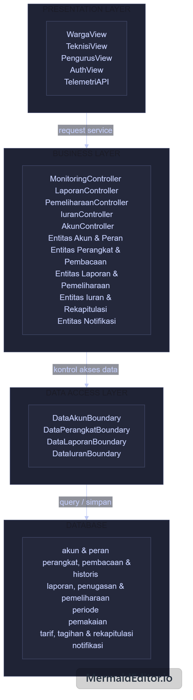
</p>
<p align="center">
<i>Gambar 1. Arsitektur Layered</i>
</p>

## 2.3 Identifikasi Komponen / Modul / Subsistem

Komponen view, controller, dan technical services pada tabel di bawah diambil dari BAB 1 dokumen APL; baris model diambil langsung dari Tabel 2.1 dokumen APL.

Tabel 2.3. Identifikasi Komponen/Modul/Subsistem

| Nama Komponen/Modul/Subsistem | Jenis | Penjelasan |
| :--- | :--- | :--- |
| *WargaView* | *PRESENTATION LAYER* | *Menampilkan dashboard air dan energi, tagihan final, serta fitur laporan gangguan bagi Warga dan meneruskan aksi pengguna ke controller terkait (UC01–UC04).* |
| *TeknisiView* | *PRESENTATION LAYER* | *Menampilkan peringatan daya kritis, riwayat kinerja panel surya, pembaruan status gangguan, dan pencatatan pemeliharaan bagi Teknisi (UC05–UC08).* |
| *PengurusView* | *PRESENTATION LAYER* | *Menampilkan analitik pemakaian, pengelolaan iuran, rekapitulasi, dan persetujuan akun bagi Pengurus (UC09–UC11, UC14).* |
| *AuthView* | *PRESENTATION LAYER* | *Menyediakan antarmuka registrasi dan login serta meneruskan data autentikasi ke AkunController (UC12–UC13).* |
| *TelemetriAPI* | *PRESENTATION LAYER* | *Menerima data dari perangkat pengukuran lapangan dan meneruskannya ke MonitoringController untuk mendukung pemantauan serta peringatan (UC01, UC05, UC06).* |
| *MonitoringController* | *BUSINESS LAYER* | *Mengoordinasikan pemantauan air dan energi, pengolahan telemetri, riwayat kinerja panel surya, dan evaluasi kondisi daya kritis dengan ModulMonitoring dan ModulNotifikasi (UC01, UC05, UC06).* |
| *LaporanController* | *BUSINESS LAYER* | *Mengoordinasikan pembuatan laporan gangguan, penelusuran riwayat/status, dan pembaruan status penanganan dengan ModulLaporan (UC03, UC04, UC07).* |
| *PemeliharaanController* | *BUSINESS LAYER* | *Mengoordinasikan pencatatan kegiatan pemeliharaan atau perbaikan perangkat dengan ModulPemeliharaan (UC08).* |
| *IuranController* | *BUSINESS LAYER* | *Mengoordinasikan akses tagihan final, analitik pemakaian, perhitungan dan finalisasi iuran, serta pembuatan rekapitulasi dengan ModulIuran (UC02, UC09–UC11).* |
| *AkunController* | *BUSINESS LAYER* | *Mengoordinasikan registrasi, login, pemeriksaan status akun, serta persetujuan atau penolakan akun dengan ModulAkun (UC12–UC14).* |
| *Validasi* | *BUSINESS LAYER* | *Menyediakan pemeriksaan input yang dapat digunakan ulang, seperti kelengkapan field, format, tipe data, dan rentang dasar. Aturan bisnis tetap ditangani controller dan modul domain terkait.* |
| *ModulAkun* | *BUSINESS LAYER* | *Mengelompokkan C01 Akun, C02 Warga, C03 Teknisi, C04 Pengurus, C05 CalonPengguna, dan C06 StatusAkun untuk aturan akun, peran, autentikasi, dan persetujuan akun (UC12–UC14 serta penggunaan akun pada use case terkait).* |
| *ModulMonitoring* | *BUSINESS LAYER* | *Mengelompokkan C07 Perangkat, C08 TangkiAir, C09 Baterai, C10 PanelSurya, C11 PembacaanSensor, C12 DataHistorisKinerja, dan C13 RentangWaktu untuk pemantauan perangkat dan data historis (UC01, UC05, UC06).* |
| *ModulLaporan* | *BUSINESS LAYER* | *Mengelompokkan C20 LaporanGangguan, C21 StatusLaporan, C22 RiwayatStatusLaporan, dan C24 PenugasanLaporan untuk pelaporan serta penanganan gangguan (UC03, UC04, UC07).* |
| *ModulPemeliharaan* | *BUSINESS LAYER* | *Mewadahi C27 CatatanPemeliharaan untuk pencatatan tindakan, waktu, hasil, dan perangkat yang dipelihara (UC08).* |
| *ModulIuran* | *BUSINESS LAYER* | *Mengelompokkan C14 Periode, C15 DataPemakaian, C16 AturanTarif, C17 Tagihan, C18 StatusTagihan, C19 KalkulatorIuran, dan C28 Rekapitulasi untuk pemakaian, kalkulasi/finalisasi iuran, dan rekapitulasi (UC02, UC09–UC11).* |
| *ModulNotifikasi* | *BUSINESS LAYER* | *Mengelompokkan C23 PenugasanPerangkat, C25 Notifikasi, dan C26 PeringatanDayaKritis untuk menentukan penerima serta isi peringatan daya kritis (UC05).* |
| *DataAkunBoundary* | *DATA ACCESS LAYER* | *Menjadi batas akses data akun, peran, status persetujuan, dan kredensial antara Business Layer dan Database.* |
| *DataPerangkatBoundary* | *DATA ACCESS LAYER* | *Menjadi batas akses data perangkat, pembacaan sensor, data historis, penugasan perangkat, notifikasi terkait perangkat, dan catatan pemeliharaan.* |
| *DataLaporanBoundary* | *DATA ACCESS LAYER* | *Menjadi batas akses data laporan gangguan, riwayat status, dan penugasan laporan.* |
| *DataIuranBoundary* | *DATA ACCESS LAYER* | *Menjadi batas akses data periode, pemakaian, aturan tarif, tagihan, dan rekapitulasi.* |
| *Database* | *DATABASE* | *Menyimpan data persisten Fajar Tech secara terpusat menggunakan PostgreSQL atau MySQL sesuai lingkungan operasi pada SKPL.* |

## 2.4 Model Arsitektur Perangkat Lunak

Architectural View adalah cara mendeskripsikan arsitektur sistem dari sudut pandang tertentu. Pada bab ini, model arsitektur Fajar Tech digambarkan menggunakan **Logical View** sebagai view utama dan **Physical View** sebagai view pelengkap. Pemilihan ini disesuaikan dengan style **Layered Architecture** serta komponen pada Tabel 2.3.

### 2.4.1 Logical View

Logical View dipilih karena mampu memperlihatkan pembagian tanggung jawab setiap lapisan dan hubungan fungsional antarkomponen. View ini juga paling mudah dicek konsistensinya dengan Tabel 2.1 dan style Layered Architecture pada BAB 1.

<p align="center">

</p>
<p align="center">
<i>Gambar 3.1. Logical View Fajar Tech</i>
</p>

Gambar 3.1 memperlihatkan empat lapisan utama, yaitu **Presentation Layer**, **Business Layer**, **Data Access Layer**, dan **Database**. Aktor serta sistem eksternal digambarkan dengan garis putus-putus di luar sistem, yaitu Warga, Teknisi, Pengurus, Calon Pengguna, dan Perangkat IoT.

#### Presentation Layer

- `WargaView`
- `TeknisiView`
- `PengurusView`
- `AuthView`
- `TelemetriAPI`

#### Business Layer

Controller:

- `MonitoringController`
- `LaporanController`
- `PemeliharaanController`
- `IuranController`
- `AkunController`

Komponen pendukung:

- `Validasi`

Modul domain:

- `ModulAkun`
- `ModulMonitoring`
- `ModulLaporan`
- `ModulPemeliharaan`
- `ModulIuran`
- `ModulNotifikasi`

#### Data Access Layer

- `DataAkunBoundary`
- `DataPerangkatBoundary`
- `DataLaporanBoundary`
- `DataIuranBoundary`

#### Database

- `Database`

#### Hubungan Antarkomponen

Aktor eksternal ke Presentation Layer:

- Warga → `WargaView`
- Teknisi → `TeknisiView`
- Pengurus → `PengurusView`
- Calon Pengguna → `AuthView`
- Perangkat IoT → `TelemetriAPI` : “kirim data metrik operasional”

Presentation Layer ke Business Layer:

- `WargaView` → `MonitoringController` : “lihat dashboard air/energi (UC01)”
- `WargaView` → `IuranController` : “lihat tagihan final (UC02)”
- `WargaView` → `LaporanController` : “buat/lihat laporan gangguan (UC03–UC04)”
- `TeknisiView` → `MonitoringController` : “lihat peringatan daya kritis & riwayat panel surya (UC05–UC06)”
- `TeknisiView` → `LaporanController` : “perbarui status gangguan (UC07)”
- `TeknisiView` → `PemeliharaanController` : “catat pemeliharaan (UC08)”
- `PengurusView` → `IuranController` : “analitik pemakaian, kelola iuran, rekapitulasi (UC09–UC11)”
- `PengurusView` → `AkunController` : “persetujuan akun (UC14)”
- `AuthView` → `AkunController` : “registrasi/login (UC12–UC13)”
- `TelemetriAPI` → `MonitoringController` : “teruskan data telemetri (UC01, UC05, UC06)”

Controller ke `Validasi`:

- `MonitoringController`, `LaporanController`, `PemeliharaanController`, `IuranController`, `AkunController` → `Validasi` : “validasi input”

Controller ke modul domain:

- `MonitoringController` → `ModulMonitoring`, `ModulNotifikasi`
- `LaporanController` → `ModulLaporan`
- `PemeliharaanController` → `ModulPemeliharaan`
- `IuranController` → `ModulIuran`
- `AkunController` → `ModulAkun`

Modul domain ke Data Access Layer:

- `ModulAkun` → `DataAkunBoundary` : “akses data akun, peran, kredensial”
- `ModulMonitoring` → `DataPerangkatBoundary` : “akses perangkat, sensor, historis”
- `ModulLaporan` → `DataLaporanBoundary` : “akses laporan, status, penugasan”
- `ModulPemeliharaan` → `DataPerangkatBoundary` : “akses catatan pemeliharaan”
- `ModulIuran` → `DataIuranBoundary` : “akses periode, pemakaian, tarif, tagihan, rekap”
- `ModulNotifikasi` → `DataPerangkatBoundary` : “akses penugasan & notifikasi perangkat”

Data Access Layer ke Database:

- `DataAkunBoundary` → `Database` : “query/CRUD akun”
- `DataPerangkatBoundary` → `Database` : “query/CRUD perangkat”
- `DataLaporanBoundary` → `Database` : “query/CRUD laporan”
- `DataIuranBoundary` → `Database` : “query/CRUD iuran”

Aturan ketergantungan antarlapisan mengikuti pola top-to-bottom. Lapisan atas dapat menggunakan layanan lapisan di bawahnya, tetapi lapisan bawah tidak menggunakan layanan dari lapisan di atasnya.

Gambar 3.1 berbentuk *block diagram*: seluruh komponen pada Tabel 2.1 digambarkan dan dikelompokkan sesuai pola yang digunakan, ditambah komponen pendukung dan basis data. Sistem di luar P/L digambarkan dengan garis putus-putus, dan setiap garis diberi label agar hubungan antarkomponen dapat dipahami.

### 2.4.2 Physical View

Physical View dipilih untuk menunjukkan lingkungan operasi sesuai Tabel 1.1, yaitu web browser, server Node.js atau PHP, DBMS PostgreSQL atau MySQL, dan perangkat keras IoT.

<p align="center">
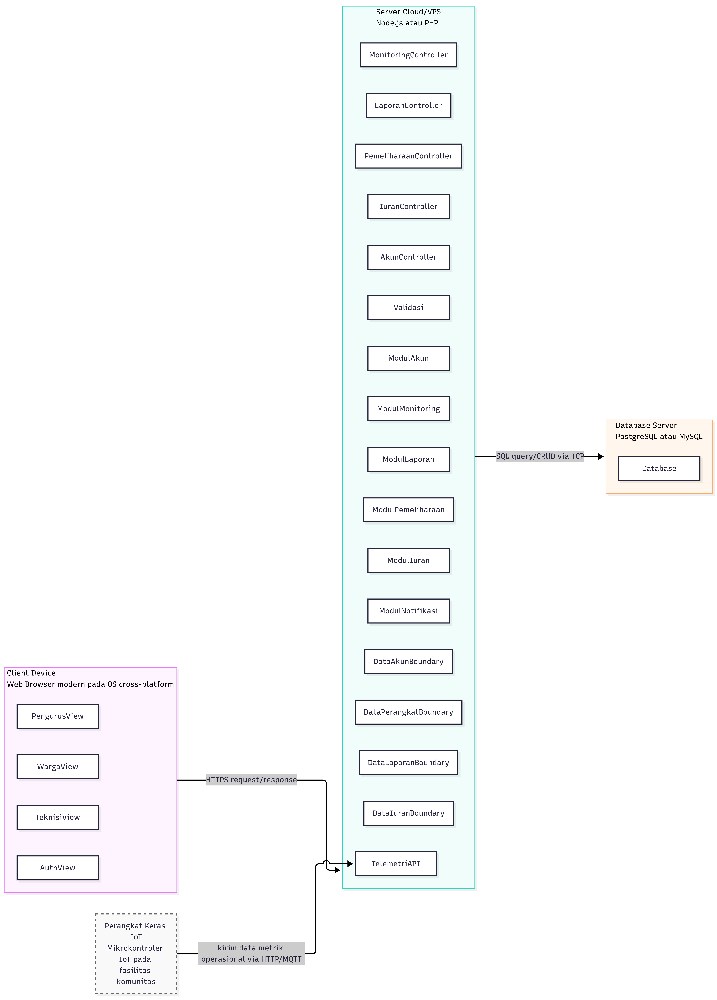
</p>
<p align="center">
<i>Gambar 3.2. Physical View Fajar Tech</i>
</p>

Gambar 3.2 memperlihatkan empat node utama.

#### Client Device

Label: “Web Browser modern pada OS cross-platform: Windows/Linux/macOS/Android/iOS”

Isi:

- `WargaView`
- `TeknisiView`
- `PengurusView`
- `AuthView`

#### Server Cloud/VPS

Label: “Node.js atau PHP”

Isi:

- `TelemetriAPI`
- `MonitoringController`
- `LaporanController`
- `PemeliharaanController`
- `IuranController`
- `AkunController`
- `Validasi`
- `ModulAkun`
- `ModulMonitoring`
- `ModulLaporan`
- `ModulPemeliharaan`
- `ModulIuran`
- `ModulNotifikasi`
- `DataAkunBoundary`
- `DataPerangkatBoundary`
- `DataLaporanBoundary`
- `DataIuranBoundary`

#### Database Server

Label: “PostgreSQL atau MySQL”

Isi:

- `Database`

#### Perangkat Keras IoT

Label: “Mikrokontroler IoT pada fasilitas komunitas”

Node ini merupakan lingkungan operasi dari Tabel 1.1, bukan komponen perangkat lunak pada Tabel 2.1.

#### Hubungan Antarnode

- Client Device → Server Cloud/VPS : “HTTPS request/response”
- Perangkat Keras IoT → `TelemetriAPI` : “kirim data metrik operasional via HTTP/MQTT”
- Server Cloud/VPS → Database Server : “SQL query/CRUD via TCP”

<br>

---


# BAB 3: Realisasi Use Case

## 3.1 Use Case Memantau Ketersediaan Air dan Energi

**ID Use Case:** *UC01*  
**Nama Use Case:** *Memantau Ketersediaan Air dan Energi*

### 3.1.1 Identifikasi Kelas

Tabel 3.1. Identifikasi Kelas Use Case Memantau Ketersediaan Air dan Energi

| No | Nama Kelas Perancangan | Nama Kelas Analisis Terkait |
|:--- | :--- | :--- |
| 1 | WargaView | — (kelas desain tambahan) |
| 2 | TelemetriAPI | — (kelas desain tambahan) |
| 3 | MonitoringController | — (kelas desain tambahan) |
| 4 | TangkiAir | C08 TangkiAir |
| 5 | Baterai | C09 Baterai |
| 6 | PanelSurya | C10 PanelSurya |
| 7 | PembacaanSensor | C11 PembacaanSensor |
| 8 | DataPerangkatBoundary | — (kelas desain tambahan) |

### 3.1.2 Sequence Diagram

- **Skenario Normal**

Warga membuka dashboard utama untuk memantau ketersediaan infrastruktur. `MonitoringController` menarik data metrik terbaru melalui `DataPerangkatBoundary`. Setelah data diperoleh, controller mendelegasikan pengecekan ke masing-masing entitas domain (`TangkiAir`, `Baterai`, `PanelSurya`) untuk dievaluasi. Hasil status dan kapasitas kemudian dirangkai dan ditampilkan kepada warga.

<p align="center">

</p>
<p align="center">
<i>Gambar 3.1.N. Sequence Diagram UC01 — Skenario Normal</i>
</p>

- **Skenario Alternatif 1: Data Sensor Tidak Tersedia**

`MonitoringController` berupaya menarik data metrik terbaru, namun `DataPerangkatBoundary` mengembalikan nilai `null` atau data usang akibat perangkat IoT tidak mengirimkan pembaruan. Sistem memberikan respons error dengan menampilkan pesan bahwa data terbaru belum tersedia serta mempertahankan tampilan data terakhir.

<p align="center">

</p>
<p align="center">
<i>Gambar 3.1.A1. Sequence Diagram UC01 — Data Sensor Tidak Tersedia</i>
</p>

### 3.1.3 Diagram Kelas

<p align="center">

</p>
<p align="center">
<i>Gambar 3.1.K. Diagram Kelas UC01</i>
</p>

Atribut dan operasi ditampilkan langsung pada kompartemen kelas dengan visibilitas (lingkaran hijau untuk public, kotak merah untuk private).

<br>

## 3.2 Use Case Melihat Tagihan Iuran Final

**ID Use Case:** *UC02*  
**Nama Use Case:** *Melihat Tagihan Iuran Final*

### 3.2.1 Identifikasi Kelas

Tabel 3.2. Identifikasi Kelas Use Case Melihat Tagihan Iuran Final

| No | Nama Kelas Perancangan | Nama Kelas Analisis Terkait |
|:--- | :--- | :--- |
| 1 | WargaView | — (kelas desain tambahan) |
| 2 | IuranController | — (kelas desain tambahan) |
| 3 | Tagihan | C17 Tagihan |
| 4 | Periode | C14 Periode |
| 5 | DataIuranBoundary | — (kelas desain tambahan) |

### 3.2.2 Sequence Diagram

- **Skenario Normal**

Warga memilih periode tagihan yang diinginkan. `IuranController` meminta data tagihan terkait dari `DataIuranBoundary`. Entitas `Tagihan` memvalidasi statusnya (`sudahFinal`) dan mengembalikan hasil `true`. Tagihan yang sudah sah kemudian dibongkar rinciannya dan dikembalikan ke antarmuka untuk ditampilkan kepada warga.

<p align="center">
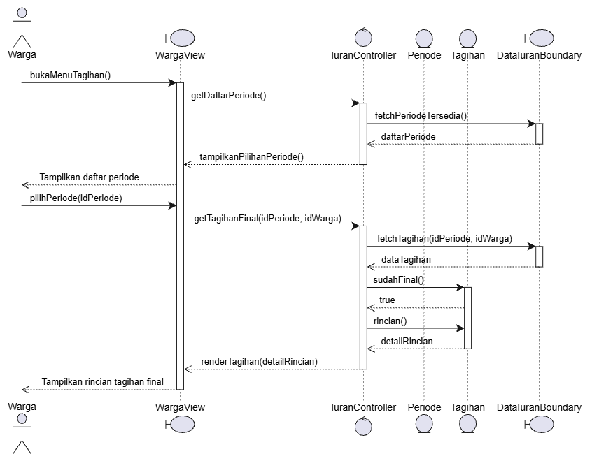
</p>
<p align="center">
<i>Gambar 3.2.N. Sequence Diagram UC02 — Skenario Normal</i>
</p>

- **Skenario Alternatif 1: Tagihan Belum Ditetapkan Final**

Ketika warga memilih periode tagihan, entitas `Tagihan` mendeteksi bahwa statusnya masih berstatus *draft* atau belum disetujui pengurus (mengembalikan `false`). Sistem memblokir rincian dan menampilkan pesan informasi bahwa tagihan final belum tersedia.

<p align="center">
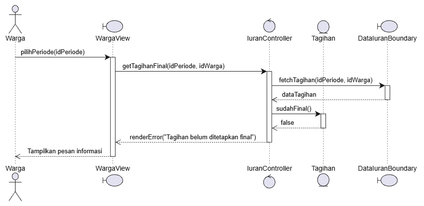
</p>
<p align="center">
<i>Gambar 3.2.A1. Sequence Diagram UC02 — Tagihan Belum Ditetapkan Final</i>
</p>

### 3.2.3 Diagram Kelas

<p align="center">
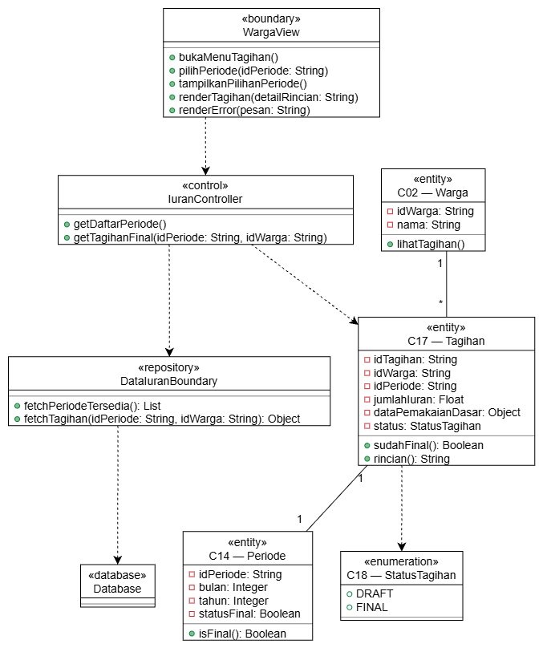
</p>
<p align="center">
<i>Gambar 3.2.K. Diagram Kelas UC02</i>
</p>

Atribut dan operasi ditampilkan langsung pada kompartemen kelas dengan visibilitas (lingkaran hijau untuk public, kotak merah untuk private).

<br>

## 3.3 Use Case Mengirim Laporan Gangguan

**ID Use Case:** *UC03*\
**Nama Use Case:** *Mengirim Laporan Gangguan*\
**Aktor:** Warga\
**Kebutuhan fungsional:** KF07, KF08, KF09, KF10.

### 3.3.1 Identifikasi Kelas

Tabel 3.3. Identifikasi Kelas Use Case UC03

| No | Nama Kelas Perancangan | Nama Kelas Analisis Terkait |
| --- | --- | --- |
| 1 | Warga | C02 Warga |
| 2 | LaporanGangguan | C20 LaporanGangguan |
| 3 | StatusLaporan | C21 StatusLaporan |
| 4 | WargaView | — (kelas desain tambahan, tidak ada padanan kelas analisis Cxx) |
| 5 | LaporanController | — (kelas desain tambahan, tidak ada padanan kelas analisis Cxx) |
| 6 | Validasi | — (kelas desain tambahan, tidak ada padanan kelas analisis Cxx) |
| 7 | ModulLaporan | — (kelas desain tambahan, tidak ada padanan kelas analisis Cxx) |
| 8 | ModulAkun | — (kelas desain tambahan, tidak ada padanan kelas analisis Cxx) |
| 9 | DataAkunBoundary | — (kelas desain tambahan, tidak ada padanan kelas analisis Cxx) |
| 10 | Database | — (kelas desain tambahan, tidak ada padanan kelas analisis Cxx) |
| 11 | DataLaporanBoundary | — (kelas desain tambahan, tidak ada padanan kelas analisis Cxx) |

Kelas View, controller, `Validasi`, fasad modul, dan data boundary diturunkan dari komponen APL M6 Tabel 2.1 dan Tabel 3.1. View menangani interaksi, controller mengoordinasikan permintaan dari sesi, fasad menjalankan layanan domain, dan data boundary membatasi akses ke `Database`. Fasad modul dan `Database` merupakan kelas perancangan tambahan; tidak diberi ID analisis Cxx baru. `ModulAkun` dan `DataAkunBoundary` digunakan sebagai dependensi akun untuk memverifikasi keanggotaan; tambahan dependensi lintas modul ini dijelaskan dalam kontrak handoff.

### 3.3.2 Sequence Diagram

- **Skenario Normal**

Data formulir mencakup jenis gangguan, deskripsi, dan foto pendukung. Identitas warga serta komunitas berasal dari sesi terautentikasi. `ModulAkun` mengambil keadaan akun terbaru; pemeriksaan keanggotaan dilakukan pada domain sebelum objek laporan dibuat. Laporan baru ditetapkan berstatus `MENUNGGU`, disimpan, lalu diikuti notifikasi keberhasilan.

<p align="center">

</p>
<p align="center">
<i>Gambar 3.3.N. Sequence Diagram UC03 — Skenario Normal</i>
</p>

[Sumber draw.io editable](./assets/diagram/rionaldo/uc03-seq-normal.drawio) · [Ekspor SVG](./assets/diagram/rionaldo/uc03-seq-normal.svg)

- **Skenario Alternatif 1: Warga Tidak Terdaftar**

Keanggotaan warga tidak memenuhi komunitas terkait. Sistem menolak pengiriman dengan pesan tidak memiliki otorisasi; objek laporan tidak dibuat dan penyimpanan tidak dipanggil.

<p align="center">

</p>
<p align="center">
<i>Gambar 3.3.A1. Sequence Diagram UC03 — Warga Tidak Terdaftar</i>
</p>

[Sumber draw.io editable](./assets/diagram/rionaldo/uc03-seq-alt1.drawio) · [Ekspor SVG](./assets/diagram/rionaldo/uc03-seq-alt1.svg)

### 3.3.3 Diagram Kelas

<p align="center">
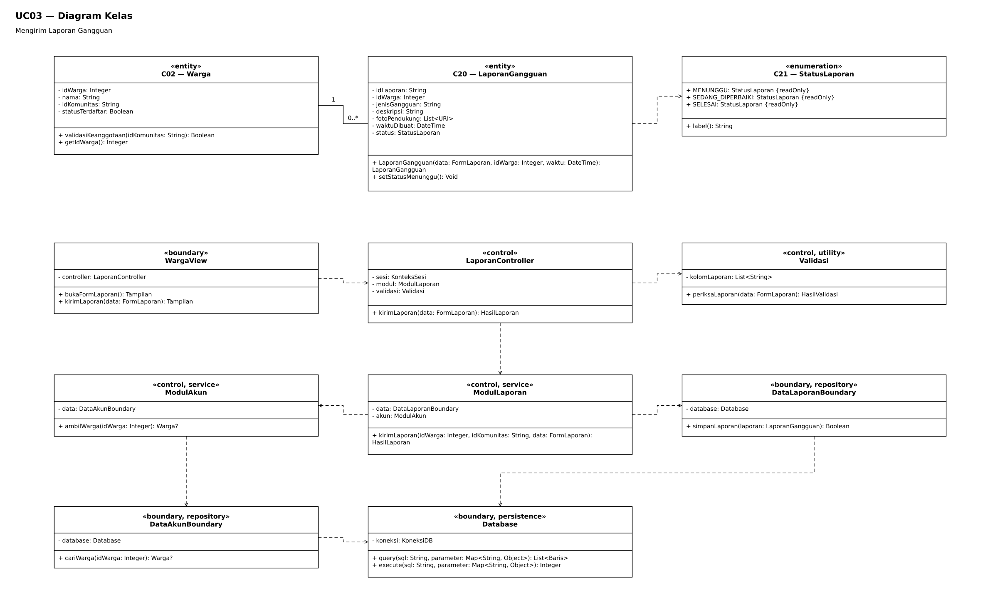
</p>
<p align="center">
<i>Gambar 3.3.K. Diagram Kelas UC03</i>
</p>

[Sumber draw.io editable](./assets/diagram/rionaldo/uc03-class.drawio) · [Ekspor SVG](./assets/diagram/rionaldo/uc03-class.svg)

Tipe `FormLaporan`, `FormPemeliharaan`, `HasilValidasi`, `HasilLaporan`, `HasilStatus`, `HasilPemeliharaan`, `DetailLaporan`, `RingkasanStatus`, dan `Tampilan` adalah record/nilai perancangan sesuai konteks operasi, bukan kelas analisis baru. Identitas pelaku berasal dari `KonteksSesi`. Definisi lengkap disertakan pada kontrak kelas pendamping.

Atribut dan operasi ditampilkan langsung pada kompartemen kelas dengan visibilitas, parameter, dan tipe data. Kelas yang digunakan lintas UC mengambil signature dari satu registri desain. Garis asosiasi memakai multiplisitas; dependensi layanan dan penggunaan enumerasi menggunakan panah putus-putus. Identitas Cxx mengikuti SKPL.

**Rujukan:** SKPL M5 §§4.4.3 / 5.2.3, §4.2, §6.1–6.2; APL M6 Tabel 2.1 dan Tabel 3.1; PDF Asistensi Akbar M7 hlm. 4–12. Nomor caption memakai identitas subbab dan skenario agar tidak berbenturan dengan gambar UC anggota lain.


<br>

## 3.4 Use Case Menelusuri Status Laporan Gangguan

**ID Use Case:** *UC04*\
**Nama Use Case:** *Menelusuri Status Laporan Gangguan*\
**Aktor:** Warga\
**Kebutuhan fungsional:** KF11, KF34.

### 3.4.1 Identifikasi Kelas

Tabel 3.4. Identifikasi Kelas Use Case UC04

| No | Nama Kelas Perancangan | Nama Kelas Analisis Terkait |
| --- | --- | --- |
| 1 | Warga | C02 Warga |
| 2 | LaporanGangguan | C20 LaporanGangguan |
| 3 | RiwayatStatusLaporan | C22 RiwayatStatusLaporan |
| 4 | WargaView | — (kelas desain tambahan, tidak ada padanan kelas analisis Cxx) |
| 5 | LaporanController | — (kelas desain tambahan, tidak ada padanan kelas analisis Cxx) |
| 6 | ModulLaporan | — (kelas desain tambahan, tidak ada padanan kelas analisis Cxx) |
| 7 | DataLaporanBoundary | — (kelas desain tambahan, tidak ada padanan kelas analisis Cxx) |
| 8 | Database | — (kelas desain tambahan, tidak ada padanan kelas analisis Cxx) |
| 9 | StatusLaporan | C21 StatusLaporan |

Kelas View, controller, `Validasi`, fasad modul, dan data boundary diturunkan dari komponen APL M6 Tabel 2.1 dan Tabel 3.1. View menangani interaksi, controller mengoordinasikan permintaan dari sesi, fasad menjalankan layanan domain, dan data boundary membatasi akses ke `Database`. Fasad modul dan `Database` merupakan kelas perancangan tambahan; tidak diberi ID analisis Cxx baru.

`StatusLaporan` (C21) ditambahkan sebagai dependensi tipe untuk atribut status C20/C22; C21 bukan kelas analisis tambahan pada daftar UC04 SKPL §5.2.4.

### 3.4.2 Sequence Diagram

- **Skenario Normal**

Pencarian daftar, detail, dan riwayat selalu menyertakan `idWarga` dari sesi pada predikat akses data. Riwayat ditampilkan bersama timestamp yang diurutkan menaik. Pemilihan ID laporan dari antarmuka tidak boleh menghilangkan pembatasan pemilik pada server.

<p align="center">

</p>
<p align="center">
<i>Gambar 3.4.N. Sequence Diagram UC04 — Skenario Normal</i>
</p>

[Sumber draw.io editable](./assets/diagram/rionaldo/uc04-seq-normal.drawio) · [Ekspor SVG](./assets/diagram/rionaldo/uc04-seq-normal.svg)

- **Skenario Alternatif 1: Laporan Tidak Ditemukan**

Pencarian berdasarkan identitas warga menghasilkan daftar kosong. Sistem menampilkan informasi bahwa belum ada laporan gangguan yang dapat ditampilkan.

<p align="center">
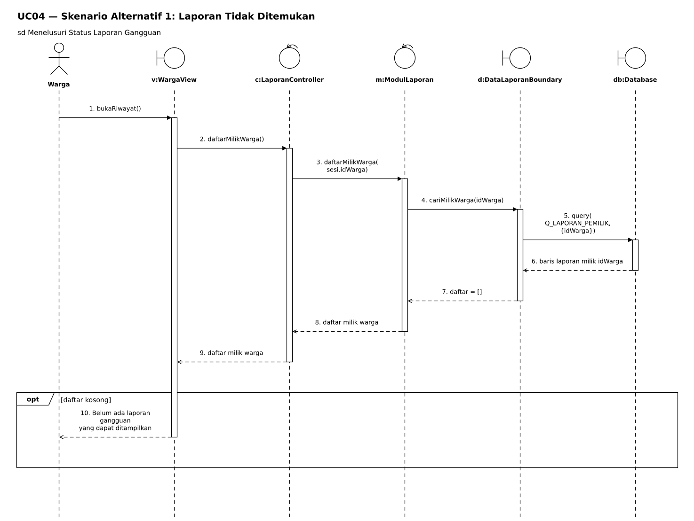
</p>
<p align="center">
<i>Gambar 3.4.A1. Sequence Diagram UC04 — Laporan Tidak Ditemukan</i>
</p>

[Sumber draw.io editable](./assets/diagram/rionaldo/uc04-seq-alt1.drawio) · [Ekspor SVG](./assets/diagram/rionaldo/uc04-seq-alt1.svg)

### 3.4.3 Diagram Kelas

<p align="center">
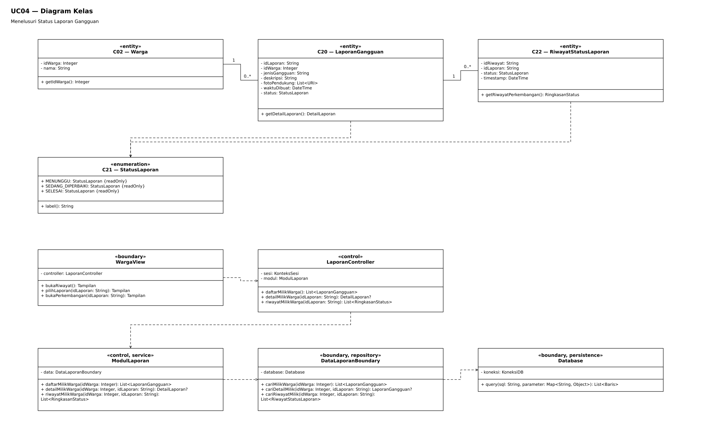
</p>
<p align="center">
<i>Gambar 3.4.K. Diagram Kelas UC04</i>
</p>

[Sumber draw.io editable](./assets/diagram/rionaldo/uc04-class.drawio) · [Ekspor SVG](./assets/diagram/rionaldo/uc04-class.svg)

Tipe `FormLaporan`, `FormPemeliharaan`, `HasilValidasi`, `HasilLaporan`, `HasilStatus`, `HasilPemeliharaan`, `DetailLaporan`, `RingkasanStatus`, dan `Tampilan` adalah record/nilai perancangan sesuai konteks operasi, bukan kelas analisis baru. Identitas pelaku berasal dari `KonteksSesi`. Definisi lengkap disertakan pada kontrak kelas pendamping.

Atribut dan operasi ditampilkan langsung pada kompartemen kelas dengan visibilitas, parameter, dan tipe data. Kelas yang digunakan lintas UC mengambil signature dari satu registri desain. Garis asosiasi memakai multiplisitas; dependensi layanan dan penggunaan enumerasi menggunakan panah putus-putus. Identitas Cxx mengikuti SKPL.

**Rujukan:** SKPL M5 §§4.4.4 / 5.2.4, §4.2, §6.1–6.2; APL M6 Tabel 2.1 dan Tabel 3.1; PDF Asistensi Akbar M7 hlm. 4–12. Diagram normal memuat seluruh langkah dalam satu urutan; gunakan SVG pada zoom 100% untuk membaca diagram panjang. Nomor caption memakai identitas subbab dan skenario agar tidak berbenturan dengan gambar UC anggota lain.


<br>

## 3.5 Use Case Menerima Peringatan Dini Daya Kritis

**ID Use Case:** *UC05*  
**Nama Use Case:** *Menerima Peringatan Dini Daya Kritis*

### 3.5.1 Identifikasi Kelas

Tabel 3.5. Identifikasi Kelas Use Case Menerima Peringatan Dini Daya Kritis

| No | Nama Kelas Perancangan | Nama Kelas Analisis Terkait |
|:--- | :--- | :--- |
| 1 | TeknisiView | — (kelas desain tambahan) |
| 2 | TelemetriAPI | — (kelas desain tambahan) |
| 3 | MonitoringController | — (kelas desain tambahan) |
| 4 | Baterai | C09 Baterai |
| 5 | PenugasanPerangkat | C23 PenugasanPerangkat |
| 6 | PeringatanDayaKritis | C26 PeringatanDayaKritis |
| 7 | DataPerangkatBoundary | — (kelas desain tambahan) |

### 3.5.2 Sequence Diagram

- **Skenario Normal**

Berdasarkan *trigger* telemetri, `MonitoringController` mengevaluasi kapasitas baterai. Saat mendeteksi kondisi kritis, sistem mencari teknisi yang ditugaskan melalui `DataPerangkatBoundary` dan memverifikasi tanggung jawabnya. Objek `PeringatanDayaKritis` dibuat dan dikirimkan ke antarmuka perangkat Teknisi yang bersangkutan dalam wujud *push notification*.

<p align="center">

</p>
<p align="center">
<i>Gambar 3.5.N. Sequence Diagram UC05 — Skenario Normal</i>
</p>

- **Skenario Alternatif 1: Koneksi Jaringan Terputus**

Saat notifikasi kritis dikirim, koneksi jaringan menuju perangkat teknisi sedang terputus. Objek `PeringatanDayaKritis` menyadari kegagalan ini dan menyimpannya ke database dengan status *pending*. Ketika teknisi *online* kembali, sistem secara otomatis menarik data *pending* tersebut dan menampilkannya.

<p align="center">
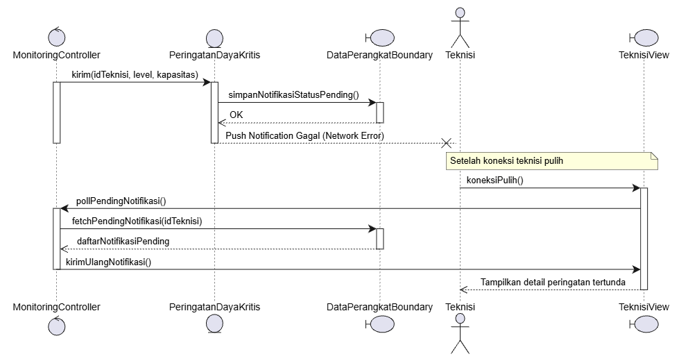
</p>
<p align="center">
<i>Gambar 3.5.A1. Sequence Diagram UC05 — Koneksi Jaringan Terputus</i>
</p>

### 3.5.3 Diagram Kelas

<p align="center">

</p>
<p align="center">
<i>Gambar 3.5.K. Diagram Kelas UC05</i>
</p>

Atribut dan operasi ditampilkan langsung pada kompartemen kelas dengan visibilitas (lingkaran hijau untuk public, kotak merah untuk private).

<br>

## 3.6 Use Case Memantau Riwayat Kinerja Panel Surya

**ID Use Case:** *UC06*  
**Nama Use Case:** *Memantau Riwayat Kinerja Panel Surya*

### 3.6.1 Identifikasi Kelas

Tabel 3.6. Identifikasi Kelas Use Case Memantau Riwayat Kinerja Panel Surya

| No | Nama Kelas Perancangan | Nama Kelas Analisis Terkait |
|:--- | :--- | :--- |
| 1 | TeknisiView | — (kelas desain tambahan) |
| 2 | MonitoringController | — (kelas desain tambahan) |
| 3 | PanelSurya | C10 PanelSurya |
| 4 | RentangWaktu | C13 RentangWaktu |
| 5 | DataHistorisKinerja | C12 DataHistorisKinerja |
| 6 | DataPerangkatBoundary | — (kelas desain tambahan) |

### 3.6.2 Sequence Diagram

- **Skenario Normal**

Teknisi memilih filter rentang waktu. `MonitoringController` memvalidasi logika penanggalan menggunakan kelas `RentangWaktu`. Jika valid, entitas `PanelSurya` akan mengambil raw data dari `DataPerangkatBoundary`, kemudian dikonversi oleh `DataHistorisKinerja` menjadi format data grafik yang dapat digambar oleh antarmuka.

<p align="center">

</p>
<p align="center">
<i>Gambar 3.6.N. Sequence Diagram UC06 — Skenario Normal</i>
</p>

- **Skenario Alternatif 1: Data Historis Belum Tersedia**

Setelah memvalidasi rentang waktu, `PanelSurya` menanyakan riwayat log kepada *database*. Karena belum ada aktivitas atau data terhapus pada periode tersebut, daftar yang dikembalikan kosong. Sistem menampilkan pesan error bahwa data historis tidak ditemukan.

<p align="center">

</p>
<p align="center">
<i>Gambar 3.6.A1. Sequence Diagram UC06 — Data Historis Belum Tersedia</i>
</p>

### 3.6.3 Diagram Kelas

<p align="center">

</p>
<p align="center">
<i>Gambar 3.6.K. Diagram Kelas UC06</i>
</p>

Atribut dan operasi ditampilkan langsung pada kompartemen kelas dengan visibilitas (lingkaran hijau untuk public, kotak merah untuk private).

<br>

## 3.7 Use Case Memperbarui Status Penanganan Gangguan

**ID Use Case:** *UC07*\
**Nama Use Case:** *Memperbarui Status Penanganan Gangguan*\
**Aktor:** Teknisi\
**Kebutuhan fungsional:** KF12, KF17, KF18, KF19, KF35.

### 3.7.1 Identifikasi Kelas

Tabel 3.7. Identifikasi Kelas Use Case UC07

| No | Nama Kelas Perancangan | Nama Kelas Analisis Terkait |
| --- | --- | --- |
| 1 | Teknisi | C03 Teknisi |
| 2 | LaporanGangguan | C20 LaporanGangguan |
| 3 | PenugasanLaporan | C24 PenugasanLaporan |
| 4 | RiwayatStatusLaporan | C22 RiwayatStatusLaporan |
| 5 | StatusLaporan | C21 StatusLaporan |
| 6 | TeknisiView | — (kelas desain tambahan, tidak ada padanan kelas analisis Cxx) |
| 7 | LaporanController | — (kelas desain tambahan, tidak ada padanan kelas analisis Cxx) |
| 8 | ModulLaporan | — (kelas desain tambahan, tidak ada padanan kelas analisis Cxx) |
| 9 | DataLaporanBoundary | — (kelas desain tambahan, tidak ada padanan kelas analisis Cxx) |
| 10 | Database | — (kelas desain tambahan, tidak ada padanan kelas analisis Cxx) |

Kelas View, controller, `Validasi`, fasad modul, dan data boundary diturunkan dari komponen APL M6 Tabel 2.1 dan Tabel 3.1. View menangani interaksi, controller mengoordinasikan permintaan dari sesi, fasad menjalankan layanan domain, dan data boundary membatasi akses ke `Database`. Fasad modul dan `Database` merupakan kelas perancangan tambahan; tidak diberi ID analisis Cxx baru.

### 3.7.2 Sequence Diagram

- **Skenario Normal**

Daftar dan detail tugas dibatasi menurut identitas teknisi pada sesi. Domain memverifikasi penugasan sebelum memeriksa transisi status. Transisi sah hanya `MENUNGGU → SEDANG_DIPERBAIKI → SELESAI`; status tetap, lompatan, dan perpindahan mundur ditolak. Status dan riwayat bertimestamp disimpan dalam satu transaksi.

<p align="center">
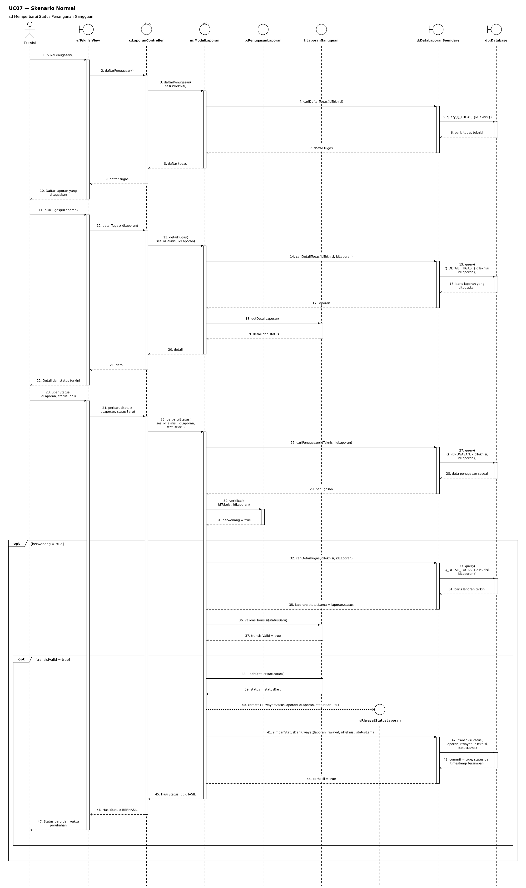
</p>
<p align="center">
<i>Gambar 3.7.N. Sequence Diagram UC07 — Skenario Normal</i>
</p>

[Sumber draw.io editable](./assets/diagram/rionaldo/uc07-seq-normal.drawio) · [Ekspor SVG](./assets/diagram/rionaldo/uc07-seq-normal.svg)

- **Skenario Alternatif 1: Teknisi Tidak Berwenang**

Penugasan yang sesuai tidak ditemukan. Sistem menolak perubahan dan menampilkan pesan tidak berwenang; status dan riwayat tidak berubah.

<p align="center">
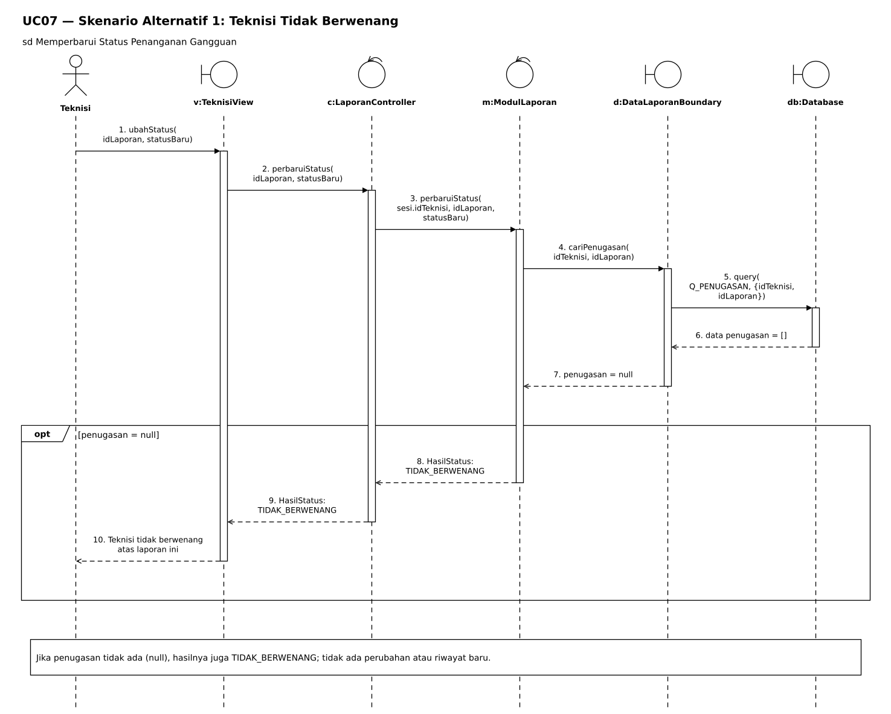
</p>
<p align="center">
<i>Gambar 3.7.A1. Sequence Diagram UC07 — Teknisi Tidak Berwenang</i>
</p>

[Sumber draw.io editable](./assets/diagram/rionaldo/uc07-seq-alt1.drawio) · [Ekspor SVG](./assets/diagram/rionaldo/uc07-seq-alt1.svg)

- **Skenario Alternatif 2: Perubahan Status Tidak Valid**

Setelah penugasan dipastikan sesuai, domain mendeteksi transisi yang tidak sah. Sistem menolak perubahan dan menampilkan pilihan status berikutnya yang legal; status dan riwayat tidak berubah.

<p align="center">

</p>
<p align="center">
<i>Gambar 3.7.A2. Sequence Diagram UC07 — Perubahan Status Tidak Valid</i>
</p>

[Sumber draw.io editable](./assets/diagram/rionaldo/uc07-seq-alt2.drawio) · [Ekspor SVG](./assets/diagram/rionaldo/uc07-seq-alt2.svg)

### 3.7.3 Diagram Kelas

<p align="center">

</p>
<p align="center">
<i>Gambar 3.7.K. Diagram Kelas UC07</i>
</p>

[Sumber draw.io editable](./assets/diagram/rionaldo/uc07-class.drawio) · [Ekspor SVG](./assets/diagram/rionaldo/uc07-class.svg)

Tipe `FormLaporan`, `FormPemeliharaan`, `HasilValidasi`, `HasilLaporan`, `HasilStatus`, `HasilPemeliharaan`, `DetailLaporan`, `RingkasanStatus`, dan `Tampilan` adalah record/nilai perancangan sesuai konteks operasi, bukan kelas analisis baru. Identitas pelaku berasal dari `KonteksSesi`. Definisi lengkap disertakan pada kontrak kelas pendamping.

Atribut dan operasi ditampilkan langsung pada kompartemen kelas dengan visibilitas, parameter, dan tipe data. Kelas yang digunakan lintas UC mengambil signature dari satu registri desain. Garis asosiasi memakai multiplisitas; dependensi layanan dan penggunaan enumerasi menggunakan panah putus-putus. Identitas Cxx mengikuti SKPL.

**Rujukan:** SKPL M5 §§4.4.7 / 5.2.7, §4.2, §6.1–6.2; APL M6 Tabel 2.1 dan Tabel 3.1; PDF Asistensi Akbar M7 hlm. 4–12. Diagram normal memuat seluruh langkah dalam satu urutan; gunakan SVG pada zoom 100% untuk membaca diagram panjang. Nomor caption memakai identitas subbab dan skenario agar tidak berbenturan dengan gambar UC anggota lain.


<br>

## 3.8 Use Case Mencatat Kegiatan Pemeliharaan

**ID Use Case:** *UC08*\
**Nama Use Case:** *Mencatat Kegiatan Pemeliharaan*\
**Aktor:** Teknisi\
**Kebutuhan fungsional:** KF20, KF21.

### 3.8.1 Identifikasi Kelas

Tabel 3.8. Identifikasi Kelas Use Case UC08

| No | Nama Kelas Perancangan | Nama Kelas Analisis Terkait |
| --- | --- | --- |
| 1 | Teknisi | C03 Teknisi |
| 2 | Perangkat | C07 Perangkat |
| 3 | CatatanPemeliharaan | C27 CatatanPemeliharaan |
| 4 | TeknisiView | — (kelas desain tambahan, tidak ada padanan kelas analisis Cxx) |
| 5 | PemeliharaanController | — (kelas desain tambahan, tidak ada padanan kelas analisis Cxx) |
| 6 | Validasi | — (kelas desain tambahan, tidak ada padanan kelas analisis Cxx) |
| 7 | ModulPemeliharaan | — (kelas desain tambahan, tidak ada padanan kelas analisis Cxx) |
| 8 | DataPerangkatBoundary | — (kelas desain tambahan, tidak ada padanan kelas analisis Cxx) |
| 9 | Database | — (kelas desain tambahan, tidak ada padanan kelas analisis Cxx) |

Kelas View, controller, `Validasi`, fasad modul, dan data boundary diturunkan dari komponen APL M6 Tabel 2.1 dan Tabel 3.1. View menangani interaksi, controller mengoordinasikan permintaan dari sesi, fasad menjalankan layanan domain, dan data boundary membatasi akses ke `Database`. Fasad modul dan `Database` merupakan kelas perancangan tambahan; tidak diberi ID analisis Cxx baru.

### 3.8.2 Sequence Diagram

- **Skenario Normal**

Formulir memuat ID perangkat, waktu pelaksanaan, tindakan, dan catatan hasil. Kelengkapan diperiksa sebelum domain membuat catatan. Catatan yang berhasil disimpan mengikat identitas teknisi, identitas perangkat, dan waktu pelaksanaan sehingga dapat ditelusuri kembali.

<p align="center">

</p>
<p align="center">
<i>Gambar 3.8.N. Sequence Diagram UC08 — Skenario Normal</i>
</p>

[Sumber draw.io editable](./assets/diagram/rionaldo/uc08-seq-normal.drawio) · [Ekspor SVG](./assets/diagram/rionaldo/uc08-seq-normal.svg)

- **Skenario Alternatif 1: Formulir Tidak Lengkap**

Validasi menemukan kolom wajib yang kosong. Sistem membatalkan penyimpanan, mempertahankan isian, dan menandai kolom yang harus dilengkapi.

<p align="center">
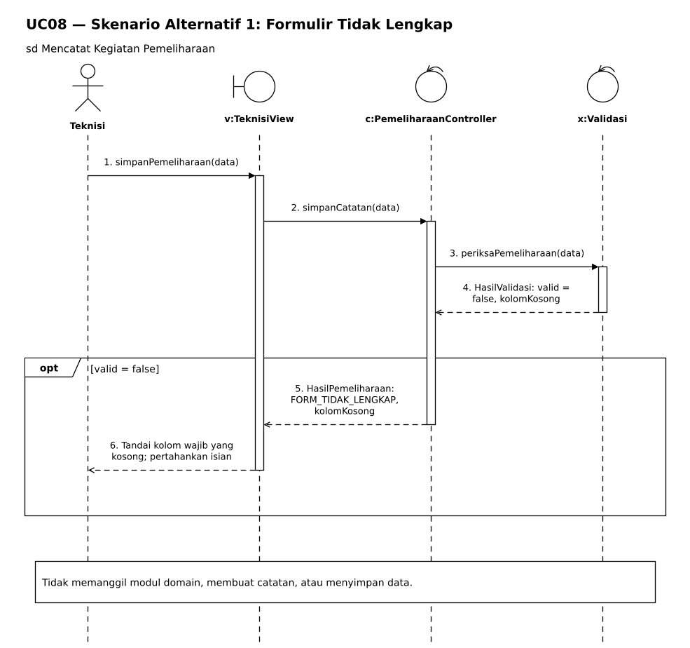
</p>
<p align="center">
<i>Gambar 3.8.A1. Sequence Diagram UC08 — Formulir Tidak Lengkap</i>
</p>

[Sumber draw.io editable](./assets/diagram/rionaldo/uc08-seq-alt1.drawio) · [Ekspor SVG](./assets/diagram/rionaldo/uc08-seq-alt1.svg)

### 3.8.3 Diagram Kelas

<p align="center">

</p>
<p align="center">
<i>Gambar 3.8.K. Diagram Kelas UC08</i>
</p>

[Sumber draw.io editable](./assets/diagram/rionaldo/uc08-class.drawio) · [Ekspor SVG](./assets/diagram/rionaldo/uc08-class.svg)

Tipe `FormLaporan`, `FormPemeliharaan`, `HasilValidasi`, `HasilLaporan`, `HasilStatus`, `HasilPemeliharaan`, `DetailLaporan`, `RingkasanStatus`, dan `Tampilan` adalah record/nilai perancangan sesuai konteks operasi, bukan kelas analisis baru. Identitas pelaku berasal dari `KonteksSesi`. Definisi lengkap disertakan pada kontrak kelas pendamping.

Atribut dan operasi ditampilkan langsung pada kompartemen kelas dengan visibilitas, parameter, dan tipe data. Kelas yang digunakan lintas UC mengambil signature dari satu registri desain. Garis asosiasi memakai multiplisitas; dependensi layanan dan penggunaan enumerasi menggunakan panah putus-putus. Identitas Cxx mengikuti SKPL.

**Rujukan:** SKPL M5 §§4.4.8 / 5.2.8, §4.2, §6.1–6.2; APL M6 Tabel 2.1 dan Tabel 3.1; PDF Asistensi Akbar M7 hlm. 4–12. Nomor caption memakai identitas subbab dan skenario agar tidak berbenturan dengan gambar UC anggota lain.

## 3.9 Use Case Menganalisis Pemakaian Komunal
 
**ID Use Case:** *UC09*  
**Nama Use Case:** *Menganalisis Pemakaian Komunal*
 
### 3.9.1 Identifikasi Kelas
 
Realisasi UC09 melewati jalur `PengurusView` → `IuranController` → `ModulIuran` → `DataIuranBoundary` sesuai Tabel 3.1 dokumen APL. Kelas *boundary*, *control*, dan *repository* adalah kelas perancangan baru yang berasal dari komponen APL, sehingga tidak memiliki kelas analisis.
 
Tabel 3.9. Identifikasi Kelas Use Case UC09
 
| No | Nama Kelas Perancangan | Nama Kelas Analisis Terkait |
|:--- | :--- | :--- |
| 1 | `PengurusView` «boundary» | — (komponen *PengurusView*, APL Tabel 2.1) |
| 2 | `IuranController` «control» | — (komponen *IuranController*, APL Tabel 2.1) |
| 3 | `Validasi` «utility» | — (komponen *Validasi*, APL Tabel 2.1) |
| 4 | `DataIuranBoundary` «repository» | — (komponen *DataIuranBoundary*, APL Tabel 2.1) |
| 5 | `Akun` «entity» | C01 – Akun |
| 6 | `Pengurus` «entity» | C04 – Pengurus |
| 7 | `Periode` «entity» | C14 – Periode |
| 8 | `DataPemakaian` «entity» | C15 – DataPemakaian |
 
### 3.9.2 Sequence Diagram
 
- **Skenario Normal**
Pengurus membuka dashboard administratif, lalu `IuranController` memeriksa kewenangan melalui `Pengurus.verifikasiKewenangan()`. Setelah pengurus memilih periode, `Validasi` memeriksa periode. `DataIuranBoundary` mengambil `Periode` dan `DataPemakaian` pada periode itu (KF24), dan `IuranController` menghitung agregat air dan energi. View menampilkan agregat dan riwayat pemakaian (KF22).
 
<p align="center">

</p>
<p align="center">
<i>Gambar 3.9.1. Sequence Diagram UC09 - Skenario Normal</i>
</p>

- **Skenario Alternatif 1: Pengguna Bukan Pengurus**
Warga atau Teknisi membuka dashboard administratif. `IuranController.periksaKewenangan()` mendeteksi bahwa akun bukan `Pengurus` dan mengembalikan `false`. Akses ditolak dan tidak ada data yang diambil dari `DataIuranBoundary` (KF23, KNF01, KNF02).
 
<p align="center">
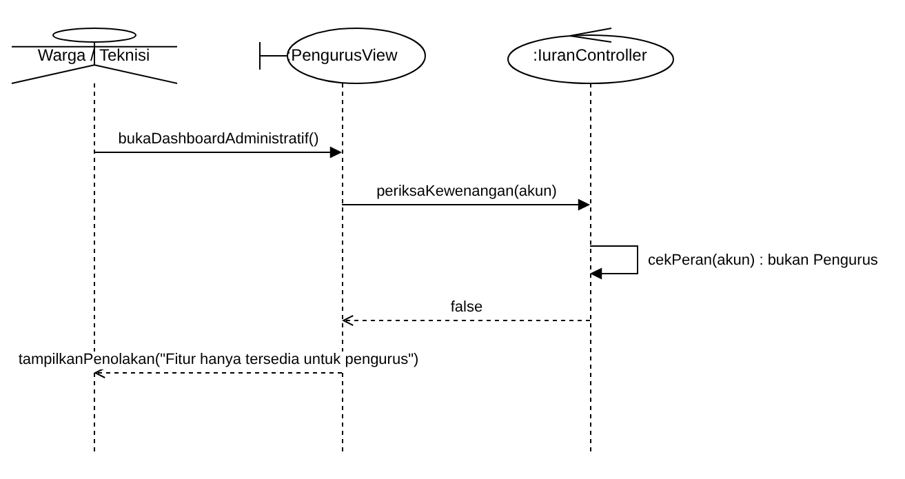
</p>
<p align="center">
<i>Gambar 3.9.2. Sequence Diagram UC09 - Pengguna Bukan Pengurus</i>
</p>

### 3.9.3 Diagram Kelas
 
<p align="center">

</p>
<p align="center">
<i>Gambar 3.9.3. Diagram Kelas UC09 - Menganalisis Pemakaian Komunal</i>
</p>
---
 
## 3.10 Use Case Menghitung dan Menetapkan Iuran Warga
 
**ID Use Case:** *UC10*  
**Nama Use Case:** *Menghitung dan Menetapkan Iuran Warga*
 
### 3.10.1 Identifikasi Kelas
 
UC10 memiliki relasi `<<include>> UC09` dan `<<extend>> UC02` (SKPL). `DataPemakaian` dan `Periode` dipakai ulang dengan definisi yang sama seperti di UC09. `KalkulatorIuran` (C19) adalah *domain service* di `ModulIuran`; `IuranController` hanya mendelegasikan ke service ini.
 
Tabel 3.10. Identifikasi Kelas Use Case UC10
 
| No | Nama Kelas Perancangan | Nama Kelas Analisis Terkait |
|:--- | :--- | :--- |
| 1 | `PengurusView` «boundary» | — (komponen *PengurusView*, APL Tabel 2.1) |
| 2 | `IuranController` «control» | — (komponen *IuranController*, APL Tabel 2.1) |
| 3 | `Validasi` «utility» | — (komponen *Validasi*, APL Tabel 2.1) |
| 4 | `DataIuranBoundary` «repository» | — (komponen *DataIuranBoundary*, APL Tabel 2.1) |
| 5 | `KalkulatorIuran` «service» | C19 – KalkulatorIuran |
| 6 | `Pengurus` «entity» | C04 – Pengurus |
| 7 | `Periode` «entity» | C14 – Periode |
| 8 | `DataPemakaian` «entity» | C15 – DataPemakaian |
| 9 | `AturanTarif` «entity» | C16 – AturanTarif |
| 10 | `Tagihan` «entity» | C17 – Tagihan |
| 11 | `StatusTagihan` «enumeration» | C18 – StatusTagihan |
| 12 | `Warga` «entity» | C02 – Warga |
 
### 3.10.2 Sequence Diagram
 
- **Skenario Normal**
Pengurus memilih periode. Setelah `Validasi` dan `KalkulatorIuran.validasiKelengkapan()` lolos, `KalkulatorIuran.pratinjau()` mengambil satu `AturanTarif` untuk periode itu dan memakainya untuk seluruh warga (KF28). Tiap `Tagihan` dibuat berstatus `DRAFT` dan dihitung lewat `hitungTotal()` (KF25, KF33). Hasilnya ditampilkan sebagai pratinjau (KF26). Saat pengurus menekan "Tetapkan Final", `KalkulatorIuran.validasiKewenangan()` memeriksa kewenangan (KF27). Setelah itu semua `Tagihan` dan `Periode` ditandai `FINAL` dan disimpan, lalu notifikasi berhasil ditampilkan.
 
<p align="center">
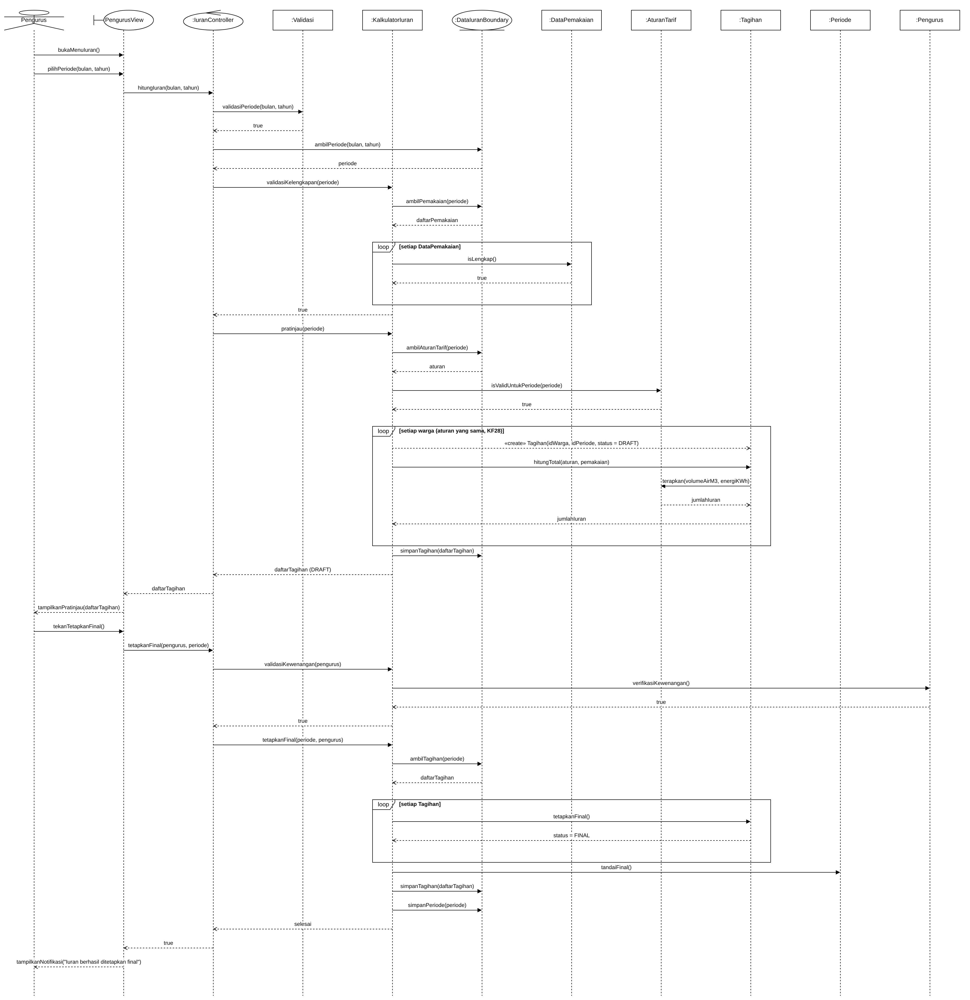
</p>
<p align="center">
<i>Gambar 3.10.1. Sequence Diagram UC10 - Skenario Normal</i>
</p>

- **Skenario Alternatif 1: Pengurus Tidak Berwenang**
`Pengurus.verifikasiKewenangan()` mengembalikan `false`, sehingga penetapan final ditolak dan pesan otorisasi ditampilkan. Tidak ada `Tagihan` atau `Periode` yang berubah.
 
<p align="center">
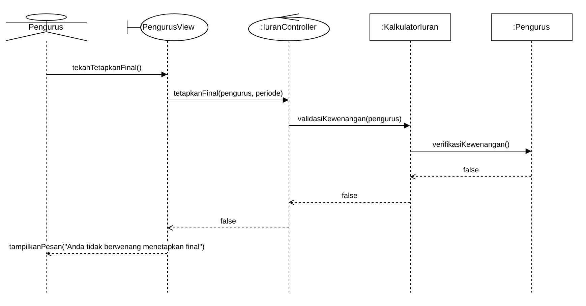
</p>
<p align="center">
<i>Gambar 3.10.2. Sequence Diagram UC10 - Pengurus Tidak Berwenang</i>
</p>

- **Skenario Alternatif 2: Data Pemakaian Belum Lengkap**
`DataPemakaian.isLengkap()` mengembalikan `false` untuk sebagian warga. `KalkulatorIuran.validasiKelengkapan()` mengembalikan `false`, perhitungan dihentikan sebelum `Tagihan` dibuat, dan pengurus diminta melengkapi data terlebih dahulu.
 
<p align="center">

</p>
<p align="center">
<i>Gambar 3.10.3. Sequence Diagram UC10 - Data Pemakaian Belum Lengkap</i>
</p>

### 3.10.3 Diagram Kelas
 
<p align="center">

</p>
<p align="center">
<i>Gambar 3.10.4. Diagram Kelas UC10 - Menghitung dan Menetapkan Iuran Warga</i>
</p>
---
 
## 3.11 Use Case Membuat Rekapitulasi Pemakaian dan Iuran
 
**ID Use Case:** *UC11*  
**Nama Use Case:** *Membuat Rekapitulasi Pemakaian dan Iuran*
 
### 3.11.1 Identifikasi Kelas
 
Tabel 3.11. Identifikasi Kelas Use Case UC11
 
| No | Nama Kelas Perancangan | Nama Kelas Analisis Terkait |
|:--- | :--- | :--- |
| 1 | `PengurusView` «boundary» | — (komponen *PengurusView*, APL Tabel 2.1) |
| 2 | `IuranController` «control» | — (komponen *IuranController*, APL Tabel 2.1) |
| 3 | `Validasi` «utility» | — (komponen *Validasi*, APL Tabel 2.1) |
| 4 | `DataIuranBoundary` «repository» | — (komponen *DataIuranBoundary*, APL Tabel 2.1) |
| 5 | `Pengurus` «entity» | C04 – Pengurus |
| 6 | `Periode` «entity» | C14 – Periode |
| 7 | `DataPemakaian` «entity» | C15 – DataPemakaian |
| 8 | `Tagihan` «entity» | C17 – Tagihan |
| 9 | `StatusTagihan` «enumeration» | C18 – StatusTagihan |
| 10 | `Rekapitulasi` «entity» | C28 – Rekapitulasi |
 
### 3.11.2 Sequence Diagram
 
- **Skenario Normal**
Pengurus membuka menu rekapitulasi. Kewenangan diperiksa lewat `Pengurus.verifikasiKewenangan()` dan daftar periode ditampilkan (KF29, KF31). Setelah periode dipilih, `IuranController` memastikan data final dengan `Periode.isFinal()` dan `Tagihan.sudahFinal()` untuk setiap tagihan (KF32). Saat pengurus memilih "buat rekapitulasi", `Pengurus.buatRekapitulasi()` memanggil `Rekapitulasi.generate(periode)`, yang menjumlahkan `DataPemakaian` dan `Tagihan` periode itu (KF30). Terakhir, pengurus memilih ekspor (PDF atau CSV, KNF10) atau cetak.
 
<p align="center">
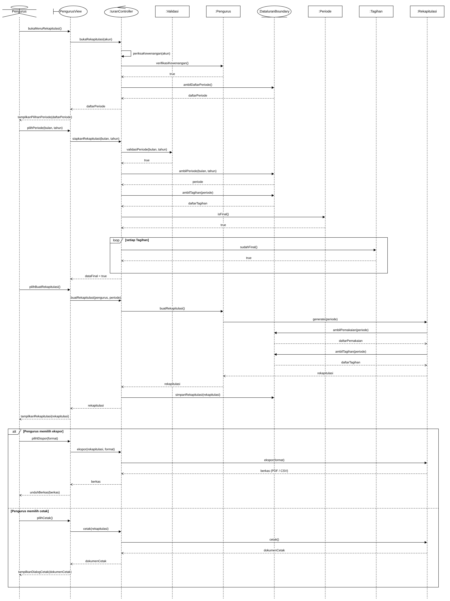
</p>
<p align="center">
<i>Gambar 3.11.1. Sequence Diagram UC11 - Skenario Normal</i>
</p>

- **Skenario Alternatif 1: Data Belum Final**
`Periode.isFinal()` bernilai `false`, atau periode sudah final tetapi masih ada `Tagihan` yang `sudahFinal()` bernilai `false`. `Rekapitulasi.generate()` tidak dipanggil, dan pengurus diberi informasi bahwa rekapitulasi hanya dapat dibuat dari data final.
 
<p align="center">

</p>
<p align="center">
<i>Gambar 3.11.2. Sequence Diagram UC11 - Data Belum Final</i>
</p>

- **Skenario Alternatif 2: Pengguna Tidak Berwenang**
Pengguna bukan pengurus (Warga atau Teknisi) mencoba membuka menu rekapitulasi. `IuranController.periksaKewenangan()` mengembalikan `false` dan akses ditolak (KF31, KNF01).
 
<p align="center">

</p>
<p align="center">
<i>Gambar 3.11.3. Sequence Diagram UC11 - Pengguna Tidak Berwenang</i>
</p>

### 3.11.3 Diagram Kelas
 
<p align="center">
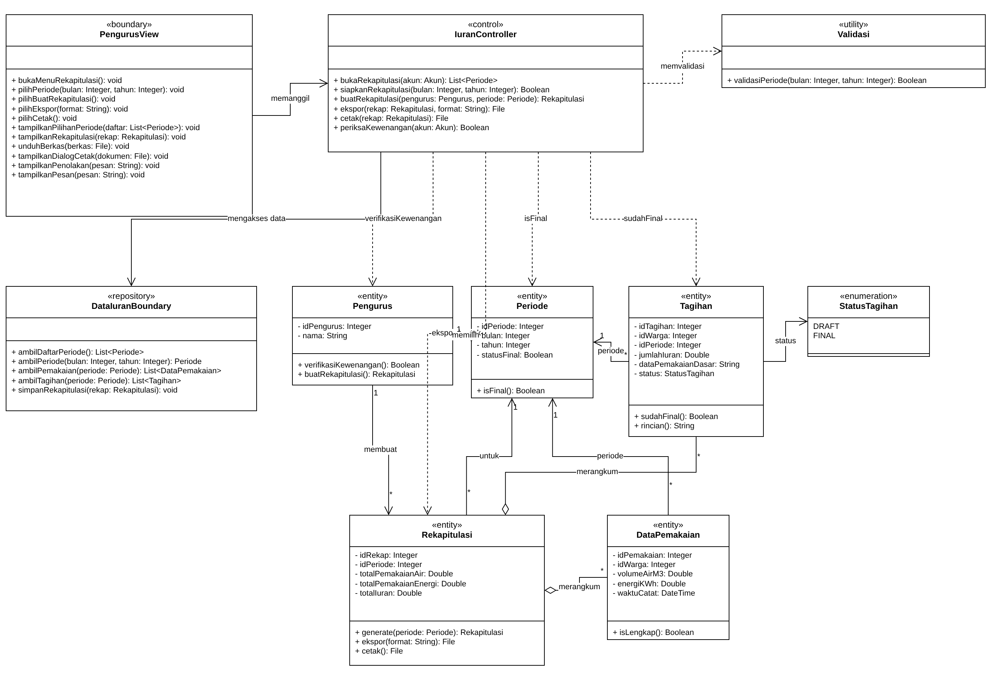
</p>
<p align="center">
<i>Gambar 3.11.4. Diagram Kelas UC11 - Membuat Rekapitulasi Pemakaian dan Iuran</i>
</p>

</br>

## 3.12 Use Case 12

**ID Use Case:** *UC12*
**Nama Use Case:** *Melakukan Registrasi Akun*
 
### 3.12.1 Identifikasi Kelas

Tabel 3.12. Identifikasi Kelas Use Case UC12

| No | Nama Kelas Perancangan | Nama Kelas Analisis Terkait |
|:--- | :--- | :--- |
| 1 | `AuthView` «boundary» | — (komponen *AuthView*, APL Tabel 2.1) |
| 2 | `AkunController` «control» | — (komponen *AkunController*, APL Tabel 2.1) |
| 3 | `Validasi` «utility» | — (komponen *Validasi*, APL Tabel 2.1) |
| 4 | `DataAkunBoundary` «repository» | — (komponen *DataAkunBoundary*, APL Tabel 2.1) |
| 5 | `CalonPengguna` «entity» | C05 – CalonPengguna |
| 6 | `Akun` «entity» | C01 – Akun |
| 7 | `Warga` «entity» | C02 – Warga |
| 8 | `Teknisi` «entity» | C03 – Teknisi |
| 9 | `Pengurus` «entity» | C04 – Pengurus |
| 10 | `StatusAkun` «entity» | C06 – StatusAkun |
 
### 3.12.2 Sequence Diagram

- **Skenario Normal**
Calon pengguna membuka halaman registrasi dan mengisi formulir (nama, email, password, pilihan peran). Saat tombol "Daftar" ditekan, `AuthView` meneruskan permintaan ke `AkunController.daftarkan(nama, email, password, peran)`. Controller mengambil data email lewat `DataAkunBoundary.cariEmail(email)` dan memvalidasi kelengkapan serta keunikan email melalui `Validasi.validasiRegistrasi(nama, email, password, existing)`. Bila lolos, `CalonPengguna.daftarkan()` menciptakan akun peran lewat `Akun.buatAkun(peran)` dengan status awal "Menunggu Persetujuan" melalui `Akun.ubahStatus(...)`, lalu menyimpannya lewat `DataAkunBoundary.simpanAkun(akun)`. `AuthView` menampilkan notifikasi bahwa registrasi berhasil dan akun menunggu persetujuan pengurus (KF09, KF14).

<p align="center">

</p>
<p align="center">
<i>Gambar 3.12.1. Sequence Diagram UC12 - Skenario Normal</i>
</p>

- **Skenario Alternatif 1: Email Sudah Terdaftar**
`DataAkunBoundary.cariEmail(email)` mengembalikan objek `Akun` yang sudah ada, sehingga `Validasi.validasiRegistrasi(...)` bernilai `false`. Tidak ada akun yang diciptakan; `AuthView` menampilkan pesan "Email sudah terdaftar, silakan gunakan email lain".

<p align="center">

</p>
<p align="center">
<i>Gambar 3.12.2. Sequence Diagram UC12 - Email Sudah Terdaftar</i>
</p>

### 3.12.3 Diagram Kelas

<p align="center">
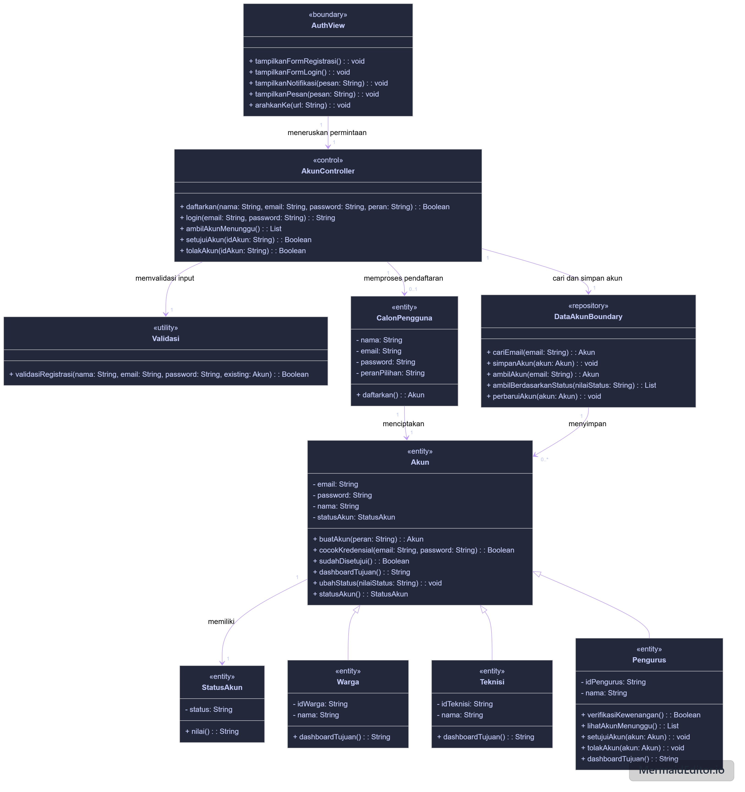
</p>
<p align="center">
<i>Gambar 3.12.3. Diagram Kelas UC12 - Melakukan Registrasi Akun (nilai izin StatusAkun: "Menunggu Persetujuan", "Disetujui", "Ditolak")</i>
</p>

<br>

## 3.13 Use Case 13

**ID Use Case:** *UC13*
**Nama Use Case:** *Melakukan Login Akun*

### 3.13.1 Identifikasi Kelas

Tabel 3.13. Identifikasi Kelas Use Case UC13

| No | Nama Kelas Perancangan | Nama Kelas Analisis Terkait |
|:--- | :--- | :--- |
| 1 | `AuthView` «boundary» | — (komponen *AuthView*, APL Tabel 2.1) |
| 2 | `AkunController` «control» | — (komponen *AkunController*, APL Tabel 2.1) |
| 3 | `DataAkunBoundary` «repository» | — (komponen *DataAkunBoundary*, APL Tabel 2.1) |
| 4 | `Akun` «entity» | C01 – Akun |
| 5 | `Warga` «entity» | C02 – Warga |
| 6 | `Teknisi` «entity» | C03 – Teknisi |
| 7 | `Pengurus` «entity» | C04 – Pengurus |
| 8 | `StatusAkun` «entity» | C06 – StatusAkun |

### 3.13.2 Sequence Diagram

- **Skenario Normal**
Pengguna (Warga/Teknisi/Pengurus) mengisi kredensial dan menekan "Login". `AkunController.login(email, password)` mengambil akun lewat `DataAkunBoundary.ambilAkun(email)`, lalu memverifikasi kecocokan kredensial dengan `Akun.cocokKredensial(email, password)` dan status persetujuan dengan `Akun.sudahDisetujui()`. Bila keduanya benar, tujuan halaman ditentukan oleh polimorfisme `Akun.dashboardTujuan()` yang dijawab berbeda oleh subclass peran (late binding), dan `AuthView` mengarahkan pengguna ke dasbor sesuai perannya (KF18, KF23, KF27).

<p align="center">
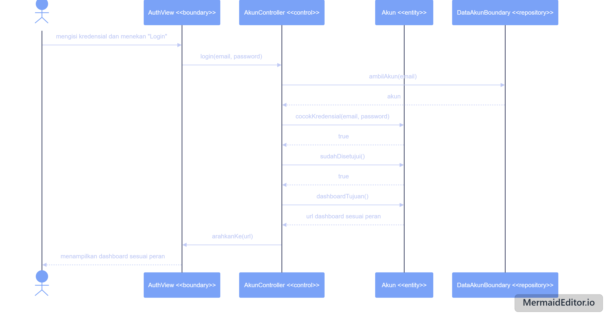
</p>
<p align="center">
<i>Gambar 3.13.1. Sequence Diagram UC13 - Skenario Normal</i>
</p>

- **Skenario Alternatif 1: Akun Belum Disetujui**
`Akun.cocokKredensial(email, password)` bernilai `true` tetapi `Akun.sudahDisetujui()` bernilai `false` karena status akun masih "Menunggu Persetujuan". `AuthView` menampilkan pesan bahwa akun masih menunggu persetujuan pengurus dan pengguna tidak diarahkan ke dasbor mana pun.

<p align="center">

</p>
<p align="center">
<i>Gambar 3.13.2. Sequence Diagram UC13 - Akun Belum Disetujui</i>
</p>

### 3.13.3 Diagram Kelas

<p align="center">
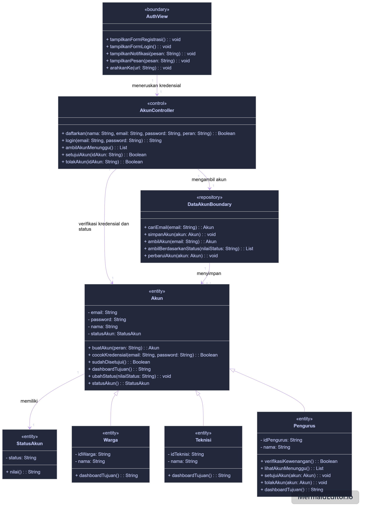
</p>
<p align="center">
<i>Gambar 3.13.3. Diagram Kelas UC13 - Melakukan Login Akun</i>
</p>

## 3.14 Use Case 14

**ID Use Case:** *UC14*
**Nama Use Case:** *Mengelola Persetujuan Akun*

### 3.14.1 Identifikasi Kelas

Tabel 3.14. Identifikasi Kelas Use Case UC14

| No | Nama Kelas Perancangan | Nama Kelas Analisis Terkait |
|:--- | :--- | :--- |
| 1 | `DashboardPengurusView` «boundary» | — (komponen *DashboardPengurusView*, APL Tabel 2.1) |
| 2 | `AkunController` «control» | — (komponen *AkunController*, APL Tabel 2.1) |
| 3 | `DataAkunBoundary` «repository» | — (komponen *DataAkunBoundary*, APL Tabel 2.1) |
| 4 | `Pengurus` «entity» | C04 – Pengurus |
| 5 | `Akun` «entity» | C01 – Akun |
| 6 | `StatusAkun` «entity» | C06 – StatusAkun |

### 3.14.2 Sequence Diagram

- **Skenario Normal**
Pengurus membuka menu persetujuan akun pada `DashboardPengurusView`. `AkunController.ambilAkunMenunggu()` terlebih dahulu memeriksa kewenangan lewat `Pengurus.verifikasiKewenangan()` (KF23), kemudian mengambil daftar akun berstatus "Menunggu Persetujuan" lewat `Pengurus.lihatAkunMenunggu()` yang membaca `DataAkunBoundary.ambilBerdasarkanStatus(...)`. Daftar ditampilkan; pengurus memilih akun dan menekan "Setujui" (atau "Tolak"), sehingga `Pengurus.setujuiAkun(akun)` memanggil `Akun.ubahStatus("Disetujui")` dan menyimpan perubahan lewat `DataAkunBoundary.perbaruiAkun(akun)`. `DashboardPengurusView` menampilkan notifikasi hasil persetujuan.

<p align="center">

</p>
<p align="center">
<i>Gambar 3.14.1. Sequence Diagram UC14 - Skenario Normal</i>
</p>

- **Skenario Alternatif 1: Tidak Ada Akun Menunggu Persetujuan**
`DataAkunBoundary.ambilBerdasarkanStatus("Menunggu Persetujuan")` mengembalikan daftar kosong. `DashboardPengurusView` menampilkan informasi bahwa tidak ada akun yang menunggu persetujuan, sehingga tidak ada aksi persetujuan yang dapat dilakukan.

<p align="center">

</p>
<p align="center">
<i>Gambar 3.14.2. Sequence Diagram UC14 - Tidak Ada Akun Menunggu Persetujuan</i>
</p>

### 3.14.3 Diagram Kelas

<p align="center">
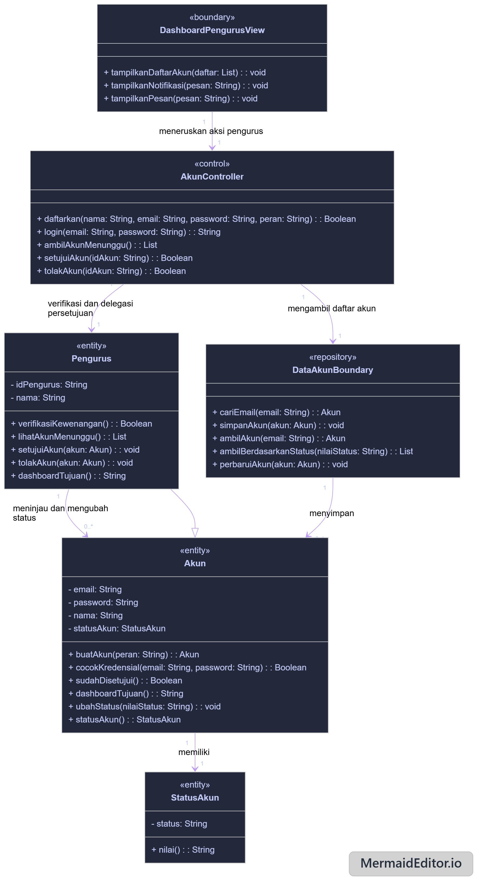
</p>
<p align="center">
<i>Gambar 3.14.3. Diagram Kelas UC14 - Mengelola Persetujuan Akun</i>
</p>

<br>

---

# BAB 4: Diagram Kelas Keseluruhan

Bab ini menyajikan diagram kelas perancangan keseluruhan (*Overall Design Class Diagram*) untuk perangkat lunak **Fajar Tech**. Berbeda dengan diagram kelas analisis pada dokumen SKPL (M5) yang hanya memuat kelas domain analisis (`C01`–`C28`), diagram kelas perancangan pada bab ini mengintegrasikan seluruh kelas hasil realisasi *use case* (`UC01`–`UC14`) pada BAB 3 beserta komponen arsitektur *Layered Architecture* dari dokumen APL (M6) dan matriks kerunutan pada BAB 5, yang mencakup:
1. **Presentation Layer (`«boundary»`):** `WargaView`, `TeknisiView`, `PengurusView`, `AuthView`, dan `TelemetriAPI`.
2. **Business Layer — Controllers & Utility (`«control»`, `«control, utility»`):** `MonitoringController`, `LaporanController`, `PemeliharaanController`, `IuranController`, `AkunController`, dan `Validasi`.
3. **Business Layer — Domain Modules (`«control, service»`):** `ModulAkun`, `ModulMonitoring`, `ModulLaporan`, `ModulPemeliharaan`, `ModulIuran`, dan `ModulNotifikasi`.
4. **Business Layer — Domain Entities, Service & Enumerations (`C01`–`C28`):** Seluruh kelas analisis yang telah dilengkapi visibilitas (`+`, `-`, `#`), tipe atribut, parameter, dan tipe kembalian (*return type*) operasi.
5. **Data Access Layer & Persistence (`«boundary, repository»`, `«boundary, persistence»`):** `DataAkunBoundary`, `DataPerangkatBoundary`, `DataLaporanBoundary`, `DataIuranBoundary`, dan `Database`.

## 4.1 Diagram Kelas

<p align="center">
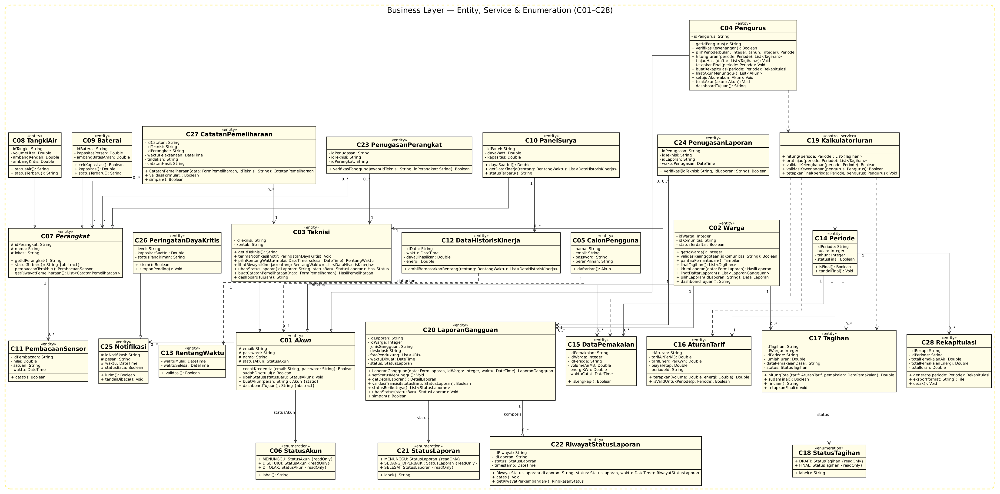
</p>
<p align="center">
<i>Gambar 4.1. Diagram Kelas Perancangan Keseluruhan Fajar Tech</i>
</p>

<br>

### 4.1.1 Spesifikasi Kelas Analisis yang Dipertajam menjadi Kelas Perancangan (C01–C28)

Tabel 4.1 menjabarkan spesifikasi lengkap untuk ke-28 kelas analisis (`C01`–`C28`) yang telah dipertajam menjadi kelas perancangan dengan visibilitas, tipe data atribut, parameter, dan tipe kembalian metode yang diseragamkan lintas *use case* (`UC01`–`UC14`).

Tabel 4.1. Daftar Kelas Perancangan Hasil Pertajaman Kelas Analisis (C01–C28)

| ID Kelas | Nama Kelas & Stereotipe | Atribut | Metode / Operasi |
| :--- | :--- | :--- | :--- |
| **C01** | `Akun` {abstract}<br>«entity» | `# email: String`<br>`# password: String`<br>`# nama: String`<br>`# statusAkun: StatusAkun` | `+ cocokKredensial(email: String, password: String): Boolean`<br>`+ sudahDisetujui(): Boolean`<br>`+ ubahStatus(statusBaru: StatusAkun): Void`<br>`+ buatAkun(peran: String): Akun` {static}<br>`+ dashboardTujuan(): String` {abstract} |
| **C02** | `Warga`<br>«entity»<br>*(extends C01 Akun)* | `- idWarga: Integer`<br>`- idKomunitas: String`<br>`- statusTerdaftar: Boolean` | `+ getIdWarga(): Integer`<br>`+ validasiKeanggotaan(idKomunitas: String): Boolean`<br>`+ pantauPemantauan(): Tampilan`<br>`+ lihatTagihan(): List<Tagihan>`<br>`+ kirimLaporan(data: FormLaporan): HasilLaporan`<br>`+ lihatDaftarLaporan(): List<LaporanGangguan>`<br>`+ pilihLaporan(idLaporan: String): DetailLaporan`<br>`+ dashboardTujuan(): String` |
| **C03** | `Teknisi`<br>«entity»<br>*(extends C01 Akun)* | `- idTeknisi: String`<br>`- kontak: String` | `+ getIdTeknisi(): String`<br>`+ terimaNotifikasi(notif: PeringatanDayaKritis): Void`<br>`+ pilihRentangWaktu(mulai: DateTime, selesai: DateTime): RentangWaktu`<br>`+ lihatRiwayatKinerja(rentang: RentangWaktu): List<DataHistorisKinerja>`<br>`+ ubahStatusLaporan(idLaporan: String, statusBaru: StatusLaporan): HasilStatus`<br>`+ buatCatatanPemeliharaan(data: FormPemeliharaan): HasilPemeliharaan`<br>`+ dashboardTujuan(): String` |
| **C04** | `Pengurus`<br>«entity»<br>*(extends C01 Akun)* | `- idPengurus: String` | `+ getIdPengurus(): String`<br>`+ verifikasiKewenangan(): Boolean`<br>`+ pilihPeriode(bulan: Integer, tahun: Integer): Periode`<br>`+ hitungIuran(periode: Periode): List<Tagihan>`<br>`+ tinjauHasil(daftar: List<Tagihan>): Void`<br>`+ tetapkanFinal(periode: Periode): Void`<br>`+ buatRekapitulasi(periode: Periode): Rekapitulasi`<br>`+ lihatAkunMenunggu(): List<Akun>`<br>`+ setujuiAkun(akun: Akun): Void`<br>`+ tolakAkun(akun: Akun): Void`<br>`+ dashboardTujuan(): String` |
| **C05** | `CalonPengguna`<br>«entity» | `- nama: String`<br>`- email: String`<br>`- password: String`<br>`- peranPilihan: String` | `+ daftarkan(): Akun` |
| **C06** | `StatusAkun`<br>«enumeration» | `+ MENUNGGU: StatusAkun` {readOnly}<br>`+ DISETUJUI: StatusAkun` {readOnly}<br>`+ DITOLAK: StatusAkun` {readOnly} | `+ label(): String` |
| **C07** | `Perangkat` {abstract}<br>«entity» | `# idPerangkat: String`<br>`# nama: String`<br>`# lokasi: String` | `+ getIdPerangkat(): String`<br>`+ statusTerbaru(): String` {abstract}<br>`+ pembacaanTerakhir(): PembacaanSensor`<br>`+ getRiwayatPemeliharaan(): List<CatatanPemeliharaan>` |
| **C08** | `TangkiAir`<br>«entity»<br>*(extends C07 Perangkat)* | `- idTangki: String`<br>`- volumeLiter: Double`<br>`- ambangRendah: Double`<br>`- ambangKritis: Double` | `+ statusAir(): String`<br>`+ statusTerbaru(): String` |
| **C09** | `Baterai`<br>«entity»<br>*(extends C07 Perangkat)* | `- idBaterai: String`<br>`- kapasitasPersen: Double`<br>`- ambangBatasAman: Double` | `+ cekKapasitas(): Boolean`<br>`+ kapasitas(): Double`<br>`+ statusTerbaru(): String` |
| **C10** | `PanelSurya`<br>«entity»<br>*(extends C07 Perangkat)* | `- idPanel: String`<br>`- dayaWatt: Double`<br>`- kapasitas: Double` | `+ dayaSaatIni(): Double`<br>`+ getDataKinerja(rentang: RentangWaktu): List<DataHistorisKinerja>`<br>`+ statusTerbaru(): String` |
| **C11** | `PembacaanSensor`<br>«entity» | `- idPembacaan: String`<br>`- nilai: Double`<br>`- satuan: String`<br>`- waktu: DateTime` | `+ catat(): Boolean` |
| **C12** | `DataHistorisKinerja`<br>«entity» | `- idData: String`<br>`- waktu: DateTime`<br>`- dayaDihasilkan: Double`<br>`- energi: Double` | `+ ambilBerdasarkanRentang(rentang: RentangWaktu): List<DataHistorisKinerja>` |
| **C13** | `RentangWaktu`<br>«entity» | `- waktuMulai: DateTime`<br>`- waktuSelesai: DateTime` | `+ validasi(): Boolean` |
| **C14** | `Periode`<br>«entity» | `- idPeriode: String`<br>`- bulan: Integer`<br>`- tahun: Integer`<br>`- statusFinal: Boolean` | `+ isFinal(): Boolean`<br>`+ tandaiFinal(): Void` |
| **C15** | `DataPemakaian`<br>«entity» | `- idPemakaian: String`<br>`- idWarga: Integer`<br>`- idPeriode: String`<br>`- volumeAirM3: Double`<br>`- energiKWh: Double`<br>`- waktuCatat: DateTime` | `+ isLengkap(): Boolean` |
| **C16** | `AturanTarif`<br>«entity» | `- idAturan: String`<br>`- tarifAirPerM3: Double`<br>`- tarifEnergiPerKWh: Double`<br>`- biayaTetap: Double`<br>`- periodeId: String` | `+ terapkan(volume: Double, energi: Double): Double`<br>`+ isValidUntukPeriode(p: Periode): Boolean` |
| **C17** | `Tagihan`<br>«entity» | `- idTagihan: String`<br>`- idWarga: Integer`<br>`- idPeriode: String`<br>`- jumlahIuran: Double`<br>`- dataPemakaianDasar: String`<br>`- status: StatusTagihan` | `+ hitungTotal(tarif: AturanTarif, pemakaian: DataPemakaian): Double`<br>`+ sudahFinal(): Boolean`<br>`+ rincian(): String`<br>`+ tetapkanFinal(): Void` |
| **C18** | `StatusTagihan`<br>«enumeration» | `+ DRAFT: StatusTagihan` {readOnly}<br>`+ FINAL: StatusTagihan` {readOnly} | `+ label(): String` |
| **C19** | `KalkulatorIuran`<br>«control, service» | — *(stateless domain service)* | `+ hitung(periode: Periode): List<Tagihan>`<br>`+ pratinjau(periode: Periode): List<Tagihan>`<br>`+ validasiKelengkapan(periode: Periode): Boolean`<br>`+ validasiKewenangan(pengurus: Pengurus): Boolean`<br>`+ tetapkanFinal(periode: Periode, pengurus: Pengurus): Void` |
| **C20** | `LaporanGangguan`<br>«entity» | `- idLaporan: String`<br>`- idWarga: Integer`<br>`- jenisGangguan: String`<br>`- deskripsi: String`<br>`- fotoPendukung: List<URI>`<br>`- waktuDibuat: DateTime`<br>`- status: StatusLaporan` | `+ LaporanGangguan(data: FormLaporan, idWarga: Integer, waktu: DateTime): LaporanGangguan`<br>`+ setStatusMenunggu(): Void`<br>`+ getDetailLaporan(): DetailLaporan`<br>`+ validasiTransisi(statusBaru: StatusLaporan): Boolean`<br>`+ statusBerikutnya(): List<StatusLaporan>`<br>`+ ubahStatus(statusBaru: StatusLaporan): Void`<br>`+ simpan(): Boolean` |
| **C21** | `StatusLaporan`<br>«enumeration» | `+ MENUNGGU: StatusLaporan` {readOnly}<br>`+ SEDANG_DIPERBAIKI: StatusLaporan` {readOnly}<br>`+ SELESAI: StatusLaporan` {readOnly} | `+ label(): String` |
| **C22** | `RiwayatStatusLaporan`<br>«entity» | `- idRiwayat: String`<br>`- idLaporan: String`<br>`- status: StatusLaporan`<br>`- timestamp: DateTime` | `+ RiwayatStatusLaporan(idLaporan: String, status: StatusLaporan, waktu: DateTime): RiwayatStatusLaporan`<br>`+ catat(): Void`<br>`+ getRiwayatPerkembangan(): RingkasanStatus` |
| **C23** | `PenugasanPerangkat`<br>«entity» | `- idPenugasan: String`<br>`- idTeknisi: String`<br>`- idPerangkat: String` | `+ verifikasiTanggungJawab(idTeknisi: String, idPerangkat: String): Boolean` |
| **C24** | `PenugasanLaporan`<br>«entity» | `- idPenugasan: String`<br>`- idTeknisi: String`<br>`- idLaporan: String`<br>`- waktuPenugasan: DateTime` | `+ verifikasi(idTeknisi: String, idLaporan: String): Boolean` |
| **C25** | `Notifikasi`<br>«entity» | `# idNotifikasi: String`<br>`# pesan: String`<br>`# waktu: DateTime`<br>`# statusBaca: Boolean` | `+ kirim(): Boolean`<br>`+ tandaiDibaca(): Void` |
| **C26** | `PeringatanDayaKritis`<br>«entity»<br>*(extends C25 Notifikasi)* | `- level: String`<br>`- kapasitasSaatIni: Double`<br>`- statusPengiriman: String` | `+ kirim(): Boolean`<br>`+ simpanPending(): Void` |
| **C27** | `CatatanPemeliharaan`<br>«entity» | `- idCatatan: String`<br>`- idTeknisi: String`<br>`- idPerangkat: String`<br>`- waktuPelaksanaan: DateTime`<br>`- tindakan: String`<br>`- catatanHasil: String` | `+ CatatanPemeliharaan(data: FormPemeliharaan, idTeknisi: String): CatatanPemeliharaan`<br>`+ validasiFormulir(): Boolean`<br>`+ simpan(): Boolean` |
| **C28** | `Rekapitulasi`<br>«entity» | `- idRekap: String`<br>`- idPeriode: String`<br>`- totalPemakaianAir: Double`<br>`- totalPemakaianEnergi: Double`<br>`- totalIuran: Double` | `+ generate(periode: Periode): Rekapitulasi`<br>`+ ekspor(format: String): File`<br>`+ cetak(): Void` |

<br>

### 4.1.2 Spesifikasi Kelas Perancangan Tambahan (Komponen Arsitektur APL)

Tabel 4.2 menjabarkan kelas-kelas perancangan tambahan yang diturunkan dari komponen arsitektur pada dokumen APL (M6) Tabel 2.1 dan Tabel 3.1 serta digunakan pada realisasi *use case* di BAB 3 dan matriks kerunutan di BAB 5.

Tabel 4.2. Daftar Kelas Perancangan Tambahan (Presentation, Business, Data Access, dan Persistence)

| No | Nama Kelas & Stereotipe | Lapisan Arsitektur | Atribut | Metode / Operasi |
| :--- | :--- | :--- | :--- | :--- |
| 1 | `WargaView`<br>«boundary» | Presentation Layer | `- monitoringController: MonitoringController`<br>`- iuranController: IuranController`<br>`- laporanController: LaporanController` | `+ tampilkanDashboard(): Tampilan`<br>`+ pilihPeriodeTagihan(idPeriode: String): Tampilan`<br>`+ bukaFormLaporan(): Tampilan`<br>`+ kirimLaporan(data: FormLaporan): Tampilan`<br>`+ bukaRiwayat(): Tampilan`<br>`+ pilihLaporan(idLaporan: String): Tampilan`<br>`+ bukaPerkembangan(idLaporan: String): Tampilan` |
| 2 | `TeknisiView`<br>«boundary» | Presentation Layer | `- monitoringController: MonitoringController`<br>`- laporanController: LaporanController`<br>`- pemeliharaanController: PemeliharaanController` | `+ tampilkanNotifikasiKritis(notif: PeringatanDayaKritis): Tampilan`<br>`+ pilihRentangKinerja(mulai: DateTime, selesai: DateTime): Tampilan`<br>`+ bukaPenugasan(): Tampilan`<br>`+ pilihTugas(idLaporan: String): Tampilan`<br>`+ ubahStatus(idLaporan: String, statusBaru: StatusLaporan): Tampilan`<br>`+ bukaFormPemeliharaan(): Tampilan`<br>`+ simpanPemeliharaan(data: FormPemeliharaan): Tampilan` |
| 3 | `PengurusView`<br>«boundary» | Presentation Layer | `- iuranController: IuranController`<br>`- akunController: AkunController` | `+ bukaDashboardAnalitik(idPeriode: String): Tampilan`<br>`+ bukaPerhitunganIuran(idPeriode: String): Tampilan`<br>`+ tekanTetapkanFinal(idPeriode: String): Tampilan`<br>`+ bukaMenuRekapitulasi(idPeriode: String): Tampilan`<br>`+ eksporRekapitulasi(idPeriode: String, format: String): Tampilan`<br>`+ bukaPersetujuanAkun(): Tampilan`<br>`+ prosesPersetujuan(email: String, disetujui: Boolean): Tampilan` |
| 4 | `AuthView`<br>«boundary» | Presentation Layer | `- akunController: AkunController` | `+ bukaRegistrasi(): Tampilan`<br>`+ tekanDaftar(nama: String, email: String, password: String, peran: String): Tampilan`<br>`+ bukaLogin(): Tampilan`<br>`+ tekanLogin(email: String, password: String): Tampilan` |
| 5 | `TelemetriAPI`<br>«boundary» | Presentation Layer | `- monitoringController: MonitoringController` | `+ kirimTelemetri(idPerangkat: String, nilai: Double, satuan: String, waktu: DateTime): ResponseTelemetri` |
| 6 | `MonitoringController`<br>«control» | Business Layer | `- modulMonitoring: ModulMonitoring`<br>`- modulNotifikasi: ModulNotifikasi`<br>`- validasi: Validasi` | `+ ambilStatusInfrastruktur(): StatusInfrastruktur`<br>`+ prosesTelemetriBaterai(idBaterai: String, kapasitas: Double): Void`<br>`+ ambilRiwayatPanel(mulai: DateTime, selesai: DateTime): List<DataHistorisKinerja>` |
| 7 | `LaporanController`<br>«control» | Business Layer | `- sesi: KonteksSesi`<br>`- modul: ModulLaporan`<br>`- validasi: Validasi` | `+ kirimLaporan(data: FormLaporan): HasilLaporan`<br>`+ daftarMilikWarga(): List<LaporanGangguan>`<br>`+ detailMilikWarga(idLaporan: String): DetailLaporan?`<br>`+ riwayatMilikWarga(idLaporan: String): List<RingkasanStatus>`<br>`+ daftarPenugasan(): List<LaporanGangguan>`<br>`+ detailTugas(idLaporan: String): DetailLaporan?`<br>`+ perbaruiStatus(idLaporan: String, statusBaru: StatusLaporan): HasilStatus` |
| 8 | `PemeliharaanController`<br>«control» | Business Layer | `- sesi: KonteksSesi`<br>`- modul: ModulPemeliharaan`<br>`- validasi: Validasi` | `+ simpanCatatan(data: FormPemeliharaan): HasilPemeliharaan` |
| 9 | `IuranController`<br>«control» | Business Layer | `- sesi: KonteksSesi`<br>`- modulIuran: ModulIuran`<br>`- validasi: Validasi` | `+ periksaKewenangan(akun: Akun): Boolean`<br>`+ lihatTagihanFinal(idWarga: Integer, idPeriode: String): Tagihan?`<br>`+ analisisPemakaian(idPeriode: String): RingkasanPemakaian`<br>`+ hitungPratinjauIuran(idPeriode: String): List<Tagihan>`<br>`+ tetapkanIuranFinal(idPeriode: String, pengurus: Pengurus): Boolean`<br>`+ buatRekapitulasi(idPeriode: String, pengurus: Pengurus): Rekapitulasi?` |
| 10 | `AkunController`<br>«control» | Business Layer | `- modulAkun: ModulAkun`<br>`- validasi: Validasi` | `+ daftarkan(nama: String, email: String, password: String, peran: String): HasilRegistrasi`<br>`+ login(email: String, password: String): HasilLogin`<br>`+ ambilAkunMenunggu(pengurus: Pengurus): List<Akun>`<br>`+ setujuiAkun(pengurus: Pengurus, email: String): Boolean`<br>`+ tolakAkun(pengurus: Pengurus, email: String): Boolean` |
| 11 | `Validasi`<br>«control, utility» | Business Layer | `- kolomLaporan: List<String>`<br>`- kolomPemeliharaan: List<String>` | `+ periksaLaporan(data: FormLaporan): HasilValidasi`<br>`+ periksaPemeliharaan(data: FormPemeliharaan): HasilValidasi`<br>`+ validasiPeriode(idPeriode: String): Boolean`<br>`+ validasiRentangWaktu(rentang: RentangWaktu): Boolean`<br>`+ validasiRegistrasi(nama: String, email: String, password: String, existing: Akun?): Boolean` |
| 12 | `ModulAkun`<br>«control, service» | Business Layer | `- data: DataAkunBoundary` | `+ ambilWarga(idWarga: Integer): Warga?`<br>`+ registrasiCalon(calon: CalonPengguna): Akun`<br>`+ autentikasi(email: String, password: String): Akun?`<br>`+ daftarAkunMenunggu(): List<Akun>`<br>`+ ubahStatusPersetujuan(email: String, status: StatusAkun): Boolean` |
| 13 | `ModulMonitoring`<br>«control, service» | Business Layer | `- data: DataPerangkatBoundary` | `+ evaluasiKetersediaan(): StatusInfrastruktur`<br>`+ catatPembacaan(idPerangkat: String, bacaan: PembacaanSensor): Boolean`<br>`+ ambilHistorisPanel(idPanel: String, rentang: RentangWaktu): List<DataHistorisKinerja>` |
| 14 | `ModulLaporan`<br>«control, service» | Business Layer | `- data: DataLaporanBoundary`<br>`- akun: ModulAkun` | `+ kirimLaporan(idWarga: Integer, idKomunitas: String, data: FormLaporan): HasilLaporan`<br>`+ daftarMilikWarga(idWarga: Integer): List<LaporanGangguan>`<br>`+ detailMilikWarga(idWarga: Integer, idLaporan: String): DetailLaporan?`<br>`+ riwayatMilikWarga(idWarga: Integer, idLaporan: String): List<RingkasanStatus>`<br>`+ daftarPenugasan(idTeknisi: String): List<LaporanGangguan>`<br>`+ detailTugas(idTeknisi: String, idLaporan: String): DetailLaporan?`<br>`+ perbaruiStatus(idTeknisi: String, idLaporan: String, statusBaru: StatusLaporan): HasilStatus` |
| 15 | `ModulPemeliharaan`<br>«control, service» | Business Layer | `- data: DataPerangkatBoundary` | `+ simpanCatatan(idTeknisi: String, data: FormPemeliharaan): HasilPemeliharaan` |
| 16 | `ModulIuran`<br>«control, service» | Business Layer | `- data: DataIuranBoundary`<br>`- kalkulator: KalkulatorIuran` | `+ ambilTagihanWarga(idWarga: Integer, idPeriode: String): Tagihan?`<br>`+ hitungAgregatKomunal(idPeriode: String): RingkasanPemakaian`<br>`+ hitungPratinjau(idPeriode: String): List<Tagihan>`<br>`+ finalisasiIuran(idPeriode: String, pengurus: Pengurus): Boolean`<br>`+ generateRekapitulasi(idPeriode: String): Rekapitulasi?` |
| 17 | `ModulNotifikasi`<br>«control, service» | Business Layer | `- data: DataPerangkatBoundary` | `+ kirimPeringatanDayaKritis(baterai: Baterai): Boolean`<br>`+ kirimUlangPending(idTeknisi: String): Integer` |
| 18 | `DataAkunBoundary`<br>«boundary, repository» | Data Access Layer | `- database: Database` | `+ cariWarga(idWarga: Integer): Warga?`<br>`+ cariEmail(email: String): Akun?`<br>`+ ambilAkun(email: String): Akun?`<br>`+ simpanAkun(akun: Akun): Boolean`<br>`+ ambilBerdasarkanStatus(status: StatusAkun): List<Akun>`<br>`+ perbaruiAkun(akun: Akun): Boolean` |
| 19 | `DataPerangkatBoundary`<br>«boundary, repository» | Data Access Layer | `- database: Database` | `+ ambilTangkiTerbaru(): TangkiAir?`<br>`+ ambilBateraiTerbaru(): Baterai?`<br>`+ ambilPanelTerbaru(): PanelSurya?`<br>`+ simpanPembacaan(bacaan: PembacaanSensor): Boolean`<br>`+ ambilHistorisKinerja(idPanel: String, rentang: RentangWaktu): List<DataHistorisKinerja>`<br>`+ cariPenugasanPerangkat(idPerangkat: String): List<PenugasanPerangkat>`<br>`+ simpanNotifikasi(notif: Notifikasi): Boolean`<br>`+ ambilNotifikasiPending(idTeknisi: String): List<PeringatanDayaKritis>`<br>`+ cariPerangkat(idPerangkat: String): Perangkat?`<br>`+ simpanCatatan(catatan: CatatanPemeliharaan): Boolean` |
| 20 | `DataLaporanBoundary`<br>«boundary, repository» | Data Access Layer | `- database: Database` | `+ simpanLaporan(laporan: LaporanGangguan): Boolean`<br>`+ cariMilikWarga(idWarga: Integer): List<LaporanGangguan>`<br>`+ cariDetailMilik(idWarga: Integer, idLaporan: String): LaporanGangguan?`<br>`+ cariRiwayatMilik(idWarga: Integer, idLaporan: String): List<RiwayatStatusLaporan>`<br>`+ cariPenugasan(idTeknisi: String, idLaporan: String): PenugasanLaporan?`<br>`+ cariDaftarTugas(idTeknisi: String): List<LaporanGangguan>`<br>`+ cariDetailTugas(idTeknisi: String, idLaporan: String): LaporanGangguan?`<br>`+ simpanStatusDanRiwayat(laporan: LaporanGangguan, riwayat: RiwayatStatusLaporan, idTeknisi: String, statusLama: StatusLaporan): Boolean` |
| 21 | `DataIuranBoundary`<br>«boundary, repository» | Data Access Layer | `- database: Database` | `+ ambilPeriode(idPeriode: String): Periode?`<br>`+ daftarPeriode(): List<Periode>`<br>`+ ambilPemakaianPeriode(idPeriode: String): List<DataPemakaian>`<br>`+ ambilAturanTarif(idPeriode: String): AturanTarif?`<br>`+ ambilTagihan(idWarga: Integer, idPeriode: String): Tagihan?`<br>`+ ambilTagihanPeriode(idPeriode: String): List<Tagihan>`<br>`+ simpanDaftarTagihan(daftar: List<Tagihan>): Boolean`<br>`+ perbaruiPeriode(periode: Periode): Boolean`<br>`+ simpanRekapitulasi(rekap: Rekapitulasi): Boolean` |
| 22 | `Database`<br>«boundary, persistence» | Database Layer | `- koneksi: KoneksiDB` | `+ query(sql: String, parameter: Map<String, Object>): List<Baris>`<br>`+ execute(sql: String, parameter: Map<String, Object>): Integer`<br>`+ transaksiStatus(laporan: LaporanGangguan, riwayat: RiwayatStatusLaporan, idTeknisi: String, statusLama: StatusLaporan): Boolean` |

<br>

### 4.1.3 Ringkasan Relasi Antarkelas

1. **Generalisasi / Pewarisan (*Inheritance*):**
   - `Warga` (C02), `Teknisi` (C03), dan `Pengurus` (C04) merupakan subkelas dari kelas abstrak `Akun` (C01) dan mengimplementasikan metode polimorfik `dashboardTujuan()`.
   - `TangkiAir` (C08), `Baterai` (C09), dan `PanelSurya` (C10) merupakan subkelas dari kelas abstrak `Perangkat` (C07) dan mengimplementasikan metode polimorfik `statusTerbaru()`.
   - `PeringatanDayaKritis` (C26) merupakan subkelas dari `Notifikasi` (C25) dan melakukan *override* metode `kirim()`.
2. **Asosiasi & Multiplisitas Domain:**
   - `CalonPengguna` (C05) `1` $\rightarrow$ `0..1` `Akun` (C01)
   - `Warga` (C02) `1` $\rightarrow$ `0..*` `LaporanGangguan` (C20), `1` $\rightarrow$ `0..*` `DataPemakaian` (C15), `1` $\rightarrow$ `0..*` `Tagihan` (C17)
   - `LaporanGangguan` (C20) `1` $\rightarrow$ `0..*` `RiwayatStatusLaporan` (C22) *(komposisi)*
   - `Teknisi` (C03) `1` $\rightarrow$ `0..*` `PenugasanLaporan` (C24) `0..*` $\rightarrow$ `1` `LaporanGangguan` (C20)
   - `Teknisi` (C03) `1` $\rightarrow$ `0..*` `PenugasanPerangkat` (C23) `0..*` $\rightarrow$ `1` `Perangkat` (C07)
   - `Teknisi` (C03) `1` $\rightarrow$ `0..*` `CatatanPemeliharaan` (C27) `0..*` $\rightarrow$ `1` `Perangkat` (C07)
   - `Teknisi` (C03) `1` $\rightarrow$ `0..*` `Notifikasi` (C25)
   - `Perangkat` (C07) `1` $\rightarrow$ `0..*` `PembacaanSensor` (C11)
   - `PanelSurya` (C10) `1` $\rightarrow$ `0..*` `DataHistorisKinerja` (C12)
   - `Periode` (C14) `1` $\rightarrow$ `1` `AturanTarif` (C16), `1` $\rightarrow$ `0..*` `DataPemakaian` (C15), `1` $\rightarrow$ `0..*` `Tagihan` (C17), `1` $\rightarrow$ `0..*` `Rekapitulasi` (C28)
3. **Ketergantungan Antarlapisan (*Layered Dependencies*):**
   - Seluruh kelas pada *Presentation Layer* (`WargaView`, `TeknisiView`, `PengurusView`, `AuthView`, `TelemetriAPI`) bergantung secara *top-to-bottom* pada *Controllers* (`MonitoringController`, `LaporanController`, `PemeliharaanController`, `IuranController`, `AkunController`).
   - Seluruh *Controller* menggunakan `Validasi` dan mendelegasikan logika bisnis ke *Modul Domain* (`ModulAkun`, `ModulMonitoring`, `ModulLaporan`, `ModulPemeliharaan`, `ModulIuran`, `ModulNotifikasi`).
   - Seluruh *Modul Domain* mengelola siklus hidup *Entity* (`C01`–`C28`) dan mengakses persistensi hanya melalui *Data Boundary* (`DataAkunBoundary`, `DataPerangkatBoundary`, `DataLaporanBoundary`, `DataIuranBoundary`) yang terhubung ke `Database`.

<br>

---

# BAB 5: Perancangan Rinci Kelas

Bab ini menjabarkan perancangan rinci seluruh kelas perancangan Fajar Tech: daftar kelas beserta kelas analisis terkait, operasi dan atribut dengan visibilitas serta tipe data, dan algoritma/*query* untuk operasi yang dianggap penting. Penomoran mengikuti §1.4; tipe data mengikuti Tabel 4.1–4.2 BAB 4. Kelas perancangan terdiri atas **28 kelas analisis** (C01–C28) yang dipertajam dan **22 kelas perancangan tambahan** turunan komponen arsitektur APL (view, controller, modul domain, data boundary, dan `Database`), sehingga total **50 kelas**.

Tabel 5.1. Daftar Kelas Perancangan dan Kelas Analisis Terkait

| No | Nama Kelas Perancangan | Nama Kelas Analisis Terkait |
| :--- | :--- | :--- |
| 1 | `Akun` «entity, abstract» | C01 – Akun |
| 2 | `Warga` «entity» | C02 – Warga |
| 3 | `Teknisi` «entity» | C03 – Teknisi |
| 4 | `Pengurus` «entity» | C04 – Pengurus |
| 5 | `CalonPengguna` «entity» | C05 – CalonPengguna |
| 6 | `StatusAkun` «enumeration» | C06 – StatusAkun |
| 7 | `Perangkat` «entity, abstract» | C07 – Perangkat |
| 8 | `TangkiAir` «entity» | C08 – TangkiAir |
| 9 | `Baterai` «entity» | C09 – Baterai |
| 10 | `PanelSurya` «entity» | C10 – PanelSurya |
| 11 | `PembacaanSensor` «entity» | C11 – PembacaanSensor |
| 12 | `DataHistorisKinerja` «entity» | C12 – DataHistorisKinerja |
| 13 | `RentangWaktu` «entity» | C13 – RentangWaktu |
| 14 | `Periode` «entity» | C14 – Periode |
| 15 | `DataPemakaian` «entity» | C15 – DataPemakaian |
| 16 | `AturanTarif` «entity» | C16 – AturanTarif |
| 17 | `Tagihan` «entity» | C17 – Tagihan |
| 18 | `StatusTagihan` «enumeration» | C18 – StatusTagihan |
| 19 | `KalkulatorIuran` «control, service» | C19 – KalkulatorIuran |
| 20 | `LaporanGangguan` «entity» | C20 – LaporanGangguan |
| 21 | `StatusLaporan` «enumeration» | C21 – StatusLaporan |
| 22 | `RiwayatStatusLaporan` «entity» | C22 – RiwayatStatusLaporan |
| 23 | `PenugasanPerangkat` «entity» | C23 – PenugasanPerangkat |
| 24 | `PenugasanLaporan` «entity» | C24 – PenugasanLaporan |
| 25 | `Notifikasi` «entity» | C25 – Notifikasi |
| 26 | `PeringatanDayaKritis` «entity» | C26 – PeringatanDayaKritis |
| 27 | `CatatanPemeliharaan` «entity» | C27 – CatatanPemeliharaan |
| 28 | `Rekapitulasi` «entity» | C28 – Rekapitulasi |
| 29 | `WargaView` «boundary» | — |
| 30 | `TeknisiView` «boundary» | — |
| 31 | `PengurusView` «boundary» | — |
| 32 | `AuthView` «boundary» | — |
| 33 | `TelemetriAPI` «boundary» | — |
| 34 | `MonitoringController` «control» | — |
| 35 | `LaporanController` «control» | — |
| 36 | `PemeliharaanController` «control» | — |
| 37 | `IuranController` «control» | — |
| 38 | `AkunController` «control» | — |
| 39 | `Validasi` «control, utility» | — |
| 40 | `ModulAkun` «control, service» | — |
| 41 | `ModulMonitoring` «control, service» | — |
| 42 | `ModulLaporan` «control, service» | — |
| 43 | `ModulPemeliharaan` «control, service» | — |
| 44 | `ModulIuran` «control, service» | — |
| 45 | `ModulNotifikasi` «control, service» | — |
| 46 | `DataAkunBoundary` «boundary, repository» | — |
| 47 | `DataPerangkatBoundary` «boundary, repository» | — |
| 48 | `DataLaporanBoundary` «boundary, repository» | — |
| 49 | `DataIuranBoundary` «boundary, repository» | — |
| 50 | `Database` «boundary, persistence» | — |

---

Tipe `Integer`, `String`, `Boolean`, `DateTime`, `URI`, `Void`, `List<T>` dan `Map<K,V>` mengikuti registri M7; `T?` berarti nullable. Kontrak pendamping yang disebut BAB3 tidak tersedia sebagai berkas terpisah. Untuk UC03/04/07, bentuk record berikut adalah **elaborasi desain dari draf lama**, bukan kelas analisis atau signature baru: `FormLaporan={jenisGangguan:String, deskripsi:String, fotoPendukung:List<URI>}`; `KonteksSesi={idWarga:Integer?, idTeknisi:String?, idKomunitas:String, peran:String, statusAkun:StatusAkun}` berasal dari server; `HasilValidasi` memuat `valid:Boolean` dan kesalahan per kolom; `HasilLaporan` memuat kode hasil, ID/status bila berhasil serta pesan kesalahan bila gagal; `HasilStatus` memuat kode hasil, status/timestamp server bila berhasil dan opsi legal bila transisi ditolak. `DetailLaporan` adalah proyeksi C20 yang telah diotorisasi; `RingkasanStatus={status:StatusLaporan, timestamp:DateTime}`. `Tampilan` adalah hasil presentasi; `Baris` dan `KoneksiDB` adalah abstraksi persistensi. Bentuk envelope retry/deduplikasi tetap perlu konfirmasi kelompok.

## 5.1 Kelas Akun

**Nama Kelas:** *Akun*  
**ID Kelas:** *C01*

Tabel 5.1.1. Operasi Kelas Akun

| Nama Operasi | Visibility | Keterangan |
| :--- | :--- | :--- |
| `+ cocokKredensial(email: String, password: String): Boolean` | public | Memverifikasi kecocokan email dan password dengan kredensial tersimpan. |
| `+ sudahDisetujui(): Boolean` | public | Memeriksa apakah status akun sudah `DISETUJUI`. |
| `+ ubahStatus(statusBaru: StatusAkun): Void` | public | Mengubah status akun. |
| `+ buatAkun(peran: String): Akun` {static} | public | *Factory method* pembuat subclass peran. |
| `+ dashboardTujuan(): String` {abstract} | public | Metode polimorfik penentu rute dasbor. |

Tabel 5.1.2. Atribut Kelas Akun

| Nama Atribut | Visibility | Tipe |
| :--- | :--- | :--- |
| `email` | protected | `String` |
| `password` | protected | `String` |
| `nama` | protected | `String` |
| `statusAkun` | protected | `StatusAkun` |

### 5.1.1 Algoritma/Query

**Nama Kelas:** *Akun*  
**Nama Operasi:** `+ cocokKredensial(email: String, password: String): Boolean`  
**ID Algoritma:** *Algo-001*

```text
FUNCTION cocokKredensial(email, password) -> Boolean
    IF this.email ≠ email THEN RETURN FALSE
    RETURN hash(password) = this.password
END FUNCTION
```

**Nama Kelas:** *Akun*  
**Nama Operasi:** `+ buatAkun(peran: String): Akun` {static}  
**ID Algoritma:** *Algo-002*

```text
FUNCTION buatAkun(peran) -> Akun
    SWITCH peran
        CASE "Warga"    : RETURN NEW Warga()
        CASE "Teknisi"  : RETURN NEW Teknisi()
        CASE "Pengurus" : RETURN NEW Pengurus()
        DEFAULT         : THROW InvalidRoleException
    END SWITCH
END FUNCTION
```

---

## 5.2 Kelas Warga

**Nama Kelas:** *Warga*  
**ID Kelas:** *C02* (extends C01)

Tabel 5.2.1. Operasi Kelas Warga

| Nama Operasi | Visibility | Keterangan |
| :--- | :--- | :--- |
| `+ getIdWarga(): Integer` | public | Mengembalikan ID warga. |
| `+ validasiKeanggotaan(idKomunitas: String): Boolean` | public | Memverifikasi keanggotaan warga. |
| `+ pantauPemantauan(): Tampilan` | public | Data pemantauan dashboard (UC01). |
| `+ lihatTagihan(): List<Tagihan>` | public | Daftar tagihan final (UC02). |
| `+ kirimLaporan(data: FormLaporan): HasilLaporan` | public | Membuat laporan baru (UC03). |
| `+ lihatDaftarLaporan(): List<LaporanGangguan>` | public | Daftar laporan warga (UC04). |
| `+ pilihLaporan(idLaporan: String): DetailLaporan` | public | Detail laporan (UC04). |
| `+ dashboardTujuan(): String` | public | Mengembalikan `"/dashboard/warga"`. |

Tabel 5.2.2. Atribut Kelas Warga

| Nama Atribut | Visibility | Tipe |
| :--- | :--- | :--- |
| `idWarga` | private | `Integer` |
| `idKomunitas` | private | `String` |
| `statusTerdaftar` | private | `Boolean` |

### 5.2.1 Algoritma/Query

**Nama Kelas:** *Warga*  
**Nama Operasi:** `+ validasiKeanggotaan(idKomunitas: String): Boolean`  
**ID Algoritma:** *Algo-003*

```text
FUNCTION validasiKeanggotaan(idKomunitas) -> Boolean
    IF this.statusTerdaftar = FALSE THEN RETURN FALSE
    RETURN this.idKomunitas = idKomunitas
END FUNCTION
```

**Nama Kelas:** *Warga*  
**Nama Operasi:** `+ kirimLaporan(data: FormLaporan): HasilLaporan`  
**ID Algoritma:** *Algo-004*

```text
FUNCTION kirimLaporan(data) -> HasilLaporan
    // Aksi domain memakai layanan yang sama; sesi bukan field milik Warga.
    RETURN LaporanController.kirimLaporan(data)
END FUNCTION
```

Tabel 5.2.3. Query Operasi kirimLaporan

| No Query | Query | Keterangan |
| :--- | :--- | :--- |
| Q-001 | `SELECT id_warga, id_komunitas, status_terdaftar FROM warga WHERE id_warga = ?` | Verifikasi keanggotaan. |
| Q-002 | `INSERT INTO laporan_gangguan (id_laporan, id_warga, jenis_gangguan, deskripsi, status, waktu_dibuat) VALUES (?, ?, ?, ?, 'MENUNGGU', ?)` | Simpan laporan. |

---

## 5.3 Kelas Teknisi

**Nama Kelas:** *Teknisi*  
**ID Kelas:** *C03* (extends C01)

Tabel 5.3.1. Operasi Kelas Teknisi

| Nama Operasi | Visibility | Keterangan |
| :--- | :--- | :--- |
| `+ getIdTeknisi(): String` | public | ID teknisi. |
| `+ terimaNotifikasi(notif: PeringatanDayaKritis): Void` | public | Terima notifikasi kritis (UC05). |
| `+ pilihRentangWaktu(mulai: DateTime, selesai: DateTime): RentangWaktu` | public | Bentuk rentang tervalidasi (UC06). |
| `+ lihatRiwayatKinerja(rentang: RentangWaktu): List<DataHistorisKinerja>` | public | Data historis panel (UC06). |
| `+ ubahStatusLaporan(idLaporan: String, statusBaru: StatusLaporan): HasilStatus` | public | Perbarui status laporan (UC07). |
| `+ buatCatatanPemeliharaan(data: FormPemeliharaan): HasilPemeliharaan` | public | Catat pemeliharaan (UC08). |
| `+ dashboardTujuan(): String` | public | Mengembalikan `"/dashboard/teknisi"`. |

Tabel 5.3.2. Atribut Kelas Teknisi

| Nama Atribut | Visibility | Tipe |
| :--- | :--- | :--- |
| `idTeknisi` | private | `String` |
| `kontak` | private | `String` |

### 5.3.1 Algoritma/Query

**Nama Kelas:** *Teknisi*  
**Nama Operasi:** `+ ubahStatusLaporan(idLaporan: String, statusBaru: StatusLaporan): HasilStatus`  
**ID Algoritma:** *Algo-005*

```text
FUNCTION ubahStatusLaporan(idLaporan, statusBaru) -> HasilStatus
    RETURN LaporanController.perbaruiStatus(idLaporan, statusBaru)
END FUNCTION
```

---

## 5.4 Kelas Pengurus

**Nama Kelas:** *Pengurus*  
**ID Kelas:** *C04* (extends C01)

Tabel 5.4.1. Operasi Kelas Pengurus

| Nama Operasi | Visibility | Keterangan |
| :--- | :--- | :--- |
| `+ getIdPengurus(): String` | public | ID pengurus. |
| `+ verifikasiKewenangan(): Boolean` | public | Periksa kewenangan (KF23). |
| `+ pilihPeriode(bulan: Integer, tahun: Integer): Periode` | public | Bentuk objek periode. |
| `+ hitungIuran(periode: Periode): List<Tagihan>` | public | Delegasi ke `KalkulatorIuran.hitung()`. |
| `+ tinjauHasil(daftar: List<Tagihan>): Void` | public | Tampilkan pratinjau. |
| `+ tetapkanFinal(periode: Periode): Void` | public | Finalisasi tagihan periode. |
| `+ buatRekapitulasi(periode: Periode): Rekapitulasi` | public | Buat rekapitulasi. |
| `+ lihatAkunMenunggu(): List<Akun>` | public | Akun menunggu persetujuan (UC14). |
| `+ setujuiAkun(akun: Akun): Void` | public | Setujui akun. |
| `+ tolakAkun(akun: Akun): Void` | public | Tolak akun. |
| `+ dashboardTujuan(): String` | public | Mengembalikan `"/dashboard/pengurus"`. |

Tabel 5.4.2. Atribut Kelas Pengurus

| Nama Atribut | Visibility | Tipe |
| :--- | :--- | :--- |
| `idPengurus` | private | `String` |

### 5.4.1 Algoritma/Query

**Nama Kelas:** *Pengurus*  
**Nama Operasi:** `+ verifikasiKewenangan(): Boolean`  
**ID Algoritma:** *Algo-006*

```text
FUNCTION verifikasiKewenangan() -> Boolean
    RETURN this INSTANCEOF Pengurus AND this.statusAkun = StatusAkun.DISETUJUI
END FUNCTION
```

**Nama Kelas:** *Pengurus*  
**Nama Operasi:** `+ tetapkanFinal(periode: Periode): Void`  
**ID Algoritma:** *Algo-007*

```text
PROCEDURE tetapkanFinal(periode)
    IF NOT verifikasiKewenangan() THEN THROW UnauthorizedException
    tagihanList ← DataIuranBoundary.ambilTagihanPeriode(periode.idPeriode)
    FOR EACH tagihan IN tagihanList DO tagihan.tetapkanFinal() END FOR
    DataIuranBoundary.simpanDaftarTagihan(tagihanList)
    periode.tandaiFinal()
    DataIuranBoundary.perbaruiPeriode(periode)
END PROCEDURE
```

---

## 5.5 Kelas CalonPengguna

**Nama Kelas:** *CalonPengguna*  
**ID Kelas:** *C05*

Tabel 5.5.1. Operasi Kelas CalonPengguna

| Nama Operasi | Visibility | Keterangan |
| :--- | :--- | :--- |
| `+ daftarkan(): Akun` | public | Membuat akun berstatus Menunggu Persetujuan. |

Tabel 5.5.2. Atribut Kelas CalonPengguna

| Nama Atribut | Visibility | Tipe |
| :--- | :--- | :--- |
| `nama` | private | `String` |
| `email` | private | `String` |
| `password` | private | `String` |
| `peranPilihan` | private | `String` |

### 5.5.1 Algoritma/Query

**Nama Kelas:** *CalonPengguna*  
**Nama Operasi:** `+ daftarkan(): Akun`  
**ID Algoritma:** *Algo-008*

```text
FUNCTION daftarkan() -> Akun
    akun ← Akun.buatAkun(this.peranPilihan)
    akun.email ← this.email
    akun.password ← hash(this.password)
    akun.nama ← this.nama
    akun.ubahStatus(StatusAkun.MENUNGGU)
    RETURN akun
END FUNCTION
```

---

## 5.6 Kelas StatusAkun

**Nama Kelas:** *StatusAkun*  
**ID Kelas:** *C06* «enumeration»

Tabel 5.6.1. Operasi Kelas StatusAkun

| Nama Operasi | Visibility | Keterangan |
| :--- | :--- | :--- |
| `+ label(): String` | public | Label tampilan status. |

Tabel 5.6.2. Atribut Kelas StatusAkun

| Nama Atribut | Visibility | Tipe |
| :--- | :--- | :--- |
| `MENUNGGU` | public (readOnly) | `StatusAkun` |
| `DISETUJUI` | public (readOnly) | `StatusAkun` |
| `DITOLAK` | public (readOnly) | `StatusAkun` |

### 5.6.1 Algoritma/Query

`label()` adalah pemetaan langsung (switch-case); algoritma rinci tidak diperlukan.

---

## 5.7 Kelas Perangkat

**Nama Kelas:** *Perangkat*  
**ID Kelas:** *C07* (abstract)

Tabel 5.7.1. Operasi Kelas Perangkat

| Nama Operasi | Visibility | Keterangan |
| :--- | :--- | :--- |
| `+ getIdPerangkat(): String` | public | ID perangkat. |
| `+ statusTerbaru(): String` {abstract} | public | Status perangkat; di-override subclass. |
| `+ pembacaanTerakhir(): PembacaanSensor` | public | Pembacaan sensor terakhir. |
| `+ getRiwayatPemeliharaan(): List<CatatanPemeliharaan>` | public | Riwayat pemeliharaan. |

Tabel 5.7.2. Atribut Kelas Perangkat

| Nama Atribut | Visibility | Tipe |
| :--- | :--- | :--- |
| `idPerangkat` | protected | `String` |
| `nama` | protected | `String` |
| `lokasi` | protected | `String` |

### 5.7.1 Algoritma/Query

`statusTerbaru()` abstract; operasi lain berupa getter/akses `DataPerangkatBoundary`.

---

## 5.8 Kelas TangkiAir

**Nama Kelas:** *TangkiAir*  
**ID Kelas:** *C08* (extends C07)

Tabel 5.8.1. Operasi Kelas TangkiAir

| Nama Operasi | Visibility | Keterangan |
| :--- | :--- | :--- |
| `+ statusAir(): String` | public | Status air (Normal/Rendah/Kritis). |
| `+ statusTerbaru(): String` | public | Override status perangkat. |

Tabel 5.8.2. Atribut Kelas TangkiAir

| Nama Atribut | Visibility | Tipe |
| :--- | :--- | :--- |
| `idTangki` | private | `String` |
| `volumeLiter` | private | `Double` |
| `ambangRendah` | private | `Double` |
| `ambangKritis` | private | `Double` |

### 5.8.1 Algoritma/Query

**Nama Kelas:** *TangkiAir*  
**Nama Operasi:** `+ statusAir(): String`  
**ID Algoritma:** *Algo-009*

```text
FUNCTION statusAir() -> String
    IF this.volumeLiter ≤ this.ambangKritis THEN RETURN "Kritis"
    ELSE IF this.volumeLiter ≤ this.ambangRendah THEN RETURN "Rendah"
    ELSE RETURN "Normal"
    END IF
END FUNCTION
```

---

## 5.9 Kelas Baterai

**Nama Kelas:** *Baterai*  
**ID Kelas:** *C09* (extends C07)

Tabel 5.9.1. Operasi Kelas Baterai

| Nama Operasi | Visibility | Keterangan |
| :--- | :--- | :--- |
| `+ cekKapasitas(): Boolean` | public | Cek kapasitas di bawah ambang aman. |
| `+ kapasitas(): Double` | public | Kapasitas persen. |
| `+ statusTerbaru(): String` | public | Override status perangkat. |

Tabel 5.9.2. Atribut Kelas Baterai

| Nama Atribut | Visibility | Tipe |
| :--- | :--- | :--- |
| `idBaterai` | private | `String` |
| `kapasitasPersen` | private | `Double` |
| `ambangBatasAman` | private | `Double` |

### 5.9.1 Algoritma/Query

**Nama Kelas:** *Baterai*  
**Nama Operasi:** `+ cekKapasitas(): Boolean`  
**ID Algoritma:** *Algo-010*

```text
FUNCTION cekKapasitas() -> Boolean
    RETURN this.kapasitasPersen < this.ambangBatasAman
END FUNCTION
```

---

## 5.10 Kelas PanelSurya

**Nama Kelas:** *PanelSurya*  
**ID Kelas:** *C10* (extends C07)

Tabel 5.10.1. Operasi Kelas PanelSurya

| Nama Operasi | Visibility | Keterangan |
| :--- | :--- | :--- |
| `+ dayaSaatIni(): Double` | public | Daya keluaran terkini. |
| `+ getDataKinerja(rentang: RentangWaktu): List<DataHistorisKinerja>` | public | Data historis dalam rentang. |
| `+ statusTerbaru(): String` | public | Override status perangkat. |

Tabel 5.10.2. Atribut Kelas PanelSurya

| Nama Atribut | Visibility | Tipe |
| :--- | :--- | :--- |
| `idPanel` | private | `String` |
| `dayaWatt` | private | `Double` |
| `kapasitas` | private | `Double` |

### 5.10.1 Algoritma/Query

`getDataKinerja` mendelegasikan ke `DataPerangkatBoundary.ambilHistorisKinerja(idPanel, rentang)`.

---

## 5.11 Kelas PembacaanSensor

**Nama Kelas:** *PembacaanSensor*  
**ID Kelas:** *C11*

Tabel 5.11.1. Operasi Kelas PembacaanSensor

| Nama Operasi | Visibility | Keterangan |
| :--- | :--- | :--- |
| `+ catat(): Boolean` | public | Menyimpan pembacaan. |

Tabel 5.11.2. Atribut Kelas PembacaanSensor

| Nama Atribut | Visibility | Tipe |
| :--- | :--- | :--- |
| `idPembacaan` | private | `String` |
| `nilai` | private | `Double` |
| `satuan` | private | `String` |
| `waktu` | private | `DateTime` |

### 5.11.1 Algoritma/Query

`catat()` meneruskan ke `DataPerangkatBoundary.simpanPembacaan(this)`.

---

## 5.12 Kelas DataHistorisKinerja

**Nama Kelas:** *DataHistorisKinerja*  
**ID Kelas:** *C12*

Tabel 5.12.1. Operasi Kelas DataHistorisKinerja

| Nama Operasi | Visibility | Keterangan |
| :--- | :--- | :--- |
| `+ ambilBerdasarkanRentang(rentang: RentangWaktu): List<DataHistorisKinerja>` | public | Ambil data historis dalam rentang. |

Tabel 5.12.2. Atribut Kelas DataHistorisKinerja

| Nama Atribut | Visibility | Tipe |
| :--- | :--- | :--- |
| `idData` | private | `String` |
| `waktu` | private | `DateTime` |
| `dayaDihasilkan` | private | `Double` |
| `energi` | private | `Double` |

### 5.12.1 Algoritma/Query

Delegasi ke `DataPerangkatBoundary.ambilHistorisKinerja`.

---

## 5.13 Kelas RentangWaktu

**Nama Kelas:** *RentangWaktu*  
**ID Kelas:** *C13*

Tabel 5.13.1. Operasi Kelas RentangWaktu

| Nama Operasi | Visibility | Keterangan |
| :--- | :--- | :--- |
| `+ validasi(): Boolean` | public | `waktuMulai ≤ waktuSelesai`. |

Tabel 5.13.2. Atribut Kelas RentangWaktu

| Nama Atribut | Visibility | Tipe |
| :--- | :--- | :--- |
| `waktuMulai` | private | `DateTime` |
| `waktuSelesai` | private | `DateTime` |

### 5.13.1 Algoritma/Query

**Nama Kelas:** *RentangWaktu*  
**Nama Operasi:** `+ validasi(): Boolean`  
**ID Algoritma:** *Algo-011*

```text
FUNCTION validasi() -> Boolean
    RETURN this.waktuMulai ≤ this.waktuSelesai
END FUNCTION
```

---

## 5.14 Kelas Periode

**Nama Kelas:** *Periode*  
**ID Kelas:** *C14*

Tabel 5.14.1. Operasi Kelas Periode

| Nama Operasi | Visibility | Keterangan |
| :--- | :--- | :--- |
| `+ isFinal(): Boolean` | public | Cek status final. |
| `+ tandaiFinal(): Void` | public | Tandai periode final. |

Tabel 5.14.2. Atribut Kelas Periode

| Nama Atribut | Visibility | Tipe |
| :--- | :--- | :--- |
| `idPeriode` | private | `String` |
| `bulan` | private | `Integer` |
| `tahun` | private | `Integer` |
| `statusFinal` | private | `Boolean` |

### 5.14.1 Algoritma/Query

`isFinal()` mengembalikan `statusFinal`; `tandaiFinal()` menetapkan `statusFinal ← true`.

---

## 5.15 Kelas DataPemakaian

**Nama Kelas:** *DataPemakaian*  
**ID Kelas:** *C15*

Tabel 5.15.1. Operasi Kelas DataPemakaian

| Nama Operasi | Visibility | Keterangan |
| :--- | :--- | :--- |
| `+ isLengkap(): Boolean` | public | Cek kelengkapan data. |

Tabel 5.15.2. Atribut Kelas DataPemakaian

| Nama Atribut | Visibility | Tipe |
| :--- | :--- | :--- |
| `idPemakaian` | private | `String` |
| `idWarga` | private | `Integer` |
| `idPeriode` | private | `String` |
| `volumeAirM3` | private | `Double` |
| `energiKWh` | private | `Double` |
| `waktuCatat` | private | `DateTime` |

### 5.15.1 Algoritma/Query

**Nama Kelas:** *DataPemakaian*  
**Nama Operasi:** `+ isLengkap(): Boolean`  
**ID Algoritma:** *Algo-012*

```text
FUNCTION isLengkap() -> Boolean
    RETURN this.volumeAirM3 ≠ NULL AND this.energiKWh ≠ NULL AND this.waktuCatat ≠ NULL
END FUNCTION
```

---

## 5.16 Kelas AturanTarif

**Nama Kelas:** *AturanTarif*  
**ID Kelas:** *C16*

Tabel 5.16.1. Operasi Kelas AturanTarif

| Nama Operasi | Visibility | Keterangan |
| :--- | :--- | :--- |
| `+ terapkan(volume: Double, energi: Double): Double` | public | Hitung total tarif. |
| `+ isValidUntukPeriode(p: Periode): Boolean` | public | Cek kesesuaian periode. |

Tabel 5.16.2. Atribut Kelas AturanTarif

| Nama Atribut | Visibility | Tipe |
| :--- | :--- | :--- |
| `idAturan` | private | `String` |
| `tarifAirPerM3` | private | `Double` |
| `tarifEnergiPerKWh` | private | `Double` |
| `biayaTetap` | private | `Double` |
| `periodeId` | private | `String` |

### 5.16.1 Algoritma/Query

**Nama Kelas:** *AturanTarif*  
**Nama Operasi:** `+ terapkan(volume: Double, energi: Double): Double`  
**ID Algoritma:** *Algo-013*

```text
FUNCTION terapkan(volume, energi) -> Double
    RETURN this.biayaTetap + (volume × this.tarifAirPerM3) + (energi × this.tarifEnergiPerKWh)
END FUNCTION
```

---

## 5.17 Kelas Tagihan

**Nama Kelas:** *Tagihan*  
**ID Kelas:** *C17*

Tabel 5.17.1. Operasi Kelas Tagihan

| Nama Operasi | Visibility | Keterangan |
| :--- | :--- | :--- |
| `+ hitungTotal(tarif: AturanTarif, pemakaian: DataPemakaian): Double` | public | Hitung total iuran. |
| `+ sudahFinal(): Boolean` | public | Cek status final tagihan. |
| `+ rincian(): String` | public | Rincian tagihan. |
| `+ tetapkanFinal(): Void` | public | Tandai tagihan final. |

Tabel 5.17.2. Atribut Kelas Tagihan

| Nama Atribut | Visibility | Tipe |
| :--- | :--- | :--- |
| `idTagihan` | private | `String` |
| `idWarga` | private | `Integer` |
| `idPeriode` | private | `String` |
| `jumlahIuran` | private | `Double` |
| `dataPemakaianDasar` | private | `String` |
| `status` | private | `StatusTagihan` |

### 5.17.1 Algoritma/Query

**Nama Kelas:** *Tagihan*  
**Nama Operasi:** `+ hitungTotal(tarif: AturanTarif, pemakaian: DataPemakaian): Double`  
**ID Algoritma:** *Algo-014*

```text
FUNCTION hitungTotal(tarif, pemakaian) -> Double
    this.jumlahIuran ← tarif.terapkan(pemakaian.volumeAirM3, pemakaian.energiKWh)
    RETURN this.jumlahIuran
END FUNCTION
```

---

## 5.18 Kelas StatusTagihan

**Nama Kelas:** *StatusTagihan*  
**ID Kelas:** *C18* «enumeration»

Tabel 5.18.1. Operasi Kelas StatusTagihan

| Nama Operasi | Visibility | Keterangan |
| :--- | :--- | :--- |
| `+ label(): String` | public | Label tampilan status tagihan. |

Tabel 5.18.2. Atribut Kelas StatusTagihan

| Nama Atribut | Visibility | Tipe |
| :--- | :--- | :--- |
| `DRAFT` | public (readOnly) | `StatusTagihan` |
| `FINAL` | public (readOnly) | `StatusTagihan` |

### 5.18.1 Algoritma/Query

Pemetaan langsung; tidak memerlukan algoritma rinci.

---

## 5.19 Kelas KalkulatorIuran

**Nama Kelas:** *KalkulatorIuran*  
**ID Kelas:** *C19*

Tabel 5.19.1. Operasi Kelas KalkulatorIuran

| Nama Operasi | Visibility | Keterangan |
| :--- | :--- | :--- |
| `+ hitung(periode: Periode): List<Tagihan>` | public | Hitung seluruh tagihan periode. |
| `+ pratinjau(periode: Periode): List<Tagihan>` | public | Pratinjau sebelum finalisasi. |
| `+ validasiKelengkapan(periode: Periode): Boolean` | public | Cek kelengkapan data pemakaian. |
| `+ validasiKewenangan(pengurus: Pengurus): Boolean` | public | Cek kewenangan pengurus. |
| `+ tetapkanFinal(periode: Periode, pengurus: Pengurus): Void` | public | Tetapkan seluruh tagihan final. |

Tabel 5.19.2. Atribut Kelas KalkulatorIuran

| Nama Atribut | Visibility | Tipe |
| :--- | :--- | :--- |
| *(stateless domain service)* | — | — |

### 5.19.1 Algoritma/Query

**Nama Kelas:** *KalkulatorIuran*  
**Nama Operasi:** `+ hitung(periode: Periode): List<Tagihan>`  
**ID Algoritma:** *Algo-015*

```text
FUNCTION hitung(periode) -> List<Tagihan>
    tarif ← DataIuranBoundary.ambilAturanTarif(periode.idPeriode)
    IF tarif = NULL THEN THROW TarifNotFoundException
    pemakaianList ← DataIuranBoundary.ambilPemakaianPeriode(periode.idPeriode)
    hasil ← []
    FOR EACH p IN pemakaianList DO
        IF NOT p.isLengkap() THEN CONTINUE
        t ← NEW Tagihan()
        t.idWarga ← p.idWarga
        t.idPeriode ← periode.idPeriode
        t.status ← StatusTagihan.DRAFT
        t.hitungTotal(tarif, p)
        hasil.append(t)
    END FOR
    RETURN hasil
END FUNCTION
```

**Nama Kelas:** *KalkulatorIuran*  
**Nama Operasi:** `+ tetapkanFinal(periode: Periode, pengurus: Pengurus): Void`  
**ID Algoritma:** *Algo-016*

```text
PROCEDURE tetapkanFinal(periode, pengurus)
    IF NOT validasiKewenangan(pengurus) THEN THROW UnauthorizedException
    IF NOT validasiKelengkapan(periode) THEN THROW DataIncompleteException
    tagihanList ← hitung(periode)
    FOR EACH t IN tagihanList DO t.tetapkanFinal() END FOR
    DataIuranBoundary.simpanDaftarTagihan(tagihanList)
    periode.tandaiFinal()
    DataIuranBoundary.perbaruiPeriode(periode)
END PROCEDURE
```

---

## 5.20 Kelas LaporanGangguan

**Nama Kelas:** *LaporanGangguan*  
**ID Kelas:** *C20*

Tabel 5.20.1. Operasi Kelas LaporanGangguan

| Nama Operasi | Visibility | Keterangan |
| :--- | :--- | :--- |
| `+ LaporanGangguan(data: FormLaporan, idWarga: Integer, waktu: DateTime): LaporanGangguan` | public | Konstruktor. |
| `+ setStatusMenunggu(): Void` | public | Status awal `MENUNGGU`. |
| `+ getDetailLaporan(): DetailLaporan` | public | Detail laporan. |
| `+ validasiTransisi(statusBaru: StatusLaporan): Boolean` | public | Validasi transisi status. |
| `+ statusBerikutnya(): List<StatusLaporan>` | public | Status legal berikutnya. |
| `+ ubahStatus(statusBaru: StatusLaporan): Void` | public | Ubah status. |
| `+ simpan(): Boolean` | public | Simpan laporan. |

Tabel 5.20.2. Atribut Kelas LaporanGangguan

| Nama Atribut | Visibility | Tipe |
| :--- | :--- | :--- |
| `idLaporan` | private | `String` |
| `idWarga` | private | `Integer` |
| `jenisGangguan` | private | `String` |
| `deskripsi` | private | `String` |
| `fotoPendukung` | private | `List<URI>` |
| `waktuDibuat` | private | `DateTime` |
| `status` | private | `StatusLaporan` |

### 5.20.1 Algoritma/Query

**Nama Kelas:** *LaporanGangguan*  
**Nama Operasi:** `+ validasiTransisi(statusBaru: StatusLaporan): Boolean`  
**ID Algoritma:** *Algo-017*

```text
FUNCTION validasiTransisi(statusBaru) -> Boolean
    IF this.status = StatusLaporan.MENUNGGU THEN
        RETURN statusBaru = StatusLaporan.SEDANG_DIPERBAIKI
    ELSE IF this.status = StatusLaporan.SEDANG_DIPERBAIKI THEN
        RETURN statusBaru = StatusLaporan.SELESAI
    ELSE RETURN FALSE
    END IF
END FUNCTION
```

Operasi `statusBerikutnya()` mengembalikan `[SEDANG_DIPERBAIKI]` dari `MENUNGGU`, `[SELESAI]` dari `SEDANG_DIPERBAIKI`, dan `[]` dari `SELESAI`. `ubahStatus()` wajib memanggil `validasiTransisi()` sebelum mengubah objek lokal; status sama, lompat, mundur, terminal, atau nilai di luar enumerasi ditolak tanpa mutasi. `setStatusMenunggu()` hanya untuk objek baru. Konstruktor menyalin formulir tervalidasi dan memberi ID/waktu server; `getDetailLaporan()` hanya sesudah cek pemilik/penugasan. `simpan()` mendelegasikan ke `DataLaporanBoundary.simpanLaporan(this)`; sukses hanya setelah persistensi berhasil. Objek lokal yang berubah belum membuktikan COMMIT.

---

## 5.21 Kelas StatusLaporan

**Nama Kelas:** *StatusLaporan*  
**ID Kelas:** *C21* «enumeration»

Tabel 5.21.1. Operasi Kelas StatusLaporan

| Nama Operasi | Visibility | Keterangan |
| :--- | :--- | :--- |
| `+ label(): String` | public | Label tampilan status laporan. |

Tabel 5.21.2. Atribut Kelas StatusLaporan

| Nama Atribut | Visibility | Tipe |
| :--- | :--- | :--- |
| `MENUNGGU` | public (readOnly) | `StatusLaporan` |
| `SEDANG_DIPERBAIKI` | public (readOnly) | `StatusLaporan` |
| `SELESAI` | public (readOnly) | `StatusLaporan` |

### 5.21.1 Algoritma/Query

Pemetaan langsung; tidak memerlukan algoritma rinci.

---

## 5.22 Kelas RiwayatStatusLaporan

**Nama Kelas:** *RiwayatStatusLaporan*  
**ID Kelas:** *C22*

Tabel 5.22.1. Operasi Kelas RiwayatStatusLaporan

| Nama Operasi | Visibility | Keterangan |
| :--- | :--- | :--- |
| `+ RiwayatStatusLaporan(idLaporan: String, status: StatusLaporan, waktu: DateTime): RiwayatStatusLaporan` | public | Konstruktor. |
| `+ catat(): Void` | public | Simpan riwayat. |
| `+ getRiwayatPerkembangan(): RingkasanStatus` | public | Ringkasan perkembangan status. |

Tabel 5.22.2. Atribut Kelas RiwayatStatusLaporan

| Nama Atribut | Visibility | Tipe |
| :--- | :--- | :--- |
| `idRiwayat` | private | `String` |
| `idLaporan` | private | `String` |
| `status` | private | `StatusLaporan` |
| `timestamp` | private | `DateTime` |

### 5.22.1 Algoritma/Query

Konstruktor mengikat ID laporan, status baru dan timestamp server; `getRiwayatPerkembangan()` memproyeksikan status/waktu. `catat()` menambah entri append-only melalui unit kerja pemanggil. Pada UC07, wajib menjadi bagian `Database.transaksiStatus()` yang sama dengan pembaruan status; tidak melakukan COMMIT terpisah. Kegagalan pencatatan membatalkan seluruh perubahan. Pengajuan awal UC03 ditampilkan dari `LaporanGangguan.waktuDibuat`, bukan mengasumsikan INSERT riwayat yang tidak ada pada sequence M7.

---

## 5.23 Kelas PenugasanPerangkat

**Nama Kelas:** *PenugasanPerangkat*  
**ID Kelas:** *C23*

Tabel 5.23.1. Operasi Kelas PenugasanPerangkat

| Nama Operasi | Visibility | Keterangan |
| :--- | :--- | :--- |
| `+ verifikasiTanggungJawab(idTeknisi: String, idPerangkat: String): Boolean` | public | Verifikasi tanggung jawab teknisi atas perangkat. |

Tabel 5.23.2. Atribut Kelas PenugasanPerangkat

| Nama Atribut | Visibility | Tipe |
| :--- | :--- | :--- |
| `idPenugasan` | private | `String` |
| `idTeknisi` | private | `String` |
| `idPerangkat` | private | `String` |

### 5.23.1 Algoritma/Query

**Nama Kelas:** *PenugasanPerangkat*  
**Nama Operasi:** `+ verifikasiTanggungJawab(idTeknisi: String, idPerangkat: String): Boolean`  
**ID Algoritma:** *Algo-018*

```text
FUNCTION verifikasiTanggungJawab(idTeknisi, idPerangkat) -> Boolean
    RETURN this.idTeknisi = idTeknisi AND this.idPerangkat = idPerangkat
END FUNCTION
```

---

## 5.24 Kelas PenugasanLaporan

**Nama Kelas:** *PenugasanLaporan*  
**ID Kelas:** *C24*

Tabel 5.24.1. Operasi Kelas PenugasanLaporan

| Nama Operasi | Visibility | Keterangan |
| :--- | :--- | :--- |
| `+ verifikasi(idTeknisi: String, idLaporan: String): Boolean` | public | Verifikasi penugasan teknisi. |

Tabel 5.24.2. Atribut Kelas PenugasanLaporan

| Nama Atribut | Visibility | Tipe |
| :--- | :--- | :--- |
| `idPenugasan` | private | `String` |
| `idTeknisi` | private | `String` |
| `idLaporan` | private | `String` |
| `waktuPenugasan` | private | `DateTime` |

### 5.24.1 Algoritma/Query

**Nama Kelas:** *PenugasanLaporan*  
**Nama Operasi:** `+ verifikasi(idTeknisi: String, idLaporan: String): Boolean`  
**ID Algoritma:** *Algo-019*

```text
FUNCTION verifikasi(idTeknisi, idLaporan) -> Boolean
    RETURN this.idTeknisi = idTeknisi AND this.idLaporan = idLaporan
END FUNCTION
```

---

## 5.25 Kelas Notifikasi

**Nama Kelas:** *Notifikasi*  
**ID Kelas:** *C25*

Tabel 5.25.1. Operasi Kelas Notifikasi

| Nama Operasi | Visibility | Keterangan |
| :--- | :--- | :--- |
| `+ kirim(): Boolean` | public | Kirim notifikasi. |
| `+ tandaiDibaca(): Void` | public | Tandai telah dibaca. |

Tabel 5.25.2. Atribut Kelas Notifikasi

| Nama Atribut | Visibility | Tipe |
| :--- | :--- | :--- |
| `idNotifikasi` | protected | `String` |
| `pesan` | protected | `String` |
| `waktu` | protected | `DateTime` |
| `statusBaca` | protected | `Boolean` |

### 5.25.1 Algoritma/Query

`kirim()` meneruskan ke `NotifikasiGateway`; `tandaiDibaca()` menetapkan `statusBaca ← true`.

---

## 5.26 Kelas PeringatanDayaKritis

**Nama Kelas:** *PeringatanDayaKritis*  
**ID Kelas:** *C26* (extends C25)

Tabel 5.26.1. Operasi Kelas PeringatanDayaKritis

| Nama Operasi | Visibility | Keterangan |
| :--- | :--- | :--- |
| `+ kirim(): Boolean` | public | Kirim; simpan pending bila gagal. |
| `+ simpanPending(): Void` | public | Simpan notifikasi pending. |

Tabel 5.26.2. Atribut Kelas PeringatanDayaKritis

| Nama Atribut | Visibility | Tipe |
| :--- | :--- | :--- |
| `level` | private | `String` |
| `kapasitasSaatIni` | private | `Double` |
| `statusPengiriman` | private | `String` |

### 5.26.1 Algoritma/Query

**Nama Kelas:** *PeringatanDayaKritis*  
**Nama Operasi:** `+ kirim(): Boolean`  
**ID Algoritma:** *Algo-020*

```text
FUNCTION kirim() -> Boolean
    TRY
        IF NotifikasiGateway.push(this, this.penerima) THEN
            this.statusPengiriman ← "TERKIRIM"
            RETURN TRUE
        END IF
    CATCH NetworkException
        simpanPending()
        RETURN FALSE
    END TRY
END FUNCTION
```

---

## 5.27 Kelas CatatanPemeliharaan

**Nama Kelas:** *CatatanPemeliharaan*  
**ID Kelas:** *C27*

Tabel 5.27.1. Operasi Kelas CatatanPemeliharaan

| Nama Operasi | Visibility | Keterangan |
| :--- | :--- | :--- |
| `+ CatatanPemeliharaan(data: FormPemeliharaan, idTeknisi: String): CatatanPemeliharaan` | public | Konstruktor. |
| `+ validasiFormulir(): Boolean` | public | Cek kelengkapan formulir. |
| `+ simpan(): Boolean` | public | Simpan catatan. |

Tabel 5.27.2. Atribut Kelas CatatanPemeliharaan

| Nama Atribut | Visibility | Tipe |
| :--- | :--- | :--- |
| `idCatatan` | private | `String` |
| `idTeknisi` | private | `String` |
| `idPerangkat` | private | `String` |
| `waktuPelaksanaan` | private | `DateTime` |
| `tindakan` | private | `String` |
| `catatanHasil` | private | `String` |

### 5.27.1 Algoritma/Query

**Nama Kelas:** *CatatanPemeliharaan*  
**Nama Operasi:** `+ validasiFormulir(): Boolean`  
**ID Algoritma:** *Algo-021*

```text
FUNCTION validasiFormulir() -> Boolean
    RETURN this.idPerangkat ≠ NULL AND this.idPerangkat ≠ ""
       AND this.waktuPelaksanaan ≠ NULL
       AND this.tindakan ≠ NULL AND this.tindakan ≠ ""
END FUNCTION
```

---

## 5.28 Kelas Rekapitulasi

**Nama Kelas:** *Rekapitulasi*  
**ID Kelas:** *C28*

Tabel 5.28.1. Operasi Kelas Rekapitulasi

| Nama Operasi | Visibility | Keterangan |
| :--- | :--- | :--- |
| `+ generate(periode: Periode): Rekapitulasi` | public | Hasilkan rekapitulasi. |
| `+ ekspor(format: String): File` | public | Ekspor PDF/CSV. |
| `+ cetak(): Void` | public | Cetak rekapitulasi. |

Tabel 5.28.2. Atribut Kelas Rekapitulasi

| Nama Atribut | Visibility | Tipe |
| :--- | :--- | :--- |
| `idRekap` | private | `String` |
| `idPeriode` | private | `String` |
| `totalPemakaianAir` | private | `Double` |
| `totalPemakaianEnergi` | private | `Double` |
| `totalIuran` | private | `Double` |

### 5.28.1 Algoritma/Query

**Nama Kelas:** *Rekapitulasi*  
**Nama Operasi:** `+ generate(periode: Periode): Rekapitulasi`  
**ID Algoritma:** *Algo-022*

```text
FUNCTION generate(periode) -> Rekapitulasi
    pemakaianList ← DataIuranBoundary.ambilPemakaianPeriode(periode.idPeriode)
    tagihanList   ← DataIuranBoundary.ambilTagihanPeriode(periode.idPeriode)
    rekap ← NEW Rekapitulasi(); rekap.idPeriode ← periode.idPeriode
    FOR EACH p IN pemakaianList DO
        rekap.totalPemakaianAir    ← rekap.totalPemakaianAir + p.volumeAirM3
        rekap.totalPemakaianEnergi ← rekap.totalPemakaianEnergi + p.energiKWh
    END FOR
    FOR EACH t IN tagihanList DO rekap.totalIuran ← rekap.totalIuran + t.jumlahIuran END FOR
    DataIuranBoundary.simpanRekapitulasi(rekap)
    RETURN rekap
END FUNCTION
```

---

## 5.29 Kelas WargaView

**Nama Kelas:** *WargaView*  
**ID Kelas:** *—* (Presentation Layer)

Tabel 5.29.1. Operasi Kelas WargaView

| Nama Operasi | Visibility | Keterangan |
| :--- | :--- | :--- |
| `+ tampilkanDashboard(): Tampilan` | public | Dashboard pemantauan (UC01). |
| `+ pilihPeriodeTagihan(idPeriode: String): Tampilan` | public | Tagihan final periode (UC02). |
| `+ bukaFormLaporan(): Tampilan` | public | Form laporan (UC03). |
| `+ kirimLaporan(data: FormLaporan): Tampilan` | public | Kirim ke `LaporanController` (UC03). |
| `+ bukaRiwayat(): Tampilan` | public | Daftar laporan (UC04). |
| `+ pilihLaporan(idLaporan: String): Tampilan` | public | Detail laporan (UC04). |
| `+ bukaPerkembangan(idLaporan: String): Tampilan` | public | Riwayat status (UC04). |

Tabel 5.29.2. Atribut Kelas WargaView

| Nama Atribut | Visibility | Tipe |
| :--- | :--- | :--- |
| `monitoringController` | private | `MonitoringController` |
| `iuranController` | private | `IuranController` |
| `laporanController` | private | `LaporanController` |

### 5.29.1 Algoritma/Query

View bersifat pasif: meneruskan aksi ke controller dan merender `Tampilan`; tidak ada algoritma bisnis.

Untuk UC03/04: `kirimLaporan()` mempertahankan isian saat invalid/gagal, menampilkan proses, dan menampilkan sukses beserta ID hanya sesudah hasil simpan berhasil. Offline berarti **belum terkirim**, disimpan sementara dan dikirim ulang sesuai KNF03; protokol deduplikasi retry belum ditentukan M5–M7 (asumsi desain, perlu konfirmasi kelompok). `bukaRiwayat()` membedakan daftar kosong dari error. `pilihLaporan()`/`bukaPerkembangan()` menampilkan pesan generik “Laporan tidak tersedia untuk akun ini” untuk ID asing/tidak ditemukan; riwayat terurut waktu menaik. Tidak menampilkan SQL atau data pemilik lain.

---

## 5.30 Kelas TeknisiView

**Nama Kelas:** *TeknisiView*  
**ID Kelas:** *—* (Presentation Layer)

Tabel 5.30.1. Operasi Kelas TeknisiView

| Nama Operasi | Visibility | Keterangan |
| :--- | :--- | :--- |
| `+ tampilkanNotifikasiKritis(notif: PeringatanDayaKritis): Tampilan` | public | Peringatan kritis (UC05). |
| `+ pilihRentangKinerja(mulai: DateTime, selesai: DateTime): Tampilan` | public | Rentang kinerja (UC06). |
| `+ bukaPenugasan(): Tampilan` | public | Daftar penugasan (UC07). |
| `+ pilihTugas(idLaporan: String): Tampilan` | public | Detail tugas (UC07). |
| `+ ubahStatus(idLaporan: String, statusBaru: StatusLaporan): Tampilan` | public | Ubah status (UC07). |
| `+ bukaFormPemeliharaan(): Tampilan` | public | Form pemeliharaan (UC08). |
| `+ simpanPemeliharaan(data: FormPemeliharaan): Tampilan` | public | Simpan catatan (UC08). |

Tabel 5.30.2. Atribut Kelas TeknisiView

| Nama Atribut | Visibility | Tipe |
| :--- | :--- | :--- |
| `monitoringController` | private | `MonitoringController` |
| `laporanController` | private | `LaporanController` |
| `pemeliharaanController` | private | `PemeliharaanController` |

### 5.30.1 Algoritma/Query

View pasif; meneruskan aksi ke controller terkait.

Untuk UC07: `bukaPenugasan()` menampilkan hanya tugas sesi dan state kosong bila tidak ada tugas. `pilihTugas()` menolak detail tanpa penugasan. `ubahStatus()` menonaktifkan tombol selama proses; sukses menampilkan status/waktu server setelah COMMIT, penolakan menampilkan pesan kewenangan atau opsi status legal. Konflik/gagal simpan memuat ulang detail tanpa menimpa otomatis; `SELESAI` tidak menawarkan pembaruan.

---

## 5.31 Kelas PengurusView

**Nama Kelas:** *PengurusView*  
**ID Kelas:** *—* (Presentation Layer)

Tabel 5.31.1. Operasi Kelas PengurusView

| Nama Operasi | Visibility | Keterangan |
| :--- | :--- | :--- |
| `+ bukaDashboardAnalitik(idPeriode: String): Tampilan` | public | Analitik pemakaian (UC09). |
| `+ bukaPerhitunganIuran(idPeriode: String): Tampilan` | public | Pratinjau iuran (UC10). |
| `+ tekanTetapkanFinal(idPeriode: String): Tampilan` | public | Finalisasi iuran (UC10). |
| `+ bukaMenuRekapitulasi(idPeriode: String): Tampilan` | public | Rekapitulasi (UC11). |
| `+ eksporRekapitulasi(idPeriode: String, format: String): Tampilan` | public | Ekspor rekap (UC11). |
| `+ bukaPersetujuanAkun(): Tampilan` | public | Daftar akun menunggu (UC14). |
| `+ prosesPersetujuan(email: String, disetujui: Boolean): Tampilan` | public | Setujui/tolak (UC14). |

Tabel 5.31.2. Atribut Kelas PengurusView

| Nama Atribut | Visibility | Tipe |
| :--- | :--- | :--- |
| `iuranController` | private | `IuranController` |
| `akunController` | private | `AkunController` |

### 5.31.1 Algoritma/Query

View pasif; meneruskan aksi ke controller terkait.

---

## 5.32 Kelas AuthView

**Nama Kelas:** *AuthView*  
**ID Kelas:** *—* (Presentation Layer)

Tabel 5.32.1. Operasi Kelas AuthView

| Nama Operasi | Visibility | Keterangan |
| :--- | :--- | :--- |
| `+ bukaRegistrasi(): Tampilan` | public | Halaman registrasi (UC12). |
| `+ tekanDaftar(nama: String, email: String, password: String, peran: String): Tampilan` | public | Kirim ke `AkunController` (UC12). |
| `+ bukaLogin(): Tampilan` | public | Halaman login (UC13). |
| `+ tekanLogin(email: String, password: String): Tampilan` | public | Kirim ke `AkunController` (UC13). |

Tabel 5.32.2. Atribut Kelas AuthView

| Nama Atribut | Visibility | Tipe |
| :--- | :--- | :--- |
| `akunController` | private | `AkunController` |

### 5.32.1 Algoritma/Query

View pasif; meneruskan kredensial ke `AkunController`.

---

## 5.33 Kelas TelemetriAPI

**Nama Kelas:** *TelemetriAPI*  
**ID Kelas:** *—* (Presentation Layer)

Tabel 5.33.1. Operasi Kelas TelemetriAPI

| Nama Operasi | Visibility | Keterangan |
| :--- | :--- | :--- |
| `+ kirimTelemetri(idPerangkat: String, nilai: Double, satuan: String, waktu: DateTime): ResponseTelemetri` | public | Terima data telemetri perangkat IoT. |

Tabel 5.33.2. Atribut Kelas TelemetriAPI

| Nama Atribut | Visibility | Tipe |
| :--- | :--- | :--- |
| `monitoringController` | private | `MonitoringController` |

### 5.33.1 Algoritma/Query

**Nama Kelas:** *TelemetriAPI*  
**Nama Operasi:** `+ kirimTelemetri(...): ResponseTelemetri`  
**ID Algoritma:** *Algo-023*

```text
FUNCTION kirimTelemetri(idPerangkat, nilai, satuan, waktu) -> ResponseTelemetri
    bacaan ← NEW PembacaanSensor(idPerangkat, nilai, satuan, waktu)
    monitoringController.prosesTelemetriBaterai(idPerangkat, nilai)
    IF bacaan.catat() THEN RETURN ResponseTelemetri.ok()
    RETURN ResponseTelemetri.error("Gagal menyimpan telemetri")
END FUNCTION
```

---

## 5.34 Kelas MonitoringController

**Nama Kelas:** *MonitoringController*  
**ID Kelas:** *—* (Business Layer)

Tabel 5.34.1. Operasi Kelas MonitoringController

| Nama Operasi | Visibility | Keterangan |
| :--- | :--- | :--- |
| `+ ambilStatusInfrastruktur(): StatusInfrastruktur` | public | Status air dan energi (UC01). |
| `+ prosesTelemetriBaterai(idBaterai: String, kapasitas: Double): Void` | public | Proses telemetri + peringatan (UC05). |
| `+ ambilRiwayatPanel(mulai: DateTime, selesai: DateTime): List<DataHistorisKinerja>` | public | Data historis panel (UC06). |

Tabel 5.34.2. Atribut Kelas MonitoringController

| Nama Atribut | Visibility | Tipe |
| :--- | :--- | :--- |
| `modulMonitoring` | private | `ModulMonitoring` |
| `modulNotifikasi` | private | `ModulNotifikasi` |
| `validasi` | private | `Validasi` |

### 5.34.1 Algoritma/Query

**Nama Kelas:** *MonitoringController*  
**Nama Operasi:** `+ prosesTelemetriBaterai(idBaterai: String, kapasitas: Double): Void`  
**ID Algoritma:** *Algo-024*

```text
PROCEDURE prosesTelemetriBaterai(idBaterai, kapasitas)
    baterai ← DataPerangkatBoundary.ambilBateraiTerbaru()
    baterai.kapasitasPersen ← kapasitas
    IF baterai.cekKapasitas() THEN
        modulNotifikasi.kirimPeringatanDayaKritis(baterai)
    END IF
END PROCEDURE
```

---

## 5.35 Kelas LaporanController

**Nama Kelas:** *LaporanController*  
**ID Kelas:** *—* (Business Layer)

Tabel 5.35.1. Operasi Kelas LaporanController

| Nama Operasi | Visibility | Keterangan |
| :--- | :--- | :--- |
| `+ kirimLaporan(data: FormLaporan): HasilLaporan` | public | Buat laporan (UC03). |
| `+ daftarMilikWarga(): List<LaporanGangguan>` | public | Daftar laporan warga (UC04). |
| `+ detailMilikWarga(idLaporan: String): DetailLaporan?` | public | Detail laporan (UC04). |
| `+ riwayatMilikWarga(idLaporan: String): List<RingkasanStatus>` | public | Riwayat status (UC04). |
| `+ daftarPenugasan(): List<LaporanGangguan>` | public | Daftar tugas (UC07). |
| `+ detailTugas(idLaporan: String): DetailLaporan?` | public | Detail tugas (UC07). |
| `+ perbaruiStatus(idLaporan: String, statusBaru: StatusLaporan): HasilStatus` | public | Ubah status (UC07). |

Tabel 5.35.2. Atribut Kelas LaporanController

| Nama Atribut | Visibility | Tipe |
| :--- | :--- | :--- |
| `sesi` | private | `KonteksSesi` |
| `modul` | private | `ModulLaporan` |
| `validasi` | private | `Validasi` |

### 5.35.1 Algoritma/Query

**Nama Kelas:** *LaporanController*  
**Nama Operasi:** `+ kirimLaporan(data: FormLaporan): HasilLaporan`  
**ID Algoritma:** *Algo-025*

```text
FUNCTION kirimLaporan(data) -> HasilLaporan
    hasilValidasi ← validasi.periksaLaporan(data)
    IF NOT hasilValidasi.valid THEN RETURN HasilLaporan.gagal(hasilValidasi.errors)
    RETURN modul.kirimLaporan(sesi.idWarga, sesi.idKomunitas, data)
END FUNCTION
```

Seluruh operasi memeriksa sesi autentik, akun disetujui dan peran yang sesuai sebelum delegasi. `idWarga`, `idTeknisi`, `idKomunitas` selalu dari `KonteksSesi`, bukan formulir/request pengguna. ID laporan dan nilai enumerasi divalidasi sebelum akses data.

```text
daftarMilikWarga(): return modul.daftarMilikWarga(sesi.idWarga)
detailMilikWarga(idLaporan): return modul.detailMilikWarga(sesi.idWarga, idLaporan)
riwayatMilikWarga(idLaporan): return modul.riwayatMilikWarga(sesi.idWarga, idLaporan)
daftarPenugasan(): return modul.daftarPenugasan(sesi.idTeknisi)
detailTugas(idLaporan): return modul.detailTugas(sesi.idTeknisi, idLaporan)
perbaruiStatus(idLaporan, statusBaru):
    return modul.perbaruiStatus(sesi.idTeknisi, idLaporan, statusBaru)
```

Kesalahan koneksi/query diteruskan sebagai kegagalan terkontrol, tidak dikonversi menjadi daftar kosong atau sukses. Delegasi di atas merinci operasi yang sudah terdaftar; tidak menambah signature/ID algoritma baru.

---

## 5.36 Kelas PemeliharaanController

**Nama Kelas:** *PemeliharaanController*  
**ID Kelas:** *—* (Business Layer)

Tabel 5.36.1. Operasi Kelas PemeliharaanController

| Nama Operasi | Visibility | Keterangan |
| :--- | :--- | :--- |
| `+ simpanCatatan(data: FormPemeliharaan): HasilPemeliharaan` | public | Simpan pemeliharaan (UC08). |

Tabel 5.36.2. Atribut Kelas PemeliharaanController

| Nama Atribut | Visibility | Tipe |
| :--- | :--- | :--- |
| `sesi` | private | `KonteksSesi` |
| `modul` | private | `ModulPemeliharaan` |
| `validasi` | private | `Validasi` |

### 5.36.1 Algoritma/Query

**Nama Kelas:** *PemeliharaanController*  
**Nama Operasi:** `+ simpanCatatan(data: FormPemeliharaan): HasilPemeliharaan`  
**ID Algoritma:** *Algo-026*

```text
FUNCTION simpanCatatan(data) -> HasilPemeliharaan
    hasilValidasi ← validasi.periksaPemeliharaan(data)
    IF NOT hasilValidasi.valid THEN RETURN HasilPemeliharaan.gagal(hasilValidasi.errors)
    RETURN modul.simpanCatatan(sesi.idTeknisi, data)
END FUNCTION
```

---

## 5.37 Kelas IuranController

**Nama Kelas:** *IuranController*  
**ID Kelas:** *—* (Business Layer)

Tabel 5.37.1. Operasi Kelas IuranController

| Nama Operasi | Visibility | Keterangan |
| :--- | :--- | :--- |
| `+ periksaKewenangan(akun: Akun): Boolean` | public | Cek kewenangan (KF23). |
| `+ lihatTagihanFinal(idWarga: Integer, idPeriode: String): Tagihan?` | public | Tagihan final (UC02). |
| `+ analisisPemakaian(idPeriode: String): RingkasanPemakaian` | public | Analitik pemakaian (UC09). |
| `+ hitungPratinjauIuran(idPeriode: String): List<Tagihan>` | public | Pratinjau iuran (UC10). |
| `+ tetapkanIuranFinal(idPeriode: String, pengurus: Pengurus): Boolean` | public | Finalisasi iuran (UC10). |
| `+ buatRekapitulasi(idPeriode: String, pengurus: Pengurus): Rekapitulasi?` | public | Rekapitulasi (UC11). |

Tabel 5.37.2. Atribut Kelas IuranController

| Nama Atribut | Visibility | Tipe |
| :--- | :--- | :--- |
| `sesi` | private | `KonteksSesi` |
| `modulIuran` | private | `ModulIuran` |
| `validasi` | private | `Validasi` |

### 5.37.1 Algoritma/Query

**Nama Kelas:** *IuranController*  
**Nama Operasi:** `+ periksaKewenangan(akun: Akun): Boolean`  
**ID Algoritma:** *Algo-027*

```text
FUNCTION periksaKewenangan(akun) -> Boolean
    IF akun = NULL OR NOT (akun INSTANCEOF Pengurus) THEN RETURN FALSE
    RETURN akun.verifikasiKewenangan()
END FUNCTION
```

**Nama Kelas:** *IuranController*  
**Nama Operasi:** `+ tetapkanIuranFinal(idPeriode: String, pengurus: Pengurus): Boolean`  
**ID Algoritma:** *Algo-028*

```text
FUNCTION tetapkanIuranFinal(idPeriode, pengurus) -> Boolean
    IF NOT periksaKewenangan(pengurus) THEN RETURN FALSE
    RETURN modulIuran.finalisasiIuran(idPeriode, pengurus)
END FUNCTION
```

---

## 5.38 Kelas AkunController

**Nama Kelas:** *AkunController*  
**ID Kelas:** *—* (Business Layer)

Tabel 5.38.1. Operasi Kelas AkunController

| Nama Operasi | Visibility | Keterangan |
| :--- | :--- | :--- |
| `+ daftarkan(nama: String, email: String, password: String, peran: String): HasilRegistrasi` | public | Registrasi (UC12). |
| `+ login(email: String, password: String): HasilLogin` | public | Login (UC13). |
| `+ ambilAkunMenunggu(pengurus: Pengurus): List<Akun>` | public | Akun menunggu (UC14). |
| `+ setujuiAkun(pengurus: Pengurus, email: String): Boolean` | public | Setujui akun (UC14). |
| `+ tolakAkun(pengurus: Pengurus, email: String): Boolean` | public | Tolak akun (UC14). |

Tabel 5.38.2. Atribut Kelas AkunController

| Nama Atribut | Visibility | Tipe |
| :--- | :--- | :--- |
| `modulAkun` | private | `ModulAkun` |
| `validasi` | private | `Validasi` |

### 5.38.1 Algoritma/Query

**Nama Kelas:** *AkunController*  
**Nama Operasi:** `+ daftarkan(...): HasilRegistrasi`  
**ID Algoritma:** *Algo-029*

```text
FUNCTION daftarkan(nama, email, password, peran) -> HasilRegistrasi
    existing ← DataAkunBoundary.cariEmail(email)
    IF NOT validasi.validasiRegistrasi(nama, email, password, existing) THEN
        RETURN HasilRegistrasi.gagal("Email sudah terdaftar atau data tidak valid")
    END IF
    calon ← NEW CalonPengguna(nama, email, password, peran)
    akun ← modulAkun.registrasiCalon(calon)
    RETURN HasilRegistrasi.sukses(akun.email)
END FUNCTION
```

**Nama Kelas:** *AkunController*  
**Nama Operasi:** `+ login(email: String, password: String): HasilLogin`  
**ID Algoritma:** *Algo-030*

```text
FUNCTION login(email, password) -> HasilLogin
    akun ← modulAkun.autentikasi(email, password)
    IF akun = NULL THEN RETURN HasilLogin.gagal("Email atau password salah")
    IF NOT akun.sudahDisetujui() THEN RETURN HasilLogin.gagal("Akun menunggu persetujuan")
    RETURN HasilLogin.sukses(akun.dashboardTujuan())
END FUNCTION
```

---

## 5.39 Kelas Validasi

**Nama Kelas:** *Validasi*  
**ID Kelas:** *—* (Business Layer)

Tabel 5.39.1. Operasi Kelas Validasi

| Nama Operasi | Visibility | Keterangan |
| :--- | :--- | :--- |
| `+ periksaLaporan(data: FormLaporan): HasilValidasi` | public | Validasi formulir laporan. |
| `+ periksaPemeliharaan(data: FormPemeliharaan): HasilValidasi` | public | Validasi formulir pemeliharaan. |
| `+ validasiPeriode(idPeriode: String): Boolean` | public | Validasi ID periode. |
| `+ validasiRentangWaktu(rentang: RentangWaktu): Boolean` | public | Validasi rentang waktu. |
| `+ validasiRegistrasi(nama: String, email: String, password: String, existing: Akun?): Boolean` | public | Validasi registrasi. |

Tabel 5.39.2. Atribut Kelas Validasi

| Nama Atribut | Visibility | Tipe |
| :--- | :--- | :--- |
| `kolomLaporan` | private | `List<String>` |
| `kolomPemeliharaan` | private | `List<String>` |

### 5.39.1 Algoritma/Query

**Nama Kelas:** *Validasi*  
**Nama Operasi:** `+ validasiRegistrasi(...): Boolean`  
**ID Algoritma:** *Algo-031*

```text
FUNCTION validasiRegistrasi(nama, email, password, existing) -> Boolean
    IF nama = NULL OR nama = "" THEN RETURN FALSE
    IF email = NULL OR NOT contains(email, "@") THEN RETURN FALSE
    IF password = NULL OR length(password) < 8 THEN RETURN FALSE
    IF existing ≠ NULL THEN RETURN FALSE
    RETURN TRUE
END FUNCTION
```

Untuk `periksaLaporan(data)`: jenis/deskripsi wajib bertipe teks dan tidak kosong setelah trim; jenis harus dari daftar komunitas. Foto opsional mengikuti PNG final (asumsi desain); URI harus berasal dari unggahan terotorisasi dengan pemeriksaan MIME/ukuran sesuai kebijakan yang perlu dikonfirmasi kelompok. Jangan menerima lokasi privat arbitrer. Kembalikan `HasilValidasi` berisi valid/tidak valid serta kesalahan per kolom. Validasi UI tidak menggantikan validasi server; tidak membuat angka batas unggah baru.

---

## 5.40 Kelas ModulAkun

**Nama Kelas:** *ModulAkun*  
**ID Kelas:** *—* (Business Layer)

Tabel 5.40.1. Operasi Kelas ModulAkun

| Nama Operasi | Visibility | Keterangan |
| :--- | :--- | :--- |
| `+ ambilWarga(idWarga: Integer): Warga?` | public | Ambil data warga. |
| `+ registrasiCalon(calon: CalonPengguna): Akun` | public | Buat akun dari calon. |
| `+ autentikasi(email: String, password: String): Akun?` | public | Verifikasi kredensial. |
| `+ daftarAkunMenunggu(): List<Akun>` | public | Akun menunggu persetujuan. |
| `+ ubahStatusPersetujuan(email: String, status: StatusAkun): Boolean` | public | Ubah status persetujuan. |

Tabel 5.40.2. Atribut Kelas ModulAkun

| Nama Atribut | Visibility | Tipe |
| :--- | :--- | :--- |
| `data` | private | `DataAkunBoundary` |

### 5.40.1 Algoritma/Query

**Nama Kelas:** *ModulAkun*  
**Nama Operasi:** `+ autentikasi(email: String, password: String): Akun?`  
**ID Algoritma:** *Algo-032*

```text
FUNCTION autentikasi(email, password) -> Akun?
    akun ← data.ambilAkun(email)
    IF akun = NULL THEN RETURN NULL
    IF NOT akun.cocokKredensial(email, password) THEN RETURN NULL
    RETURN akun
END FUNCTION
```

Pada UC03, `ambilWarga(idWarga)` mendelegasikan ke `data.cariWarga(idWarga)` untuk memperoleh keanggotaan terkini; cache akun lama bukan satu-satunya bukti otorisasi.

---

## 5.41 Kelas ModulMonitoring

**Nama Kelas:** *ModulMonitoring*  
**ID Kelas:** *—* (Business Layer)

Tabel 5.41.1. Operasi Kelas ModulMonitoring

| Nama Operasi | Visibility | Keterangan |
| :--- | :--- | :--- |
| `+ evaluasiKetersediaan(): StatusInfrastruktur` | public | Evaluasi status air & energi. |
| `+ catatPembacaan(idPerangkat: String, bacaan: PembacaanSensor): Boolean` | public | Catat pembacaan sensor. |
| `+ ambilHistorisPanel(idPanel: String, rentang: RentangWaktu): List<DataHistorisKinerja>` | public | Data historis panel. |

Tabel 5.41.2. Atribut Kelas ModulMonitoring

| Nama Atribut | Visibility | Tipe |
| :--- | :--- | :--- |
| `data` | private | `DataPerangkatBoundary` |

### 5.41.1 Algoritma/Query

**Nama Kelas:** *ModulMonitoring*  
**Nama Operasi:** `+ evaluasiKetersediaan(): StatusInfrastruktur`  
**ID Algoritma:** *Algo-033*

```text
FUNCTION evaluasiKetersediaan() -> StatusInfrastruktur
    tangki  ← data.ambilTangkiTerbaru()
    baterai ← data.ambilBateraiTerbaru()
    panel   ← data.ambilPanelTerbaru()
    RETURN NEW StatusInfrastruktur(tangki.statusAir(), baterai.statusTerbaru(), panel.statusTerbaru())
END FUNCTION
```

---

## 5.42 Kelas ModulLaporan

**Nama Kelas:** *ModulLaporan*  
**ID Kelas:** *—* (Business Layer)

Tabel 5.42.1. Operasi Kelas ModulLaporan

| Nama Operasi | Visibility | Keterangan |
| :--- | :--- | :--- |
| `+ kirimLaporan(idWarga: Integer, idKomunitas: String, data: FormLaporan): HasilLaporan` | public | Buat laporan baru. |
| `+ daftarMilikWarga(idWarga: Integer): List<LaporanGangguan>` | public | Daftar laporan warga. |
| `+ detailMilikWarga(idWarga: Integer, idLaporan: String): DetailLaporan?` | public | Detail laporan. |
| `+ riwayatMilikWarga(idWarga: Integer, idLaporan: String): List<RingkasanStatus>` | public | Riwayat status. |
| `+ daftarPenugasan(idTeknisi: String): List<LaporanGangguan>` | public | Daftar tugas teknisi. |
| `+ detailTugas(idTeknisi: String, idLaporan: String): DetailLaporan?` | public | Detail tugas. |
| `+ perbaruiStatus(idTeknisi: String, idLaporan: String, statusBaru: StatusLaporan): HasilStatus` | public | Ubah status. |

Tabel 5.42.2. Atribut Kelas ModulLaporan

| Nama Atribut | Visibility | Tipe |
| :--- | :--- | :--- |
| `data` | private | `DataLaporanBoundary` |
| `akun` | private | `ModulAkun` |

### 5.42.1 Algoritma/Query

**Nama Kelas:** *ModulLaporan*  
**Nama Operasi:** `+ kirimLaporan(...): HasilLaporan`  
**ID Algoritma:** *Algo-034*

```text
FUNCTION kirimLaporan(idWarga, idKomunitas, data) -> HasilLaporan
    warga ← akun.ambilWarga(idWarga)
    IF warga = NULL OR NOT warga.validasiKeanggotaan(idKomunitas) THEN
        RETURN HasilLaporan.gagal("Tidak memiliki otorisasi")
    END IF
    laporan ← NEW LaporanGangguan(data, idWarga, now())
    laporan.setStatusMenunggu()
    IF laporan.simpan() THEN RETURN HasilLaporan.sukses(laporan.idLaporan)
    RETURN HasilLaporan.gagal("Penyimpanan gagal")
END FUNCTION
```

Parameter `data: FormLaporan` pada operasi kirim berbeda dari atribut `this.data: DataLaporanBoundary`; persistensi `laporan.simpan()` memakai boundary tersebut. Keanggotaan diperiksa sebelum konstruksi/INSERT, sehingga penolakan tidak memutasi laporan. Offline/invalid tidak mencapai persistensi dan tidak menghasilkan sukses. Retry KNF03 perlu pemeriksaan keanggotaan ulang; deduplikasi server adalah asumsi desain yang belum memiliki kontrak transport pada sumber.

```text
daftarMilikWarga(idWarga): return this.data.cariMilikWarga(idWarga)
detailMilikWarga(idWarga, idLaporan):
    laporan ← this.data.cariDetailMilik(idWarga, idLaporan)
    return NULL jika laporan = NULL, selain itu laporan.getDetailLaporan()
riwayatMilikWarga(idWarga, idLaporan):
    laporan ← this.data.cariDetailMilik(idWarga, idLaporan)
    IF laporan = NULL THEN THROW LaporanTidakTersedia("Laporan tidak tersedia untuk akun ini")
    return this.data.cariRiwayatMilik(idWarga, idLaporan).map(getRiwayatPerkembangan)
daftarPenugasan(idTeknisi): return this.data.cariDaftarTugas(idTeknisi)
detailTugas(idTeknisi, idLaporan):
    laporan ← this.data.cariDetailTugas(idTeknisi, idLaporan)
    return NULL jika laporan = NULL, selain itu laporan.getDetailLaporan()
perbaruiStatus(idTeknisi, idLaporan, statusBaru):
    tugas ← this.data.cariPenugasan(idTeknisi, idLaporan)
    IF tugas = NULL OR NOT tugas.verifikasi(idTeknisi, idLaporan) THEN
        RETURN HasilStatus.gagal("Teknisi tidak berwenang")
    laporan ← this.data.cariDetailTugas(idTeknisi, idLaporan)
    IF laporan = NULL THEN RETURN HasilStatus.gagal("Tugas tidak tersedia")
    IF NOT laporan.validasiTransisi(statusBaru) THEN
        RETURN HasilStatus.gagal("Transisi tidak valid", laporan.statusBerikutnya())
    statusLama ← laporan.status
    laporan.ubahStatus(statusBaru)
    riwayat ← NEW RiwayatStatusLaporan(idLaporan, statusBaru, now())
    IF NOT this.data.simpanStatusDanRiwayat(laporan, riwayat, idTeknisi, statusLama) THEN
        buang objek lokal; RETURN HasilStatus.gagal("Gagal atau konflik; muat ulang")
    RETURN HasilStatus.sukses()
```

`riwayatMilikWarga()` memeriksa detail milik sesi pada permintaan yang sama sebelum membaca riwayat dengan predikat pemilik. ID asing/tidak ada menghasilkan kegagalan terkontrol dengan pesan generik; daftar kosong hanya berarti detail sah belum memiliki perubahan. Penugasan/status lama diperiksa ulang di transaksi. Potongan di atas adalah rincian operasi terdaftar, bukan algoritma bernomor baru.

---

## 5.43 Kelas ModulPemeliharaan

**Nama Kelas:** *ModulPemeliharaan*  
**ID Kelas:** *—* (Business Layer)

Tabel 5.43.1. Operasi Kelas ModulPemeliharaan

| Nama Operasi | Visibility | Keterangan |
| :--- | :--- | :--- |
| `+ simpanCatatan(idTeknisi: String, data: FormPemeliharaan): HasilPemeliharaan` | public | Simpan catatan pemeliharaan. |

Tabel 5.43.2. Atribut Kelas ModulPemeliharaan

| Nama Atribut | Visibility | Tipe |
| :--- | :--- | :--- |
| `data` | private | `DataPerangkatBoundary` |

### 5.43.1 Algoritma/Query

**Nama Kelas:** *ModulPemeliharaan*  
**Nama Operasi:** `+ simpanCatatan(...): HasilPemeliharaan`  
**ID Algoritma:** *Algo-035*

```text
FUNCTION simpanCatatan(idTeknisi, data) -> HasilPemeliharaan
    catatan ← NEW CatatanPemeliharaan(data, idTeknisi)
    IF NOT catatan.validasiFormulir() THEN RETURN HasilPemeliharaan.gagal("Formulir tidak lengkap")
    IF catatan.simpan() THEN RETURN HasilPemeliharaan.sukses(catatan.idCatatan)
    RETURN HasilPemeliharaan.gagal("Penyimpanan gagal")
END FUNCTION
```

---

## 5.44 Kelas ModulIuran

**Nama Kelas:** *ModulIuran*  
**ID Kelas:** *—* (Business Layer)

Tabel 5.44.1. Operasi Kelas ModulIuran

| Nama Operasi | Visibility | Keterangan |
| :--- | :--- | :--- |
| `+ ambilTagihanWarga(idWarga: Integer, idPeriode: String): Tagihan?` | public | Tagihan warga. |
| `+ hitungAgregatKomunal(idPeriode: String): RingkasanPemakaian` | public | Agregat pemakaian. |
| `+ hitungPratinjau(idPeriode: String): List<Tagihan>` | public | Pratinjau tagihan. |
| `+ finalisasiIuran(idPeriode: String, pengurus: Pengurus): Boolean` | public | Finalisasi iuran. |
| `+ generateRekapitulasi(idPeriode: String): Rekapitulasi?` | public | Rekapitulasi. |

Tabel 5.44.2. Atribut Kelas ModulIuran

| Nama Atribut | Visibility | Tipe |
| :--- | :--- | :--- |
| `data` | private | `DataIuranBoundary` |
| `kalkulator` | private | `KalkulatorIuran` |

### 5.44.1 Algoritma/Query

**Nama Kelas:** *ModulIuran*  
**Nama Operasi:** `+ hitungAgregatKomunal(idPeriode: String): RingkasanPemakaian`  
**ID Algoritma:** *Algo-036*

```text
FUNCTION hitungAgregatKomunal(idPeriode) -> RingkasanPemakaian
    periode ← data.ambilPeriode(idPeriode)
    IF periode = NULL THEN THROW PeriodeNotFoundException
    pemakaianList ← data.ambilPemakaianPeriode(idPeriode)
    totalAir ← 0; totalEnergi ← 0
    FOR EACH p IN pemakaianList DO
        totalAir ← totalAir + p.volumeAirM3
        totalEnergi ← totalEnergi + p.energiKWh
    END FOR
    RETURN NEW RingkasanPemakaian(periode, totalAir, totalEnergi, pemakaianList)
END FUNCTION
```

---

## 5.45 Kelas ModulNotifikasi

**Nama Kelas:** *ModulNotifikasi*  
**ID Kelas:** *—* (Business Layer)

Tabel 5.45.1. Operasi Kelas ModulNotifikasi

| Nama Operasi | Visibility | Keterangan |
| :--- | :--- | :--- |
| `+ kirimPeringatanDayaKritis(baterai: Baterai): Boolean` | public | Kirim peringatan kritis. |
| `+ kirimUlangPending(idTeknisi: String): Integer` | public | Kirim ulang notifikasi pending. |

Tabel 5.45.2. Atribut Kelas ModulNotifikasi

| Nama Atribut | Visibility | Tipe |
| :--- | :--- | :--- |
| `data` | private | `DataPerangkatBoundary` |

### 5.45.1 Algoritma/Query

**Nama Kelas:** *ModulNotifikasi*  
**Nama Operasi:** `+ kirimPeringatanDayaKritis(baterai: Baterai): Boolean`  
**ID Algoritma:** *Algo-037*

```text
FUNCTION kirimPeringatanDayaKritis(baterai) -> Boolean
    penugasanList ← data.cariPenugasanPerangkat(baterai.idPerangkat)
    IF penugasanList.isEmpty() THEN RETURN FALSE
    FOR EACH p IN penugasanList DO
        notif ← NEW PeringatanDayaKritis()
        notif.pesan ← "Kapasitas baterai kritis: " + baterai.kapasitasPersen + "%"
        notif.level ← "KRITIS"
        notif.kapasitasSaatIni ← baterai.kapasitasPersen
        notif.penerima ← p.idTeknisi
        IF NOT notif.kirim() THEN data.simpanNotifikasi(notif) END IF
    END FOR
    RETURN TRUE
END FUNCTION
```

---

## 5.46 Kelas DataAkunBoundary

**Nama Kelas:** *DataAkunBoundary*  
**ID Kelas:** *—* (Data Access Layer)

Tabel 5.46.1. Operasi Kelas DataAkunBoundary

| Nama Operasi | Visibility | Keterangan |
| :--- | :--- | :--- |
| `+ cariWarga(idWarga: Integer): Warga?` | public | Cari data warga. |
| `+ cariEmail(email: String): Akun?` | public | Cari akun berdasarkan email. |
| `+ ambilAkun(email: String): Akun?` | public | Ambil akun. |
| `+ simpanAkun(akun: Akun): Boolean` | public | Simpan akun baru. |
| `+ ambilBerdasarkanStatus(status: StatusAkun): List<Akun>` | public | Ambil akun per status. |
| `+ perbaruiAkun(akun: Akun): Boolean` | public | Perbarui akun. |

Tabel 5.46.2. Atribut Kelas DataAkunBoundary

| Nama Atribut | Visibility | Tipe |
| :--- | :--- | :--- |
| `database` | private | `Database` |

### 5.46.1 Algoritma/Query

**Nama Kelas:** *DataAkunBoundary*  
**Nama Operasi:** `+ ambilBerdasarkanStatus(status: StatusAkun): List<Akun>`  
**ID Algoritma:** *Algo-038*

```text
FUNCTION ambilBerdasarkanStatus(status) -> List<Akun>
    rows ← database.query("SELECT * FROM akun WHERE status_akun = ?", {status})
    hasil ← []
    FOR EACH row IN rows DO hasil.append(mapRowToAkun(row)) END FOR
    RETURN hasil
END FUNCTION
```

Tabel 5.46.3. Query Operasi ambilBerdasarkanStatus

| No Query | Query | Keterangan |
| :--- | :--- | :--- |
| Q-001 | `SELECT id_akun, email, nama, peran, status_akun FROM akun WHERE status_akun = ?` | Ambil akun per status. |

Pada UC03, `cariWarga(idWarga)` memakai query berparameter `SELECT id_warga, id_komunitas, status_terdaftar FROM warga WHERE id_warga = :idWarga`. Hasil kosong menjadi `null`; lebih dari satu baris adalah error integritas, bukan akun pertama. Tidak mengambil password ke layanan laporan. Nama tabel/kolom adalah rancangan logis, belum skema executable.

---

## 5.47 Kelas DataPerangkatBoundary

**Nama Kelas:** *DataPerangkatBoundary*  
**ID Kelas:** *—* (Data Access Layer)

Tabel 5.47.1. Operasi Kelas DataPerangkatBoundary

| Nama Operasi | Visibility | Keterangan |
| :--- | :--- | :--- |
| `+ ambilTangkiTerbaru(): TangkiAir?` | public | Tangki terbaru. |
| `+ ambilBateraiTerbaru(): Baterai?` | public | Baterai terbaru. |
| `+ ambilPanelTerbaru(): PanelSurya?` | public | Panel terbaru. |
| `+ simpanPembacaan(bacaan: PembacaanSensor): Boolean` | public | Simpan pembacaan. |
| `+ ambilHistorisKinerja(idPanel: String, rentang: RentangWaktu): List<DataHistorisKinerja>` | public | Data historis panel. |
| `+ cariPenugasanPerangkat(idPerangkat: String): List<PenugasanPerangkat>` | public | Penugasan perangkat. |
| `+ simpanNotifikasi(notif: Notifikasi): Boolean` | public | Simpan notifikasi. |
| `+ ambilNotifikasiPending(idTeknisi: String): List<PeringatanDayaKritis>` | public | Notifikasi pending. |
| `+ cariPerangkat(idPerangkat: String): Perangkat?` | public | Cari perangkat. |
| `+ simpanCatatan(catatan: CatatanPemeliharaan): Boolean` | public | Simpan catatan pemeliharaan. |

Tabel 5.47.2. Atribut Kelas DataPerangkatBoundary

| Nama Atribut | Visibility | Tipe |
| :--- | :--- | :--- |
| `database` | private | `Database` |

### 5.47.1 Algoritma/Query

**Nama Kelas:** *DataPerangkatBoundary*  
**Nama Operasi:** `+ ambilHistorisKinerja(idPanel: String, rentang: RentangWaktu): List<DataHistorisKinerja>`  
**ID Algoritma:** *Algo-039*

```text
FUNCTION ambilHistorisKinerja(idPanel, rentang) -> List<DataHistorisKinerja>
    rows ← database.query(
        "SELECT * FROM data_historis_kinerja WHERE id_panel = ? AND waktu BETWEEN ? AND ?",
        {idPanel, rentang.waktuMulai, rentang.waktuSelesai})
    RETURN mapRowsToHistoris(rows)
END FUNCTION
```

Tabel 5.47.3. Query Operasi ambilHistorisKinerja

| No Query | Query | Keterangan |
| :--- | :--- | :--- |
| Q-001 | `SELECT * FROM data_historis_kinerja WHERE id_panel = ? AND waktu BETWEEN ? AND ?` | Ambil historis dalam rentang. |

---

## 5.48 Kelas DataLaporanBoundary

**Nama Kelas:** *DataLaporanBoundary*  
**ID Kelas:** *—* (Data Access Layer)

Tabel 5.48.1. Operasi Kelas DataLaporanBoundary

| Nama Operasi | Visibility | Keterangan |
| :--- | :--- | :--- |
| `+ simpanLaporan(laporan: LaporanGangguan): Boolean` | public | Simpan laporan. |
| `+ cariMilikWarga(idWarga: Integer): List<LaporanGangguan>` | public | Laporan warga. |
| `+ cariDetailMilik(idWarga: Integer, idLaporan: String): LaporanGangguan?` | public | Detail laporan warga. |
| `+ cariRiwayatMilik(idWarga: Integer, idLaporan: String): List<RiwayatStatusLaporan>` | public | Riwayat laporan warga. |
| `+ cariPenugasan(idTeknisi: String, idLaporan: String): PenugasanLaporan?` | public | Penugasan laporan. |
| `+ cariDaftarTugas(idTeknisi: String): List<LaporanGangguan>` | public | Daftar tugas teknisi. |
| `+ cariDetailTugas(idTeknisi: String, idLaporan: String): LaporanGangguan?` | public | Detail tugas teknisi. |
| `+ simpanStatusDanRiwayat(laporan: LaporanGangguan, riwayat: RiwayatStatusLaporan, idTeknisi: String, statusLama: StatusLaporan): Boolean` | public | Simpan status + riwayat (transaksi). |

Tabel 5.48.2. Atribut Kelas DataLaporanBoundary

| Nama Atribut | Visibility | Tipe |
| :--- | :--- | :--- |
| `database` | private | `Database` |

### 5.48.1 Algoritma/Query

**Nama Kelas:** *DataLaporanBoundary*  
**Nama Operasi:** `+ simpanStatusDanRiwayat(laporan: LaporanGangguan, riwayat: RiwayatStatusLaporan, idTeknisi: String, statusLama: StatusLaporan): Boolean`\
**ID Algoritma:** *Algo-040*

```text
FUNCTION simpanStatusDanRiwayat(laporan, riwayat, idTeknisi, statusLama) -> Boolean
    RETURN database.transaksiStatus(laporan, riwayat, idTeknisi, statusLama)
END FUNCTION
```

Tabel 5.48.3. Query Operasi simpanStatusDanRiwayat

| No Query | Query | Keterangan |
| :--- | :--- | :--- |
| Q-001 | `UPDATE laporan_gangguan SET status = :statusBaru WHERE id_laporan = :idLaporan AND status = :statusLama AND EXISTS (SELECT 1 FROM penugasan_laporan p WHERE p.id_laporan = :idLaporan AND p.id_teknisi = :idTeknisi)` | Dilakukan hanya oleh transaksi Algo-042 setelah cek transisi dan lock; tepat satu baris wajib. |
| Q-002 | `INSERT INTO riwayat_status_laporan (id_riwayat, id_laporan, status, timestamp) VALUES (:idRiwayat, :idLaporan, :statusBaru, :waktuServer)` | Satu transaksi dengan UPDATE, gagal berarti rollback. |

Semua query memakai binding parameter. Nama tabel/kolom dan serialisasi koleksi foto adalah rancangan logis, bukan skema executable. `simpanLaporan(laporan)` menyimpan jenis/deskripsi/foto/status awal/waktu/ID pemilik yang telah tervalidasi; true hanya setelah simpan berhasil. Penutupan race perubahan membership saat INSERT memerlukan unit kerja yang memeriksa ulang akun dengan lock; ini penguatan desain yang perlu review kelompok, bukan signature baru.

Tabel 5.48.4. Query Baca UC04/UC07

| Operasi | Query logis terparameterisasi | Hasil/otorisasi |
| :--- | :--- | :--- |
| `cariMilikWarga` | `SELECT * FROM laporan_gangguan WHERE id_warga = :idWarga ORDER BY waktu_dibuat DESC, id_laporan ASC` | Hanya pemilik sesi; kosong sah, error diteruskan. |
| `cariDetailMilik` | `SELECT * FROM laporan_gangguan WHERE id_warga = :idWarga AND id_laporan = :idLaporan` | Kosong → null; pesan generik untuk ID asing/tidak ada. |
| `cariRiwayatMilik` | `SELECT r.* FROM riwayat_status_laporan r JOIN laporan_gangguan l ON l.id_laporan = r.id_laporan WHERE l.id_warga = :idWarga AND l.id_laporan = :idLaporan ORDER BY r.timestamp ASC, r.id_riwayat ASC` | Pemilik diperiksa pada setiap baca; tie-breaker ID adalah elaborasi desain. |
| `cariPenugasan` | `SELECT * FROM penugasan_laporan WHERE id_teknisi = :idTeknisi AND id_laporan = :idLaporan` | Kosong → null/tidak berwenang. |
| `cariDaftarTugas` | `SELECT l.* FROM laporan_gangguan l WHERE EXISTS (SELECT 1 FROM penugasan_laporan p WHERE p.id_laporan = l.id_laporan AND p.id_teknisi = :idTeknisi) ORDER BY l.waktu_dibuat ASC, l.id_laporan ASC` | Hanya tugas sesi; EXISTS tidak menggandakan laporan. |
| `cariDetailTugas` | `SELECT l.* FROM laporan_gangguan l WHERE l.id_laporan = :idLaporan AND EXISTS (SELECT 1 FROM penugasan_laporan p WHERE p.id_laporan = l.id_laporan AND p.id_teknisi = :idTeknisi)` | Null bila tidak ditugaskan; tidak membocorkan detail. |

---

## 5.49 Kelas DataIuranBoundary

**Nama Kelas:** *DataIuranBoundary*  
**ID Kelas:** *—* (Data Access Layer)

Tabel 5.49.1. Operasi Kelas DataIuranBoundary

| Nama Operasi | Visibility | Keterangan |
| :--- | :--- | :--- |
| `+ ambilPeriode(idPeriode: String): Periode?` | public | Ambil periode. |
| `+ daftarPeriode(): List<Periode>` | public | Daftar periode. |
| `+ ambilPemakaianPeriode(idPeriode: String): List<DataPemakaian>` | public | Pemakaian periode. |
| `+ ambilAturanTarif(idPeriode: String): AturanTarif?` | public | Aturan tarif. |
| `+ ambilTagihan(idWarga: Integer, idPeriode: String): Tagihan?` | public | Tagihan warga. |
| `+ ambilTagihanPeriode(idPeriode: String): List<Tagihan>` | public | Tagihan periode. |
| `+ simpanDaftarTagihan(daftar: List<Tagihan>): Boolean` | public | Simpan daftar tagihan. |
| `+ perbaruiPeriode(periode: Periode): Boolean` | public | Perbarui periode. |
| `+ simpanRekapitulasi(rekap: Rekapitulasi): Boolean` | public | Simpan rekapitulasi. |

Tabel 5.49.2. Atribut Kelas DataIuranBoundary

| Nama Atribut | Visibility | Tipe |
| :--- | :--- | :--- |
| `database` | private | `Database` |

### 5.49.1 Algoritma/Query

**Nama Kelas:** *DataIuranBoundary*  
**Nama Operasi:** `+ ambilPemakaianPeriode(idPeriode: String): List<DataPemakaian>`  
**ID Algoritma:** *Algo-041*

```text
FUNCTION ambilPemakaianPeriode(idPeriode) -> List<DataPemakaian>
    rows ← database.query(
        "SELECT * FROM data_pemakaian WHERE id_periode = ?", {idPeriode})
    RETURN mapRowsToPemakaian(rows)
END FUNCTION
```

Tabel 5.49.3. Query Operasi ambilPemakaianPeriode

| No Query | Query | Keterangan |
| :--- | :--- | :--- |
| Q-001 | `SELECT id_warga, volume_air_m3, energi_kwh, waktu_catat FROM data_pemakaian WHERE id_periode = ?` | Ambil pemakaian periode. |

---

## 5.50 Kelas Database

**Nama Kelas:** *Database*  
**ID Kelas:** *—* (Database Layer)

Tabel 5.50.1. Operasi Kelas Database

| Nama Operasi | Visibility | Keterangan |
| :--- | :--- | :--- |
| `+ query(sql: String, parameter: Map<String, Object>): List<Baris>` | public | Jalankan SELECT. |
| `+ execute(sql: String, parameter: Map<String, Object>): Integer` | public | Jalankan INSERT/UPDATE/DELETE. |
| `+ transaksiStatus(laporan: LaporanGangguan, riwayat: RiwayatStatusLaporan, idTeknisi: String, statusLama: StatusLaporan): Boolean` | public | Transaksi status + riwayat. |

Tabel 5.50.2. Atribut Kelas Database

| Nama Atribut | Visibility | Tipe |
| :--- | :--- | :--- |
| `koneksi` | private | `KoneksiDB` |

### 5.50.1 Algoritma/Query

**Nama Kelas:** *Database*  
**Nama Operasi:** `+ transaksiStatus(laporan: LaporanGangguan, riwayat: RiwayatStatusLaporan, idTeknisi: String, statusLama: StatusLaporan): Boolean`\
**ID Algoritma:** *Algo-042*

```text
FUNCTION transaksiStatus(laporan, riwayat, idTeknisi, statusLama) -> Boolean
    TRY
        this.koneksi.BEGIN()
        terkini ← SELECT laporan terkait FOR UPDATE
        tugas ← SELECT penugasan terkait idTeknisi/idLaporan FOR UPDATE
        IF terkini = NULL OR tugas = NULL OR terkini.status ≠ statusLama THEN
            this.koneksi.ROLLBACK(); RETURN FALSE
        IF NOT terkini.validasiTransisi(laporan.status) OR
           riwayat.idLaporan ≠ laporan.idLaporan OR riwayat.status ≠ laporan.status THEN
            this.koneksi.ROLLBACK(); RETURN FALSE
        affected ← this.koneksi.execute(Q-001, {statusBaru: laporan.status, idTeknisi: idTeknisi, idLaporan: laporan.idLaporan, statusLama: statusLama})
        IF affected ≠ 1 THEN this.koneksi.ROLLBACK(); RETURN FALSE
        affected ← this.koneksi.execute(Q-002, {idRiwayat: riwayat.idRiwayat, idLaporan: riwayat.idLaporan, statusBaru: riwayat.status, waktuServer: riwayat.timestamp})
        IF affected ≠ 1 THEN this.koneksi.ROLLBACK(); RETURN FALSE
        this.koneksi.COMMIT()
        RETURN TRUE
    CATCH Exception
        this.koneksi.ROLLBACK()
        RETURN FALSE
    END TRY
END FUNCTION
```

Tabel 5.50.3. Query Operasi transaksiStatus

| No Query | Query | Keterangan |
| :--- | :--- | :--- |
| Q-001 | `UPDATE laporan_gangguan SET status = :statusBaru WHERE id_laporan = :idLaporan AND status = :statusLama AND EXISTS (SELECT 1 FROM penugasan_laporan p WHERE p.id_laporan = :idLaporan AND p.id_teknisi = :idTeknisi)` | Guard status lama + penugasan setelah validasi transisi; affected wajib 1. |
| Q-002 | `INSERT INTO riwayat_status_laporan (id_riwayat, id_laporan, status, timestamp) VALUES (:idRiwayat, :idLaporan, :statusBaru, :waktuServer)` | Timestamp server, affected wajib 1; baru COMMIT keduanya. |

Lock logis: `SELECT id_laporan, status FROM laporan_gangguan WHERE id_laporan = :idLaporan FOR UPDATE`, lalu `SELECT id_penugasan FROM penugasan_laporan WHERE id_laporan = :idLaporan AND id_teknisi = :idTeknisi FOR UPDATE`. Seluruh writer penugasan harus memakai urutan lock yang sama; strategi ini penguatan integritas untuk review kelompok. SQL belum dieksekusi terhadap DBMS. `query()`/`execute()` memakai prepared statement dan meneruskan kegagalan; tidak menginterpolasi input UI. Tidak ada COMMIT per langkah. Konflik/gagal membuang objek lokal dan memuat ulang, tanpa retry status otomatis.

<br>

---

# BAB 6: Perancangan Antarmuka

Rancangan ini mengacu pada SKPL M5 §4.4.1–§4.4.14 (alur normal dan alternatif), APL M6 Tabel 2.1/3.1 (batas lapisan/peran), serta operasi aktual BAB5 dan registri M7 §4.1. Bukti visual berupa **20 PNG final ekspor pengguna**, bukan hasil audit node atau prototype native. [Figma final pengguna](https://www.figma.com/design/m8esKpQeFqfidizfymXTJF/Fajar-Tech-Mockup?node-id=1-2) adalah referensi final, menggantikan tautan draf lama. Tidak dilakukan audit interaksi/editability Figma.

Semua nama, nominal, tarif, waktu dan sensor pada PNG adalah **data ilustrasi**, bukan nilai produksi. State alternatif, loading, error, dialog dan hasil aksi yang belum diekspor dinyatakan sebagai **spesifikasi state tekstual**; tidak diklaim sebagai mockup tambahan. Layar publik tidak memberi hak akses. Seluruh layar terlindungi memerlukan sesi autentik dan akun disetujui; otorisasi server tetap wajib pada baca dan mutasi, walaupun menu disembunyikan.

Dimensi berkas dicatat pada rekap §6.21. PNG desktop lebarnya 2880 px, konsisten dengan ekspor 2× dari viewport sekitar 1440 px; mobile 780 px konsisten dengan sekitar 390 px pada skala 2×. Ini perkiraan dari raster, bukan pengukuran layout native. Landing adalah halaman panjang; crop detail tugas mobile tidak menyertakan bottom navigation. Komponen navbar teknisi terpisah tidak dihitung sebagai layar ke-21.

Ketentuan interaksi tekstual lintas layar: setiap field berlabel; urutan fokus mengikuti baca; keyboard dapat mengaktifkan button/link/tab/accordion; error terkait field dan pesan status terbaca tanpa bergantung warna. Selama aksi tulis, tombol dinonaktifkan sampai respons; error teknis tidak membocorkan SQL, password atau data pihak lain. Tidak ada payment gateway atau kendali pompa. Ketentuan ini spesifikasi, bukan bukti pengujian runtime atau aksesibilitas native.

<a id="I-00"></a>

## 6.1 Rancangan Antarmuka I-00 — Landing page publik

**ID Antarmuka:** I-00\
**Nama Layar:** Landing page publik\
**Peran/Aktor:** Publik\
**UC terkait:** UC12/UC13 (navigasi publik)\
**Jenis viewport:** Desktop\
**Konteks/tujuan:** Memperkenalkan ruang informasi pasokan komunal dan mengarahkan pengunjung ke registrasi/login; landing bukan UC bisnis baru.

<p align="center"></p>
<p align="center"><i>Gambar 6.1. I-00 — Landing page publik</i></p>

Tabel 6.1. Spesifikasi Objek Antarmuka I-00

| Id_Objek | Jenis | Konten | Keterangan |
| :--- | :--- | :--- | :--- |
| I-00-OBJ-01 | navbar | fajar.tech; Fitur; Untuk siapa; Cara kerja; Masuk; Daftar akun | Logo kembali ke awal I-00; tiga tautan bagian menggulir halaman yang sama; Masuk → I-01, Daftar akun → I-02. Tidak mengubah peran/sesi. |
| I-00-OBJ-02 | hero dan button | Pasokan bersama, lebih mudah dipantau.; Daftar akun; Lihat cara kerjanya | CTA daftar → I-02; tombol cara kerja menggulir bagian langkah bergabung di I-00. |
| I-00-OBJ-03 | blok informasi dan ilustrasi | Dua sumber. Satu keseharian.; Surya, Baterai, Warga, Sumber air, Tangki | Ilustrasi alur pasokan, bukan sensor langsung atau kontrol perangkat. |
| I-00-OBJ-04 | link bagian | Lihat yang terhubung; Kenali alurnya | Menggulir penjelasan fitur dan alur di I-00; tidak membuka dashboard terlindungi. |
| I-00-OBJ-05 | card fitur | Pahami. Laporkan. Kelola.; Pantau pasokan; Telusuri laporan; Kelola komunal | Menjelaskan monitoring, urutan laporan dan iuran final; angka/diagram ilustrasi tidak menjadi data operasional. |
| I-00-OBJ-06 | link peran | Kenali peran warga; Kenali peran teknisi; Kenali peran pengurus | Menggulir bagian peran I-00 dan memilih tab penjelasan yang sesuai; tidak memberi akses akun. |
| I-00-OBJ-07 | tab | Warga; Teknisi; Pengurus | Memilih ringkasan tugas tiap peran di bagian “Satu komunitas. Tampilan yang tepat.”; tab Warga tampak aktif. Isi tab lain adalah spesifikasi tekstual sampai ada PNG variannya. |
| I-00-OBJ-08 | stepper informasi | Daftarkan akun; Tunggu persetujuan; Gunakan ruangmu | Menjelaskan UC12 → UC14 → UC13; bukan tombol melewati persetujuan. |
| I-00-OBJ-09 | accordion | Pertanyaan umum: akses langsung, data sensor, tindak lanjut laporan, kendali pompa/pembayaran | Empat pertanyaan bertanda +; aktivasi membuka jawaban informatif pada I-00. Tidak ada kendali pompa atau pembayaran; jawaban terbuka belum diekspor. |
| I-00-OBJ-10 | button dan footer | Daftar akun; Fitur; Untuk siapa; Cara kerja; FAQ | CTA akhir → I-02; footer menggulir bagian I-00. Kredit foto/ikon dipertahankan pada PNG, bukan bukti data lapangan. |

**Alur navigasi dan otorisasi:** Akses publik → I-01 atau I-02; dashboard hanya dibuka setelah autentikasi/peran disetujui. Tautan bagian tetap pada I-00.

**State normal/alternatif kritis:** Normal: informasi publik tersedia. Spesifikasi tekstual: tab/FAQ terbuka, fokus keyboard, dan kegagalan pemuatan gambar mempertahankan teks serta navigasi. PNG hanya menunjukkan tab Warga dan FAQ tertutup.

<a id="I-01"></a>

## 6.2 Rancangan Antarmuka I-01 — Login

**ID Antarmuka:** I-01\
**Nama Layar:** Login\
**Peran/Aktor:** Warga, Teknisi, Pengurus\
**UC terkait:** UC13\
**Jenis viewport:** Desktop\
**Konteks/tujuan:** Mengautentikasi akun yang sudah memperoleh persetujuan sebelum masuk ke ruang sesuai peran.

<p align="center">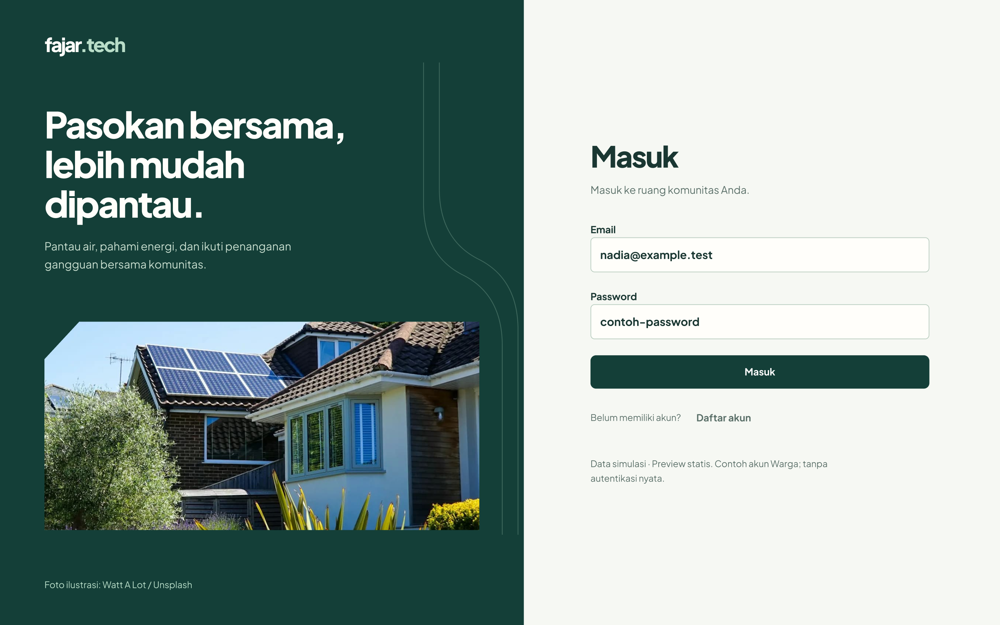</p>
<p align="center"><i>Gambar 6.2. I-01 — Login</i></p>

Tabel 6.2. Spesifikasi Objek Antarmuka I-01

| Id_Objek | Jenis | Konten | Keterangan |
| :--- | :--- | :--- | :--- |
| I-01-OBJ-01 | panel informasi dan gambar | Pasokan bersama, lebih mudah dipantau.; foto ilustrasi | Identitas produk dan ilustrasi dengan kredit; tidak menjalankan autentikasi. |
| I-01-OBJ-02 | email field | Email; nadia@example.test | Wajib, format email; diteruskan AuthView.tekanLogin(email,password) ke AkunController.login (Algo-030). |
| I-01-OBJ-03 | password field | Password; contoh-password (teks ilustrasi pada PNG) | Input rahasia pada implementasi harus dimasking; tidak dilog/ditampilkan ulang. PNG menampilkan teks contoh, dicatat sebagai gap visual. |
| I-01-OBJ-04 | button | Masuk | Verifikasi kredensial dahulu, lalu status DISETUJUI; dashboardTujuan() menentukan I-03 untuk Warga, I-08 untuk Teknisi, I-13 untuk Pengurus. Tombol disabled selama proses; tidak sukses saat respons gagal. |
| I-01-OBJ-05 | link | Belum memiliki akun? Daftar akun | Menuju I-02 melalui AuthView.bukaRegistrasi(). |

**Alur navigasi dan otorisasi:** Dari I-00/I-02 → I-01. Tujuan ditentukan akun server, bukan pilihan peran klien; akun menunggu/ditolak tetap di I-01.

**State normal/alternatif kritis:** Normal: kredensial benar dan DISETUJUI → dashboard peran. Tekstual UC13 A1: kredensial benar tetapi MENUNGGU → “Akun masih menunggu persetujuan pengurus”; A2: DITOLAK → “Akun tidak memperoleh persetujuan”; A3: kombinasi salah → satu pesan “Email atau password salah”, tidak membocorkan keberadaan email. Loading menahan submit; error jaringan menyediakan coba lagi tanpa memberi sesi; data password tidak ditampilkan ulang.

<a id="I-02"></a>

## 6.3 Rancangan Antarmuka I-02 — Registrasi akun

**ID Antarmuka:** I-02\
**Nama Layar:** Registrasi akun\
**Peran/Aktor:** Calon Pengguna\
**UC terkait:** UC12\
**Jenis viewport:** Desktop\
**Konteks/tujuan:** Mendaftarkan calon anggota dengan peran yang diajukan, tanpa akses otomatis sebelum persetujuan.

<p align="center">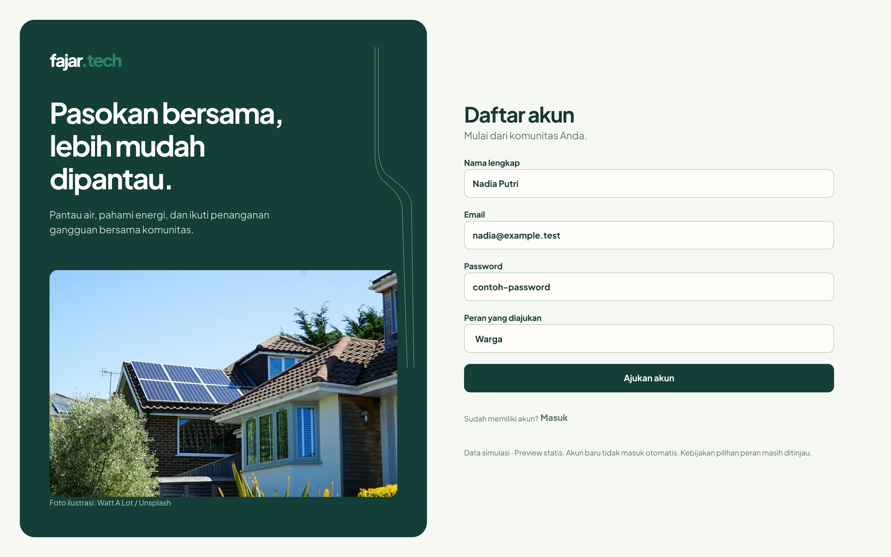</p>
<p align="center"><i>Gambar 6.3. I-02 — Registrasi akun</i></p>

Tabel 6.3. Spesifikasi Objek Antarmuka I-02

| Id_Objek | Jenis | Konten | Keterangan |
| :--- | :--- | :--- | :--- |
| I-02-OBJ-01 | panel informasi dan gambar | Pasokan bersama, lebih mudah dipantau.; foto ilustrasi | Brand dan konteks komunitas; gambar bukan data akun. |
| I-02-OBJ-02 | text field | Nama lengkap; Nadia Putri | Wajib, trim dan validasi kelengkapan lewat Validasi.validasiRegistrasi (Algo-031). |
| I-02-OBJ-03 | email field | Email; nadia@example.test | Wajib, format sah dan unik; email duplikat ditolak tanpa akun baru. |
| I-02-OBJ-04 | password field | Password; contoh-password (ilustrasi) | Wajib; masking dan hash saat implementasi menurut KNF14. Batas minimal 8 pada Algo-031 adalah keputusan desain BAB5, perlu konfirmasi kebijakan kelompok. |
| I-02-OBJ-05 | dropdown | Peran yang diajukan; Warga | Pilihan peran harus valid; tidak menjadi hak akses aktif. Pilihan lain menurut M5: Teknisi/Pengurus, kebijakan pemberian peran perlu review kelompok. |
| I-02-OBJ-06 | button | Ajukan akun | AuthView.tekanDaftar → AkunController.daftarkan (Algo-029); kelengkapan dan email unik → simpan MENUNGGU PERSETUJUAN; sukses hanya setelah persistensi. |
| I-02-OBJ-07 | link | Sudah memiliki akun? Masuk | Kembali ke I-01; tidak melakukan login otomatis. |

**Alur navigasi dan otorisasi:** I-00/I-01 → I-02; sesudah sukses tetap menampilkan hasil menunggu dan tautan I-01. Pengurus meninjau akun pada I-16.

**State normal/alternatif kritis:** Normal UC12: akun tersimpan berstatus Menunggu Persetujuan dan tampil notifikasi. Tekstual A1 email terdaftar: minta email lain, tanpa INSERT; A2 wajib kosong: tandai per kolom dan pertahankan isian nonrahasia. Loading menahan submit; error penyimpanan/jaringan tidak mengklaim akun terdaftar. Tampilan sukses/invalid/duplikat belum memiliki PNG tersendiri.

<a id="I-03"></a>

## 6.4 Rancangan Antarmuka I-03 — Dashboard warga

**ID Antarmuka:** I-03\
**Nama Layar:** Dashboard warga\
**Peran/Aktor:** Warga\
**UC terkait:** UC01\
**Jenis viewport:** Desktop\
**Konteks/tujuan:** Menyajikan pembacaan terakhir air, baterai dan panel dengan satuan/waktu yang jelas.

<p align="center">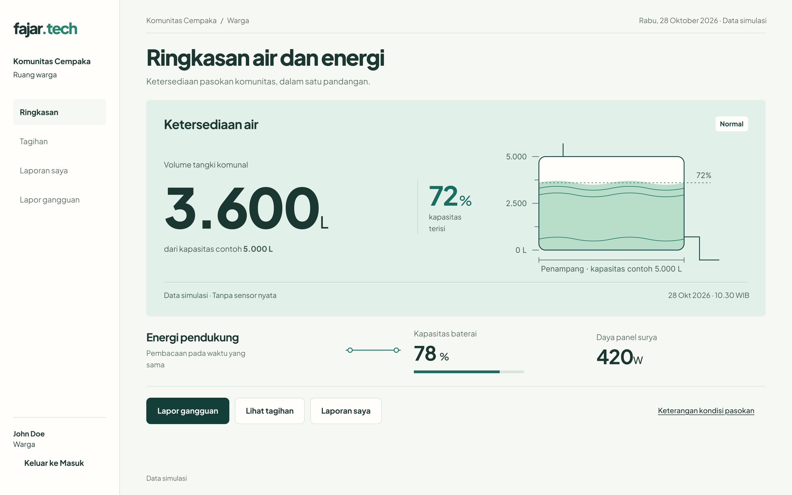</p>
<p align="center"><i>Gambar 6.4. I-03 — Dashboard warga</i></p>

Tabel 6.4. Spesifikasi Objek Antarmuka I-03

| Id_Objek | Jenis | Konten | Keterangan |
| :--- | :--- | :--- | :--- |
| I-03-OBJ-01 | sidebar navbar | Ringkasan; Tagihan; Laporan saya; Lapor gangguan; Keluar ke Masuk | Ringkasan → I-03; Tagihan → I-04; Laporan saya → I-06; Lapor gangguan → I-05. Keluar mengakhiri sesi lalu I-01; menu hanya peran aktif, server tetap memeriksa akses. |
| I-03-OBJ-02 | card dan status badge | Ketersediaan air; 3.600 L dari 5.000 L; 72%; Normal | MonitoringController.ambilStatusInfrastruktur → ModulMonitoring; TangkiAir.statusAir (Algo-009). Volume, kapasitas dan ambang pada PNG adalah contoh. |
| I-03-OBJ-03 | diagram tangki | Penampang; kapasitas contoh 5.000 L | Representasi volume, didampingi angka/label agar tidak hanya mengandalkan warna. |
| I-03-OBJ-04 | blok timestamp | 28 Okt 2026 · 10.30 WIB; Data simulasi · Tanpa sensor nyata | Waktu pembacaan terakhir harus disajikan bersama nilai, tidak diganti waktu membuka halaman. |
| I-03-OBJ-05 | metric | Kapasitas baterai 78%; Daya panel surya 420 W | Menampilkan kapasitas baterai dan daya sesaat; W bukan kWh dan bukan energi kumulatif. |
| I-03-OBJ-06 | button | Lapor gangguan | WargaView.bukaFormLaporan() → I-05. |
| I-03-OBJ-07 | button | Lihat tagihan | Menuju I-04; hanya tagihan final milik sesi. |
| I-03-OBJ-08 | button | Laporan saya | WargaView.bukaRiwayat() → I-06. |
| I-03-OBJ-09 | link | Keterangan kondisi pasokan | Membuka penjelasan label Normal/Rendah/Kritis di I-03; state tekstual, tidak menetapkan ambang produksi. |
| I-03-OBJ-10 | header dan footer informasi | Komunitas Cempaka / Warga; tanggal; Data simulasi; identitas akun contoh | Konteks komunitas/peran/waktu dan batas pratinjau; bukan kontrol pengganti identitas sesi. Nama, tanggal dan angka PNG adalah ilustrasi. |

**Alur navigasi dan otorisasi:** Login peran Warga → I-03; aksi menuju I-04/I-05/I-06. Akses data mengikuti sesi warga yang disetujui.

**State normal/alternatif kritis:** Normal UC01: pembacaan terbaru dan klasifikasi Normal/Rendah/Kritis. Tekstual A1: tidak menerima data baru → data terakhir + timestamp + “Data terbaru belum tersedia”; jika belum pernah membaca tampil —, bukan nol. Loading memberi penanda sedang memuat; error koneksi dibedakan dari nilai sensor kritis. KNF11 ≤2 detik merupakan target runtime, belum diuji.

<a id="I-04"></a>

## 6.5 Rancangan Antarmuka I-04 — Tagihan iuran final

**ID Antarmuka:** I-04\
**Nama Layar:** Tagihan iuran final\
**Peran/Aktor:** Warga\
**UC terkait:** UC02\
**Jenis viewport:** Desktop\
**Konteks/tujuan:** Menampilkan rincian iuran yang telah FINAL untuk warga pemilik pada periode terpilih.

<p align="center">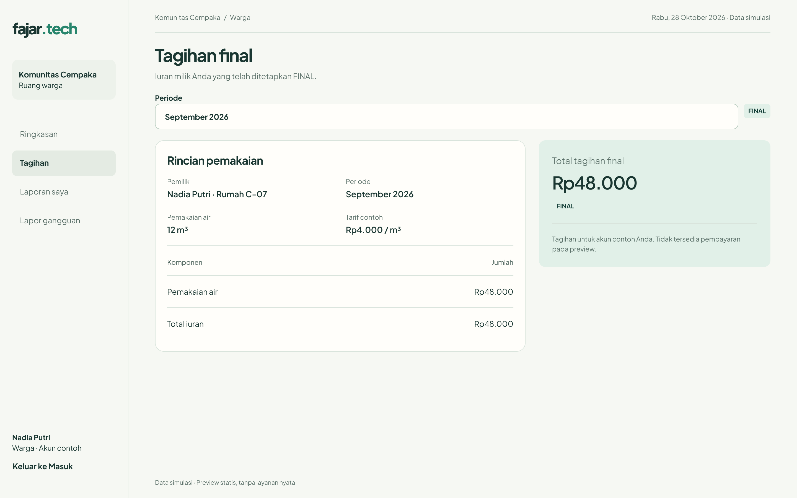</p>
<p align="center"><i>Gambar 6.5. I-04 — Tagihan iuran final</i></p>

Tabel 6.5. Spesifikasi Objek Antarmuka I-04

| Id_Objek | Jenis | Konten | Keterangan |
| :--- | :--- | :--- | :--- |
| I-04-OBJ-01 | sidebar navbar | Ringkasan; Tagihan; Laporan saya; Lapor gangguan; Keluar ke Masuk | Ringkasan → I-03; Tagihan → I-04; Laporan saya → I-06; Lapor gangguan → I-05. Keluar mengakhiri sesi lalu I-01; menu hanya peran aktif, server tetap memeriksa akses. |
| I-04-OBJ-02 | dropdown dan badge | Periode; September 2026; FINAL | WargaView.pilihPeriodeTagihan → IuranController.lihatTagihanFinal; idWarga berasal sesi. Pilih periode memeriksa status sebelum nominal ditampilkan. |
| I-04-OBJ-03 | card rincian | Pemilik Nadia Putri · Rumah C-07; Periode September 2026; Pemakaian air 12 m³; Tarif contoh Rp4.000/m³ | Tagihan.rincian() untuk pemilik; bukan data warga lain. Tarif dan rumah hanya ilustrasi. |
| I-04-OBJ-04 | data table | Komponen/Jumlah; Pemakaian air Rp48.000; Total iuran Rp48.000 | Ilustrasi 12 × 4.000 = 48.000. Model M7 juga mengenal energi/biaya tetap; rincian itu ditampilkan bila berlaku, state tekstual dan perlu kesepakatan tarif. |
| I-04-OBJ-05 | summary card | Total tagihan final Rp48.000; FINAL | Hanya tampil setelah Tagihan.sudahFinal() benar. Tidak memuat tombol bayar; mekanisme iuran di luar payment gateway. |
| I-04-OBJ-06 | header dan footer informasi | Komunitas Cempaka / Warga; tanggal; Data simulasi; identitas akun contoh | Konteks komunitas/peran/waktu dan batas pratinjau; bukan kontrol pengganti identitas sesi. Nama, tanggal dan angka PNG adalah ilustrasi. |

**Alur navigasi dan otorisasi:** I-03 → I-04, navbar kembali I-03 atau I-06/I-05; hanya Warga pemilik dengan sesi aktif.

**State normal/alternatif kritis:** Normal UC02: pilihan periode → verifikasi final → rincian final. Tekstual A1: periode belum final → “Tagihan final belum tersedia”, sembunyikan nominal draft. Jika belum ada periode, tampil kosong; loading/error baca data terpisah, tidak dianggap tagihan Rp0.

<a id="I-05"></a>

## 6.6 Rancangan Antarmuka I-05 — Buat laporan gangguan

**ID Antarmuka:** I-05\
**Nama Layar:** Buat laporan gangguan\
**Peran/Aktor:** Warga\
**UC terkait:** UC03\
**Jenis viewport:** Desktop\
**Konteks/tujuan:** Menerima laporan gangguan warga dan memastikan keanggotaan sah sebelum membuat serta menyimpan laporan.

<p align="center">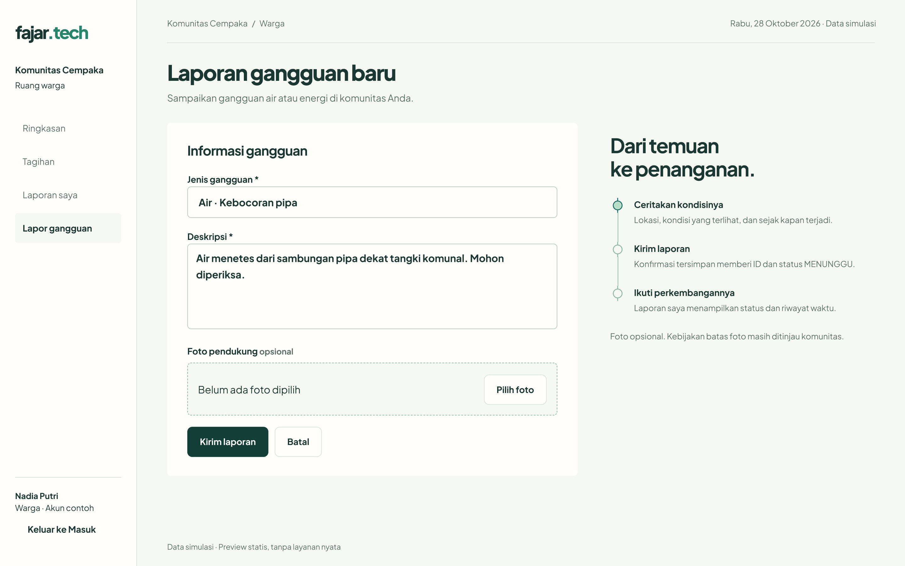</p>
<p align="center"><i>Gambar 6.6. I-05 — Buat laporan gangguan</i></p>

Tabel 6.6. Spesifikasi Objek Antarmuka I-05

| Id_Objek | Jenis | Konten | Keterangan |
| :--- | :--- | :--- | :--- |
| I-05-OBJ-01 | sidebar navbar | Ringkasan; Tagihan; Laporan saya; Lapor gangguan; Keluar ke Masuk | Ringkasan → I-03; Tagihan → I-04; Laporan saya → I-06; Lapor gangguan → I-05. Keluar mengakhiri sesi lalu I-01; menu hanya peran aktif, server tetap memeriksa akses. |
| I-05-OBJ-02 | dropdown | Jenis gangguan *; Air - Kebocoran pipa | Wajib dan jenis sah komunitas; Validasi.periksaLaporan mengulang validasi server. |
| I-05-OBJ-03 | textarea | Deskripsi *; Air menetes dari sambungan pipa dekat tangki komunal. Mohon diperiksa. | Wajib, trim, pertahankan isian bila invalid/gagal; tidak menerima field idWarga/status dari form. |
| I-05-OBJ-04 | file input dan button | Foto pendukung opsional; Belum ada foto dipilih; Pilih foto | Pilih unggahan terotorisasi, periksa tipe/MIME/ukuran sesuai kebijakan yang perlu konfirmasi. Tidak mengarang batas ukuran; URI asing tidak dipercaya. |
| I-05-OBJ-05 | button | Kirim laporan | WargaView.kirimLaporan → LaporanController.kirimLaporan (Algo-025) → ModulLaporan.kirimLaporan (Algo-034). Validasi membership terkini (Algo-003) sebelum create, status MENUNGGU, simpan lalu tampil sukses dengan ID. |
| I-05-OBJ-06 | button | Batal | Kembali I-06 tanpa INSERT; spesifikasi tekstual konfirmasi bila isian belum tersimpan. |
| I-05-OBJ-07 | stepper informasi | Dari temuan ke penanganan.; Ceritakan kondisinya; Kirim laporan; Ikuti perkembangannya | Menjelaskan alur, konfirmasi tersimpan memberi ID dan status MENUNGGU; perkembangan dipantau I-06 → I-07. Bukan tiga tombol pengubah status. |
| I-05-OBJ-08 | header dan footer informasi | Komunitas Cempaka / Warga; tanggal; Data simulasi; identitas akun contoh | Konteks komunitas/peran/waktu dan batas pratinjau; bukan kontrol pengganti identitas sesi. Nama, tanggal dan angka PNG adalah ilustrasi. |

**Alur navigasi dan otorisasi:** I-03/I-06 → I-05 → sukses dengan ID dan tautan I-07; Batal → I-06. Hanya Warga terdaftar pada komunitas sesi. Penolakan keanggotaan terjadi sebelum objek laporan dibuat.

**State normal/alternatif kritis:** Normal UC03: valid → MENUNGGU → simpan → “Laporan berhasil dikirim” dan ID. Tekstual A1: tidak terdaftar → tidak berwenang, tanpa create/INSERT. Invalid: tandai field, tanpa simpan. Loading: tombol nonaktif, belum terkirim. Offline KNF03: draf sementara berlabel “Belum terkirim”, kirim ulang setelah koneksi pulih dan membership diperiksa ulang. Gagal simpan mempertahankan isian, tidak sukses palsu. Pencegahan duplikasi retry memerlukan identitas permintaan stabil/deduplikasi server sebagai asumsi desain yang belum diputuskan sumber; bukan jaminan implementasi.

<a id="I-06"></a>

## 6.7 Rancangan Antarmuka I-06 — Daftar laporan saya

**ID Antarmuka:** I-06\
**Nama Layar:** Daftar laporan saya\
**Peran/Aktor:** Warga\
**UC terkait:** UC04\
**Jenis viewport:** Desktop\
**Konteks/tujuan:** Menelusuri hanya laporan milik warga dari identitas sesi.

<p align="center">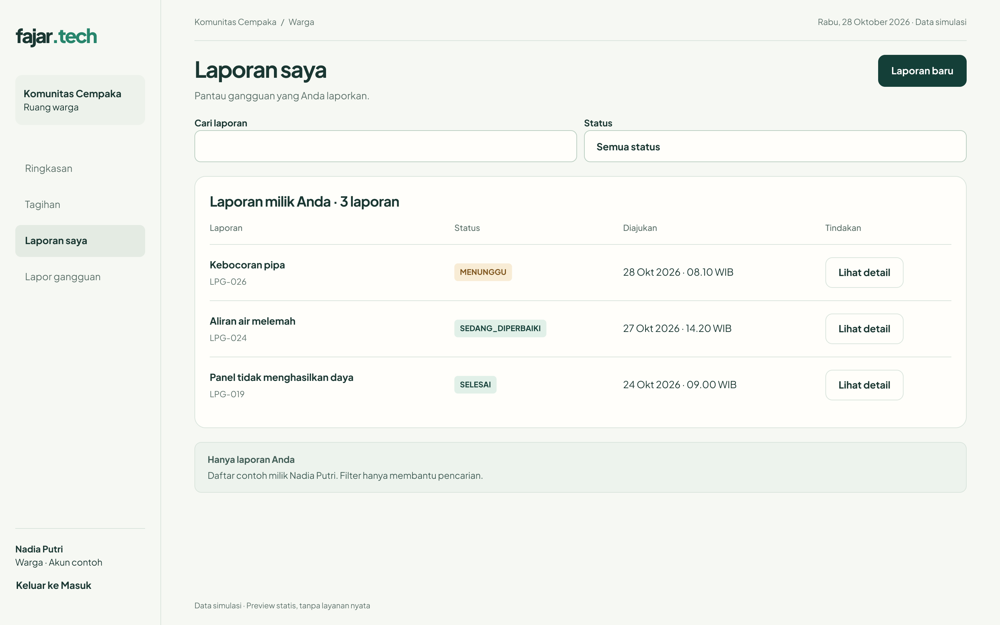</p>
<p align="center"><i>Gambar 6.7. I-06 — Daftar laporan saya</i></p>

Tabel 6.7. Spesifikasi Objek Antarmuka I-06

| Id_Objek | Jenis | Konten | Keterangan |
| :--- | :--- | :--- | :--- |
| I-06-OBJ-01 | sidebar navbar | Ringkasan; Tagihan; Laporan saya; Lapor gangguan; Keluar ke Masuk | Ringkasan → I-03; Tagihan → I-04; Laporan saya → I-06; Lapor gangguan → I-05. Keluar mengakhiri sesi lalu I-01; menu hanya peran aktif, server tetap memeriksa akses. |
| I-06-OBJ-02 | button | Laporan baru | WargaView.bukaFormLaporan() → I-05. |
| I-06-OBJ-03 | search field | Cari laporan | Menyaring daftar milik sesi; filter UI tidak menggantikan predikat idWarga server. |
| I-06-OBJ-04 | dropdown | Status; Semua status | Filter MENUNGGU/SEDANG_DIPERBAIKI/SELESAI pada himpunan pemilik; pilihan lain tidak menambah hak baca. |
| I-06-OBJ-05 | data table dan badge | Laporan milik Anda · 3 laporan; Kebocoran pipa LPG-026 MENUNGGU; Aliran air melemah LPG-024 SEDANG_DIPERBAIKI; Panel tidak menghasilkan daya LPG-019 SELESAI | LaporanController.daftarMilikWarga → ModulLaporan → cariMilikWarga (Tabel 5.48.4), idWarga sesi; tampil status dan waktu diajukan. |
| I-06-OBJ-06 | button per baris | Lihat detail | WargaView.pilihLaporan(idLaporan) → I-07 setelah cariDetailMilik(idWarga sesi,idLaporan). ID asing tidak membuka rincian. |
| I-06-OBJ-07 | notice | Hanya laporan Anda | Menyatakan isolasi pemilik; nama dan tiga entri adalah data simulasi. |
| I-06-OBJ-08 | header dan footer informasi | Komunitas Cempaka / Warga; tanggal; Data simulasi; identitas akun contoh | Konteks komunitas/peran/waktu dan batas pratinjau; bukan kontrol pengganti identitas sesi. Nama, tanggal dan angka PNG adalah ilustrasi. |

**Alur navigasi dan otorisasi:** I-03/I-05 → I-06 → I-07 untuk laporan sendiri; I-05 untuk laporan baru. Daftar terurut waktu_dibuat DESC, id_laporan ASC menurut rincian BAB5.

**State normal/alternatif kritis:** Normal UC04: daftar → pilih → detail/riwayat. Tekstual A1: query berhasil tetapi [] → “Belum ada laporan gangguan”, tawarkan I-05. Filter tanpa hasil → “Tidak ada laporan sesuai filter”, bedakan dari belum pernah melapor. Error query/koneksi → “Gagal memuat laporan” dan coba lagi, bukan daftar kosong. Loading tidak menampilkan hasil lama sebagai hasil baru.

<a id="I-07"></a>

## 6.8 Rancangan Antarmuka I-07 — Detail dan riwayat laporan

**ID Antarmuka:** I-07\
**Nama Layar:** Detail dan riwayat laporan\
**Peran/Aktor:** Warga\
**UC terkait:** UC04\
**Jenis viewport:** Desktop\
**Konteks/tujuan:** Menyajikan detail dan perkembangan bertimestamp milik warga tanpa membocorkan laporan pihak lain.

<p align="center">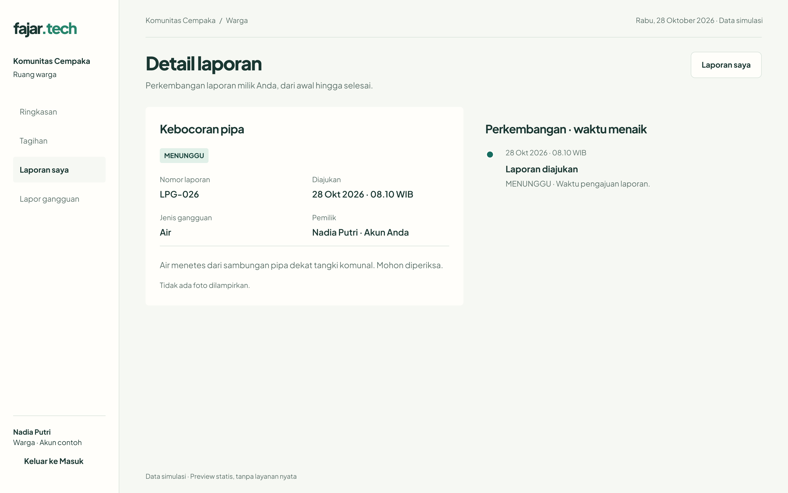</p>
<p align="center"><i>Gambar 6.8. I-07 — Detail dan riwayat laporan</i></p>

Tabel 6.8. Spesifikasi Objek Antarmuka I-07

| Id_Objek | Jenis | Konten | Keterangan |
| :--- | :--- | :--- | :--- |
| I-07-OBJ-01 | sidebar navbar | Ringkasan; Tagihan; Laporan saya; Lapor gangguan; Keluar ke Masuk | Ringkasan → I-03; Tagihan → I-04; Laporan saya → I-06; Lapor gangguan → I-05. Keluar mengakhiri sesi lalu I-01; menu hanya peran aktif, server tetap memeriksa akses. |
| I-07-OBJ-02 | button | Laporan saya | Kembali I-06 tanpa mutasi. |
| I-07-OBJ-03 | card dan badge | Kebocoran pipa; MENUNGGU; Nomor laporan LPG-026 | WargaView.pilihLaporan → detailMilikWarga, lalu LaporanGangguan.getDetailLaporan(); hanya hasil query pemilik. |
| I-07-OBJ-04 | blok informasi | Diajukan 28 Okt 2026 · 08.10 WIB; Jenis gangguan Air; Pemilik Nadia Putri · Akun Anda | Identitas pemilik berasal hasil terotorisasi, tidak dari parameter klien. |
| I-07-OBJ-05 | teks dan lampiran | Air menetes dari sambungan pipa dekat tangki komunal. Mohon diperiksa.; Tidak ada foto dilampirkan. | Deskripsi/foto hasil laporan sendiri; ketiadaan foto bukan error. |
| I-07-OBJ-06 | timeline | Perkembangan · waktu menaik; Laporan diajukan; MENUNGGU · Waktu pengajuan laporan | WargaView.bukaPerkembangan → riwayatMilikWarga; query pemilik pada setiap baca, timestamp ASC lalu id_riwayat ASC. Peristiwa awal dari waktuDibuat, bukan mengarang riwayat perubahan. |
| I-07-OBJ-07 | header dan footer informasi | Komunitas Cempaka / Warga; tanggal; Data simulasi; identitas akun contoh | Konteks komunitas/peran/waktu dan batas pratinjau; bukan kontrol pengganti identitas sesi. Nama, tanggal dan angka PNG adalah ilustrasi. |

**Alur navigasi dan otorisasi:** I-06 → I-07 → I-06; idWarga diambil dari sesi pada detail maupun riwayat. Tidak menyediakan perubahan status bagi Warga.

**State normal/alternatif kritis:** Normal UC04: status terkini dan riwayat menaik. Tekstual: ID asing/tidak ada → pesan sama “Laporan tidak tersedia untuk akun ini”, tanpa detail; riwayat perubahan kosong pada detail sah → “Belum ada perubahan”, pengajuan awal tetap dapat ditampilkan. Error riwayat tidak disamakan dengan belum ada perubahan. Loading/error/coba lagi berada di I-07, akses dicek ulang pada setiap permintaan.

<a id="I-08"></a>

## 6.9 Rancangan Antarmuka I-08 — Peringatan perangkat

**ID Antarmuka:** I-08\
**Nama Layar:** Peringatan perangkat\
**Peran/Aktor:** Teknisi\
**UC terkait:** UC05\
**Jenis viewport:** Desktop\
**Konteks/tujuan:** Menyajikan peringatan baterai kritis kepada teknisi penanggung jawab perangkat.

<p align="center">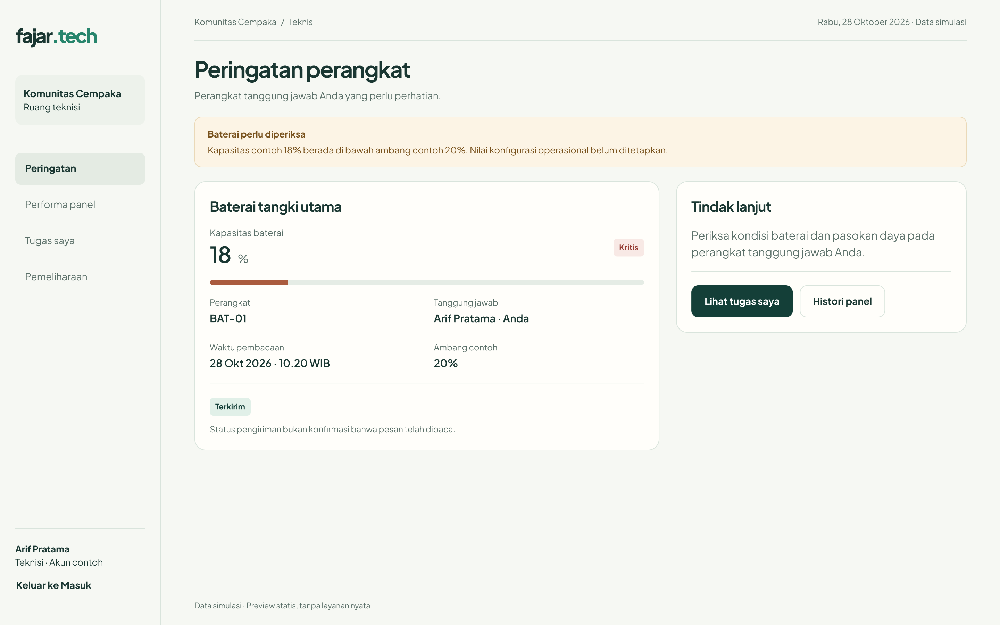</p>
<p align="center"><i>Gambar 6.9. I-08 — Peringatan perangkat</i></p>

Tabel 6.9. Spesifikasi Objek Antarmuka I-08

| Id_Objek | Jenis | Konten | Keterangan |
| :--- | :--- | :--- | :--- |
| I-08-OBJ-01 | sidebar navbar | Peringatan; Performa panel; Tugas saya; Pemeliharaan; Keluar ke Masuk | Peringatan → I-08; Performa panel → I-09; Tugas saya → I-10; Pemeliharaan → I-12. Keluar mengakhiri sesi lalu I-01; menu hanya peran aktif, server tetap memeriksa akses. |
| I-08-OBJ-02 | alert | Baterai perlu diperiksa; kapasitas contoh 18% di bawah ambang contoh 20% | UC05 dipicu ketika kapasitas mencapai atau di bawah ambang aman (≤); angka ambang contoh belum konfigurasi produksi. |
| I-08-OBJ-03 | card dan meter | Baterai tangki utama; 18%; Kritis; BAT-01 | TeknisiView.tampilkanNotifikasiKritis menampilkan detail perangkat tanggung jawab sesi. |
| I-08-OBJ-04 | blok informasi | Tanggung jawab Arif Pratama · Anda; Waktu pembacaan 28 Okt 2026 · 10.20 WIB; Ambang contoh 20% | Penugasan perangkat menentukan penerima; waktu adalah waktu kondisi/pembacaan, bukan waktu membuka notifikasi. |
| I-08-OBJ-05 | status badge | Terkirim; Status pengiriman bukan konfirmasi bahwa pesan telah dibaca. | Status kirim terpisah dari dibaca; tidak mengklaim penerima sudah membaca. |
| I-08-OBJ-06 | button | Lihat tugas saya | Menuju I-10 untuk daftar penugasan laporan; peringatan tidak otomatis menciptakan tugas laporan. |
| I-08-OBJ-07 | button | Histori panel | Menuju I-09; tidak memberi kendali fisik perangkat. |
| I-08-OBJ-08 | header dan footer informasi | Komunitas Cempaka / Teknisi; tanggal; Data simulasi; identitas akun contoh | Konteks komunitas/peran/waktu dan batas pratinjau; bukan kontrol pengganti identitas sesi. Nama, tanggal dan angka PNG adalah ilustrasi. |

**Alur navigasi dan otorisasi:** Teknisi disetujui → I-08; hanya notifikasi perangkat yang menjadi tanggung jawabnya (PenugasanPerangkat). Aksi → I-10/I-09.

**State normal/alternatif kritis:** Normal UC05: deteksi ≤ ambang → tentukan teknisi → kirim → buka detail. Tekstual A1: jaringan putus → simpan pending, label “Belum terkirim”; koneksi pulih → kirim ulang, status menjadi terkirim hanya setelah berhasil. Loading/error pemuatan detail dibedakan dari tidak ada peringatan; kosong menunjukkan tidak ada peringatan aktif, bukan perangkat pasti sehat. KNF05 ≤3 detik adalah target runtime yang belum diuji.

<a id="I-09"></a>

## 6.10 Rancangan Antarmuka I-09 — Histori panel surya

**ID Antarmuka:** I-09\
**Nama Layar:** Histori panel surya\
**Peran/Aktor:** Teknisi\
**UC terkait:** UC06\
**Jenis viewport:** Desktop\
**Konteks/tujuan:** Memeriksa grafik daya panel dalam rentang waktu yang dipilih.

<p align="center">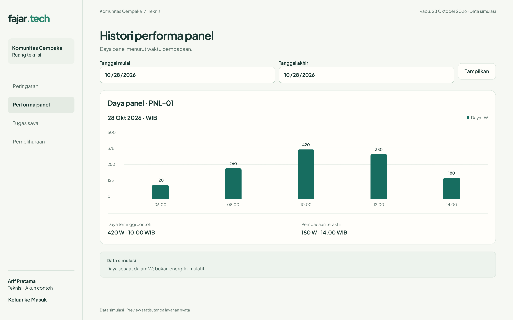</p>
<p align="center"><i>Gambar 6.10. I-09 — Histori panel surya</i></p>

Tabel 6.10. Spesifikasi Objek Antarmuka I-09

| Id_Objek | Jenis | Konten | Keterangan |
| :--- | :--- | :--- | :--- |
| I-09-OBJ-01 | sidebar navbar | Peringatan; Performa panel; Tugas saya; Pemeliharaan; Keluar ke Masuk | Peringatan → I-08; Performa panel → I-09; Tugas saya → I-10; Pemeliharaan → I-12. Keluar mengakhiri sesi lalu I-01; menu hanya peran aktif, server tetap memeriksa akses. |
| I-09-OBJ-02 | date field | Tanggal mulai; 10/28/2026 | RentangWaktu.validasi() memastikan mulai ≤ selesai; tanggal valid, simpan sebagai waktu yang konsisten. |
| I-09-OBJ-03 | date field | Tanggal akhir; 10/28/2026 | Bersama tanggal mulai menentukan rentang inklusif pembacaan; batas zona waktu mengikuti WIB pada label (spesifikasi desain). |
| I-09-OBJ-04 | button | Tampilkan | TeknisiView.pilihRentangKinerja → MonitoringController.ambilRiwayatPanel; invalid tidak mengambil grafik baru. |
| I-09-OBJ-05 | bar chart | Daya panel · PNL-01; 28 Okt 2026 · WIB; 06.00 120 W, 08.00 260 W, 10.00 420 W, 12.00 380 W, 14.00 180 W | DataHistorisKinerja dalam rentang; batang adalah sampel diskret, bukan interpolasi energi atau pembacaan kontinu. |
| I-09-OBJ-06 | metric | Daya tertinggi contoh 420 W · 10.00 WIB; Pembacaan terakhir 180 W · 14.00 WIB | Ringkasan dari data yang sama; jangan menganggap W sebagai kWh. |
| I-09-OBJ-07 | notice | Data simulasi; Daya sesaat dalam W, bukan energi kumulatif. | Tekstual aksesibilitas: sediakan tabel nilai waktu/daya yang sama sebagai alternatif grafik, belum ada PNG varian tabel. |
| I-09-OBJ-08 | header dan footer informasi | Komunitas Cempaka / Teknisi; tanggal; Data simulasi; identitas akun contoh | Konteks komunitas/peran/waktu dan batas pratinjau; bukan kontrol pengganti identitas sesi. Nama, tanggal dan angka PNG adalah ilustrasi. |

**Alur navigasi dan otorisasi:** I-08/navbar → I-09 untuk Teknisi; ganti rentang memperbarui I-09 tanpa perubahan data sumber.

**State normal/alternatif kritis:** Normal UC06: rentang valid → data historis → grafik/tren. Tekstual A1: tidak ada data pada rentang → grafik kosong dan “Data historis belum tersedia”, tawarkan ganti rentang. Rentang invalid ditandai; loading/error dibedakan dari hasil kosong, jangan membuat nol palsu. KNF04 ≤5 detik adalah target runtime, belum diuji.

<a id="I-10"></a>

## 6.11 Rancangan Antarmuka I-10 — Daftar tugas teknisi

**ID Antarmuka:** I-10\
**Nama Layar:** Daftar tugas teknisi\
**Peran/Aktor:** Teknisi\
**UC terkait:** UC07\
**Jenis viewport:** Desktop\
**Konteks/tujuan:** Menyajikan laporan yang ditugaskan kepada teknisi saat ini.

<p align="center">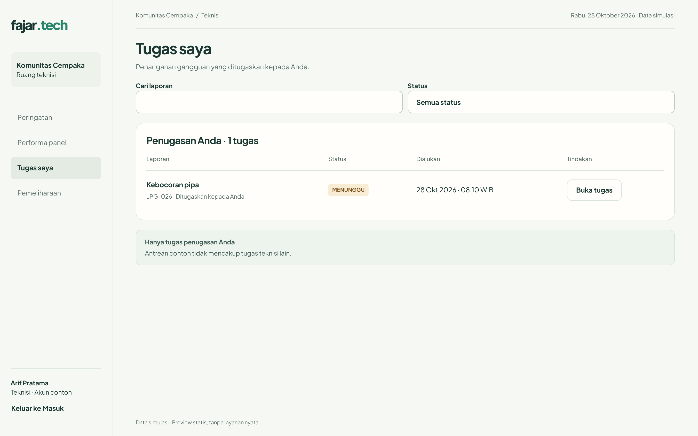</p>
<p align="center"><i>Gambar 6.11. I-10 — Daftar tugas teknisi</i></p>

Tabel 6.11. Spesifikasi Objek Antarmuka I-10

| Id_Objek | Jenis | Konten | Keterangan |
| :--- | :--- | :--- | :--- |
| I-10-OBJ-01 | sidebar navbar | Peringatan; Performa panel; Tugas saya; Pemeliharaan; Keluar ke Masuk | Peringatan → I-08; Performa panel → I-09; Tugas saya → I-10; Pemeliharaan → I-12. Keluar mengakhiri sesi lalu I-01; menu hanya peran aktif, server tetap memeriksa akses. |
| I-10-OBJ-02 | search field | Cari laporan | Filter hanya tugas sesi; tidak melakukan pencarian seluruh laporan komunitas. |
| I-10-OBJ-03 | dropdown | Status; Semua status | Menyaring status pada daftar tugas yang telah diotorisasi. |
| I-10-OBJ-04 | data table dan badge | Penugasan Anda · 1 tugas; Kebocoran pipa; LPG-026 · Ditugaskan kepada Anda; MENUNGGU; 28 Okt 2026 · 08.10 WIB | TeknisiView.bukaPenugasan → daftarPenugasan → cariDaftarTugas(idTeknisi sesi); query EXISTS penugasan. |
| I-10-OBJ-05 | button | Buka tugas | TeknisiView.pilihTugas(idLaporan) → I-11, server memeriksa ulang penugasan. |
| I-10-OBJ-06 | notice | Hanya tugas penugasan Anda | Antrean tidak mencakup teknisi lain; tidak ada aksi mengklaim tugas bebas. |
| I-10-OBJ-07 | header dan footer informasi | Komunitas Cempaka / Teknisi; tanggal; Data simulasi; identitas akun contoh | Konteks komunitas/peran/waktu dan batas pratinjau; bukan kontrol pengganti identitas sesi. Nama, tanggal dan angka PNG adalah ilustrasi. |

**Alur navigasi dan otorisasi:** I-08/navbar → I-10 → I-11. Versi mobile ekuivalen I-10-M → I-11-M; pergantian viewport tidak mengubah hak akses.

**State normal/alternatif kritis:** Normal UC07: daftar penugasan → detail tugas. Tekstual: tidak ada tugas → “Belum ada tugas”, tidak ada mutasi; filter tanpa hasil berbeda dari error pemuatan. Penugasan dicabut sebelum detail dibuka → akses ditolak. Loading/error menawarkan muat ulang, tidak memperluas pencarian ke tugas orang lain.

<a id="I-11"></a>

## 6.12 Rancangan Antarmuka I-11 — Detail dan status tugas teknisi

**ID Antarmuka:** I-11\
**Nama Layar:** Detail dan status tugas teknisi\
**Peran/Aktor:** Teknisi\
**UC terkait:** UC07\
**Jenis viewport:** Desktop\
**Konteks/tujuan:** Memandu teknisi penugasan melakukan hanya langkah status legal dan mencatat waktunya secara atomik.

<p align="center">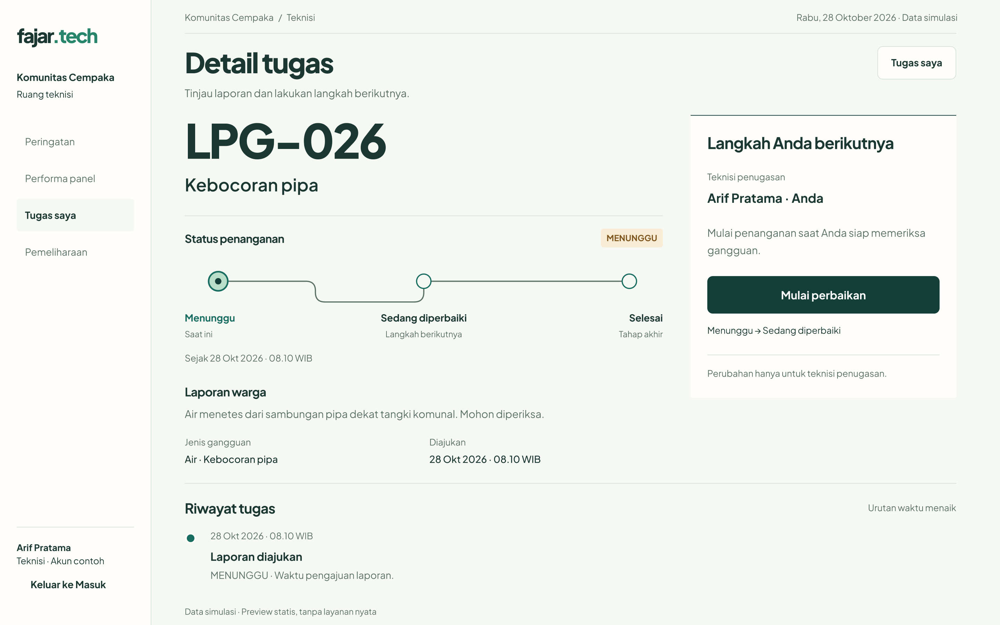</p>
<p align="center"><i>Gambar 6.12. I-11 — Detail dan status tugas teknisi</i></p>

Tabel 6.12. Spesifikasi Objek Antarmuka I-11

| Id_Objek | Jenis | Konten | Keterangan |
| :--- | :--- | :--- | :--- |
| I-11-OBJ-01 | sidebar navbar | Peringatan; Performa panel; Tugas saya; Pemeliharaan; Keluar ke Masuk | Peringatan → I-08; Performa panel → I-09; Tugas saya → I-10; Pemeliharaan → I-12. Keluar mengakhiri sesi lalu I-01; menu hanya peran aktif, server tetap memeriksa akses. |
| I-11-OBJ-02 | button | Tugas saya | Kembali I-10 tanpa mengubah status. |
| I-11-OBJ-03 | heading dan card | LPG-026; Kebocoran pipa | TeknisiView.pilihTugas → detailTugas → cariDetailTugas(idTeknisi sesi,idLaporan); ID tugas bukan bukti kewenangan. |
| I-11-OBJ-04 | status badge dan stepper | MENUNGGU; Menunggu (Saat ini) → Sedang diperbaiki (Langkah berikutnya) → Selesai (Tahap akhir) | Stepper informasi, bukan tiga tombol pilihan bebas. statusBerikutnya() hanya mengizinkan SEDANG_DIPERBAIKI dari MENUNGGU. |
| I-11-OBJ-05 | timestamp | Sejak 28 Okt 2026 · 08.10 WIB | Menampilkan waktu keadaan server, tidak waktu lokal perkiraan. |
| I-11-OBJ-06 | card tindakan | Langkah Anda berikutnya; Teknisi penugasan Arif Pratama · Anda | Tindakan dibatasi penugasan; server memverifikasi ulang pada setiap mutasi. |
| I-11-OBJ-07 | button | Mulai perbaikan | TeknisiView.ubahStatus → LaporanController.perbaruiStatus → ModulLaporan.perbaruiStatus → simpanStatusDanRiwayat (Algo-040) → transaksiStatus (Algo-042). Verifikasi tugas, transisi Algo-017, guard status lama, UPDATE+riwayat atomik; sukses sesudah COMMIT. |
| I-11-OBJ-08 | blok informasi | Laporan warga; Air menetes dari sambungan pipa dekat tangki komunal. Mohon diperiksa.; Air - Kebocoran pipa; Diajukan 28 Okt 2026 · 08.10 WIB | Hanya detail tugas terotorisasi; tidak mengubah deskripsi warga. |
| I-11-OBJ-09 | timeline | Riwayat tugas; Urutan waktu menaik; Laporan diajukan; MENUNGGU | Awal dari waktuDibuat; perubahan berikutnya dari riwayat timestamp ASC. Catatan awal tidak dianggap INSERT C22 oleh UC03. |
| I-11-OBJ-10 | header dan footer informasi | Komunitas Cempaka / Teknisi; tanggal; Data simulasi; identitas akun contoh | Konteks komunitas/peran/waktu dan batas pratinjau; bukan kontrol pengganti identitas sesi. Nama, tanggal dan angka PNG adalah ilustrasi. |

**Alur navigasi dan otorisasi:** I-10 → I-11 → I-10; ekuivalen I-11-M pada mobile. Teknisi hanya menangani penugasan sesi; UI tidak menerima idTeknisi buatan klien.

**State normal/alternatif kritis:** Normal UC07: MENUNGGU → SEDANG_DIPERBAIKI, kemudian hanya → SELESAI; terminal tidak punya tombol pembaruan. Tekstual A1: tanpa penugasan → “Teknisi tidak berwenang”, tanpa UPDATE/INSERT. A2: status sama/lompat/mundur → “Perubahan status ditolak. Pilih tahap berikutnya” dan opsiLegal, tanpa mutasi. Loading menonaktifkan tombol; sukses menampilkan status serta waktu server; konflik status lama/penugasan atau INSERT riwayat gagal → rollback status+riwayat, buang objek lokal, tampilkan gagal dan muat ulang; tidak overwrite otomatis. PNG hanya menunjukkan MENUNGGU sebelum aksi.

<a id="I-12"></a>

## 6.13 Rancangan Antarmuka I-12 — Form pemeliharaan

**ID Antarmuka:** I-12\
**Nama Layar:** Form pemeliharaan\
**Peran/Aktor:** Teknisi\
**UC terkait:** UC08\
**Jenis viewport:** Desktop\
**Konteks/tujuan:** Mencatat perangkat, waktu, tindakan dan hasil pemeliharaan sebagai riwayat yang bisa ditelusuri.

<p align="center">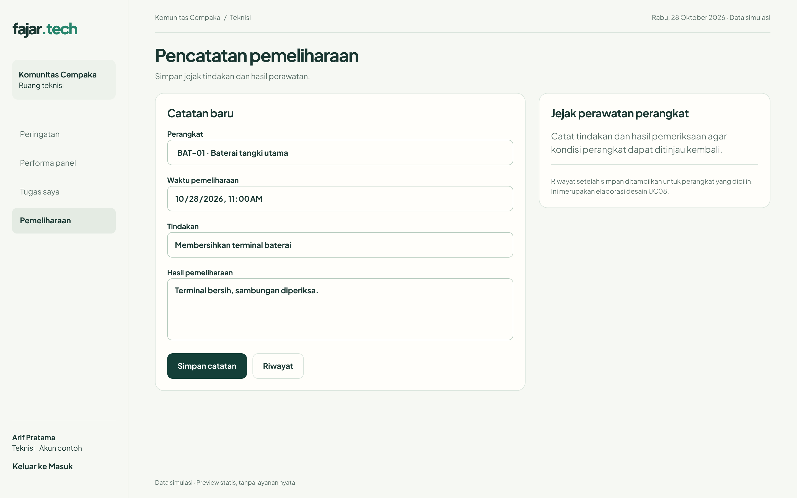</p>
<p align="center"><i>Gambar 6.13. I-12 — Form pemeliharaan</i></p>

Tabel 6.13. Spesifikasi Objek Antarmuka I-12

| Id_Objek | Jenis | Konten | Keterangan |
| :--- | :--- | :--- | :--- |
| I-12-OBJ-01 | sidebar navbar | Peringatan; Performa panel; Tugas saya; Pemeliharaan; Keluar ke Masuk | Peringatan → I-08; Performa panel → I-09; Tugas saya → I-10; Pemeliharaan → I-12. Keluar mengakhiri sesi lalu I-01; menu hanya peran aktif, server tetap memeriksa akses. |
| I-12-OBJ-02 | dropdown | Perangkat; BAT-01 · Baterai tangki utama | Pilih perangkat valid dalam lingkup teknisi; ModulPemeliharaan menerima ID perangkat, bukan label arbitrer. |
| I-12-OBJ-03 | datetime field | Waktu pemeliharaan; 10/28/2026, 11:00 AM | Wajib, tanggal/waktu valid; simpan DateTime dengan zona waktu yang jelas (WIB sebagai spesifikasi desain). |
| I-12-OBJ-04 | text field | Tindakan; Membersihkan terminal baterai | Wajib; Validasi.periksaPemeliharaan memeriksa kelengkapan. |
| I-12-OBJ-05 | textarea | Hasil pemeliharaan; Terminal bersih, sambungan diperiksa. | Wajib, dipertahankan jika gagal validasi/simpan. |
| I-12-OBJ-06 | button | Simpan catatan | TeknisiView.simpanPemeliharaan → PemeliharaanController.simpanCatatan → ModulPemeliharaan.simpanCatatan (Algo-035); identitas teknisi dari sesi. Sukses hanya sesudah simpan. |
| I-12-OBJ-07 | button | Riwayat | Membuka state riwayat perangkat terpilih di I-12, bukan layar baru. Catatan dapat ditelusuri menurut perangkat/waktu (Perangkat.getRiwayatPemeliharaan). |
| I-12-OBJ-08 | card informasi | Jejak perawatan perangkat | Menjelaskan penelusuran catatan setelah simpan; tampilan riwayat adalah elaborasi desain UC08, belum ada PNG hasilnya. |
| I-12-OBJ-09 | header dan footer informasi | Komunitas Cempaka / Teknisi; tanggal; Data simulasi; identitas akun contoh | Konteks komunitas/peran/waktu dan batas pratinjau; bukan kontrol pengganti identitas sesi. Nama, tanggal dan angka PNG adalah ilustrasi. |

**Alur navigasi dan otorisasi:** Teknisi lewat navbar → I-12; ekuivalen mobile I-12-M. Simpan tidak otomatis menyelesaikan laporan UC07; perubahan status tetap di I-11.

**State normal/alternatif kritis:** Normal UC08: lengkap → simpan → notifikasi “Catatan pemeliharaan berhasil disimpan”, riwayat perangkat/waktu dapat dibuka. Tekstual A1: kolom wajib kosong → batal simpan, tandai kolom, pertahankan lainnya. Loading menahan simpan; gagal DB/jaringan tidak menampilkan sukses; state riwayat kosong berbeda dari gagal memuat.

<a id="I-13"></a>

## 6.14 Rancangan Antarmuka I-13 — Analitik komunal

**ID Antarmuka:** I-13\
**Nama Layar:** Analitik komunal\
**Peran/Aktor:** Pengurus\
**UC terkait:** UC09\
**Jenis viewport:** Desktop\
**Konteks/tujuan:** Memberi pengurus agregat dan riwayat pemakaian komunal per periode.

<p align="center">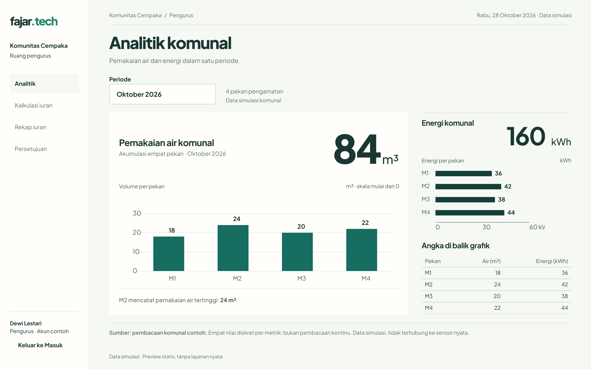</p>
<p align="center"><i>Gambar 6.14. I-13 — Analitik komunal</i></p>

Tabel 6.14. Spesifikasi Objek Antarmuka I-13

| Id_Objek | Jenis | Konten | Keterangan |
| :--- | :--- | :--- | :--- |
| I-13-OBJ-01 | sidebar navbar | Analitik; Kalkulasi iuran; Rekap iuran; Persetujuan; Keluar ke Masuk | Analitik → I-13; Kalkulasi iuran → I-14; Rekap iuran → I-15; Persetujuan → I-16. Keluar mengakhiri sesi lalu I-01; menu hanya peran aktif, server tetap memeriksa akses. |
| I-13-OBJ-02 | dropdown | Periode; Oktober 2026 | PengurusView.bukaDashboardAnalitik → IuranController.analisisPemakaian; validasi periode dan kewenangan sebelum mengambil data. |
| I-13-OBJ-03 | blok informasi | 4 pekan pengamatan; Data simulasi komunal | Menjelaskan grain empat sampel pekanan, bukan aliran sensor kontinu. |
| I-13-OBJ-04 | metric dan bar chart | Pemakaian air komunal 84 m³; M1 18, M2 24, M3 20, M4 22 | ModulIuran.hitungAgregatKomunal (Algo-036); 18+24+20+22=84, satuan volume m³. |
| I-13-OBJ-05 | metric dan bar chart | Energi komunal 160 kWh; M1 36, M2 42, M3 38, M4 44 | Agregat energi, 36+42+38+44=160; kWh berbeda dari daya W pada I-09. |
| I-13-OBJ-06 | data table | Angka di balik grafik; Pekan, Air (m³), Energi (kWh) | Menyajikan empat baris yang sama dengan grafik agar nilai tidak hanya dikodekan warna. |
| I-13-OBJ-07 | notice | Sumber: pembacaan komunal contoh; Data simulasi, tidak terhubung ke sensor nyata | Pernyataan sumber dan batas data; pengurus tidak menyunting pembacaan dari grafik. |
| I-13-OBJ-08 | header dan footer informasi | Komunitas Cempaka / Pengurus; tanggal; Data simulasi; identitas akun contoh | Konteks komunitas/peran/waktu dan batas pratinjau; bukan kontrol pengganti identitas sesi. Nama, tanggal dan angka PNG adalah ilustrasi. |

**Alur navigasi dan otorisasi:** Login Pengurus → I-13; navbar ke I-14/I-15/I-16. Pemeriksaan Pengurus.verifikasiKewenangan() dilakukan sebelum data diambil.

**State normal/alternatif kritis:** Normal UC09: pilih periode → kelompokkan pemakaian air/energi → agregat dan riwayat. Tekstual A1: Warga/Teknisi mencoba akses → ditolak, tanpa query data komunal. Periode kosong menampilkan belum ada data, bukan nol terukur; loading/error/coba lagi terpisah dari empty.

<a id="I-14"></a>

## 6.15 Rancangan Antarmuka I-14 — Kalkulasi dan finalisasi iuran

**ID Antarmuka:** I-14\
**Nama Layar:** Kalkulasi dan finalisasi iuran\
**Peran/Aktor:** Pengurus\
**UC terkait:** UC10\
**Jenis viewport:** Desktop\
**Konteks/tujuan:** Menghitung pratinjau iuran dengan aturan tarif satu periode, meninjau, lalu menetapkannya FINAL oleh pengurus berwenang.

<p align="center">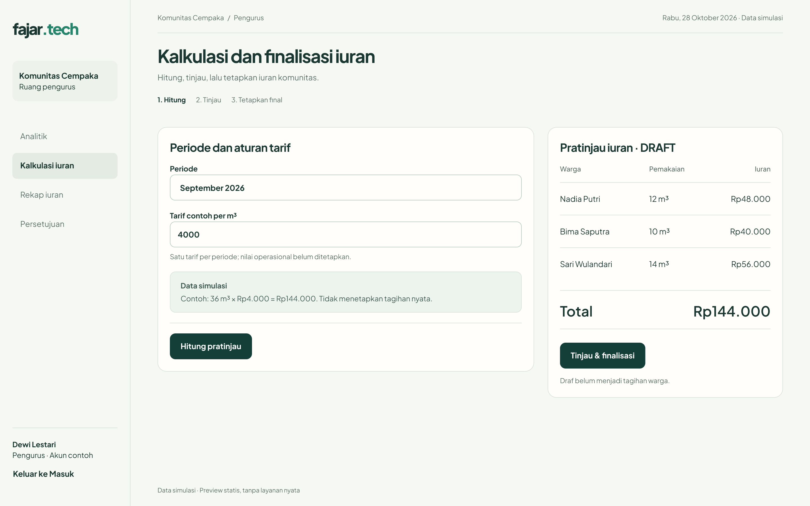</p>
<p align="center"><i>Gambar 6.15. I-14 — Kalkulasi dan finalisasi iuran</i></p>

Tabel 6.15. Spesifikasi Objek Antarmuka I-14

| Id_Objek | Jenis | Konten | Keterangan |
| :--- | :--- | :--- | :--- |
| I-14-OBJ-01 | sidebar navbar | Analitik; Kalkulasi iuran; Rekap iuran; Persetujuan; Keluar ke Masuk | Analitik → I-13; Kalkulasi iuran → I-14; Rekap iuran → I-15; Persetujuan → I-16. Keluar mengakhiri sesi lalu I-01; menu hanya peran aktif, server tetap memeriksa akses. |
| I-14-OBJ-02 | stepper informasi | 1. Hitung; 2. Tinjau; 3. Tetapkan final | Urutan proses; pratinjau bukan hasil final yang boleh ditagihkan. |
| I-14-OBJ-03 | dropdown | Periode; September 2026 | Validasi periode dan kelengkapan DataPemakaian sebelum KalkulatorIuran membuat tagihan. |
| I-14-OBJ-04 | number field | Tarif contoh per m³; 4000 | Satu tarif periode dipakai seluruh warga. Angka ilustrasi; aturan produksi termasuk energi/biaya tetap dari AturanTarif perlu konfirmasi. Bukan izin mengganti tarif final secara bebas. |
| I-14-OBJ-05 | notice | Data simulasi; 36 m³ × Rp4.000 = Rp144.000 | Contoh aritmetika, tidak menetapkan tagihan nyata. |
| I-14-OBJ-06 | button | Hitung pratinjau | IuranController.hitungPratinjauIuran → KalkulatorIuran.pratinjau; validasi kelengkapan dan satu AturanTarif per periode. Error menghentikan hitung. |
| I-14-OBJ-07 | data table dan summary | Pratinjau iuran · DRAFT; Nadia Putri 12 m³ Rp48.000; Bima Saputra 10 m³ Rp40.000; Sari Wulandari 14 m³ Rp56.000; Total Rp144.000 | Hasil DRAFT ditinjau pengurus; 48.000+40.000+56.000=144.000. Draft belum tersedia sebagai tagihan warga. |
| I-14-OBJ-08 | button | Tinjau & finalisasi | Membuka konfirmasi tekstual dalam I-14 berisi periode, tarif, hasil dan dampak penetapan; bukan langsung final tanpa review. |
| I-14-OBJ-09 | dialog, spesifikasi state tekstual | Tetapkan Final; Batal (belum ada PNG) | Setelah review, PengurusView.tekanTetapkanFinal → IuranController.tetapkanIuranFinal (Algo-028), cek pengurus ulang → finalisasi; sukses baru notifikasi FINAL. Batal kembali pratinjau tanpa mutasi. |
| I-14-OBJ-10 | header dan footer informasi | Komunitas Cempaka / Pengurus; tanggal; Data simulasi; identitas akun contoh | Konteks komunitas/peran/waktu dan batas pratinjau; bukan kontrol pengganti identitas sesi. Nama, tanggal dan angka PNG adalah ilustrasi. |

**Alur navigasi dan otorisasi:** I-13/navbar → I-14; setelah final, Pengurus dapat membuka I-15, warga melihat miliknya di I-04. Hanya Pengurus disetujui dapat menghitung dan memfinalisasi.

**State normal/alternatif kritis:** Normal UC10: pilih periode → kelengkapan → hitung → tinjau DRAFT → konfirmasi Tetapkan Final → otorisasi ulang → FINAL. Tekstual A1: kewenangan tidak sah/dicabut → finalisasi ditolak tanpa perubahan tagihan/periode. A2: sebagian pemakaian belum lengkap → hentikan hitung sebelum tagihan dibuat, jelaskan data perlu dilengkapi. Loading mencegah aksi berulang; gagal simpan tidak menampilkan FINAL, muat ulang kondisi tersimpan. PNG belum membuktikan transaksi finalisasi runtime; tidak memberi klaim sudah diuji.

<a id="I-15"></a>

## 6.16 Rancangan Antarmuka I-15 — Rekapitulasi iuran

**ID Antarmuka:** I-15\
**Nama Layar:** Rekapitulasi iuran\
**Peran/Aktor:** Pengurus\
**UC terkait:** UC11\
**Jenis viewport:** Desktop\
**Konteks/tujuan:** Menghasilkan rekapitulasi dari pemakaian serta iuran FINAL, lalu mengekspor atau mencetak dokumen.

<p align="center">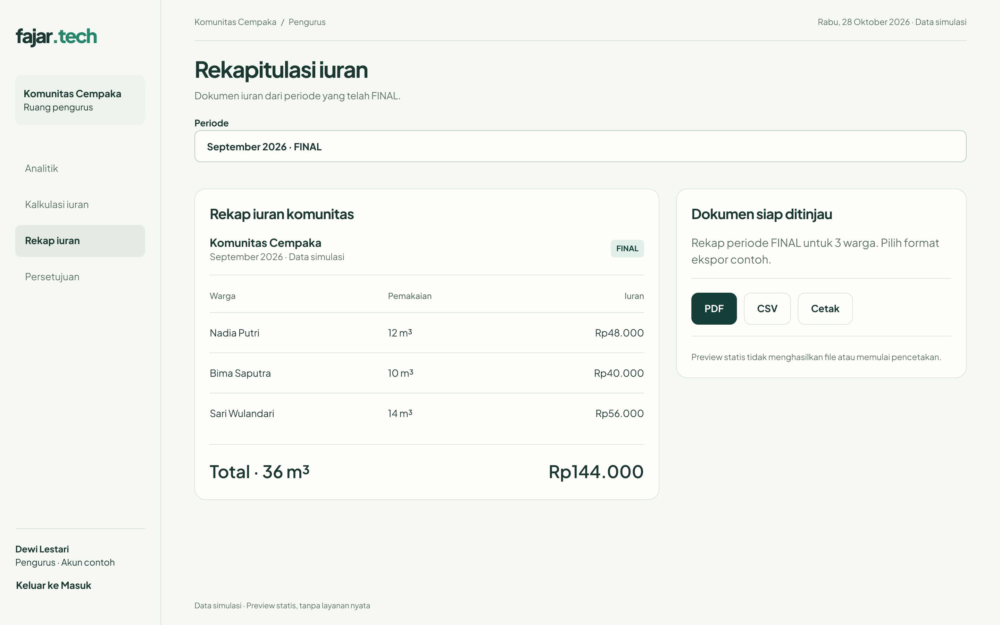</p>
<p align="center"><i>Gambar 6.16. I-15 — Rekapitulasi iuran</i></p>

Tabel 6.16. Spesifikasi Objek Antarmuka I-15

| Id_Objek | Jenis | Konten | Keterangan |
| :--- | :--- | :--- | :--- |
| I-15-OBJ-01 | sidebar navbar | Analitik; Kalkulasi iuran; Rekap iuran; Persetujuan; Keluar ke Masuk | Analitik → I-13; Kalkulasi iuran → I-14; Rekap iuran → I-15; Persetujuan → I-16. Keluar mengakhiri sesi lalu I-01; menu hanya peran aktif, server tetap memeriksa akses. |
| I-15-OBJ-02 | dropdown | Periode; September 2026 · FINAL | PengurusView.bukaMenuRekapitulasi; cek peran dan status Periode.isFinal() serta seluruh Tagihan.sudahFinal(). |
| I-15-OBJ-03 | document preview dan badge | Rekap iuran komunitas; Komunitas Cempaka; September 2026; FINAL | Pratinjau hasil Rekapitulasi.generate(periode). Aksi membuat rekap dalam state tekstual sebelum pratinjau ini; belum ada kontrol terpisah pada PNG. |
| I-15-OBJ-04 | data table dan summary | Warga/Pemakaian/Iuran; Nadia Putri 12 m³ Rp48.000; Bima Saputra 10 m³ Rp40.000; Sari Wulandari 14 m³ Rp56.000; Total 36 m³ Rp144.000 | Hanya periode final, berasal dari himpunan data yang sama. Energi pada model sumber disertakan bila berlaku; PNG contoh hanya memuat air. |
| I-15-OBJ-05 | card informasi | Dokumen siap ditinjau; Rekap periode FINAL untuk 3 warga | Status kesiapan, bukan bukti berkas unduhan sudah dibuat. |
| I-15-OBJ-06 | button | PDF | Rekapitulasi.ekspor("PDF") menghasilkan berkas sesudah otorisasi; gagal ekspor tampil error tanpa klaim terunduh. |
| I-15-OBJ-07 | button | CSV | Rekapitulasi.ekspor("CSV") untuk periode/himpunan data sama; KNF10. |
| I-15-OBJ-08 | button | Cetak | Rekapitulasi.cetak(); implementasi kelak membuka dialog cetak dokumen final, bukan langsung mencetak tanpa pilihan pengguna. |
| I-15-OBJ-09 | button, spesifikasi state tekstual | Buat rekapitulasi (belum ada PNG) | Setelah pilih periode final, IuranController.buatRekapitulasi memanggil generate; sukses menampilkan pratinjau yang ada, sebelum ekspor/cetak. |
| I-15-OBJ-10 | header dan footer informasi | Komunitas Cempaka / Pengurus; tanggal; Data simulasi; identitas akun contoh | Konteks komunitas/peran/waktu dan batas pratinjau; bukan kontrol pengganti identitas sesi. Nama, tanggal dan angka PNG adalah ilustrasi. |

**Alur navigasi dan otorisasi:** I-13/I-14/navbar → I-15, khusus Pengurus. Periode dan data final diverifikasi kembali sebelum generate/ekspor, bukan percaya label klien.

**State normal/alternatif kritis:** Normal UC11: pilih periode → periksa final → buat rekap → pratinjau → ekspor PDF/CSV atau cetak. Tekstual A1: periode atau salah satu tagihan belum final → blokir generate/ekspor, tampil “Rekapitulasi hanya dapat dibuat menggunakan data final”; A2 bukan pengurus → tolak akses. Loading generate/ekspor dan error tersedia; empty tidak dianggap rekap nol. Tidak mengklaim file/cetak benar-benar dijalankan dari PNG.

<a id="I-16"></a>

## 6.17 Rancangan Antarmuka I-16 — Persetujuan akun

**ID Antarmuka:** I-16\
**Nama Layar:** Persetujuan akun\
**Peran/Aktor:** Pengurus\
**UC terkait:** UC14\
**Jenis viewport:** Desktop\
**Konteks/tujuan:** Meninjau identitas dan peran yang diajukan sebelum persetujuan atau penolakan akun.

<p align="center">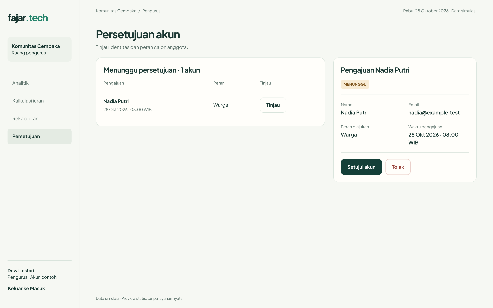</p>
<p align="center"><i>Gambar 6.17. I-16 — Persetujuan akun</i></p>

Tabel 6.17. Spesifikasi Objek Antarmuka I-16

| Id_Objek | Jenis | Konten | Keterangan |
| :--- | :--- | :--- | :--- |
| I-16-OBJ-01 | sidebar navbar | Analitik; Kalkulasi iuran; Rekap iuran; Persetujuan; Keluar ke Masuk | Analitik → I-13; Kalkulasi iuran → I-14; Rekap iuran → I-15; Persetujuan → I-16. Keluar mengakhiri sesi lalu I-01; menu hanya peran aktif, server tetap memeriksa akses. |
| I-16-OBJ-02 | data table | Menunggu persetujuan · 1 akun; Nadia Putri; 28 Okt 2026 · 08.00 WIB; Warga | PengurusView.bukaPersetujuanAkun → AkunController.ambilAkunMenunggu, hanya status MENUNGGU; peran pengurus dicek sebelum baca. |
| I-16-OBJ-03 | button | Tinjau | Memilih pengajuan dan menampilkan detail di panel I-16; tidak langsung mengaktifkan akun. |
| I-16-OBJ-04 | card dan badge | Pengajuan Nadia Putri; MENUNGGU; Nama; Email nadia@example.test; Peran diajukan Warga; Waktu pengajuan | Ringkasan identitas dan peran; password tidak ditampilkan. Pengurus menilai sebelum aksi. |
| I-16-OBJ-05 | button | Setujui akun | PengurusView.prosesPersetujuan(email,true) → AkunController.setujuiAkun; validasi kewenangan dan pengajuan masih menunggu → DISETUJUI, simpan, notifikasi, perbarui daftar. |
| I-16-OBJ-06 | button | Tolak | PengurusView.prosesPersetujuan(email,false) → AkunController.tolakAkun → DITOLAK; sukses hanya setelah tersimpan, daftar diperbarui. |
| I-16-OBJ-07 | header dan footer informasi | Komunitas Cempaka / Pengurus; tanggal; Data simulasi; identitas akun contoh | Konteks komunitas/peran/waktu dan batas pratinjau; bukan kontrol pengganti identitas sesi. Nama, tanggal dan angka PNG adalah ilustrasi. |

**Alur navigasi dan otorisasi:** Pengurus lewat navbar → I-16. Akun disetujui dapat login di I-01; proses tinjau tidak login sebagai calon pengguna.

**State normal/alternatif kritis:** Normal UC14: pengurus tinjau → Setujui → simpan DISETUJUI → notifikasi dan refresh daftar. Tekstual A1: Tolak → DITOLAK → notifikasi dan refresh; A2 Warga/Teknisi → tolak sebelum baca/mutasi. Daftar kosong → “Tidak ada akun menunggu persetujuan”, tanpa tombol aksi. Loading menahan aksi; pengajuan berubah bersamaan/gagal simpan → muat ulang dan tampil error, tidak mengklaim persetujuan berhasil.

<a id="I-10-M"></a>

## 6.18 Rancangan Antarmuka I-10-M — Daftar tugas teknisi (mobile)

**ID Antarmuka:** I-10-M\
**Nama Layar:** Daftar tugas teknisi (mobile)\
**Peran/Aktor:** Teknisi\
**UC terkait:** UC07\
**Jenis viewport:** Mobile\
**Konteks/tujuan:** Menyajikan laporan yang ditugaskan kepada teknisi saat ini.

<p align="center">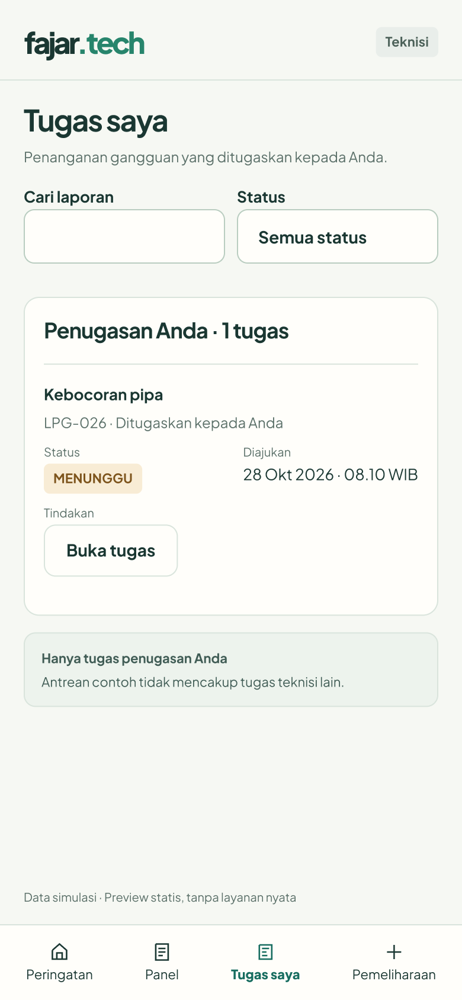</p>
<p align="center"><i>Gambar 6.18. I-10-M — Daftar tugas teknisi (mobile)</i></p>

Tabel 6.18. Spesifikasi Objek Antarmuka I-10-M

| Id_Objek | Jenis | Konten | Keterangan |
| :--- | :--- | :--- | :--- |
| I-10-M-OBJ-01 | header | fajar.tech; Teknisi | Identitas produk/peran, tidak menjadi pemilih peran atau bukti penugasan. |
| I-10-M-OBJ-02 | search field | Cari laporan | Filter hanya tugas sesi; tidak melakukan pencarian seluruh laporan komunitas. |
| I-10-M-OBJ-03 | dropdown | Status; Semua status | Menyaring status pada daftar tugas yang telah diotorisasi. |
| I-10-M-OBJ-04 | card tugas dan status badge | Penugasan Anda · 1 tugas; Kebocoran pipa; LPG-026 · Ditugaskan kepada Anda; MENUNGGU; 28 Okt 2026 · 08.10 WIB | TeknisiView.bukaPenugasan → daftarPenugasan → cariDaftarTugas(idTeknisi sesi); query EXISTS penugasan. |
| I-10-M-OBJ-05 | button | Buka tugas | TeknisiView.pilihTugas(idLaporan) → I-11-M, server memeriksa ulang penugasan. |
| I-10-M-OBJ-06 | notice | Hanya tugas penugasan Anda | Antrean tidak mencakup teknisi lain; tidak ada aksi mengklaim tugas bebas. |
| I-10-M-OBJ-07 | bottom navbar | Peringatan; Panel; Tugas saya; Pemeliharaan | Peringatan → I-08; Panel → I-09; Tugas saya → I-10-M; Pemeliharaan → I-12-M. I-08/I-09 menjadi tujuan logis, varian mobile belum diekspor. Aktif sesuai layar. |

**Alur navigasi dan otorisasi:** Ekuivalen desktop I-10; bottom navigation → I-10-M → I-11-M. Hanya penugasan teknisi sesi; pergantian viewport tidak mengubah hak akses.

**State normal/alternatif kritis:** Normal UC07: daftar penugasan → detail tugas. Tekstual: tidak ada tugas → “Belum ada tugas”, tidak ada mutasi; filter tanpa hasil berbeda dari error pemuatan. Penugasan dicabut sebelum detail dibuka → akses ditolak. Loading/error menawarkan muat ulang, tidak memperluas pencarian ke tugas orang lain. Responsif: form/kartu satu kolom, isi panjang digulir vertikal; bidang cari dan status berdampingan pada I-10-M. Spesifikasi tekstual: bottom navigation tidak menutup isi/fokus, label tetap terbaca dan target sentuh minimal 44 px saat implementasi; ukuran target belum diukur dari node native. Perubahan viewport tidak mereset status atau otorisasi.

<a id="I-11-M"></a>

## 6.19 Rancangan Antarmuka I-11-M — Detail dan status tugas teknisi (mobile)

**ID Antarmuka:** I-11-M\
**Nama Layar:** Detail dan status tugas teknisi (mobile)\
**Peran/Aktor:** Teknisi\
**UC terkait:** UC07\
**Jenis viewport:** Mobile\
**Konteks/tujuan:** Memandu teknisi penugasan melakukan hanya langkah status legal dan mencatat waktunya secara atomik.

<p align="center">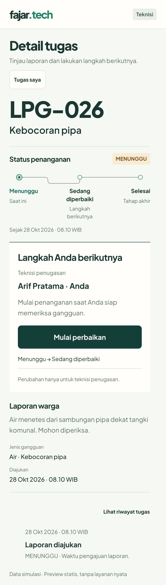</p>
<p align="center"><i>Gambar 6.19. I-11-M — Detail dan status tugas teknisi (mobile)</i></p>

Tabel 6.19. Spesifikasi Objek Antarmuka I-11-M

| Id_Objek | Jenis | Konten | Keterangan |
| :--- | :--- | :--- | :--- |
| I-11-M-OBJ-01 | header | fajar.tech; Teknisi | Identitas produk/peran, tidak menjadi pemilih peran atau bukti penugasan. |
| I-11-M-OBJ-02 | button | Tugas saya | Kembali I-10-M tanpa mutasi. |
| I-11-M-OBJ-03 | heading dan card | LPG-026; Kebocoran pipa | TeknisiView.pilihTugas → detailTugas → cariDetailTugas(idTeknisi sesi,idLaporan); ID tugas bukan bukti kewenangan. |
| I-11-M-OBJ-04 | status badge dan stepper | MENUNGGU; Menunggu (Saat ini) → Sedang diperbaiki (Langkah berikutnya) → Selesai (Tahap akhir) | Stepper informasi, bukan tiga tombol pilihan bebas. statusBerikutnya() hanya mengizinkan SEDANG_DIPERBAIKI dari MENUNGGU. |
| I-11-M-OBJ-05 | timestamp | Sejak 28 Okt 2026 · 08.10 WIB | Menampilkan waktu keadaan server, tidak waktu lokal perkiraan. |
| I-11-M-OBJ-06 | card tindakan | Langkah Anda berikutnya; Teknisi penugasan Arif Pratama · Anda | Tindakan dibatasi penugasan; server memverifikasi ulang pada setiap mutasi. |
| I-11-M-OBJ-07 | button | Mulai perbaikan | TeknisiView.ubahStatus → LaporanController.perbaruiStatus → ModulLaporan.perbaruiStatus → simpanStatusDanRiwayat (Algo-040) → transaksiStatus (Algo-042). Verifikasi tugas, transisi Algo-017, guard status lama, UPDATE+riwayat atomik; sukses sesudah COMMIT. |
| I-11-M-OBJ-08 | blok informasi | Laporan warga; Air menetes dari sambungan pipa dekat tangki komunal. Mohon diperiksa.; Air - Kebocoran pipa; Diajukan 28 Okt 2026 · 08.10 WIB | Hanya detail tugas terotorisasi; tidak mengubah deskripsi warga. |
| I-11-M-OBJ-09 | timeline dan link bagian | Lihat riwayat tugas; Laporan diajukan; MENUNGGU | Link menggulir riwayat pada I-11-M; urutan waktu menaik, pengajuan awal dari waktuDibuat. Tugas harus terotorisasi sebelum isi ditampilkan. |
| I-11-M-OBJ-10 | bottom navbar, spesifikasi komponen | Peringatan; Panel; Tugas saya; Pemeliharaan (tidak termuat pada crop layar) | Bukti terpisah Nav - Menu Teknisi.png, bukan layar tambahan. Peringatan → I-08; Panel → I-09; Tugas saya → I-10-M; Pemeliharaan → I-12-M. Posisi akhir/navbar pada I-11-M perlu review gabungan dengan komponen. |

**Alur navigasi dan otorisasi:** Ekuivalen desktop I-11; I-10-M → I-11-M → I-10-M. Teknisi hanya menangani penugasan sesi; UI tidak menerima idTeknisi buatan klien.

**State normal/alternatif kritis:** Normal UC07: MENUNGGU → SEDANG_DIPERBAIKI, kemudian hanya → SELESAI; terminal tidak punya tombol pembaruan. Tekstual A1: tanpa penugasan → “Teknisi tidak berwenang”, tanpa UPDATE/INSERT. A2: status sama/lompat/mundur → “Perubahan status ditolak. Pilih tahap berikutnya” dan opsiLegal, tanpa mutasi. Loading menonaktifkan tombol; sukses menampilkan status serta waktu server; konflik status lama/penugasan atau INSERT riwayat gagal → rollback status+riwayat, buang objek lokal, tampilkan gagal dan muat ulang; tidak overwrite otomatis. PNG hanya menunjukkan MENUNGGU sebelum aksi. Responsif: form/kartu satu kolom, isi panjang digulir vertikal; bidang cari dan status berdampingan pada I-10-M. Spesifikasi tekstual: bottom navigation tidak menutup isi/fokus, label tetap terbaca dan target sentuh minimal 44 px saat implementasi; ukuran target belum diukur dari node native. Perubahan viewport tidak mereset status atau otorisasi.

<a id="I-12-M"></a>

## 6.20 Rancangan Antarmuka I-12-M — Form pemeliharaan (mobile)

**ID Antarmuka:** I-12-M\
**Nama Layar:** Form pemeliharaan (mobile)\
**Peran/Aktor:** Teknisi\
**UC terkait:** UC08\
**Jenis viewport:** Mobile\
**Konteks/tujuan:** Mencatat perangkat, waktu, tindakan dan hasil pemeliharaan sebagai riwayat yang bisa ditelusuri.

<p align="center">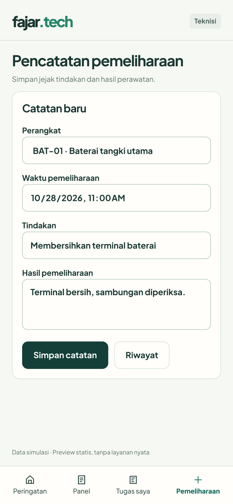</p>
<p align="center"><i>Gambar 6.20. I-12-M — Form pemeliharaan (mobile)</i></p>

Tabel 6.20. Spesifikasi Objek Antarmuka I-12-M

| Id_Objek | Jenis | Konten | Keterangan |
| :--- | :--- | :--- | :--- |
| I-12-M-OBJ-01 | header | fajar.tech; Teknisi | Identitas produk/peran, tidak menjadi pemilih peran atau bukti penugasan. |
| I-12-M-OBJ-02 | dropdown | Perangkat; BAT-01 · Baterai tangki utama | Pilih perangkat valid dalam lingkup teknisi; ModulPemeliharaan menerima ID perangkat, bukan label arbitrer. |
| I-12-M-OBJ-03 | datetime field | Waktu pemeliharaan; 10/28/2026, 11:00 AM | Wajib, tanggal/waktu valid; simpan DateTime dengan zona waktu yang jelas (WIB sebagai spesifikasi desain). |
| I-12-M-OBJ-04 | text field | Tindakan; Membersihkan terminal baterai | Wajib; Validasi.periksaPemeliharaan memeriksa kelengkapan. |
| I-12-M-OBJ-05 | textarea | Hasil pemeliharaan; Terminal bersih, sambungan diperiksa. | Wajib, dipertahankan jika gagal validasi/simpan. |
| I-12-M-OBJ-06 | button | Simpan catatan | TeknisiView.simpanPemeliharaan → PemeliharaanController.simpanCatatan → ModulPemeliharaan.simpanCatatan (Algo-035); identitas teknisi dari sesi. Sukses hanya sesudah simpan. |
| I-12-M-OBJ-07 | button | Riwayat | Membuka state riwayat perangkat terpilih di I-12-M, bukan layar baru. Catatan dapat ditelusuri menurut perangkat/waktu (Perangkat.getRiwayatPemeliharaan). |
| I-12-M-OBJ-08 | bottom navbar | Peringatan; Panel; Tugas saya; Pemeliharaan | Peringatan → I-08; Panel → I-09; Tugas saya → I-10-M; Pemeliharaan → I-12-M. I-08/I-09 menjadi tujuan logis, varian mobile belum diekspor. Aktif sesuai layar. |

**Alur navigasi dan otorisasi:** Ekuivalen desktop I-12; bottom navigation → I-12-M. Simpan tidak otomatis menyelesaikan laporan UC07; perubahan status tetap di I-11-M.

**State normal/alternatif kritis:** Normal UC08: lengkap → simpan → notifikasi “Catatan pemeliharaan berhasil disimpan”, riwayat perangkat/waktu dapat dibuka. Tekstual A1: kolom wajib kosong → batal simpan, tandai kolom, pertahankan lainnya. Loading menahan simpan; gagal DB/jaringan tidak menampilkan sukses; state riwayat kosong berbeda dari gagal memuat. Responsif: form/kartu satu kolom, isi panjang digulir vertikal; bidang cari dan status berdampingan pada I-10-M. Spesifikasi tekstual: bottom navigation tidak menutup isi/fokus, label tetap terbaca dan target sentuh minimal 44 px saat implementasi; ukuran target belum diukur dari node native. Perubahan viewport tidak mereset status atau otorisasi.

## 6.21 Rancangan Antarmuka Keseluruhan

Tabel 6.21. Rancangan Antarmuka Keseluruhan

| ID | Nama tampilan | UC / Aktor | Tautan screenshot dan path relatif | Dimensi PNG |
| :--- | :--- | :--- | :--- | :--- |
| [I-00](#I-00) | Landing page publik | UC12/UC13 (navigasi publik) / Publik | [I-00.png](./assets/diagram/figma-final/I-00.png) | 2880 × 12465 px |
| [I-01](#I-01) | Login | UC13 / Warga, Teknisi, Pengurus | [I-01.png](./assets/diagram/figma-final/I-01.png) | 2880 × 1800 px |
| [I-02](#I-02) | Registrasi akun | UC12 / Calon Pengguna | [I-02.png](./assets/diagram/figma-final/I-02.png) | 2880 × 1800 px |
| [I-03](#I-03) | Dashboard warga | UC01 / Warga | [I-03.png](./assets/diagram/figma-final/I-03.png) | 2880 × 1800 px |
| [I-04](#I-04) | Tagihan iuran final | UC02 / Warga | [I-04.png](./assets/diagram/figma-final/I-04.png) | 2880 × 1800 px |
| [I-05](#I-05) | Buat laporan gangguan | UC03 / Warga | [I-05.png](./assets/diagram/figma-final/I-05.png) | 2880 × 1800 px |
| [I-06](#I-06) | Daftar laporan saya | UC04 / Warga | [I-06.png](./assets/diagram/figma-final/I-06.png) | 2880 × 1800 px |
| [I-07](#I-07) | Detail dan riwayat laporan | UC04 / Warga | [I-07.png](./assets/diagram/figma-final/I-07.png) | 2880 × 1800 px |
| [I-08](#I-08) | Peringatan perangkat | UC05 / Teknisi | [I-08.png](./assets/diagram/figma-final/I-08.png) | 2880 × 1800 px |
| [I-09](#I-09) | Histori panel surya | UC06 / Teknisi | [I-09.png](./assets/diagram/figma-final/I-09.png) | 2880 × 1800 px |
| [I-10](#I-10) | Daftar tugas teknisi | UC07 / Teknisi | [I-10.png](./assets/diagram/figma-final/I-10.png) | 2880 × 1800 px |
| [I-11](#I-11) | Detail dan status tugas teknisi | UC07 / Teknisi | [I-11.png](./assets/diagram/figma-final/I-11.png) | 2880 × 1800 px |
| [I-12](#I-12) | Form pemeliharaan | UC08 / Teknisi | [I-12.png](./assets/diagram/figma-final/I-12.png) | 2880 × 1800 px |
| [I-13](#I-13) | Analitik komunal | UC09 / Pengurus | [I-13.png](./assets/diagram/figma-final/I-13.png) | 2880 × 1800 px |
| [I-14](#I-14) | Kalkulasi dan finalisasi iuran | UC10 / Pengurus | [I-14.png](./assets/diagram/figma-final/I-14.png) | 2880 × 1800 px |
| [I-15](#I-15) | Rekapitulasi iuran | UC11 / Pengurus | [I-15.png](./assets/diagram/figma-final/I-15.png) | 2880 × 1800 px |
| [I-16](#I-16) | Persetujuan akun | UC14 / Pengurus | [I-16.png](./assets/diagram/figma-final/I-16.png) | 2880 × 1800 px |
| [I-10-M](#I-10-M) | Daftar tugas teknisi (mobile) | UC07 / Teknisi | [I-10-M.png](./assets/diagram/figma-final/I-10-M.png) | 780 × 1688 px |
| [I-11-M](#I-11-M) | Detail dan status tugas teknisi (mobile) | UC07 / Teknisi | [I-11-M.png](./assets/diagram/figma-final/I-11-M.png) | 780 × 2730 px |
| [I-12-M](#I-12-M) | Form pemeliharaan (mobile) | UC08 / Teknisi | [I-12-M.png](./assets/diagram/figma-final/I-12-M.png) | 780 × 1688 px |

Spesifikasi objek tiap layar memakai empat kolom template; tabel rekap memakai kolom inventaris agar path dan aktor dapat diaudit. Seluruh jalur normal/alternatif M5 ditelusuri pada [laporan QA](./M8_HANDOFF_QA.md); gap visual tidak disamakan dengan kekurangan kebutuhan tekstual.

# BAB 7: Matriks Kerunutan

Petakan kelas perancangan dengan use case yang terkait. Gunakan **BAB 6 Traceability pada dokumen SKPL** sebagai acuan keterkaitan kelas analisis dan use case, lalu sesuaikan dengan realisasi use case dan kelas perancangan pada BAB 3–BAB 5 DPPL.

Tabel 7.1. Matriks Kerunutan Kelas terhadap Use Case

| Kelas | Use Case Terkait |
| :--- | :--- |
| *[ID kelas - Nama kelas]* | *[ID UC - Nama use case; tuliskan seluruh use case terkait]* |
| *[ID kelas - Nama kelas]* | *[ID UC - Nama use case]* |
| *...* | *...* |
